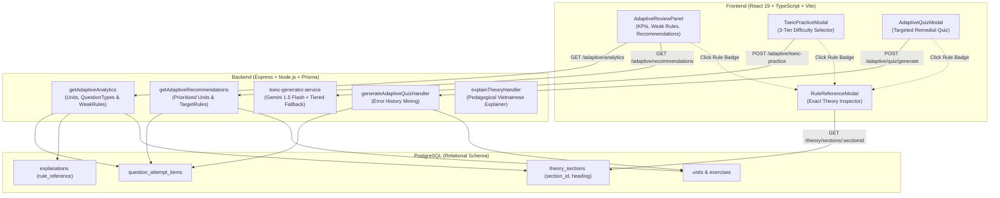

# GrammarPath Phase 9: Adaptive Learning, AI Tutor & TOEIC Practice Engine Specification

This specification documents the complete architecture, REST API contracts, algorithms, and frontend user experience for **Phase 9 (Phase 9.1, 9.2, and 9.3)** in GrammarPath (`grammarpath-app/`).

Phase 9 transforms GrammarPath from a linear textbook exercise platform into an **intelligent, adaptive English learning and TOEIC preparation system** anchored in three core architectural pillars:
1. **Pillar 1 — Granular Error Analytics & Rule-Level (`ruleReference`) Attribution**: Real-time error pattern analysis grouped by Unit, Question Type, and granular theory sub-sections (`explanations.rule_reference` joined with `theory_sections`).
2. **Pillar 2 — 3-Tier Difficulty Levels (`easy` | `medium` | `hard`) & AI Question Generation**: Gemini-powered TOEIC Part 5 practice and targeted remedial quizzes featuring 3 difficulty tiers with explicit theory rule referencing.
3. **Pillar 3 — Interactive AI Review Panel, Rule Cross-Referencing & Guided Remediation**: Modern interactive modals with segmented difficulty controls, one-click theory rule inspection (`RuleReferenceModal`), and personalized study recommendations.

---

## 1. Architectural Architecture & Data Flow



---

## 2. Pillar 1: Granular Rule-Level Error Analytics & Recommendations

### 2.1. GET `/api/v1/adaptive/analytics`
Analyzes all historical question attempts (`question_attempt_items`) for the authenticated user, aggregating performance across:
1. **Overall Progress**: Total attempts evaluated, correct count, total errors, accuracy percentage.
2. **Unit-Level Weaknesses**: Units with at least 1 mistake, sorted by `errorCount DESC`, with breakdown of weakest question types per unit.
3. **Question Type Distribution**: Error rates across exercise formats (`fill_blank`, `multiple_choice`, `transformation`, etc.).
4. **Granular Theory Sub-sections (`weakRules`)**: Groups errors by `explanations.rule_reference` (e.g. `"1A"`, `"1B"`, `"29C"`), joined with `theory_sections` to fetch exact headings, parent unit numbers, and titles.

#### Request Headers
```http
GET /api/v1/adaptive/analytics
Authorization: Bearer <jwt_token>
```

#### Response (`200 OK`)
```json
{
  "success": true,
  "data": {
    "totalEvaluated": 24,
    "totalCorrect": 14,
    "totalErrors": 10,
    "accuracyPercentage": 58.3,
    "weakestUnits": [
      {
        "unitNumber": 1,
        "unitTitle": "Present continuous (I am doing)",
        "totalAttempts": 12,
        "errorCount": 6,
        "accuracyPercentage": 50.0,
        "weakestQuestionTypes": ["fill_blank", "transformation"]
      }
    ],
    "errorDistribution": [
      {
        "questionType": "fill_blank",
        "errorCount": 6,
        "totalAttempts": 14,
        "errorRatePercentage": 42.9
      },
      {
        "questionType": "transformation",
        "errorCount": 4,
        "totalAttempts": 10,
        "errorRatePercentage": 40.0
      }
    ],
    "weakestQuestionType": "fill_blank",
    "weakRules": [
      {
        "ruleReference": "1B",
        "heading": "I am doing something = I'm in the middle of doing it; I've started doing it and I haven't finished",
        "unitNumber": 1,
        "unitTitle": "Present continuous (I am doing)",
        "errorCount": 4,
        "totalAttempts": 7,
        "accuracyPercentage": 42.9
      },
      {
        "ruleReference": "1A",
        "heading": "Study this example situation:",
        "unitNumber": 1,
        "unitTitle": "Present continuous (I am doing)",
        "errorCount": 2,
        "totalAttempts": 5,
        "accuracyPercentage": 60.0
      }
    ]
  }
}
```

---

### 2.2. GET `/api/v1/adaptive/recommendations`
Generates prioritized study recommendations based on error patterns, accuracy thresholds, and active learning progress.

#### Prioritization Rules:
- **`high` priority**: Unit error count $\ge 3$ or accuracy percentage $< 60\%$.
- **`medium` priority**: Units with $1 \le \text{errors} < 3$, or units currently marked as `in_progress`.
- **`low` priority**: Units recommended as forward progression or maintenance review.

Each recommendation item identifies the **exact target sub-sections (`targetRules`)** where errors occurred so the student can focus on specific grammar rules rather than re-reading the entire unit blindly.

#### Response (`200 OK`)
```json
{
  "success": true,
  "data": {
    "totalRecommendations": 2,
    "recommendations": [
      {
        "unitNumber": 1,
        "unitTitle": "Present continuous (I am doing)",
        "priority": "high",
        "reason": "Tỷ lệ sai đáng kể với 6 lỗi sai ở Unit này (độ chính xác 50%). Bạn hay gặp nhầm lẫn ở dạng bài (fill_blank, transformation) (Mục lý thuyết: 1B, 1A).",
        "errorCount": 6,
        "accuracyPercentage": 50.0,
        "weakestQuestionTypes": ["fill_blank", "transformation"],
        "targetRules": ["1B", "1A"],
        "suggestedActions": [
          "Đọc lại lý thuyết Unit 1: Present continuous (I am doing) (Trọng tâm: Mục 1B, 1A)",
          "Nhấn '🤖 AI giảng lại bằng tiếng Việt' trong mục lý thuyết nếu cần giải thích sâu hơn",
          "Luyện tập lại các câu hỏi bị sai trong trang Review Mistakes"
        ]
      }
    ]
  }
}
```

---

## 3. Pillar 2: 3-Tier Difficulty Levels & AI Exercise Generation

### 3.1. Difficulty Level Definitions

| Tier | Code | Pedagogical Focus | Target Profile | Distractor Complexity |
|---|---|---|---|---|
| **Dễ (Cơ bản)** | `easy` | Basic formula recognition, explicit signals (`now`, `always`, `yesterday`). | Beginners / foundational review. | Morphologically distinct non-competing verb forms. |
| **Trung bình (TOEIC Chuẩn)** | `medium` | Standard Part 5 workplace scenarios (management, logistics, procurement). | TOEIC 500–650 target. | Plausible workplace distractors and common tense confusions. |
| **Khó (Bẫy TOEIC 700+)** | `hard` | State vs. dynamic verbs, inversion (`Seldom`, `Not only`), subjunctive mood, subtle time expressions (`these days`, `more and more`), confusable collocations. | TOEIC 700–990 candidates. | Near-synonyms, subtle structural traps, and complex sentence modifiers. |

---

### 3.2. POST `/api/v1/adaptive/toeic-practice`
Generates authentic TOEIC Part 5 (Incomplete Sentences) multiple-choice questions for any unit from 1 to 145 at the requested difficulty tier.

#### Request Body
```json
{
  "unitNumber": 1,
  "count": 5,
  "difficulty": "hard"
}
```

#### Validation Schema (Zod)
```typescript
export const toeicPracticeSchema = z.object({
  unitNumber: z.coerce.number().int().min(1).max(145),
  count: z.coerce.number().int().min(1).max(20).optional().default(5),
  difficulty: z.enum(["easy", "medium", "hard"]).optional().default("medium"),
});
```

#### Response (`200 OK`)
```json
{
  "success": true,
  "data": {
    "unitNumber": 1,
    "title": "Present continuous (I am doing)",
    "difficulty": "hard",
    "questions": [
      {
        "prompt": "Although the regional director usually _______ conservative investments, she is currently considering higher-yield instruments.",
        "options": [
          { "key": "A", "text": "prefers" },
          { "key": "B", "text": "is preferring" },
          { "key": "C", "text": "preferred" },
          { "key": "D", "text": "prefer" }
        ],
        "correctAnswer": "A",
        "explanation": "Bẫy TOEIC 700+: Động từ chỉ nhận thức/sở thích (state verb) 'prefer' không chia ở dạng tiếp diễn dù có vế tương phản hiện tại. Chọn thì Hiện tại đơn 'prefers'.",
        "difficulty": "hard",
        "ruleReference": "1D"
      }
    ]
  }
}
```

---

### 3.3. POST `/api/v1/adaptive/quiz/generate`
Mines user error history across all submitted questions to build a personalized remedial quiz session targeting weak units and rules at the requested difficulty tier.

#### Request Body
```json
{
  "questionCount": 5,
  "difficulty": "hard",
  "targetUnitNumbers": [1, 2]
}
```

#### Response (`200 OK`)
```json
{
  "success": true,
  "data": {
    "sessionId": "quiz_1731056400000_a8f93e1",
    "difficulty": "hard",
    "targetUnits": [
      { "unitNumber": 1, "title": "Present continuous (I am doing)", "errorCount": 3 }
    ],
    "totalQuestions": 5,
    "questions": [
      {
        "id": "c1a2b3c4-...",
        "questionId": "1.1-q1",
        "unitNumber": 1,
        "unitTitle": "Present continuous (I am doing)",
        "exerciseId": "ex-1",
        "exerciseNumber": "1.1",
        "questionType": "multiple_choice",
        "instruction": "Choose the correct verb form",
        "prompt": "Please don't make noise. I _______ to concentrate.",
        "options": [
          { "key": "A", "text": "try" },
          { "key": "B", "text": "am trying" },
          { "key": "C", "text": "tried" },
          { "key": "D", "text": "was trying" }
        ],
        "correctAnswer": "B",
        "explanation": "Diễn tả hành động đang diễn ra lúc nói: 'am trying'.",
        "difficulty": "hard",
        "ruleReference": "1B",
        "contextClue": "Diễn ra ngay bây giờ"
      }
    ]
  }
}
```

---

## 4. Pillar 3: Frontend User Experience & Guided Remediation

### 4.1. 3-Tier Difficulty Selector (`ToeicPracticeModal` & `AdaptiveQuizModal`)
Both modals feature a 3-button segmented control at the top of the modal window:
- `Dễ (Cơ bản)`: Switches question bank to foundational formula recognition.
- `Trung bình (TOEIC Chuẩn)`: Default Part 5 corporate context.
- `Khó (Bẫy TOEIC 700+)`: Advanced traps, state/action nuances, and collocations.

Switching difficulty instantly triggers an asynchronous fetch for a fresh question set at the selected tier without forcing the user to close and reopen the modal.

```
+---------------------------------------------------------------------------------+
|  🎯 TOEIC Part 5 Format • Unit 1: Present continuous (I am doing)         [X Đóng] |
+---------------------------------------------------------------------------------+
|  Cấp độ đề: [ Dễ (Cơ bản) ]  [ Trung bình (TOEIC Chuẩn)* ]  [ Khó (Bẫy 700+) ]  |
+---------------------------------------------------------------------------------+
|  Câu 1 / 5                                                                       |
|  Ms. Patterson _______ a comprehensive quarterly financial review right now.    |
|                                                                                 |
|  (A) conducts       (B) is conducting       (C) conducted       (D) has conducted|
|                                                                                 |
|  [✓ Chính xác! Đáp án đúng là (B)]                 [ 📖 Quy tắc 1A ]             |
|  Dấu hiệu 'right now' diễn tả một hành động đang trực tiếp diễn ra tại thời... |
+---------------------------------------------------------------------------------+
```

### 4.2. Rule Reference Badges & Theory Inspector Modal
Every question feedback box displays a clickable rule badge (e.g. `[ 📖 Quy tắc 1A ]`). Clicking this badge opens the `RuleReferenceModal` dialog, allowing learners to immediately read the textbook explanation and examples without leaving their practice test:
- Displays section ID, section heading, and unabridged source text from *English Grammar in Use*.
- Direct link to jump directly to the unit's theory page (`/units/1#section-1A`).

### 4.3. Weak Theory Sub-sections Section in `AdaptiveReviewPanel`
Inside `AdaptiveReviewPanel.tsx`, learners see a dedicated section:
**"Tiểu mục lý thuyết hay sai nhất (Weak Theory Rules)"**
- Displays top 10 error sub-sections ranked by error frequency.
- Each rule card shows:
  - `Quy tắc {ruleReference}` pill badge.
  - Number of errors and historical accuracy percentage (`X lỗi (Y% chính xác)`).
  - Exact rule heading and parent Unit title.
  - One-click `Đọc lý thuyết →` shortcut to launch `RuleReferenceModal`.

---

## 5. Automated Test Coverage & Verification

### 5.1. Backend Test Suites
- `tests/adaptive.api.test.ts`:
  - Empty state analytics verification (fresh user returns `weakRules: []`).
  - Error generation simulation and verification of `weakRules` (`ruleReference`, `heading`, `errorCount`).
  - Verification of `targetRules` in `/api/v1/adaptive/recommendations`.
- `tests/adaptive-toeic.api.test.ts`:
  - Authentication and validation guards for `/api/v1/adaptive/toeic-practice` and `/api/v1/adaptive/quiz/generate`.
  - Verification of 3-tier difficulty parameter (`easy`, `medium`, `hard`) on TOEIC practice.
  - Verification of `difficulty` and `ruleReference` attribution on every generated question.
  - Remedial quiz targeting weak units with mistake history.

### 5.2. Frontend Test Suites
- `tests/adaptive-toeic.test.tsx`:
  - UnitPage: TOEIC practice launcher button, modal rendering, 3-tier difficulty segmented control, and question checking with rule reference badge.
  - ProgressDashboardPage: Renders "Tiểu mục lý thuyết hay sai nhất (Weak Theory Rules)" with `weakRules` cards and launches Adaptive Quiz targeting weak units.
- `tests/adaptive-and-ai.test.tsx`:
  - AI theory explainer modal and error pattern analytics rendering.
- `tests/exercise-renderer.test.tsx`, `tests/catalog-and-theory.test.tsx`, `tests/auth-and-progress.test.tsx`:
  - Comprehensive regression test pass across all existing curriculum, auth, and rendering features.

---

## 6. Deployment & Environment Configuration

| Variable | Description | Required | Fallback |
|---|---|---|---|
| `GEMINI_API_KEY` | Google Gemini API key for dynamic AI question generation and theory explainer | Optional | Structured pedagogical fallback generator |
| `JWT_SECRET` | Secret key for signing and verifying JWT tokens | Required | Secure default in dev |
| `DATABASE_URL` | PostgreSQL connection string | Required | Local PostgreSQL container |
| `VITE_API_BASE_URL` | Frontend API proxy endpoint | Optional | Relative URL `/api/v1` |

