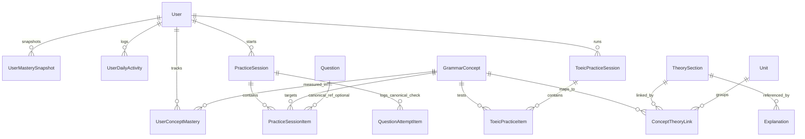

# GrammarPath — Phase 3.0 Workstreams D & G1: Data Architecture & Concept Mapping

> **Phase:** 3.0 — Design & Audit Only  
> **Date:** 2026-11-13  
> **Scope:** Grammar Concept Mapping Model (Workstream D) + Database / Prisma Schema Architecture (Workstream G1).

---

## Part 1 — Workstream D: Grammar Concept Mapping Audit & Model

### D1. Evaluation of Canonical JSON Structure (`grammarpath-data`)

Inspecting all 145 canonical files (`unit-001.json`..`unit-145.json`) and [schema.prisma](file:///Users/kd.quach03/Documents/grammarpath-app/backend/prisma/schema.prisma) establishes what the canonical dataset provides—and what it lacks:

| Attribute | Canonical JSON Evidence | Sufficiency for Concept Mastery |
|---|---|---|
| `unit.unit_number`, `title`, `category` | 145 units cleanly organized by topic (e.g., Unit 1 Present continuous, Unit 13–14 Present perfect vs past) | **Good coarse grouping**, too coarse when a unit teaches 2–3 distinct contrasts (e.g., Unit 12 `for` vs `since` + `how long`). |
| `theory_sections[].section_id` | 542 globally unique IDs (`1A`, `1B`, ..., `145C`) | **Ideal fine-grained textbook anchor**, but `heading` values are Raymond Murphy prose sentences (*"I am doing something = I'm in the middle..."*), unsuitable as learner-facing skill names. |
| `explanation.rule_reference` | **4,414 / 4,414 (100%)** non-null and **100% match a `TheorySection.section_id` in the exact same unit** | **Deterministic 100% question-to-section link**, except in DB (`Explanation.ruleReference`) it is only a bare string, not a relational FK, and **30 intro sections** (`512/542` linked) have 0 direct question references. |
| TOEIC skill / part / priority tags | Zero TOEIC metadata exists in `grammarpath-data` | Currently lives **exclusively in frontend** [toeicRoadmap.ts](file:///Users/kd.quach03/Documents/grammarpath-app/frontend/src/data/toeicRoadmap.ts) (5 stages, 16 modules, 145 unit entries, with label typos like `"Listening Part 2"` and `"Reading Part 5"`). |

### D2. Proposed Concept Taxonomy & Hybrid Mapping Model

**Design Decision:** Keep `grammarpath-data` canonical JSON files **100% untouched** (per canonical curriculum constraint). Store the normalized Grammar Concept Taxonomy and mappings in PostgreSQL (seeded deterministically from a versioned JSON/TS taxonomy manifest derived from `toeicRoadmap.ts` + the 542 `TheorySection` IDs).

```
Unit (145) ──1:N──> TheorySection (542) <──1:N (new FK)── Explanation (4,414) ──1:1── Question (4,414)
                        │                                                                   ▲
                   M:N (ConceptTheoryLink, primary/secondary)                               │ (optional override)
                        ▼                                                                   │
                  GrammarConcept (~95 normalized skills) ───1:N (optional)─────── QuestionConceptOverride
                        │
                        ├── moduleCode ("1.1".."5.3" from 16 TOEIC Modules)
                        ├── toeicStage (1..5)
                        ├── toeicCategory (e.g. tenses_voice, word_forms_pos, clauses_connectors...)
                        ├── priority ("core" | "recommended" | "advanced")
                        └── toeicParts (["Part 5", "Part 6", ...])
```

#### Resolution Rules (Deterministic Priority Chain)
1. **Explicit Question Override (`QuestionConceptOverride`, optional):** Used only when a single `TheorySection` tests two distinct mastery concepts (e.g., *for/since* vs *when* in Unit 12). Initially ~0–5% of items; curated over time without altering canonical JSON.
2. **Primary Section Mapping (Default for 4,414/4,414 items):** `Question -> Explanation.theorySectionId -> ConceptTheoryLink (isPrimary = true) -> GrammarConcept`. Covers 100% of textbook questions deterministically because 100% of explanations match a same-unit `TheorySection`.
3. **Unit Fallback (For Practice / Unit Drills / the 30 intro sections):** All 542 `TheorySection`s (including the 30 unreferenced `"A"` intro sections) link to a `GrammarConcept`, and every `Unit` maps to >=1 `GrammarConcept`.
4. **Canonical vs Application Separation:** Clearly tag `TheorySection.sectionId` and `Unit.unitNumber` as *Canonical Textbook Provenance*, while `GrammarConcept.toeicCategory`, `priority`, and `toeicParts` remain *Application Curriculum Metadata*.

#### Granularity Recommendation (~95 Concepts vs 145 Units vs 542 Sections)
- **Why not 542 section-level concepts?** Many units have 3–5 micro-sections (`A`, `B`, `C`, `D`) that only have 1–4 questions each—too sparse to pass the `N_distinct >= 3` evidence threshold.
- **Why not 145 unit-level only?** Adjacent units sometimes cover one shared TOEIC grammar concept (e.g., Units 13–14 *Present Perfect vs Past Simple*, Units 42–44 *Passive Voice*, Units 92–96 *Relative Clauses*) while some single units contain distinct test traps.
- **Optimal balance (~90–100 curated concepts):** Roughly 1 concept per 1–2 related units (averaging ~38 canonical interactive questions per concept), providing fast statistical stability (`N_distinct >= 15` easily achievable) while still allowing drill-down to specific `Unit` and `TheorySection` (`1A`, `70A`) rules.

---

## Part 2 — Workstream G1: Database & Prisma Architecture

### G1.1 Reuse vs New Entity Justification

To avoid unnecessary table proliferation over the existing **29 tables**, Phase 3 reuses all 13 canonical curriculum tables, `User`, `LearningProgress`, `ExerciseAttempt`, `QuestionAttemptItem`, `AdaptiveQuizSession`, `ToeicPracticeSession`, and `ToeicPracticeItem`, adding only **targeted extensions to 4 existing tables** and **7 justified new tables** (total: **36 tables**).

| Proposed Change | Kind | Justification (Why Existing Tables Cannot Cover It) |
|---|---|---|
| `Explanation.theorySectionId` FK | **Alter existing** | Replaces un-indexed string scanning across `sectionId` (`VarChar(20)`); backfilled 100% deterministically in migration from `ruleReference` + `unitId`. |
| `QuestionAttemptItem` (`attemptStatus`, `attemptSource`, `adaptiveSessionId`, `practiceSessionId`, `responseTimeMs`) | **Alter existing** | Fixes the critical null-as-false bug cleanly via `AttemptStatus` (`correct \| incorrect \| unanswered`) and gives every attempt item clear provenance (`single_check` vs `mistake_retry` vs `adaptive_quiz`). |
| `AdaptiveQuizSession` (`status`, `mode`, `scorePercentage`, `completedAt`) | **Alter existing** | Converts fire-and-forget quiz JSON blobs into trackable, resumable sessions. |
| `ToeicPracticeSession` & `ToeicPracticeItem` (`mode`, `status`, `timeLimitSeconds`, `elapsedSeconds`, `completedAt`, `conceptId`, `validationMeta`, `attemptStatus`) | **Alter existing** | Enables `timed_sprint`, `mixed_grammar`, `weak_topics`, and `part6_grammar` modes plus links TOEIC performance into Concept Mastery without creating redundant TOEIC tables. |
| `grammar_concepts` + `concept_theory_links` (+ optional `question_concept_overrides`) | **3 New Tables** | Relational representation of the ~95-concept taxonomy & TOEIC metadata currently trapped in frontend `toeicRoadmap.ts`. |
| `user_concept_mastery` | **New Table** | Materialized mastery/SRS/confidence state per `(userId, conceptId)` so Dashboard, Review Queue, and Recommendations read in `O(1)` (~95 rows/user) instead of scanning thousands of raw attempt rows. |
| `user_mastery_snapshots` + `user_daily_activity` | **2 New Tables** | Stores daily accuracy/mastery trend points and study streak/activity counts cleanly without expensive `GROUP BY` full-history scans. |
| `practice_sessions` + `practice_session_items` | **2 New Tables** | Persists Personalized Practice drills—specifically storing Tier-1 template and Tier-2 validated AI-generated items **outside** canonical `questions`, keeping the 4,414 canonical textbook dataset completely pure while preserving anti-spoiler separation and per-item grading history. |

*(Note: `question_concept_overrides` can start empty or be seeded lazily if `QuestionConceptOverride` is needed; keeping it lightweight brings new tables to 7–8 depending on whether overrides ship in Phase 3.2).*

### G1.2 Proposed Schema Additions (ERD)



### G1.3 Key Prisma Schema Proposals (Draft Snippets)

```prisma
enum AttemptStatus {
  correct
  incorrect
  unanswered
}

enum AttemptSource {
  exercise_submit
  single_check
  mistake_retry
  adaptive_quiz
  personalized_practice
}

enum MasteryLevel {
  insufficient_data
  novice
  developing
  proficient
  mastered
}

enum ConfidenceLevel {
  none
  low
  medium
  high
}

enum SessionStatus {
  active
  completed
  abandoned
}

enum ToeicSessionMode {
  unit_drill
  weak_topics
  mixed_grammar
  timed_sprint
  part6_grammar
}

model GrammarConcept {
  id              String   @id @default(uuid()) @db.Uuid
  code            String   @unique @db.VarChar(40)   // e.g. "TENSE-PRESENT-PERF-VS-PAST"
  titleEn         String   @map("title_en") @db.VarChar(180)
  titleVi         String   @map("title_vi") @db.VarChar(200)
  toeicStage      Int      @map("toeic_stage")       // 1..5
  moduleCode      String   @map("module_code") @db.VarChar(16) // "1.1".."5.3"
  toeicCategory   String   @map("toeic_category") @db.VarChar(50)
  priority        String   @db.VarChar(20)           // "core" | "recommended" | "advanced"
  toeicParts      Json     @map("toeic_parts")       // ["Part 5", "Part 6"]
  displayOrder    Int      @map("display_order")
  createdAt       DateTime @default(now()) @map("created_at") @db.Timestamptz(6)

  theoryLinks     ConceptTheoryLink[]
  userMasteries   UserConceptMastery[]
  practiceItems   PracticeSessionItem[]
  toeicItems      ToeicPracticeItem[]

  @@index([toeicStage, displayOrder])
  @@index([toeicCategory])
  @@map("grammar_concepts")
}

model ConceptTheoryLink {
  id              String         @id @default(uuid()) @db.Uuid
  conceptId       String         @map("concept_id") @db.Uuid
  unitId          String         @map("unit_id") @db.Uuid
  theorySectionId String         @map("theory_section_id") @db.Uuid
  isPrimary       Boolean        @default(true) @map("is_primary")

  concept         GrammarConcept @relation(fields: [conceptId], references: [id], onDelete: Cascade)
  unit            Unit           @relation(fields: [unitId], references: [id], onDelete: Cascade)
  theorySection   TheorySection  @relation(fields: [theorySectionId], references: [id], onDelete: Cascade)

  @@unique([conceptId, theorySectionId])
  @@index([theorySectionId, isPrimary])
  @@index([unitId])
  @@map("concept_theory_links")
}

model UserConceptMastery {
  id                         String          @id @default(uuid()) @db.Uuid
  userId                     String          @map("user_id") @db.Uuid
  conceptId                  String          @map("concept_id") @db.Uuid
  masteryScore               Int             @default(0) @map("mastery_score") // 0..100
  masteryLevel               MasteryLevel    @default(insufficient_data) @map("mastery_level")
  confidenceLevel            ConfidenceLevel @default(none) @map("confidence_level")
  rawAccuracy                Float           @default(0) @map("raw_accuracy")
  retentionScore             Float           @default(1) @map("retention_score")
  distinctQuestionsAttempted Int             @default(0) @map("distinct_questions_attempted")
  distinctSessionsCount      Int             @default(0) @map("distinct_sessions_count")
  unresolvedMistakeCount     Int             @default(0) @map("unresolved_mistake_count")
  srsStage                   Int             @default(0) @map("srs_stage")
  halfLifeDays               Int             @default(2) @map("half_life_days")
  lastPracticedAt            DateTime?       @map("last_practiced_at") @db.Timestamptz(6)
  lastSuccessfulAt           DateTime?       @map("last_successful_at") @db.Timestamptz(6)
  nextReviewAt               DateTime?       @map("next_review_at") @db.Timestamptz(6)
  updatedAt                  DateTime        @updatedAt @map("updated_at") @db.Timestamptz(6)

  user    User           @relation(fields: [userId], references: [id], onDelete: Cascade)
  concept GrammarConcept @relation(fields: [conceptId], references: [id], onDelete: Cascade)

  @@unique([userId, conceptId])
  @@index([userId, nextReviewAt])
  @@index([userId, masteryLevel])
  @@map("user_concept_mastery")
}

model UserMasterySnapshot {
  id                 String   @id @default(uuid()) @db.Uuid
  userId             String   @map("user_id") @db.Uuid
  snapshotDate       DateTime @map("snapshot_date") @db.Date
  avgMasteryScore    Float    @map("avg_mastery_score")
  assessedConcepts   Int      @map("assessed_concepts")
  masteredConcepts   Int      @map("mastered_concepts")
  rollingAccuracy14d Float    @map("rolling_accuracy_14d")
  createdAt          DateTime @default(now()) @map("created_at") @db.Timestamptz(6)

  user User @relation(fields: [userId], references: [id], onDelete: Cascade)

  @@unique([userId, snapshotDate])
  @@map("user_mastery_snapshots")
}

model UserDailyActivity {
  id               String   @id @default(uuid()) @db.Uuid
  userId           String   @map("user_id") @db.Uuid
  activityDate     DateTime @map("activity_date") @db.Date
  gradedCount      Int      @default(0) @map("graded_count")
  correctCount     Int      @default(0) @map("correct_count")
  unansweredCount  Int      @default(0) @map("unanswered_count")
  sessionsCompleted Int     @default(0) @map("sessions_completed")

  user User @relation(fields: [userId], references: [id], onDelete: Cascade)

  @@unique([userId, activityDate])
  @@map("user_daily_activity")
}

model PracticeSession {
  id              String        @id @default(uuid()) @db.Uuid
  userId          String        @map("user_id") @db.Uuid
  mode            String        @db.VarChar(40) // "weak_concept" | "review_srs" | "mixed_reinforcement"
  targetConceptIds Json         @map("target_concept_ids")
  difficulty      String        @db.VarChar(20) // "easy" | "medium" | "hard" | "adaptive"
  status          SessionStatus @default(active)
  questionCount   Int           @map("question_count")
  scorePercentage Float?        @map("score_percentage")
  startedAt       DateTime      @default(now()) @map("started_at") @db.Timestamptz(6)
  completedAt     DateTime?     @map("completed_at") @db.Timestamptz(6)

  user  User                  @relation(fields: [userId], references: [id], onDelete: Cascade)
  items PracticeSessionItem[]

  @@index([userId, startedAt(sort: Desc)])
  @@map("practice_sessions")
}

model PracticeSessionItem {
  id                String          @id @default(uuid()) @db.Uuid
  sessionId         String          @map("session_id") @db.Uuid
  itemIndex         Int             @map("item_index")
  conceptId         String          @map("concept_id") @db.Uuid
  canonicalQuestionId String?       @map("canonical_question_id") @db.Uuid
  contentOrigin     ContentOrigin   @map("content_origin") // textbook | ai_generated | human_authored
  questionType      QuestionType    @map("question_type")
  promptText        String          @map("prompt_text")
  options           Json?           // null for fill_blank/transformation
  correctAnswer     Json            @map("correct_answer") // NEVER exposed pre-submit
  explanation       String
  ruleReference     String?         @map("rule_reference") @db.VarChar(20)
  validationMeta    Json?           @map("validation_meta")
  studentAnswer     Json?           @map("student_answer")
  attemptStatus     AttemptStatus?  @map("attempt_status")
  isCorrect         Boolean?        @map("is_correct")
  answeredAt        DateTime?       @map("answered_at") @db.Timestamptz(6)

  session           PracticeSession @relation(fields: [sessionId], references: [id], onDelete: Cascade)
  concept           GrammarConcept  @relation(fields: [conceptId], references: [id], onDelete: Cascade)
  canonicalQuestion Question?       @relation(fields: [canonicalQuestionId], references: [id], onDelete: SetNull)

  @@unique([sessionId, itemIndex])
  @@index([conceptId])
  @@map("practice_session_items")
}
```

### G1.4 CHECK Constraints, Backfill & Migration Safety
- Add PostgreSQL `CHECK` constraints enforcing: `mastery_score BETWEEN 0 AND 100`, `raw_accuracy BETWEEN 0 AND 100`, `retention_score BETWEEN 0 AND 1`, `srs_stage BETWEEN 0 AND 5`, `toeic_stage BETWEEN 1 AND 5`.
- **Safe Backfill Plan (Zero Downtime on Existing Data):**
  1. `attemptStatus` on `question_attempt_items`: `UPDATE question_attempt_items SET attempt_status = CASE WHEN student_answer IS NULL OR student_answer::text = 'null' THEN 'unanswered'::"AttemptStatus" WHEN is_correct = true THEN 'correct'::"AttemptStatus" ELSE 'incorrect'::"AttemptStatus" END`.
  2. `Explanation.theorySectionId`: deterministic join matching `LOWER(TRIM(e.rule_reference)) = LOWER(ts.section_id)` inside the same `unit_id` (verified 4,414/4,414 exact matches).
  3. Seed `grammar_concepts` + `concept_theory_links` deterministically via idempotent script, then run an offline-safe per-user backfill job populating `user_concept_mastery` and `user_daily_activity` from existing non-unanswered attempts (`QuestionAttemptItem` + `ToeicPracticeItem`).
- Ensure [schema.prisma](file:///Users/kd.quach03/Documents/grammarpath-app/backend/prisma/schema.prisma) adds `directUrl = env("DIRECT_URL")` (or keeps migration runbook explicit) so pooled Neon URLs never break `prisma migrate deploy`.

