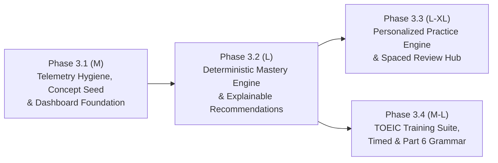

# GrammarPath — Phase 3.0 Workstreams H & I: Implementation Roadmap & Testing Strategy

> **Phase:** 3.0 — Design & Audit Only  
> **Date:** 2026-11-13  
> **Scope:** Phased Implementation Roadmap (Workstream H) and Verification, Security & Acceptance Strategy (Workstream I).

---

## Part 1 — Workstream H: Phased Implementation Roadmap

To deliver immediate learner value safely while preserving all verified Phase 2 workflows, Phase 3 is structured into **four incremental phases (3.1–3.4)**. No Phase 3.2+ mastery math ships before Phase 3.1 cleans up the unanswered-answer telemetry bug and lands the DB concept taxonomy.

---

### Phase 3.1 — Telemetry Hygiene, Concept Seed & Dashboard Foundation
- **Effort Estimate:** **M** (Medium)
- **Dependencies:** Phase 2.2.2 staging baseline clean (`3/3` migrations applied).
- **Database Changes:**
  - Add `AttemptStatus` & `AttemptSource` enums + columns on `QuestionAttemptItem`; backfill `studentAnswer IS NULL` -> `'unanswered'`.
  - Add nullable FK `Explanation.theorySectionId -> TheorySection.id`; backfill 4,414/4,414 rows deterministically.
  - Create `grammar_concepts` & `concept_theory_links` tables and seed ~95 concepts + 542 section links (migrating [toeicRoadmap.ts](file:///Users/kd.quach03/Documents/grammarpath-app/frontend/src/data/toeicRoadmap.ts) metadata and normalizing `"Listening Part 2"` / `"Reading Part 5"` labels).
- **Backend Changes:**
  - Update [exercises.controller.ts](file:///Users/kd.quach03/Documents/grammarpath-app/backend/src/controllers/exercises.controller.ts) and [questions.controller.ts](file:///Users/kd.quach03/Documents/grammarpath-app/backend/src/controllers/questions.controller.ts) to persist `attemptStatus` and `attemptSource`.
  - Fix [progress.controller.ts](file:///Users/kd.quach03/Documents/grammarpath-app/backend/src/controllers/progress.controller.ts) and [adaptive.controller.ts](file:///Users/kd.quach03/Documents/grammarpath-app/backend/src/controllers/adaptive.controller.ts) to strictly exclude `unanswered` rows from accuracy and error counts.
  - Implement `concept-mapping.service.ts` and `GET /api/v1/curriculum/roadmap`, `GET /api/v1/dashboard/summary` (Phase 3.1 baseline fields).
- **Frontend Changes:**
  - Upgrade navigation IA ([Sidebar.tsx](file:///Users/kd.quach03/Documents/grammarpath-app/frontend/src/components/layout/Sidebar.tsx), [App.tsx](file:///Users/kd.quach03/Documents/grammarpath-app/frontend/src/App.tsx)) with `/dashboard`, `/learn`, `/practice` (placeholder/coming-soon or Adaptive entry), `/review`, `/toeic`, `/progress`.
  - Launch `DashboardPage` clearly separating `Units Opened`, `Units Completed`, `Exercises Attempted`, `Questions Answered`, and `Recent Accuracy` (non-null).
  - Remove duplicated `<AdaptiveReviewPanel />` from [MistakeReviewPage.tsx](file:///Users/kd.quach03/Documents/grammarpath-app/frontend/src/pages/MistakeReviewPage.tsx).
- **Acceptance Criteria:** Submitting 4/8 questions in a partial exercise no longer lowers `accuracyPercentage` or creates false error counts; 4,414/4,414 questions resolve to a `GrammarConcept`; all existing Phase 2 unit/API/FE tests pass with zero regression.
- **Key Risk:** Backfill mismatch on `Explanation.ruleReference` in staging vs production (mitigated by verifying exact 4,414 match count post-migration; checking Unit 110 production parity first).

---

### Phase 3.2 — Deterministic Mastery Engine & Explainable Recommendations
- **Effort Estimate:** **L** (Large)
- **Dependencies:** Phase 3.1 (clean `attemptStatus` telemetry + seeded `GrammarConcept`s).
- **Database Changes:**
  - Create `user_concept_mastery`, `user_mastery_snapshots`, and `user_daily_activity` with CHECK constraints and indexes.
  - Run deterministic historical backfill script generating initial `UserConceptMastery` rows for existing users.
- **Backend Changes:**
  - Implement `mastery.service.ts` (formula from Workstream C: Bayesian smoothing `m=4, p0=0.40`, same-day retry cap `0.70`, unresolved mistake penalty `P_err`, exponential retention decay `R(t)`).
  - Hook event-driven `recomputeForUserConcepts` into exercise, single-question, mistake-retry, and TOEIC grading paths.
  - Implement `recommendation.service.ts` + `GET /api/v1/mastery/concepts`, `GET /api/v1/mastery/trends`, `GET /api/v1/recommendations`.
- **Frontend Changes:**
  - Add Mastery & Confidence tiers (`Not enough practice data` when `< 3` items), `ExplainableRecommendationCard` (4-part structure), `UnitHeatmap145`, `AccuracyTrendChart` (SVG), and `QuestionTypeComparisonBars` on `/progress` & `/dashboard`.
- **Acceptance Criteria:** All 4 worked examples from Workstream C pass deterministic unit tests; concepts with `< 3` items never show numerical mastery tiers; Dashboard `/dashboard/summary` responds in `< 100ms` on seeded multi-thousand-attempt test users.
- **Key Risk:** Score shock for existing users whose old "completed" units drop to `insufficient_data` or `developing` (mitigated via clear onboarding callout explaining `Completion` vs `Mastery`).

---

### Phase 3.3 — Personalized Practice Engine & Spaced Review Loop
- **Effort Estimate:** **L–XL** (Large to Extra-Large)
- **Dependencies:** Phase 3.2 (`user_concept_mastery` + `srsStage` / `nextReviewAt`).
- **Database Changes:**
  - Create `practice_sessions` and `practice_session_items`.
  - Extend `AdaptiveQuizSession` (`status`, `completedAt`, `scorePercentage`).
- **Backend Changes:**
  - Implement `srs.service.ts` (`GET /api/v1/review/queue`), `practice-generator.service.ts` (Tier-1 canonical + rule templates; Tier-2 Gemini supplement), and `practice-validator.service.ts` (5-Gate Validator + anti-spoiler DTO stripping).
  - Implement `POST /practice/sessions`, `GET /practice/sessions/:id`, `POST /practice/sessions/:id/submit`.
  - Fix [AdaptiveQuizModal.tsx](file:///Users/kd.quach03/Documents/grammarpath-app/frontend/src/components/adaptive/AdaptiveQuizModal.tsx) wiring or migrate smoothly into `/practice`.
- **Frontend Changes:**
  - Build `PracticeHubPage` (`/practice`) using shared `QuizSessionRunner` supporting `fill_blank`, `sentence_correction`, `transformation`, and `multiple_choice`.
  - Upgrade `/review` into unified **Due for Review (SRS)** + **Unresolved Mistakes** workspace.
- **Acceptance Criteria:** Zero unvalidated AI items persisted (100% pass 5-Gate Validator or fall back cleanly to Tier-1); pre-submit API payloads contain zero `correctAnswer` / `explanation`; spaced recall updates `srsStage` and resolves matching mistakes.
- **Key Risk:** Gemini latency/rate limits or ambiguous AI distractors (mitigated by strict Gate 2/4 rejection + automatic Tier-1 deterministic fallback).

---

### Phase 3.4 — TOEIC Grammar Training Suite & Analytics
- **Effort Estimate:** **M–L** (Medium to Large)
- **Dependencies:** Phase 3.1 (`GrammarConcept` TOEIC categories), Phase 3.2 (concept mastery & weak-topic ranking), Phase 3.3 (`practice-validator.service.ts` shared across generators).
- **Database Changes:**
  - Extend `ToeicPracticeSession` (`mode`, `timeLimitSeconds`, `elapsedSeconds`, `status`, `completedAt`) and `ToeicPracticeItem` (`conceptId`, `attemptStatus`, `validationMeta`).
- **Backend Changes:**
  - Implement `unit_drill`, `weak_topics`, `mixed_grammar`, `timed_sprint` (server-side clock check), and `part6_grammar` (curated/validated short 3-blank workplace memos) using `practice-validator.service.ts`.
  - Author curated Wave-1 business-register TOEIC Part 5 bank for Top 25 `core` units (beyond Units 1–4) + 8–12 Part 6 grammar memos.
  - Implement `toeic-analytics.service.ts` (`GET /api/v1/toeic/analytics`).
- **Frontend Changes:**
  - Build dedicated `ToeicTrainingPage` (`/toeic`) with mode selector, countdown timer bar (client UX synced with server start), category breakdown bars (6 TOEIC grammar categories), pacing insights (`avgSecondsPerItem`), and explicit non-ETS / non-800-guarantee disclaimers.
- **Acceptance Criteria:** Mixed & Timed drills execute across all 6 categories; expired timed submissions record authoritative `elapsedSeconds` and `timedOut` flag; TOEIC attempts cleanly update `UserConceptMastery` and TOEIC analytics without polluting canonical textbook counts (`4,414`).
- **Key Risk:** Part 6 passage generation drifting into Reading Comprehension rather than grammar (mitigated by curated memo templates + strict grammar-slot validation).

---

## Part 2 — Workstream I: Testing & Acceptance Strategy

### I1. Deterministic Unit Tests (Mastery, Validation & Analytics)

| Test ID | Target Module | Exact Input / Fixture | Expected Deterministic Output |
|---|---|---|---|
| **UT-M1** | `mastery.service` | 1 `fill_blank` correct (`w=1.1`) | `distinctQuestionsAttempted=1`, `confidenceLevel='low'`, `masteryLevel='insufficient_data'` |
| **UT-M2** | `mastery.service` | 10 `fill_blank` + 5 `transformation` all correct across Day 1 & Day 3 | `Mastery_base=88.84 -> M=89`, `confidenceLevel='high'`, `masteryLevel='mastered'` |
| **UT-M3** | `mastery.service` | 2 correct + 4 wrong on Day 1, then all 4 retried correctly 10 min later | Same-day retry cap `0.70` active (`s=0.65`), `U_unresolved=0`, `M=63` (`developing`), **blocked** from `mastered` |
| **UT-M4** | `mastery.service` | `Mastery_base=84, srsStage=3 (H=18)`, `t=36` days inactive | `R(36)=0.25`, `M=62` (`developing`), flagged as `isReviewDue=true` |
| **UT-M5** | `mastery.service` | Exercise `2.1` partial submit: Q1–Q3 correct, Q4 wrong, Q5–Q8 skipped (`null`) | `N_distinct=4`, `rawAccuracy=75.0`, `U_unresolved=1`, Q5–Q8 ignored completely |
| **UT-V1** | `practice-validator` | AI JSON with duplicate option (`"goes"` and `"Goes "`) | Rejected at Gate 2 (`DUPLICATE_OPTION`), replaced by Tier-1 item |
| **UT-V2** | `practice-validator` | AI JSON missing blank token or referencing non-existent `ruleReference="999Z"` | Rejected at Gate 1/3, falls back safely without 500 |
| **UT-V3** | `toeic.service` | `GEMINI_API_KEY` unset or Gemini circuit open | Returns `201` with 100% Tier-1 deterministic items (`contentOrigin != 'ai_generated'`), zero HTTP 500 |

### I2. Backend Staging Integration & Security Tests (Supertest + Isolated Staging DB)

- **IDOR Isolation:** User B calling `GET /practice/sessions/:id_of_A`, `POST /practice/sessions/:id_of_A/submit`, or `GET /toeic/sessions/:id_of_A` receives `404` / `403` and zero data leakage.
- **Anti-Spoiler Suite:**
  - Calling `POST /practice/sessions` or `POST /toeic/sessions` asserts response JSON contains zero `correctAnswer`, `acceptedAnswers`, or `explanation` fields anywhere in payload.
  - Appending `?includeAnswers=true`, `?showAnswers=1`, `?withAnswers=yes` on `/practice/*`, `/toeic/*`, `/exercises/*` returns `403 SPOILER_FORBIDDEN`.
  - Calling `GET /questions/:id/solution` before non-empty attempt returns `403 SOLUTION_LOCKED` (even after a partial submission skipped that question!).
- **Telemetry Integrity:** Submitting a partial exercise (3/8 answered) via `POST /exercises/:id/check`, then calling `GET /progress/overview`, `GET /dashboard/summary`, and `GET /adaptive/analytics` verifies `totalIncorrect` and `accuracyPercentage` reflect ONLY the 3 non-null answers.
- **Timed Sprint Integrity:** Submitting a `timed_sprint` (`timeLimitSeconds: 60`) after manipulating clock / payload `elapsedSeconds: 5` confirms server enforces true `now - startedAt` duration.
- **Idempotency & Rate Limits:** Duplicate `submissionId` returns deduplicated response without double-counting `QuestionAttemptItem` or `UserDailyActivity`; exceeding `aiRateLimiter` returns `429 RATE_LIMIT_EXCEEDED`.

### I3. Frontend & Browser E2E Verification (Playwright / Vitest)

- **Component Unit Tests (Vitest):**
  - `MasteryTierBadge` renders `"Not enough practice data"` when `distinctQuestionsAttempted < 3`.
  - `ExplainableRecommendationCard` renders all 4 fields (`Action`, `Reason`, `Evidence`, `Expected Outcome`).
  - `PracticeHub` & `ToeicTraining` pre-submit confirmation warns accurately about skipped questions without labeling them incorrect.
- **Playwright Browser E2E (Desktop `1280x800` & Mobile `375x812`):**
  1. Authenticated Dashboard -> verifies distinct counters (`Opened`, `Completed`, `Accuracy`) and `0` horizontal overflow (`scrollWidth <= innerWidth`).
  2. Unit Exercise Partial Submit -> reloads page -> verifies `Unanswered` feedback persisted cleanly and accuracy/weakness analytics did NOT count skipped items as errors.
  3. Personalized Practice Flow -> generate drill -> verify network response hides answers -> submit answers -> verify explanation & `RuleReferenceModal` open cleanly -> return to Dashboard and verify mastery/daily activity updated.
  4. Review Hub Flow -> resolve due SRS item / unresolved mistake -> confirm queue decrements.
  5. TOEIC Timed Sprint -> start 5-item sprint -> verify timer runs, submit, verify category breakdown and non-ETS disclaimer visible.

### I4. Mandatory Release Gate Checklist (Per Phase 3.1 – 3.4)

A phase may advance to staging/release sign-off **only** when all gates pass:
1. Canonical baseline intact (`145` units, `549` exercises, `4,414` questions, `4,414` explanations) — zero mutation of `grammarpath-data`.
2. `prisma migrate status` reports all migrations applied and `prisma migrate diff` shows `0` schema drift.
3. `backend` unit tests (`100%` mastery/validator coverage) + staging API integration tests + `frontend` unit/typecheck/build + Playwright desktop/mobile E2E all pass.
4. Security & Anti-Spoiler regression suite passes (`403 SPOILER_FORBIDDEN`, `403 SOLUTION_LOCKED`, cross-user IDOR tests).
5. **Production Rollout Gate (carried forward from Phase 2.2.2):** Verify production DB has `20261113000000_add_practice_sessions` applied and Unit 110 reconciled before applying any Phase 3 migration to production.

