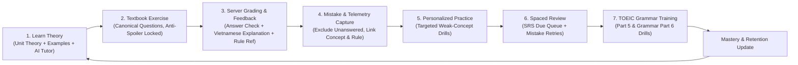

# GrammarPath — Phase 3.0 Workstream B: Learning Experience Design

> **Phase:** 3.0 — Design & Audit Only  
> **Date:** 2026-11-13  
> **Scope:** Navigation & Information Architecture, Dashboard Design, End-to-End Learning Loop, Mastery Visualization, and Explainable Recommendation UX.

---

## 1. Navigation & Information Architecture (IA)

Currently, GrammarPath exposes 4 top-level routes (`/`, `/roadmap`, `/progress`, `/mistakes`) and traps Adaptive Quiz and TOEIC Practice inside modals. To unify textbook study, personalized practice, spaced review, and TOEIC training into one coherent loop without breaking existing Phase 1–2 links, Phase 3 introduces a **6-area primary navigation structure** in [Sidebar.tsx](file:///Users/kd.quach03/Documents/grammarpath-app/frontend/src/components/layout/Sidebar.tsx) and [App.tsx](file:///Users/kd.quach03/Documents/grammarpath-app/frontend/src/App.tsx):

| Nav Item | Route | Legacy Alias / Preservation | Purpose in Learning Loop |
|---|---|---|---|
| **1. Dashboard** | `/dashboard` (authenticated default entry; guests see `/learn` hero + preview) | Links seamlessly with `/` | Answers "Where am I?", "What next?", "What is due?", "Where am I weak?", "Am I improving?" in < 5 seconds. |
| **2. Learn** | `/learn` + `/units/:unitNumber` | `/` renders Catalog for guests or links cleanly; `/units/:unitNumber` preserved | Browse 145 *English Grammar in Use* units by category, search, or TOEIC stage; read Theory, Examples, and solve canonical exercises. |
| **3. Practice** | `/practice` | Absorbs & upgrades `AdaptiveQuizModal` | Dedicated Personalized Practice hub targeting weak concepts, mixed reinforcement, and question formats beyond passive MCQs. |
| **4. Review** | `/review` | `/mistakes` redirects or opens Mistakes tab | Two integrated tabs: **Due for Review (SRS Queue)** and **Unresolved Mistakes (`mistakes.service.ts`)**; removes duplicated `AdaptiveReviewPanel`. |
| **5. TOEIC Training** | `/toeic` + `/roadmap` (sub-tab or linked map) | `/roadmap` preserved and linked directly | Bridges textbook grammar into TOEIC Part 5 & grammar-scoped Part 6 drills (Unit Bridge, Weak Topics, Mixed Drill, Timed Sprint). |
| **6. Progress & Analytics** | `/progress` | Preserves `/progress` route | Deep analytics: 16-Module Mastery Matrix, 145-Unit Heatmap, Question-Type breakdown, Accuracy & Retention trends, TOEIC category pace. |

---

## B1. Learning Dashboard Design (`/dashboard`)

The Dashboard is structured into **four scannable zones**, strictly separating curriculum completion, raw accuracy, estimated mastery, and retention signals—never blending them into vanity metrics.

### Core Metric Taxonomy (Never Conflated in UI Copy or Tooltips)

| Metric Label | Exact Meaning | Visual Treatment |
|---|---|---|
| **Units Opened** | Units with `LearningProgress.status IN ('in_progress', 'completed')` | Neutral count badge (`X / 145`) |
| **Units Completed** | Units meeting exercise completion rule or manual completion | Green completion ring (`X / 145 completed`) |
| **Exercises Attempted** | Distinct textbook exercises with `>= 1` `ExerciseAttempt` | Sub-metric (`X / 549`) |
| **Questions Answered** | Distinct interactive items answered non-null (`attemptStatus != 'unanswered'`) | Activity count (`X / 3,753` canonical + practice items) |
| **Recent Accuracy** | `correct / graded` across **non-unanswered** attempts in the trailing 14 days | Percentage with denominator (`e.g., 78% · 42/54 graded`) |
| **Estimated Mastery** | Deterministic evidence-gated score (`0–100`) & tier across assessed concepts | Tier pill + score (or `"Not enough data"` when `< 3` items) |
| **Active Streak** | Consecutive UTC/user-TZ calendar days with `>= 5` graded items or `>= 1` completed session | Optional secondary pill ("3-day study streak"); hidden/softened if 0 so it never shames learners |

### Dashboard Layout Wireframe

1. **Top Row — Next Best Action Banner (Primary CTA + Recommendation #1):**
   - Shows the top explainable recommendation (`Action`, `Why`, `Supporting Evidence`, `Expected Outcome`) with a single high-contrast CTA button (e.g., `Start 6-Item Drill`, `Review 4 Due Concepts`, or `Continue Unit 42`).
   - Displays current **TOEIC Grammar Readiness Framing**: *"Grammar Foundation toward TOEIC 800 — X/73 Core Units Assessed. (Note: Listening, vocabulary, and reading speed require separate practice.)"*
2. **Second Row — 4 Honest KPI Cards:**
   - **Curriculum Progress:** Units Completed vs Opened vs Exercises Attempted (`145` total units; breakdown by Stage 1–5).
   - **Concept Mastery Snapshot:** Count of `Mastered`, `Proficient`, `Developing`, `Novice`, and `Unassessed / Insufficient Data` concepts (out of ~95 curriculum concepts).
   - **Review & Mistake Queue:** `Due Today (SRS)` count + `Unresolved Mistakes` count, with one-click `Start Review`.
   - **14-Day Accuracy & Volume:** Trailing non-unanswered accuracy + sparkline showing week-over-week movement (`+6% vs prior 14d` or `"Baseline building"` if `< 10` items).
3. **Third Row — Weakest Grammar Topics & Recent Activity (2-column split):**
   - **Left: Top 4 Weakest Concepts** (ranked by `WeaknessPriority` — never showing concepts with `0` attempts as "weak"!). Each row displays Concept Title, linked Unit(s), Confidence badge, Mastery bar, Unresolved Mistakes badge, and `Practice` button.
   - **Right: Recent Learning Feed** (chronological textbook attempts, personalized drills, TOEIC drills, with answered vs unanswered count explicitly shown so partial submissions are transparent).
4. **Bottom — Quick Curriculum Jump / Current Unit Card:**
   - Resumes the most recently accessed `in_progress` unit directly at Theory or next unfinished Exercise.

---

## B2. End-to-End Learning Loop

GrammarPath enforces a continuous 7-step loop while preserving Phase 2's interaction model and anti-spoiler guarantees:

### When Mastery Updates (Explicit Rules)

| User Event | Updates Completion? | Updates Accuracy? | Updates Mastery / Retention? | Rationale |
|---|---|---|---|---|
| Reading Theory / Examples / AI Tutor | Optional `in_progress` | No | **No** | Passive exposure does not demonstrate recall. |
| Opening Worked Example (`isExample = true`) | No | No | **No** | Model demonstrations are non-evaluated. |
| Clicking `Show Solution` after failed attempt | No | No | **No** | Viewing solutions teaches; only subsequent independent attempts verify learning. |
| Submitting **empty / skipped** item in partial exercise | Does not advance completion | **No** (`unanswered`) | **No** | Never penalize skipped questions as wrong knowledge. |
| Textbook `Check Answer` / `Exercise Submit` (non-empty) | Yes (`>= 80%` rule) | **Yes** | **Yes (`1.0x` weight)** | Authentic recall + open production (`fill_blank`, `transformation`). |
| Mistake Review retry (non-empty) | No | **Yes** | **Yes (capped if same-day; full recovery on spaced day)** | Prevents same-day answer-guessing from inflating mastery. |
| Personalized Practice item submission | No | **Yes** | **Yes (`0.85x`–`1.0x` by format)** | Reinforces targeted concepts cleanly. |
| TOEIC Training item submission | No | **Yes** (tracked in TOEIC + Concept) | **Yes (`0.85x` MCQ / timed bonus <=1.0x)** | Measures applied grammar recognition under TOEIC patterns. |

---

## B3. Mastery Visualization & Anti-False-Precision

To prevent misleading learners with inflated numbers from tiny samples:

1. **Insufficient-Data State (`< 3` distinct graded questions):**
   - Never display a numeric score like `100% Mastery` after 1 lucky click.
   - Render a muted slate pill: **`Not enough practice data (1/3 items)`**, alongside raw observed attempts (`1/1 correct so far`).
2. **Evidence Confidence Indicator (Every Concept & Unit Card):**
   - **Low Confidence** (`3–5` distinct items): dotted border / amber info icon (*"Early signal — answer 3+ more items to stabilize"*).
   - **Medium Confidence** (`6–14` items or single session): solid bar (*"Moderate evidence"*).
   - **High Confidence** (`>= 15` items across `>= 2` separate sessions): crisp solid bar + verified shield.
3. **Multi-Granularity Analytics Views (`/progress`):**
   - **By TOEIC Stage & 16 Modules:** Accordion cards showing `Completion %` bar vs `Mastery Tier` distribution (stacked segments: Mastered / Proficient / Developing / Novice / Insufficient Data).
   - **145-Unit Interactive Heatmap Grid:** Color-coded cells by mastery tier (or striped slate for insufficient data), with click-through drawer showing unit concepts, linked sections (`1A`, `1B`...), and retention status (`Fresh` vs `Review Due`).
   - **Question-Type Performance Breakdown:** Compares accuracy across `multiple_choice` vs `fill_blank` vs `transformation` vs `sentence_correction` vs `word_formation`—exposing learners who score 85% on MCQs but only 45% on sentence production.
   - **Historical Trend Line (SVG):** Dual-series 30/90-day SVG trend showing rolling non-unanswered accuracy and average concept mastery from `UserMasterySnapshot`.

---

## B4. Explainable Recommendation UX

Every recommendation surfaced on Dashboard, Review, or Unit pages must populate a strict **4-part explanation contract** rendered in a structured card:

| Field | Example Rendered Copy | Grounding Source |
|---|---|---|
| **1. Action (What)** | *"Practice 6 questions on Past Simple vs Present Perfect (Unit 13–14)"* | Top ranked recommendation (`type: 'weak_concept'`) |
| **2. Reason (Why)** | *"Your accuracy on time-marker contrasts (`since/for` vs `ago/yesterday`) dropped to 42%, with 3 unresolved mistakes."* | `masteryScore = 38`, `unresolvedMistakeCount = 3` |
| **3. Supporting Evidence (Audit Chips)** | `[42% accuracy (5/12)]` · `[3 unresolved mistakes]` · `[Last practiced 4 days ago]` · `[Confidence: Medium]` | Exact counts from `UserConceptMastery` + `Mistake` records |
| **4. Expected Outcome (Impact)** | *"Resolving these 3 items and scoring >= 4/6 lifts this concept from Novice to Developing and updates your next review interval to 3 days."* | Deterministic delta preview |

Users can dismiss/snooze a recommendation (`"Skip for today"`) without losing transparency, and fallback state for brand-new learners (`0` attempts) recommends Stage 1 Core diagnostic or Unit 1 (`am/is/are`) with explicit *"Starter onboarding path (no personal attempt data yet)"* labeling rather than fake personalization.

