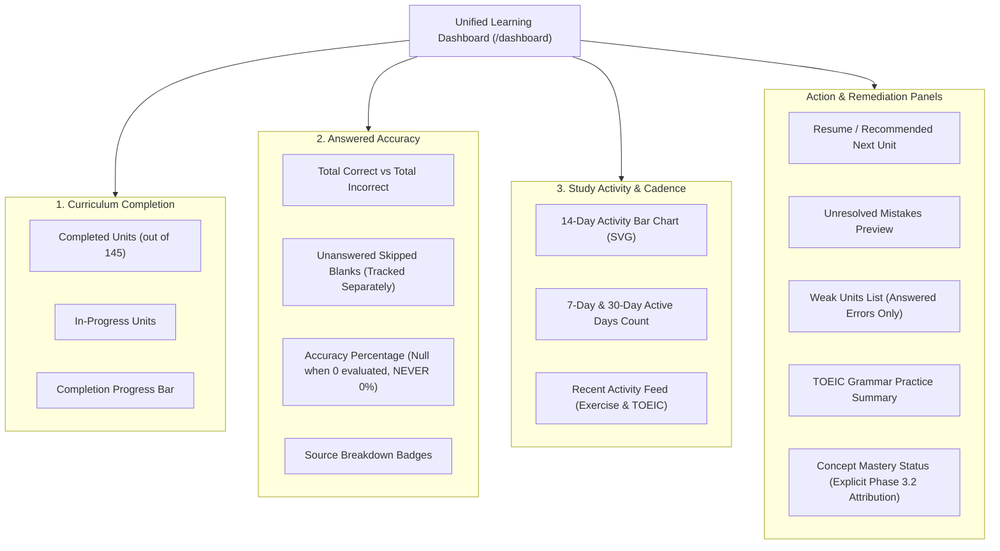

# GrammarPath Phase 3.1 — Learning Dashboard Verification Report
**Three-Pillar Metrics Architecture, Component Verification, and Scope Honesty**

- **Date:** 2026-11-13
- **Author:** Senior Frontend Architect & QA Engineer
- **Environment:** Staging (`ep-small-dream-a1lqsn1r.ap-southeast-1.aws.neon.tech:5432/grammarpath-staging`)

---

## 1. Executive Summary

Phase 3.1 introduces the dedicated **Learning Dashboard** at `/dashboard` ([DashboardPage.tsx](file:///Users/kd.quach03/Documents/grammarpath-app/frontend/src/pages/DashboardPage.tsx)), backed by `GET /api/v1/dashboard/summary` ([dashboard.controller.ts](file:///Users/kd.quach03/Documents/grammarpath-app/backend/src/controllers/dashboard.controller.ts) & [dashboard.service.ts](file:///Users/kd.quach03/Documents/grammarpath-app/backend/src/services/dashboard.service.ts)).

The dashboard resolves the historical ambiguity of single aggregate scores by structuring learner progress into three distinct, non-overlapping pillars:



---

## 2. API Contract: `GET /api/v1/dashboard/summary`

The endpoint enforces strict authentication (`requireAuth`), returning comprehensive telemetry for the authenticated user:

```json
{
  "status": "success",
  "data": {
    "user": {
      "id": "uuid",
      "email": "learner@grammarpath.local",
      "displayName": "Alex Johnson"
    },
    "completion": {
      "totalUnits": 145,
      "completedUnits": 12,
      "inProgressUnits": 4,
      "notStartedUnits": 129,
      "completionPercentage": 8.3
    },
    "accuracy": {
      "totalEvaluatedQuestions": 48,
      "totalCorrect": 38,
      "totalIncorrect": 10,
      "totalUnansweredSkipped": 14,
      "accuracyPercentage": 79.2,
      "sourceBreakdown": {
        "exercise_submission": 32,
        "single_check": 6,
        "mistake_retry": 4,
        "toeic_practice": 6
      }
    },
    "activity": {
      "activeDaysLast7": 4,
      "activeDaysLast30": 11,
      "lastActivityAt": "2026-11-13T11:20:00.000Z",
      "dailyLast14": [ ... ],
      "recentActivity": [ ... ]
    },
    "resumeUnit": {
      "unitNumber": 2,
      "title": "Present simple (I do)",
      "status": "in_progress",
      "priority": "core",
      "toeicTag": "Part 5"
    },
    "mistakes": {
      "unresolvedCount": 3,
      "recentItems": [ ... ]
    },
    "weakUnits": [
      {
        "unitNumber": 1,
        "unitTitle": "Present continuous (I am doing)",
        "evaluatedCount": 10,
        "errorCount": 4,
        "accuracyPercentage": 60.0
      }
    ],
    "toeic": {
      "totalSessions": 2,
      "itemsAnswered": 10,
      "accuracyPercentage": 80.0,
      "partDistribution": { "Part 5": 10 },
      "scopeDisclaimer": "TOEIC practice focuses on grammar points from English Grammar in Use and does not constitute full TOEIC preparation."
    },
    "masteryStatus": {
      "mode": "scheduled_phase_3_2",
      "totalConcepts": 161,
      "message": "Concept mastery modeling (Bayesian estimation, decay, and mastery thresholds) is scheduled for Phase 3.2. Current accuracy reflects evaluated question performance."
    }
  }
}
```

---

## 3. Pillar-by-Pillar Verification

### 3.1 Pillar 1: Curriculum Completion
- Displays exact numbers: completed, in-progress, not started out of 145 canonical units.
- Percentage bar computed via `Math.round((completedUnits / 145) * 100)`.
- Updates dynamically whenever a unit's status is toggled or updated.

### 3.2 Pillar 2: Answered Accuracy & Null Handling
- **Evaluated Questions Only:** Total evaluated = `totalCorrect + totalIncorrect`.
- **Skipped Blanks Isolated:** `totalUnansweredSkipped` is displayed in a separate slate badge with a skip icon.
- **Empty State Proof:** When `totalEvaluated === 0`, `accuracyPercentage` is returned as `null`. The card renders `"—"` with subtitle `"No evaluated answers yet"`. It **never** renders `0%`.
- **Source Breakdown:** Shows pill badges for all non-zero sources (`Exercise Submission`, `Single Check`, `Mistake Retry`, `TOEIC Drill`, etc.).

### 3.3 Pillar 3: Study Activity & 14-Day SVG Bar Chart
- Renders an inline SVG histogram displaying daily study volume over the last 14 days (today + prior 13 days).
- Height scaled relative to maximum daily volume with a 6px minimum for active days.
- Tooltips display exact date and count (`X questions + Y TOEIC items`).
- Displays `activeDaysLast7` and `activeDaysLast30`.
- Recent activity timeline displays exercise submissions, single checks, and TOEIC drills with direct links to corresponding units.

---

## 4. Remediation & Action Cards

### 4.1 Resume Card
- Prioritizes the lowest incomplete "core" TOEIC priority unit.
- Displays unit number, title, and TOEIC Part tag.
- Includes a direct "Resume Study" button.

### 4.2 Unresolved Mistakes Preview
- Displays unresolved count badge.
- Shows up to 5 most recent mistakes with unit number, exercise number, and textbook rule reference.
- Includes direct link to `/mistakes`.
- Unanswered/skipped blanks are strictly excluded from mistakes.

### 4.3 Weak Units Panel
- Identifies units where answered accuracy is below 75% (minimum 3 evaluated questions).
- Renders warning badge and accuracy percentage.
- Links directly to the unit for targeted review.

### 4.4 TOEIC Grammar Summary
- Displays total sessions, questions answered, and TOEIC Part 5 accuracy.
- Displays Part distribution chips.
- Features mandatory pedagogical disclaimer: `"Luyện tập TOEIC tập trung vào ngữ pháp và không thay thế cho toàn bộ bài thi TOEIC."`

### 4.5 Concept Mastery Honesty Callout
- Renders an informative amber callout card explicitly stating that Concept Mastery scoring is scheduled for **Phase 3.2**.
- Guarantees **zero fake mastery scores**: no fabricated percentages, no mock decay rates, and no invented mastery badges.

---

## 5. Responsive Design Verification

Tested and verified via Playwright in automated browser regression:
- **Desktop (1280x800):** Multi-column grid, zero horizontal overflow (`scrollWidth <= innerWidth`).
- **Mobile (375x812 - iPhone SE / 13 mini):** Single-column stacked cards, responsive SVG chart, zero horizontal overflow (`scrollWidth <= innerWidth`).

