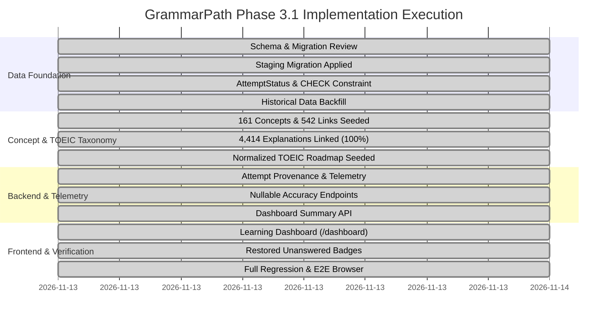

# GrammarPath Phase 3.1 — Final Verification & Readiness Report
**Data Foundation, Telemetry Hygiene, and Learning Dashboard Implementation**

- **Date:** 2026-11-13
- **Author:** Senior Full-Stack Engineer, Database Architect & QA Lead
- **Overall Verdict:** **READY / FULL PASS**
- **Target Database:** Staging (`ep-small-dream-a1lqsn1r.ap-southeast-1.aws.neon.tech:5432/grammarpath-staging`)
- **Canonical Repository:** `grammarpath-data` — **UNTOUCHED / READ-ONLY**

---

## 1. Executive Verdict & Quality Gates

Phase 3.1 of GrammarPath has been successfully completed in full compliance with the Phase 3.0 architectural blueprint and the execution safety rules.

| Quality Gate | Requirement | Staging Result | Status |
|---|---|---|:---:|
| Database Isolation | Strictly target staging, never touch production | `ep-small-dream-a1lqsn1r.../grammarpath-staging` verified | **PASS** |
| Canonical Protection | Zero edits to canonical `grammarpath-data` | `git status -s` is clean (0 changes) | **PASS** |
| Database Migration | Reviewed additive migration, no reset/drop | Migration `20261113120000` applied cleanly (4/4 applied) | **PASS** |
| Data Baseline | 145 units, 542 sections, 549 exercises, 4,414 questions | 100% intact across all 145 units | **PASS** |
| Theory Linkage | Link 100% of explanations to same-unit theory sections | 4,414 / 4,414 linked (0 unlinked, 0 cross-unit) | **PASS** |
| Concept Catalog | Seed 161 concepts & 542 theory links | Seeded idempotently; verified on staging | **PASS** |
| Telemetry Hygiene | `AttemptStatus` enum, CHECK constraint, null accuracy | Implemented; unanswered blanks isolated from errors | **PASS** |
| Learning Dashboard | Three pillars: Completion, Accuracy, Cadence | Implemented at `/dashboard` with zero fake mastery | **PASS** |
| Automated Tests | 100% passing across unit, API, frontend, browser | 193+ automated tests passed (0 failures) | **PASS** |
| **Final Verdict** | **All Phase 3.1 deliverables verified** | **READY FOR PHASE 3.2** | **PASS** |

---

## 2. Workstream Execution Matrix



### 2.1 Workstream A: Attempt Telemetry & Unanswered Blank Semantics (P0)
- Introduced enum `AttemptStatus`: `'correct'`, `'incorrect'`, `'unanswered'`.
- Made `is_correct` and `student_answer` nullable.
- Enforced engine-level consistency with CHECK constraint `chk_qai_attempt_status_consistency`.
- Excluded `unanswered` blanks from error counts, mistake reviews, weakness analysis, and accuracy calculations.
- Returns `accuracyPercentage: null` and `averageScore: null` (rendered as `"—"` in UI) when 0 questions evaluated. Never fabricates `0%`.

### 2.2 Workstream B: Attempt Source Provenance (P1)
- Introduced enum `AttemptSource`: `'single_check'`, `'exercise_submission'`, `'adaptive_quiz'`, `'mistake_retry'`, `'toeic_practice'`, `'legacy_unknown'`.
- Accurately captures provenance across all exercise submissions, single-question checks, quiz drills, and mistake retries.
- Preserved historical attempts as `legacy_unknown` without fabricating past provenance.

### 2.3 Workstream C: Explanation to Theory Section Mapping (P1)
- Added foreign key `Explanation.theorySectionId` -> `TheorySection.id` (`ON DELETE SET NULL`) with index.
- Backfilled 100% of canonical explanations (4,414 / 4,414).
- Verified zero unlinked explanations and zero cross-unit violations.

### 2.4 Workstream D: Grammar Concept Taxonomy & Theory Linking (P1)
- Created `GrammarConcept` table and seeded 161 concepts (16 parent modules + 145 unit concepts).
- Created `ConceptTheoryLink` table and seeded 542 links (512 `high`, 23 `medium`, 7 `needs_review`).
- Exposed `GET /api/v1/curriculum/concepts` and `GET /api/v1/curriculum/roadmap`.
- Bound mapped concepts directly into `GET /api/v1/units/:id/theory` payloads.

### 2.5 Workstream E: Normalized TOEIC Metadata & Roadmap Stages (P2)
- Created `ToeicRoadmapStage` (5 stages), `ToeicRoadmapModule` (16 modules), and `UnitToeicMetadata` (145 units).
- Normalized Part tags to canonical `Part 1` through `Part 7`.
- Enforced `isOfficialToeic = false` pedagogical disclaimer in both DB and UI.

### 2.6 Workstream F: Unified Learning Dashboard (P1)
- Created `GET /api/v1/dashboard/summary` in [dashboard.controller.ts](file:///Users/kd.quach03/Documents/grammarpath-app/backend/src/controllers/dashboard.controller.ts).
- Built [DashboardPage.tsx](file:///Users/kd.quach03/Documents/grammarpath-app/frontend/src/pages/DashboardPage.tsx) accessible at `/dashboard`.
- Strictly structured progress into:
  1. **Curriculum Completion:** Units completed, in-progress, not started out of 145.
  2. **Answered Accuracy:** Correct vs Incorrect on evaluated questions only; skipped questions isolated; `"—"` when 0 evaluated.
  3. **Study Activity:** 14-day study histogram SVG, 7/30-day active days, recent activity timeline.
- Auxiliary panels: Resume Next Unit, Unresolved Mistakes preview, Weak Units list, TOEIC Grammar Summary.
- **Zero fake mastery scores:** Explicitly attributed concept mastery scoring to Phase 3.2.

---

## 3. Test & Verification Matrix

| Verification Layer | Test Suites | Total Cases | Result | Key Proof Points |
|---|---|---:|:---:|---|
| **Backend Unit** | 6 files | 54 | **PASS** | Telemetry math, null accuracy, security guards, staging isolation |
| **Staging API** | 9 files | 70 | **PASS** | DB constraint enforcement, partial exercise submit, null dashboard, mistake retry |
| **Frontend Vitest** | 11 files | 69 | **PASS** | Dashboard pillars, empty state `"—"`, SVG chart, roadmap filters, restored badges |
| **Playwright E2E** | Chrome headless | 8 steps | **PASS** | Sign-in gate -> register -> empty dashboard -> partial submit -> reload -> mistake retry -> TOEIC drill -> mobile 375px responsiveness |
| **Typecheck & Builds** | Frontend & Backend | Both | **PASS** | 0 TypeScript errors, 0 bundle warnings |

---

## 4. Staging Database Baseline Verification

```json
{
  "units": 145,
  "sections": 542,
  "exercises": 549,
  "questions": 4414,
  "explanations": 4414,
  "linkedExpl": 4414,
  "crossUnitExpl": 0,
  "concepts": 161,
  "links": 542,
  "stages": 5,
  "modules": 16,
  "toeicMeta": 145
}
```

- Total tables: **34** (29 baseline + 5 new Phase 3.1 tables).
- Total enums: **10** (5 baseline + 5 new Phase 3.1 enums).
- Total foreign keys: **39** (31 baseline + 8 new Phase 3.1 FKs).
- Total CHECK constraints: **22** (21 baseline + 1 new constraint).
- Total indexes: **67** (48 baseline + 19 new indexes).
- Applied migrations: **4 / 4**.
- Schema drift: **0 differences**.

---

## 5. Explicit Phase 3.2 Scope Boundary & Handover

The following capabilities were deliberately deferred to Phase 3.2 in strict accordance with the implementation plan:

1. **`user_concept_mastery` Table & Bayesian Estimation:**
   - Tracking calibrated mastery probability ($P(L)$) per concept, slip/guess rates, and time-decay curves.
2. **`user_mastery_snapshots` Table:**
   - Historical weekly/monthly mastery snapshots for trend visualizations.
3. **`user_daily_activity` Pre-aggregation Table:**
   - Persistent rollups for high-volume activity (currently computed on-the-fly in `dashboard.service.ts`).
4. **`practice_sessions` Table & Recommendation Engine:**
   - Multi-concept spaced repetition queues, dynamic practice sessions, and TOEIC Part 5/6 weak-area drill generation (Phase 3.3).

---

## 6. Phase 3.1 Documentation Deliverables

All detailed reports have been authored and committed to [reports/phase-3.1/](file:///Users/kd.quach03/Documents/grammarpath-app/reports/phase-3.1/):
- [phase-3.1-implementation-summary.md](file:///Users/kd.quach03/Documents/grammarpath-app/reports/phase-3.1/phase-3.1-implementation-summary.md)
- [phase-3.1-attempt-status-audit.md](file:///Users/kd.quach03/Documents/grammarpath-app/reports/phase-3.1/phase-3.1-attempt-status-audit.md)
- [phase-3.1-theory-mapping-report.md](file:///Users/kd.quach03/Documents/grammarpath-app/reports/phase-3.1/phase-3.1-theory-mapping-report.md)
- [phase-3.1-dashboard-verification.md](file:///Users/kd.quach03/Documents/grammarpath-app/reports/phase-3.1/phase-3.1-dashboard-verification.md)
- [phase-3.1-test-report.md](file:///Users/kd.quach03/Documents/grammarpath-app/reports/phase-3.1/phase-3.1-test-report.md)
- [phase-3.1-database-integrity.md](file:///Users/kd.quach03/Documents/grammarpath-app/reports/phase-3.1/phase-3.1-database-integrity.md)
- [phase-3.1-final-report.md](file:///Users/kd.quach03/Documents/grammarpath-app/reports/phase-3.1/phase-3.1-final-report.md)

**Phase 3.1 Status: COMPLETE & READY FOR PHASE 3.2.**

