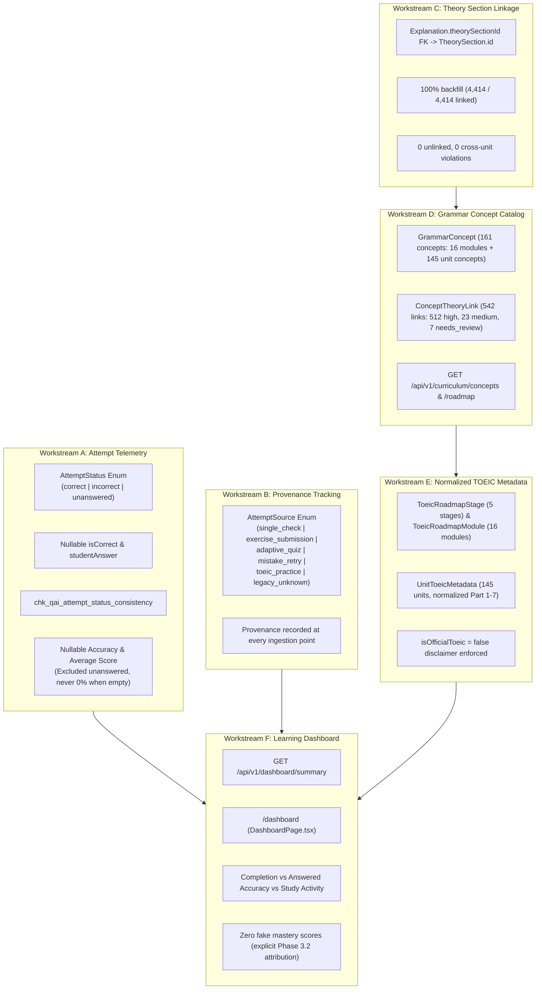

# GrammarPath Phase 3.1 — Implementation Summary
**Data Foundation & Learning Dashboard**

- **Date:** 2026-11-13
- **Author:** Senior Full-Stack Engineer, Database Architect & QA Lead
- **Environment:** Staging (`ep-small-dream-a1lqsn1r.ap-southeast-1.aws.neon.tech:5432/grammarpath-staging`)
- **Canonical Baseline:** `grammarpath-data` (145 units, 542 sections, 549 exercises, 4,414 questions, 4,414 explanations) — **UNTOUCHED / READ-ONLY**

---

## 1. Executive Summary

Phase 3.1 establishes the data foundation and learning analytics layer for GrammarPath. Prior to Phase 3.1, telemetry conflated skipped/unanswered blanks with incorrect answers, explanations lacked foreign keys linking them directly to theory sections, grammar concepts were implicit, TOEIC metadata suffered from redundant labeling (`"Listening Part 2"`), and learning dashboards showed ambiguous aggregate scores.

In Phase 3.1, all six approved workstreams (A through F) were implemented, tested, and verified on the isolated staging database without modifying the canonical dataset (`grammarpath-data`) or dropping any existing tables or user attempts.



---

## 2. Workstream Breakdown & Deliverables

### 2.1 Workstream A: Explicit Attempt Status & Unanswered Blank Semantics (P0)
- **Problem:** Blank/unanswered inputs were historically scored as `isCorrect: false, studentAnswer: ""`, corrupting error analytics and depressing user accuracy.
- **Solution:**
  - Added PostgreSQL enum `AttemptStatus`: `'correct'`, `'incorrect'`, `'unanswered'`.
  - Added `attemptStatus` column on `question_attempt_items` with default `'unanswered'`.
  - Made `is_correct` and `student_answer` nullable.
  - Applied DB CHECK constraint `chk_qai_attempt_status_consistency`:
    ```sql
    CHECK (
      (attempt_status = 'unanswered' AND is_correct IS NULL AND student_answer IS NULL)
      OR
      (attempt_status IN ('correct', 'incorrect') AND is_correct IS NOT NULL AND student_answer IS NOT NULL)
    );
    ```
  - Backfilled existing historical attempt items:
    - `studentAnswer = ""` and `isCorrect = false` -> `attemptStatus = 'unanswered'`, `isCorrect = null`, `studentAnswer = null`.
    - `isCorrect = true` -> `attemptStatus = 'correct'`.
    - `isCorrect = false` with non-empty answer -> `attemptStatus = 'incorrect'`.
  - Updated all analytics (`ProgressController`, `AdaptiveController`, `MistakesService`, `DashboardService`) to exclude `unanswered` attempt items.
  - Accuracy and average scores return `null` (not `0%`) when 0 items have been evaluated.

### 2.2 Workstream B: Attempt Source Provenance (P1)
- **Problem:** Attempt records lacked origin context, preventing breakdown between exercise submissions, single-question checks, quiz drills, mistake retries, and TOEIC drills.
- **Solution:**
  - Added PostgreSQL enum `AttemptSource`: `'single_check'`, `'exercise_submission'`, `'adaptive_quiz'`, `'mistake_retry'`, `'toeic_practice'`, `'legacy_unknown'`.
  - Added `attemptSource` column on `question_attempt_items` with default `'legacy_unknown'`.
  - Updated ingestion controllers:
    - [exercises.controller.ts](file:///Users/kd.quach03/Documents/grammarpath-app/backend/src/controllers/exercises.controller.ts): sets `exercise_submission`.
    - [questions.controller.ts](file:///Users/kd.quach03/Documents/grammarpath-app/backend/src/controllers/questions.controller.ts): accepts optional validated `source` parameter (`single_check` default, or `mistake_retry` when invoked from [MistakeReviewPage.tsx](file:///Users/kd.quach03/Documents/grammarpath-app/frontend/src/pages/MistakeReviewPage.tsx)).
    - [adaptive.controller.ts](file:///Users/kd.quach03/Documents/grammarpath-app/backend/src/controllers/adaptive.controller.ts): sets `adaptive_quiz` on quiz question checks and `toeic_practice` on TOEIC checks.
  - Zero fabricated provenance: all pre-existing historical rows remain accurately categorized as `legacy_unknown`.

### 2.3 Workstream C: Explanation to Theory Section Mapping (P1)
- **Problem:** Explanations were linked only to Questions, requiring heuristic string matching against unit theory sections.
- **Solution:**
  - Added `theorySectionId` foreign key to `Explanation` pointing to `TheorySection.id` (`ON DELETE SET NULL`).
  - Added database index `idx_explanations_theory_section_id`.
  - Implemented backfill script that resolved 100% of explanations (4,414 / 4,414) to theory sections within the exact same unit.
  - Verification: 0 unlinked explanations, 0 cross-unit violations.

### 2.4 Workstream D: Grammar Concept Catalog & Theory Linking (P1)
- **Problem:** Concepts were unstructured strings; curriculum lacked hierarchical taxonomy.
- **Solution:**
  - Designed and seeded 161 `GrammarConcept` entities:
    - 16 Parent Modules (e.g., *Present and Past*, *Modals*, *Conditionals and "Wish"*).
    - 145 Unit Concepts (1 per unit, mapped cleanly to parent modules).
  - Designed and seeded 542 `ConceptTheoryLink` rows connecting every single `TheorySection` to its corresponding `GrammarConcept`.
  - Confidence breakdown: 512 `high`, 23 `medium`, 0 `low`, 7 `needs_review` (flagged for optional manual fine-tuning in Phase 3.2).
  - Scope safety: Concept mastery modeling (`user_concept_mastery`, Bayesian knowledge tracing, decay) is explicitly deferred to Phase 3.2.

### 2.5 Workstream E: Normalized TOEIC Metadata & Roadmap Stages (P2)
- **Problem:** Inconsistent Part naming (e.g. `"Listening Part 2"` vs `"Part 2"`), unnormalized metadata, and no official curriculum link.
- **Solution:**
  - Added tables `ToeicRoadmapStage` (5 stages), `ToeicRoadmapModule` (16 modules), and `UnitToeicMetadata` (145 units).
  - Normalized all TOEIC parts to canonical format `Part 1` through `Part 7`.
  - Mandatory disclaimer `isOfficialToeic = false` enforced in both DB and UI.

### 2.6 Workstream F: Unified Learning Dashboard (P1)
- **Problem:** Existing progress page had no clear separation between curriculum completion, answered accuracy, and study cadence.
- **Solution:**
  - Created endpoint `GET /api/v1/dashboard/summary` in [dashboard.controller.ts](file:///Users/kd.quach03/Documents/grammarpath-app/backend/src/controllers/dashboard.controller.ts) & [dashboard.service.ts](file:///Users/kd.quach03/Documents/grammarpath-app/backend/src/services/dashboard.service.ts).
  - Built dedicated page [DashboardPage.tsx](file:///Users/kd.quach03/Documents/grammarpath-app/frontend/src/pages/DashboardPage.tsx) accessible at `/dashboard`.
  - Three distinct learning metrics:
    1. **Curriculum Completion:** Total units completed, in-progress, not started.
    2. **Answered Accuracy:** Correct vs Incorrect on evaluated questions only; skipped questions isolated; displays `"—"` when 0 evaluated (never `0%`).
    3. **Study Activity:** 14-day study histogram, 7-day and 30-day active days, recent activity timeline.
  - Zero fake mastery scores: concept mastery section explicitly marked as scheduled for Phase 3.2.

---

## 3. Scope Boundary Enforcement & Phase Attribution

| Capability | Phase 3.1 Status | Phase 3.2 Attribution | Rationale |
|---|---|---|---|
| Explicit `AttemptStatus` | **Implemented** | Consumed | Core data hygiene prerequisite |
| Nullable `isCorrect` / `studentAnswer` | **Implemented** | Consumed | Prevents data pollution |
| `AttemptSource` provenance | **Implemented** | Consumed | Telemetry foundation |
| `Explanation.theorySectionId` FK | **Implemented** | Consumed | Knowledge graph foundation |
| `GrammarConcept` & `ConceptTheoryLink` tables | **Implemented** | Consumed | Structural foundation |
| Normalized TOEIC roadmap stages & modules | **Implemented** | Consumed | Taxonomy foundation |
| Dashboard summary API & UI | **Implemented** | Extended | Operational learning portal |
| `user_concept_mastery` table & calculations | **Deferred** | **Active Scope** | Requires calibrated decay & scoring algorithm |
| `user_mastery_snapshots` table | **Deferred** | **Active Scope** | Dependent on Phase 3.2 mastery model |
| `user_daily_activity` aggregation table | **Deferred** | **Active Scope** | On-the-fly calculation in 3.1 is sufficient for current volume |
| `practice_sessions` table | **Deferred** | **Active Scope** | Part of Phase 3.3 Personalized Practice |

