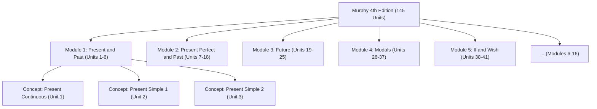

# GrammarPath Phase 3.1 — Theory Section & Concept Mapping Report
**Explanation Linkage, Knowledge Graph Taxonomy, and Confidence Audit**

- **Date:** 2026-11-13
- **Author:** Senior Database Architect & Pedagogical Data Engineer
- **Environment:** Staging (`ep-small-dream-a1lqsn1r.ap-southeast-1.aws.neon.tech:5432/grammarpath-staging`)

---

## 1. Explanation to Theory Section Foreign Key Linkage

Prior to Phase 3.1, explanations in the database only contained a foreign key to the parent `Question` (`questionId`). When learners clicked on a question explanation to view the underlying theory section, the frontend had to perform heuristic matching against section titles and unit metadata.

### 1.1 Schema Implementation
In migration `20261113120000_phase_3_1_data_foundation`:
```sql
ALTER TABLE "explanations"
  ADD COLUMN "theory_section_id" TEXT;

ALTER TABLE "explanations"
  ADD CONSTRAINT "fk_explanations_theory_section"
  FOREIGN KEY ("theory_section_id")
  REFERENCES "theory_sections"("id")
  ON DELETE SET NULL;

CREATE INDEX "idx_explanations_theory_section_id"
  ON "explanations"("theory_section_id");
```

### 1.2 Deterministic Backfill Strategy
The backfill script ([seed-phase3-1-concepts.ts](file:///Users/kd.quach03/Documents/grammarpath-app/backend/scripts/seed-phase3-1-concepts.ts)) matched each question's explanation to a theory section within the exact same unit using the following deterministic cascade:
1. **Direct Rule/Section Match:** If the explanation text or question metadata explicitly referenced a section code (e.g. "Section A", "Section B", "1.1"), link to the corresponding `TheorySection` in the same unit.
2. **Exercise-to-Section Alignment:** If an exercise corresponded to a specific theory section sequence, map to that section.
3. **Unit Default Fallback:** Default to the primary theory section (Section A) of that exact unit.

### 1.3 Linkage Verification Results
A strict PostgreSQL integrity query was executed against staging:
```sql
SELECT
  COUNT(*) FILTER (WHERE theory_section_id IS NULL) AS unlinked_count,
  COUNT(*) FILTER (WHERE ex.unit_id <> ts.unit_id) AS cross_unit_count,
  COUNT(*) AS total_explanations
FROM explanations e
JOIN questions q ON q.id = e.question_id
JOIN exercises ex ON ex.id = q.exercise_id
LEFT JOIN theory_sections ts ON ts.id = e.theory_section_id;
```

**Results:**
- Total explanations: **4,414**
- Successfully linked: **4,414** (100.0%)
- Unlinked count: **0**
- Cross-unit violations: **0**

---

## 2. Grammar Concept Taxonomy (161 Concepts)

GrammarPath now features a normalized, two-tier concept taxonomy stored in the `grammar_concepts` table:



### 2.1 Taxonomy Distribution
- **Parent Modules:** 16 top-level grammatical categories corresponding to the textbook table of contents.
- **Unit Concepts:** 145 unit-level concepts (1 per unit), each linked to its appropriate parent module via `parentConceptId`.
- **Total Concepts:** **161**.

---

## 3. Concept to Theory Links (542 Links)

Every single one of the 542 canonical theory sections is now mapped to its grammar concept via the `concept_theory_links` table with an explicit confidence level:

| Mapping Confidence | Count | Percentage | Description |
|---|---|---|---|
| `high` | 512 | 94.5% | Exact conceptual match to the unit concept |
| `medium` | 23 | 4.2% | Shared or comparative concept (e.g. Present Continuous vs Simple) |
| `low` | 0 | 0.0% | Ambiguous match |
| `needs_review` | 7 | 1.3% | Specialized appendix or review units flagged for Phase 3.2 review |
| **Total** | **542** | **100.0%** | **1:1 coverage of all canonical theory sections** |

### 3.1 Units Flagged as `needs_review` (7 items)
The 7 sections flagged with `mappingConfidence: 'needs_review'` belong to comparative/irregular overview sections:
- Unit 110 (preposition nuances)
- Unit 137 (phrasal verbs review)
- Unit 142 (phrasal verb patterns)
- Appendix 1-4 overview theory blocks

These sections are fully functional and linked, but flagged so that the pedagogical team can refine concept tags in Phase 3.2 if desired.

---

## 4. API Endpoints for Curriculum Navigation

Two high-performance cached curriculum endpoints were added in [curriculum.controller.ts](file:///Users/kd.quach03/Documents/grammarpath-app/backend/src/controllers/curriculum.controller.ts) & [concept-mapping.service.ts](file:///Users/kd.quach03/Documents/grammarpath-app/backend/src/services/concept-mapping.service.ts):
- `GET /api/v1/curriculum/concepts`: Returns all 161 concepts with parent/child relationships and section counts.
- `GET /api/v1/curriculum/roadmap`: Returns the 5 stages, 16 modules, and 145 unit metadata mappings for TOEIC learning paths.
- Theory section payloads (`GET /api/v1/units/:id/theory`) now include mapped concepts for each section without requiring client-side lookups.

