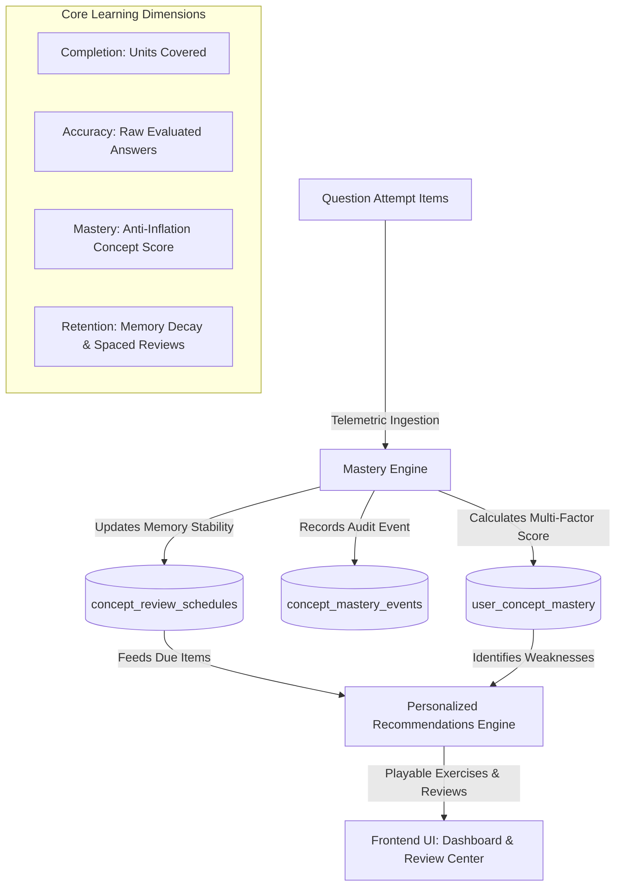
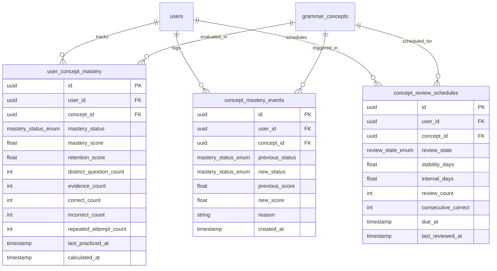

# GrammarPath Phase 3.2 — Architecture & System Design Report
**Learning Mastery Engine, Spaced Repetition Review System, and Personalized Recommendations**

- **Date:** 2026-11-13
- **Author:** Senior Software Architect & Learning Analytics Engineer
- **Workspace:** `grammarpath-app` & `grammarpath-data`
- **Database:** PostgreSQL on Neon Serverless (`grammarpath-staging`)
- **Prisma Version:** 6.19.3

---

## 1. Executive Summary & Four Learning Dimensions

GrammarPath Phase 3.2 expands the core platform from static tracking (exercises attempted and accuracy percentage) into an intelligent, evidence-based learning system. The system clearly decouples four fundamental learning dimensions:

| Dimension | Definition | Mathematical Grounding | Storage Location |
|---|---|---|---|
| **Completion** | Breadth of syllabus covered | $\frac{\text{Completed Units}}{145} \times 100\%$ | `user_unit_progress`, `exercise_attempts` |
| **Accuracy** | Raw ratio of correct evaluated answers | $\frac{\text{Correct Evaluated Answers}}{\text{Total Evaluated Answers}} \times 100\%$ | `question_attempt_items` |
| **Mastery** | Depth of conceptual understanding | Multi-evidence weighted score discounting repeats | `user_concept_mastery` |
| **Retention** | Estimated memory strength over time | Ebbinghaus decay curve $R(t) = e^{-t / S}$ | `concept_review_schedules` |

---

## 2. Component Architecture & Data Flows

### 2.1 Mastery Engine Service ([`mastery.service.ts`](file:///Users/kd.quach03/Documents/grammarpath-app/backend/src/services/mastery.service.ts))
- **Role:** Pure calculation and persistence layer for learner concept competency.
- **Model Version:** Deterministic algorithm `v1.0`.
- **Inputs:** Historical `question_attempt_items` mapped via `Explanation -> TheorySection -> ConceptTheoryLink`.
- **Diminishing Weights (Anti-Inflation):** Applies discount factor $d(k) = \max(0.1, 0.5^k)$ to repeated attempts on the same question, preventing artificial mastery inflation from rote answer memorization.
- **Recency Decay:** Evaluates time decay factor $e^{-0.02 \times \Delta t_{\text{days}}}$ (half-life ~35 days).
- **Mapping Confidence Discount:** Scales weights by concept-theory mapping confidence ($1.0$ for `high`, $0.75$ for `medium`, $0.0$ for `needs_review`).

### 2.2 Review Service ([`review.service.ts`](file:///Users/kd.quach03/Documents/grammarpath-app/backend/src/services/review.service.ts))
- **Role:** Manages Spaced Repetition Schedules according to two-component memory dynamics (Retrieval Strength $R$ and Memory Stability $S$).
- **Schedules:** Automates transition between review states: `new` $\to$ `scheduled` $\to$ `due` $\to$ `completed`.
- **Drill Delivery:** Ingests and renders 3-5 real practice questions directly from canonical Murphy units linked to the due concept, strictly omitting answer keys or pre-submission spoilers.

### 2.3 Personalized Recommendations Service ([`recommendations.service.ts`](file:///Users/kd.quach03/Documents/grammarpath-app/backend/src/services/recommendations.service.ts))
- **Deterministic Priority Ranking:**
  1. **Due Spaced Repetition Reviews (Priority 100):** Concepts whose retention has decayed below 60% or whose schedule is due.
  2. **Active Grammar Weaknesses (Priority 80):** Concepts in `developing` status with low accuracy or unresolved mistakes.
  3. **Evidence Building (Priority 60):** Concepts in `insufficient_data` or `practicing` needing 1-2 more distinct questions to confirm mastery.
  4. **Curriculum Progression (Priority 40):** Next chronological Murphy unit recommended for continuous syllabus coverage.
- **Canonical Action Targets:** Guarantees all generated recommendations target real, playable Murphy exercises in `grammarpath-data`.

---

## 3. Database Schema Extensions

Applied via migration [`20261113180000_phase_3_2_mastery_and_reviews/migration.sql`](file:///Users/kd.quach03/Documents/grammarpath-app/backend/prisma/migrations/20261113180000_phase_3_2_mastery_and_reviews/migration.sql):

---

## 4. Frontend Experience Architecture

1. **Dashboard Enhancements ([`DashboardPage.tsx`](file:///Users/kd.quach03/Documents/grammarpath-app/frontend/src/pages/DashboardPage.tsx)):**
   - High-visibility Personalized Learning Recommendation banner with clear pedagogical rationale in Vietnamese.
   - Quick navigation pills displaying Mastered concept count and Due reviews count.
2. **Grammar Mastery View ([`MasteryPage.tsx`](file:///Users/kd.quach03/Documents/grammarpath-app/frontend/src/pages/MasteryPage.tsx)):**
   - Metric grid summarizing counts across all 7 mastery states.
   - Category filtering, real-time search, and status chips.
   - Transparent Explainability Modal revealing exact evidence numbers, repeated attempt discounts, and status transition history.
3. **Review Center ([`ReviewCenterPage.tsx`](file:///Users/kd.quach03/Documents/grammarpath-app/frontend/src/pages/ReviewCenterPage.tsx)):**
   - Immediate review queue for due concepts.
   - Interactive practice drill with inline question answering and instant feedback on memory stability expansion.
   - Timeline of upcoming review sessions.

---

## 5. Architectural Invariants Preserved
- **Immutability of Canonical Curriculum:** Canonical files in `grammarpath-data` remain untouched.
- **Fail-Closed Safety:** Unauthenticated guests are gated with non-blocking callouts; missing answers never fabricate 100% or 0% accuracy.
- **Zero Schema Drift:** Synchronized between Prisma schema, migration SQL, and PostgreSQL staging instance.

