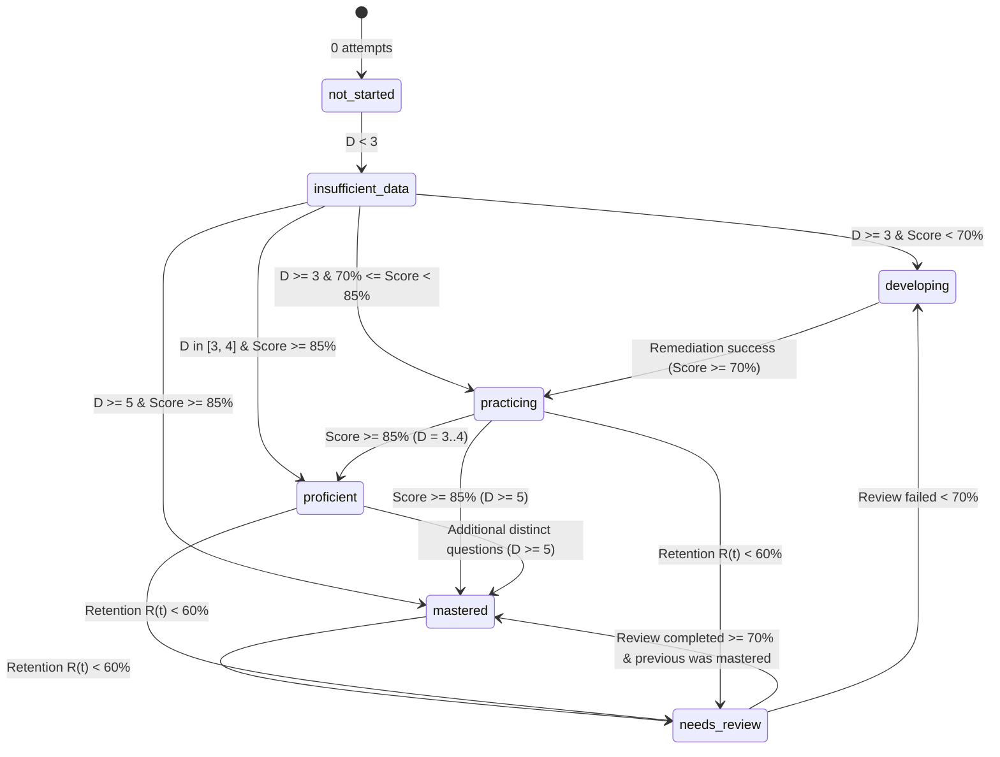

# GrammarPath Phase 3.2 — Mastery Model & Mathematical Specification
**Deterministic Scoring Algorithm, Diminishing Returns, and Threshold Classification**

- **Date:** 2026-11-13
- **Author:** Lead Learning Analytics Engineer & Algorithm Architect
- **Algorithm Version:** `v1.0-deterministic`
- **Reference Implementation:** [`mastery.service.ts`](file:///Users/kd.quach03/Documents/grammarpath-app/backend/src/services/mastery.service.ts)

---

## 1. Problem Formulation & Anti-Inflation Objectives

Traditional LMS platforms calculate mastery simply by dividing correct answers by total attempts:
$$\text{Naive Mastery} = \frac{\sum \text{Correct Attempts}}{\text{Total Attempts}}$$

This naive approach suffers from two fatal flaws:
1. **Rote Memorization / Cramming:** A learner who fails an exercise, reads the answer key, and immediately retries the same 5 questions 10 times will achieve 50 correct answers out of 55 attempts ($90.9\%$), erroneously showing "mastery".
2. **False Confidence from Insufficient Data:** A learner who answers 1 question correctly on a topic has 100% naive accuracy, but cannot pedagogicaly be considered "mastered".

The GrammarPath Mastery Model `v1.0` eliminates these flaws through four core mechanisms:
1. **Strict Distinct Question Minimums:** Mastery cannot be granted without encountering at least 5 distinct questions.
2. **Diminishing Weights for Repeated Questions ($d(k)$):** Each subsequent attempt on the same question yields exponentially decaying weight.
3. **Same-Day Rapid Retrying Penalty:** Immediate retries within 24 hours are penalized by an additional $0.5\times$ multiplier to prevent short-term visual recall exploits.
4. **Time-Based Recency Decay:** Past performance gracefully decays unless reinforced.

---

## 2. Mathematical Specification

### 2.1 Attempt Weighting Function
For a question $q$, let $k \in \{0, 1, 2, \dots\}$ be the index of repeated attempts on that specific question ($k = 0$ for first encounter, $k = 1$ for first retry).

The base repeat discount factor is:
$$d(k) = \max\left(0.10, \; 0.50^k\right)$$

| Attempt $k$ | Interpretation | Discount Factor $d(k)$ |
|---|---|---|
| $k = 0$ | First encounter | $1.00$ ($100\%$ weight) |
| $k = 1$ | 1st retry | $0.50$ ($50\%$ weight) |
| $k = 2$ | 2nd retry | $0.25$ ($25\%$ weight) |
| $k = 3$ | 3rd retry | $0.125$ ($12.5\%$ weight) |
| $k \ge 4$ | 4th+ retry | $0.10$ ($10\%$ floor weight) |

### 2.2 Same-Day Rapid Cramming Penalty
If an attempt occurs within 24 hours of the previous attempt on the same question, an additional cramming discount $c = 0.50$ is applied:
$$w_{\text{attempt}} = d(k) \times (\text{isSameDay} \mathbin{?} 0.50 : 1.00)$$

### 2.3 Recency Decay
Performance value decays smoothly with elapsed time $\Delta t$ (in days):
$$\lambda_{\text{recency}} = e^{-0.02 \times \Delta t_{\text{days}}}$$
*(Half-life $\approx \frac{\ln(2)}{0.02} \approx 34.66\text{ days}$)*.

### 2.4 Concept-Theory Link Confidence
Attempts are tied to concepts via syllabus mapping links. Each link carries a mapping confidence factor $C_{\text{mapping}}$:
- `high`: $1.00$
- `medium`: $0.75$
- `low`: $0.50$
- `needs_review`: $0.00$ (quarantined, no contribution to score)

### 2.5 Aggregate Mastery Score Formula
Let $N$ be the total number of evaluated attempts for concept $c$. For each attempt $i$:
- $v_i \in \{0, 1\}$ (0 for incorrect, 1 for correct)
- $W_i = w_{\text{attempt}, i} \times \lambda_{\text{recency}, i} \times C_{\text{mapping}, i}$

The raw weighted score is:
$$S_{\text{raw}} = \frac{\sum_{i=1}^{N} v_i \cdot W_i}{\sum_{i=1}^{N} W_i} \times 100\%$$

---

## 3. Threshold Classification & State Machine

Let $D$ be the count of distinct questions answered, and $R(t)$ be the estimated memory retention score.

### Threshold Matrix:

| Status Enum | Distinct Questions ($D$) | Score Threshold | Retention Condition | Pedagogical Meaning |
|---|---|---|---|---|
| `not_started` | 0 | `null` | N/A | Learner has not encountered this grammar concept. |
| `insufficient_data` | $1 \le D < 3$ | Evaluated | N/A | Insufficient question variety to establish competency. |
| `developing` | $D \ge 3$ | $< 70.0\%$ | N/A | High error rate; student needs theory review and mistake remediation. |
| `practicing` | $D \ge 3$ | $70.0\% \le S < 85.0\%$ | $R(t) \ge 0.60$ | Solid understanding, but needs further consolidation. |
| `proficient` | $D \in \{3, 4\}$ | $\ge 85.0\%$ | $R(t) \ge 0.60$ | High accuracy on limited questions; needs $\ge 5$ distinct questions to prove mastery. |
| `mastered` | $D \ge 5$ | $\ge 85.0\%$ | $R(t) \ge 0.60$ | Robust conceptual mastery proven across extensive distinct questions. |
| `needs_review` | $D \ge 3$ | Any | $R(t) < 0.60$ | Memory decay or review lapse detected; requires quick review drill. |

---

## 4. Transparent Explainability Architecture

To build trust, the engine never presents opaque "black-box" scores. The API endpoint `GET /api/v1/mastery/concepts/:conceptId` provides:
1. `distinctQuestionCount`: Exact count of unique questions evaluated.
2. `correctCount` vs `incorrectCount`: Raw split.
3. `repeatedAttemptCount`: Number of discounted retries.
4. `stabilityDays`: Current memory stability in days.
5. `explanationVi`: Natural language rationale detailing why the status was assigned.
6. `recommendedActionVi`: Concrete next step for the learner.
7. `historyEvents`: Chronological audit trail showing past status and score changes with trigger reasons (`exercise_submission`, `review_completed`, etc.).

