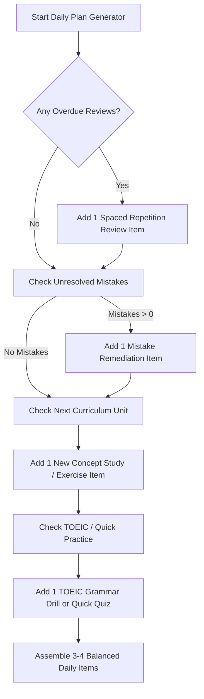

# Phase 3.3 — Daily Learning Plan & Routine Engine Report

## 1. Objectives & Behavioral Goals

A major reason language learners drop off is lack of structure and decision fatigue: opening an app with 145 units without knowing what to do today causes abandonment.

Phase 3.3 introduced the **Daily Learning Plan & Routine Engine**, which:
1. Synthesizes the learner's preferences, overdue spaced-repetition reviews, unresolved mistakes, and curriculum progress into a bite-sized 3-to-4 item daily checklist.
2. Automatically generates or retrieves a date-stamped plan (`YYYY-MM-DD`) on the learner's first session each day.
3. Allows interactive checklist toggling (`not_started` <-> `completed`).
4. Updates dynamically as the learner completes textbook exercises or review drills.
5. Surfaces directly on the primary Learning Dashboard (`/dashboard`) via a dedicated widget (`DailyPlanWidget.tsx`).

---

## 2. Daily Plan Composition & Balancing Algorithm

The plan generation algorithm in `backend/src/services/daily-plan.service.ts` enforces pedagogical balance based on the learner's daily target time (e.g., 15 minutes):



### 2.1 Item Selection Priorities
1. **Urgent Spaced Repetition (Retention Decay):** Concepts whose retention has decayed below 0.60 are prioritized to prevent catastrophic forgetting. (Type: `review`, estimated 5 mins).
2. **Mistake Remediation (Error Elimination):** Up to 1 item focusing on recent incorrect attempts in Murphy exercises. (Type: `mistake_practice`, estimated 4 mins).
3. **Core Curriculum Progress (New Material):** The next sequential Murphy unit or unmastered concept. (Type: `new_theory` or `practice`, estimated 6 mins).
4. **Application / Challenge (TOEIC Foundation):** For learners with `toeic_foundation` or general goals, a targeted 3-question TOEIC Part 5 grammar practice session. (Type: `toeic_practice`, estimated 3 mins).

Total estimated time is budgeted to match the learner's `dailyGoalMinutes` (default: 15 minutes).

---

## 3. Database Schema & State Transitions

The plan engine is backed by `DailyLearningPlan` and `DailyLearningPlanItem`:

```prisma
model DailyLearningPlan {
  id               String                @id @default(uuid())
  userId           String
  user             User                  @relation(fields: [userId], references: [id], onDelete: Cascade)
  planDate         DateTime              @db.Date
  targetMinutes    Int                   @default(15)
  completedMinutes Int                   @default(0)
  isCompleted      Boolean               @default(false)
  createdAt        DateTime              @default(now())
  updatedAt        DateTime              @updatedAt
  items            DailyLearningPlanItem[]

  @@unique([userId, planDate])
  @@index([userId, planDate])
}

model DailyLearningPlanItem {
  id           String            @id @default(uuid())
  planId       String
  plan         DailyLearningPlan @relation(fields: [planId], references: [id], onDelete: Cascade)
  itemType     String            // 'new_theory' | 'practice' | 'review' | 'mistake_practice' | 'toeic_practice'
  title        String
  description  String?
  targetType   String?           // 'unit' | 'concept' | 'review' | 'toeic'
  targetId     String?
  estimatedMin Int               @default(5)
  displayOrder Int               @default(0)
  status       String            @default("not_started") // 'not_started' | 'in_progress' | 'completed' | 'skipped'
  completedAt  DateTime?

  @@index([planId, displayOrder])
}
```

### 3.2 State Lifecycle & Idempotency
- Plan dates are stored using PostgreSQL `@db.Date`, guaranteeing a strict `[userId, planDate]` unique constraint.
- Repeated calls to `GET /api/v1/daily-plan` on the same calendar day return the existing plan without duplicating records.
- Learner can toggle status via `PATCH /api/v1/daily-plan/items/:itemId` with `{ status: "completed" }` or `{ status: "not_started" }`.
- When all items reach `completed`, the parent `DailyLearningPlan.isCompleted` flag is automatically updated to `true`.

---

## 4. Dashboard UI Integration

The `DailyPlanWidget` (`frontend/src/components/daily/DailyPlanWidget.tsx`) provides:
- **Daily Progress Bar:** Visual completion indicator (e.g. `2/3 Hoàn thành (67%)`).
- **Interactive Checkbox:** Allows one-click completion toggling with instant optimistic UI feedback.
- **Action Deep-Links:** Each plan item provides a direct link to the corresponding activity:
  - Unit practice -> `/study-session?unit=X`
  - Review -> `/reviews`
  - Mistake retry -> `/mistakes`
  - TOEIC practice -> `/roadmap`
- **Celebratory State:** When all tasks are completed, the widget renders a completion badge congratulating the learner on fulfilling today's routine.

---

## 5. Verification & Evidence

- **Unit Tests:** `backend/tests/phase3-3-unit.test.ts` tested plan creation, priority sorting, status updates, and daily idempotency.
- **Staging Database Integration:** `backend/tests/phase3-3-staging.api.test.ts` verified that items persist correctly in Neon staging and enforce unique daily constraints per user.
- **Frontend Component Tests:** `frontend/tests/phase3-3-experience.test.tsx` confirmed rendering of the daily plan checklist, item toggle actions, and percentage bar calculations.
- **Playwright Live Verification:** Journey 4 executed in live Chromium (`05-daily-plan-dashboard.png`), confirming checklist rendering on `/dashboard` and live toggling of plan items.

