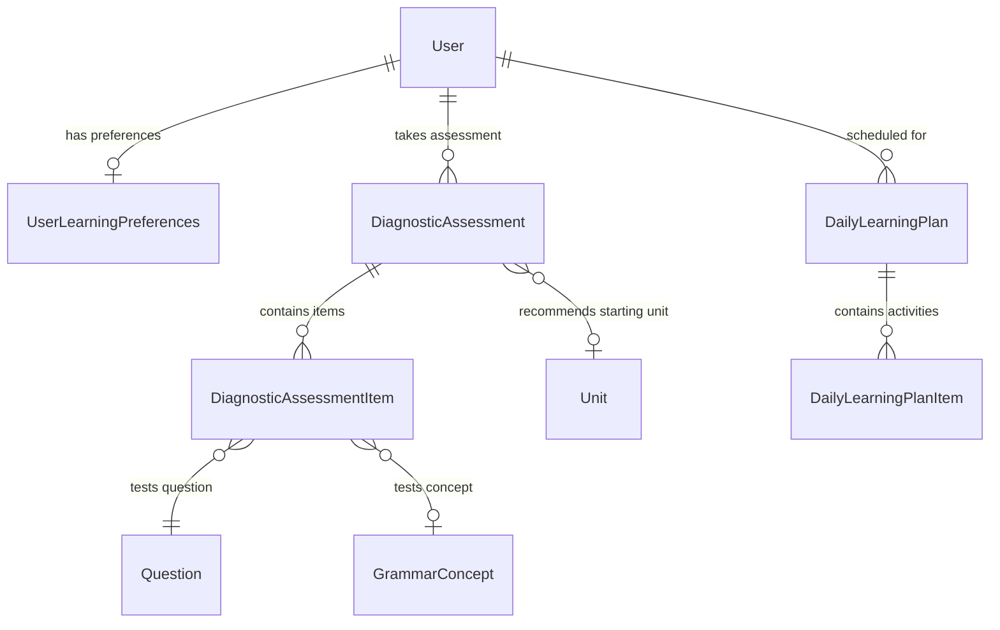

# GrammarPath Phase 3.3 — Database & API Design Specification

**Document Version:** 1.0.0  
**Date:** 2026-11-13  
**Author:** Senior Backend Architect & Database Engineer  
**Status:** APPROVED FOR IMPLEMENTATION  

---

## 1. Database Schema Additions (Prisma ORM)

To support Onboarding, Diagnostic Assessment, and Daily Learning Plans without introducing duplicate progress systems, 5 targeted models are added to `schema.prisma`.

### 1.1 Entity Relationship Diagram

### 1.2 Model Definitions

#### 1. `UserLearningPreferences`
Stores learner onboarding preferences and goals (1-to-1 with `User`):
- `id`: UUID (Primary Key)
- `userId`: UUID (Unique, FK to `User.id` with `onDelete: Cascade`)
- `grammarConfidence`: VarChar(30) (`beginner`, `elementary`, `intermediate`, `advanced`)
- `learningObjective`: VarChar(50) (`foundation`, `toeic_prep`, `speaking_writing`, `review`)
- `dailyStudyMinutes`: Integer (default: 20 minutes)
- `preferredDays`: Json (array of day codes, e.g. `["mon","tue","wed","thu","fri"]`)
- `targetToeicScore`: Integer (optional, e.g. 600, 750, 800)
- `targetDate`: Timestamptz (optional goal completion date)
- `onboardingCompleted`: Boolean (default: `false`)
- Timestamps: `createdAt`, `updatedAt`

#### 2. `DiagnosticAssessment`
Records diagnostic assessment sessions:
- `id`: UUID (Primary Key)
- `userId`: UUID (FK to `User.id` with `onDelete: Cascade`)
- `startedAt`: Timestamptz
- `completedAt`: Timestamptz (nullable)
- `status`: VarChar(30) (`in_progress`, `completed`, `abandoned`)
- `totalQuestions`: Integer (default: 0)
- `correctCount`: Integer (default: 0)
- `scorePercentage`: Float (nullable until submitted)
- `estimatedLevel`: VarChar(50) (`foundation`, `developing`, `intermediate`, `advanced`)
- `recommendedUnitId`: UUID (nullable, FK to `Unit.id` with `onDelete: SetNull`)
- `summaryNotes`: Text (nullable)
- Timestamps: `createdAt`, `updatedAt`

#### 3. `DiagnosticAssessmentItem`
Questions tested during diagnostic assessment:
- `id`: UUID (Primary Key)
- `assessmentId`: UUID (FK to `DiagnosticAssessment.id` with `onDelete: Cascade`)
- `questionId`: UUID (FK to `Question.id` with `onDelete: Cascade`)
- `conceptId`: UUID (nullable, FK to `GrammarConcept.id` with `onDelete: SetNull`)
- `studentAnswer`: Json (nullable)
- `isCorrect`: Boolean (nullable)
- `displayOrder`: Integer (default: 0)
- Constraint: `@@unique([assessmentId, questionId])` prevents duplicate questions in a single assessment.

#### 4. `DailyLearningPlan`
Represents a personalized daily learning plan for a specific calendar date:
- `id`: UUID (Primary Key)
- `userId`: UUID (FK to `User.id` with `onDelete: Cascade`)
- `planDate`: VarChar(10) (ISO date string `YYYY-MM-DD`)
- `status`: VarChar(30) (`not_started`, `in_progress`, `completed`, `partially_completed`, `deferred`)
- `targetMinutes`: Integer (budgeted study time, default: 20)
- `completedMinutes`: Integer (default: 0)
- `summaryVi`: Text (localized plan summary)
- Constraint: `@@unique([userId, planDate])` guarantees idempotency per user per calendar day.

#### 5. `DailyLearningPlanItem`
Specific learning activities within the daily plan:
- `id`: UUID (Primary Key)
- `planId`: UUID (FK to `DailyLearningPlan.id` with `onDelete: Cascade`)
- `activityType`: VarChar(50) (`spaced_review`, `theory_reading`, `exercise_practice`, `mistake_review`, `toeic_practice`)
- `status`: VarChar(30) (`not_started`, `in_progress`, `completed`, `deferred`)
- `title`: VarChar(255)
- `description`: Text (optional)
- `estimatedMinutes`: Integer (conservative estimate)
- `targetId`: VarChar(100) (target entity ID: exerciseId, unitId, or conceptId)
- `targetNumber`: VarChar(50) (human-readable reference, e.g. "1.1" or "Unit 1")
- `metadata`: Json (optional context data)
- `displayOrder`: Integer (default: 0)
- `completedAt`: Timestamptz (nullable)

---

## 2. REST API Endpoints Specification

### 2.1 Onboarding & Preferences (`/api/v1/onboarding` & `/api/v1/preferences`)

- `GET /api/v1/onboarding/preferences`
  - Returns current user preferences or default skeleton if not yet set.
- `PUT /api/v1/onboarding/preferences`
  - Updates learning preferences and sets `onboardingCompleted: true`.
  - Body: `{ grammarConfidence, learningObjective, dailyStudyMinutes, preferredDays, targetToeicScore, targetDate }`

### 2.2 Diagnostic Assessment (`/api/v1/assessment`)

- `POST /api/v1/assessment/start`
  - Generates or resumes a diagnostic assessment session.
  - Samples 6–8 questions across representative foundation/developing units (e.g. Unit 1 Present Continuous, Unit 2 Present Simple, Unit 7 Past Simple, Unit 19 Present Perfect, Unit 25 Future).
  - Sanitizes answers and explanations (`answerKey: undefined`).
- `POST /api/v1/assessment/:id/submit`
  - Submits answers for server-side evaluation.
  - Returns score percentage, strengths, concepts requiring practice, and recommended starting unit.
  - Does NOT mark concepts as mastered (explicitly flags insufficient evidence / diagnostic baseline).

### 2.3 Learning Path (`/api/v1/learning-path`)

- `GET /api/v1/learning-path`
  - Returns structured 5-tier progression:
    1. Foundation Grammar (Units 1–25: Tenses & Basics)
    2. Developing Grammar (Units 26–52: Modals & Conditionals)
    3. Intermediate Grammar (Units 53–91: Passive, Reported Speech, Relatives)
    4. Advanced Grammar (Units 92–145: Prepositions, Conjunctions, Phrasal Verbs)
    5. TOEIC Grammar Readiness (Curated units mapped to Part 5 & 6)
  - Enriched with concept mastery status, retention rates, evidence counts, and recommended next action.

### 2.4 Daily Learning Plan (`/api/v1/daily-plan`)

- `GET /api/v1/daily-plan`
  - Fetches or idempotently generates the plan for the user's current calendar day.
  - Respects user's `dailyStudyMinutes` budget.
  - Prioritizes: Due reviews $\to$ Study theory & exercise $\to$ Mistake remediation $\to$ Optional TOEIC drill.
- `POST /api/v1/daily-plan/generate`
  - Forces generation or re-sync for a specific date (`YYYY-MM-DD`).
- `PATCH /api/v1/daily-plan/items/:itemId`
  - Updates activity item status (`in_progress`, `completed`, `deferred`).
  - Automatically updates parent plan status and `completedMinutes`.

### 2.5 Study Session (`/api/v1/study-sessions`)

- `GET /api/v1/study-sessions/init?unit=1&exercise=1.1`
  - Returns unified study bundle: Unit metadata, Theory sections, Illustrative examples, Exercise questions (without answers), Concept links, and Rule references.
- Completion hooks into existing `POST /api/v1/exercises/:id/check` and returns mastery status deltas for transparent feedback.

### 2.6 Learning Engagement & Streaks (`/api/v1/engagement`)

- `GET /api/v1/engagement/summary`
  - Returns current streak, longest streak, weekly qualifying days, and goal completion status based on actual learning events.

