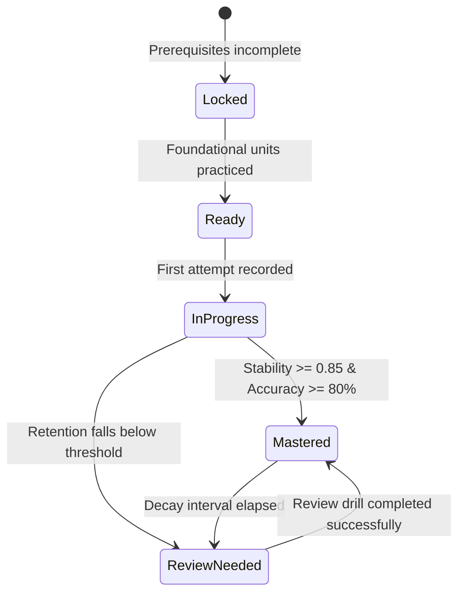

# Phase 3.3 — Personalized Learning Path Report

## 1. Objectives & Overview

The Murphy curriculum (*English Grammar in Use — 4th Edition*) contains 145 discrete units. Without an organizing structural framework, learners experience cognitive overload when navigating this vast catalog.

Phase 3.3 introduced the **Personalized Learning Path** (`/learning-path`), which:
1. Structures the 145 Murphy units into 14 thematic grammar modules (Tenses, Modals, Passives, Conditionals, Reported Speech, Relatives, Prepositions, etc.).
2. Maps Murphy units to underlying `GrammarConcept` nodes (161 canonical concepts).
3. Evaluates real-time learner readiness, completion status, and mastery evidence.
4. Identifies the learner's "Next Recommended Action" dynamically based on Phase 3.2's recommendation engine.
5. Provides visual progress indicators that reflect genuine evidence rather than superficial checkmarks.

---

## 2. Curriculum Architecture & Structural Grouping

The 145 Murphy units are organized into 14 high-level grammar clusters:

| Module # | Module Title (Grammar Cluster) | Murphy Units | Concept Coverage |
|---|---|---|---|
| **Module 1** | Present and Past Tenses | Units 1–18 | Present Continuous, Present Simple, Past Continuous, Past Simple |
| **Module 2** | Present Perfect and Past | Units 19–25 | Present Perfect Simple/Continuous, Past Perfect, Time adverbs |
| **Module 3** | Future Forms | Units 26–37 | `will`, `going to`, Present tenses with future meaning |
| **Module 4** | Modals and Auxiliary Verbs | Units 38–46 | `can`, `could`, `may`, `might`, `must`, `should`, `had better` |
| **Module 5** | Conditionals and "Wish" | Units 47–52 | Zero, First, Second, Third conditionals, `wish` structures |
| **Module 6** | Passive Voice | Units 53–58 | Passive forms across all tenses, `by`, `get` passive |
| **Module 7** | Reported Speech | Units 59–62 | Indirect speech, tense backshifting, question structures |
| **Module 8** | Questions and Auxiliary Verbs | Units 63–68 | Tag questions, question words, short responses |
| **Module 9** | `-ing` and "to..." (Gerunds & Infinitives) | Units 69–81 | Verb + `-ing`, Verb + `to`, adjectives followed by prepositions |
| **Module 10** | Articles and Nouns | Units 82–91 | Countable/uncountable, `a/an`, `the`, generic reference |
| **Module 11** | Pronouns and Determiners | Units 92–97 | Reflexives, possessives, `all`, `every`, `none`, `each` |
| **Module 12** | Relative Clauses | Units 98–101 | Defining vs non-defining relative clauses, relative pronouns |
| **Module 13** | Adjectives and Adverbs | Units 102–120 | Comparative/superlative, order of adjectives, adverb placement |
| **Module 14** | Prepositions and Phrasal Verbs | Units 121–145 | Place/time prepositions, prepositional phrases, phrasal verb syntax |

---

## 3. Dynamic Concept Readiness & Status Progression

Each concept in the learning path is evaluated in real-time according to five operational states:



1. **`locked`:** Dependent concepts whose foundational prerequisites have not yet met minimal exposure.
2. **`ready`:** Unlocked and primed for study based on the learner's current baseline.
3. **`in_progress`:** Actively being studied; attempts exist but mastery thresholds (sample size, accuracy, consistency) are not yet fully met.
4. **`mastered`:** Satisfies Phase 3.2 rigorous criteria:
   - Total questions attempted >= 5
   - Historical accuracy >= 80%
   - Stability metric >= 0.85
5. **`needs_review`:** Spaced repetition retention score has decayed below the review threshold (0.60), triggering an active review requirement.

---

## 4. Visual Layout & Next Action Callout

The frontend page (`frontend/src/pages/LearningPathPage.tsx`) implements:
- **Hero Banner:** Displays the learner's overall path completion percentage, total mastered concepts count, and an active progress bar.
- **Next Best Action Card:** Prominently highlights the immediate next unit or review session recommended by the recommendation engine.
- **Module Accordion / Grid:** Expands each of the 14 grammar clusters, displaying:
  - Concept titles and Murphy unit badges (e.g., `Unit 1`, `Unit 2`).
  - Mastery score meter (0–100%).
  - Readiness badges (`Sẵn sàng học`, `Đang học`, `Đã thành thạo`, `Cần ôn tập`).
  - Direct deep-links to the Unified Study Session (`/study-session?unit=X`).

---

## 5. API Contract & Implementation

The learning path is powered by `GET /api/v1/learning-path`, implemented in `backend/src/services/learning-path.service.ts`:

### Response Payload Structure
```typescript
interface LearningPathOverviewResponse {
  summary: {
    totalConcepts: number;
    masteredConcepts: number;
    inProgressConcepts: number;
    readyConcepts: number;
    overallProgressPercentage: number;
  };
  recommendedNext: {
    type: "new_concept" | "review" | "mistake_remediation";
    conceptId: string;
    conceptName: string;
    unitNumber: number;
    unitTitle: string;
    reason: string;
  } | null;
  modules: Array<{
    moduleId: string;
    moduleNumber: number;
    title: string;
    unitRange: string;
    totalUnits: number;
    completedUnits: number;
    concepts: Array<{
      id: string;
      slug: string;
      name: string;
      status: "locked" | "ready" | "in_progress" | "mastered" | "needs_review";
      masteryScore: number | null;
      retentionScore: number;
      units: Array<{
        unitNumber: number;
        title: string;
        isCompleted: boolean;
      }>;
    }>;
  }>;
}
```

---

## 6. Verification & Evidence

- **Backend Unit Tests:** `backend/tests/phase3-3-unit.test.ts` verified module grouping, prerequisite status logic, and progress calculations.
- **Staging Integration Tests:** `backend/tests/phase3-3-staging.api.test.ts` confirmed that `GET /api/v1/learning-path` returns the complete 14-module curriculum hierarchy against the live Neon database.
- **Frontend Component Tests:** `frontend/tests/phase3-3-experience.test.tsx` confirmed rendering of the 14 modules, progress metrics, and action links.
- **Playwright Live Verification:** Journey 2 executed in live Chromium (`02-learning-path-overview.png`), confirming full-page rendering, module expansion, and unit badge navigation.

