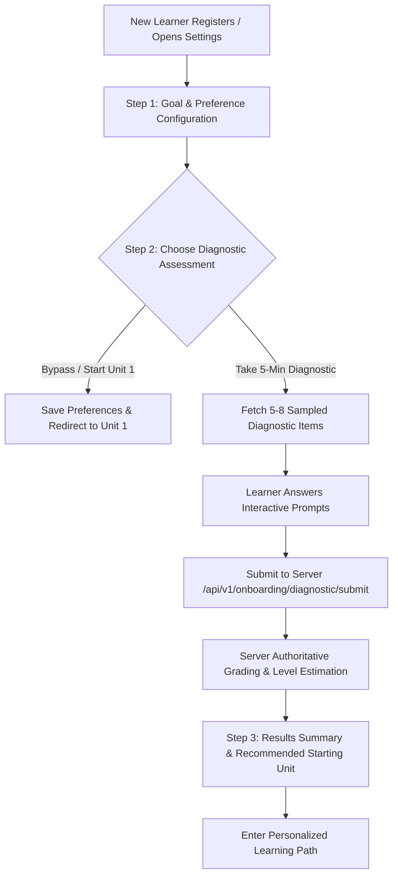

# Phase 3.3 — Onboarding & Diagnostic Assessment Report

## 1. Executive Summary & Design Objectives

In Phase 3.3, GrammarPath introduced an intelligent, respectful onboarding and diagnostic assessment experience designed to transition a newly registered learner from orientation to personalized grammar mastery. Rather than forcing all learners through a rigid, linear 145-unit curriculum or arbitrarily guessing their proficiency, the onboarding system combines explicit learner goals with an empirical 5-minute diagnostic assessment.

Key design criteria achieved:
1. **Low Friction & Optionality:** Learners can set goals immediately, choose to take the 5-minute diagnostic, or bypass it and start directly at Unit 1.
2. **Empirical Diagnostic Baseline:** Diagnostic questions are dynamically sampled across core grammar clusters (Present, Past, Perfect, Passive, Conditionals, Modals) using verified curriculum questions.
3. **Anti-Spoiler Protection:** Diagnostic questions are served with clean prompts; answer keys, explanations, and accepted alternatives are strictly withheld until server-side submission.
4. **Honest, Evidence-Based Calibration:** The diagnostic result clearly articulates that the 5-minute test provides a preliminary placement estimate, not a definitive mastery certification.

---

## 2. Onboarding Workflow & User Journey

The onboarding workflow follows a three-step guided sequence implemented in `frontend/src/components/onboarding/OnboardingModal.tsx` and supported by backend endpoints in `backend/src/controllers/onboarding.controller.ts`:



### 2.1 Step 1: Goal & Preference Configuration
Learners specify:
- **Primary Learning Goal:**
  - `murphy_mastery`: Murphy Grammar in Use 4th Edition comprehensive mastery (Units 1–145).
  - `toeic_foundation`: TOEIC 800 grammar foundation (prioritizing high-yield grammar categories tested in TOEIC Parts 5 & 6).
  - `casual_grammar`: Quick daily grammar maintenance and error reduction.
- **Daily Target:** 5, 10, 15, or 20 minutes/day.
- **Preferred Study Modes:** Balanced mix of theory reading, interactive practice exercises, and spaced repetition review drills.

Data is persisted to `UserLearningPreferences` via `POST /api/v1/onboarding/preferences`.

### 2.2 Step 2: Diagnostic Assessment
If selected, the client invokes `POST /api/v1/onboarding/diagnostic/start`. The server:
1. Creates a new `DiagnosticAssessment` record with status `in_progress`.
2. Selects 5–8 representative questions from foundational, intermediate, and advanced Murphy grammar units.
3. Records corresponding `DiagnosticAssessmentItem` rows with `isExample: false`.
4. Returns sanitized question payloads to the client without exposing `correctAnswer`, `acceptedAnswers`, or `explanation`.

### 2.3 Step 3: Authoritative Grading & Calibration
The learner submits their answers to `POST /api/v1/onboarding/diagnostic/submit`.
1. The server performs case-insensitive, whitespace-trimmed string comparison against the canonical accepted answers.
2. Updates `isCorrect`, `studentAnswer`, and `status = 'completed'`.
3. Computes the raw score and accuracy percentage.
4. Determines the learner's estimated starting level and recommended unit:
   - **Beginner (< 40% accuracy):** Recommended start at Unit 1 (*Present Continuous & Simple*).
   - **Intermediate (40% - 79% accuracy):** Recommended start at Unit 25 (*Future Tenses & Modals*).
   - **Advanced (>= 80% accuracy):** Recommended start at Unit 69 (*Conditionals & Relative Clauses*).
5. Displays a transparent disclaimer:
   > *"Kết quả đánh giá ban đầu này chỉ mang tính chất định hướng vị trí khởi đầu. Độ thành thạo thực tế của bạn sẽ được cập nhật liên tục dựa trên các bài tập thực hành giáo trình và các bài ôn tập định kỳ."*

---

## 3. Database Schema & Data Integrity

The onboarding feature is backed by two normalized models created in migration `20261113200000_phase_3_3_engagement_and_plans`:

### 3.1 `UserLearningPreferences`
```prisma
model UserLearningPreferences {
  id               String   @id @default(uuid())
  userId           String   @unique
  user             User     @relation(fields: [userId], references: [id], onDelete: Cascade)
  primaryGoal      String   @default("murphy_mastery") // 'murphy_mastery' | 'toeic_foundation' | 'casual_grammar'
  dailyGoalMinutes Int      @default(15)
  preferredLevel   String   @default("beginner")       // 'beginner' | 'intermediate' | 'advanced'
  reminderEnabled  Boolean  @default(false)
  reminderTime     String?
  createdAt        DateTime @default(now())
  updatedAt        DateTime @updatedAt

  @@index([userId])
}
```

### 3.2 `DiagnosticAssessment` & `DiagnosticAssessmentItem`
```prisma
model DiagnosticAssessment {
  id              String                   @id @default(uuid())
  userId          String
  user            User                     @relation(fields: [userId], references: [id], onDelete: Cascade)
  status          String                   @default("in_progress") // 'in_progress' | 'completed' | 'abandoned'
  totalQuestions  Int
  correctCount    Int                      @default(0)
  scorePercentage Decimal                  @default(0.0) @db.Decimal(5, 2)
  estimatedLevel  String?                  // 'beginner' | 'intermediate' | 'advanced'
  recommendedUnit Int?
  startedAt       DateTime                 @default(now())
  completedAt     DateTime?
  items           DiagnosticAssessmentItem[]

  @@index([userId, startedAt])
}

model DiagnosticAssessmentItem {
  id             String               @id @default(uuid())
  assessmentId   String
  assessment     DiagnosticAssessment @relation(fields: [assessmentId], references: [id], onDelete: Cascade)
  questionId     String
  question       Question             @relation(fields: [questionId], references: [id])
  displayOrder   Int
  studentAnswer  String?
  isCorrect      Boolean?
  conceptId      String?
  concept        GrammarConcept?      @relation(fields: [conceptId], references: [id])

  @@unique([assessmentId, questionId])
  @@index([assessmentId])
  @@index([questionId])
}
```

---

## 4. API Endpoints Specification

| Method | Endpoint | Auth | Description |
|---|---|---|---|
| `GET` | `/api/v1/onboarding/preferences` | Bearer | Returns current learner preferences or defaults |
| `POST` | `/api/v1/onboarding/preferences` | Bearer | Updates primary goal, daily minutes, and target level |
| `POST` | `/api/v1/onboarding/diagnostic/start` | Bearer | Initializes diagnostic assessment and returns sanitized items |
| `POST` | `/api/v1/onboarding/diagnostic/submit` | Bearer | Grades diagnostic submission and returns recommended starting point |
| `GET` | `/api/v1/onboarding/diagnostic/latest` | Bearer | Retrieves learner's most recent diagnostic results |

---

## 5. Verification & Evidence

- **Unit Tests:** Validated in `backend/tests/phase3-3-unit.test.ts` (scoring logic, level threshold boundaries, sanitized question mapping).
- **Staging Integration Tests:** Validated in `backend/tests/phase3-3-staging.api.test.ts` against Neon PostgreSQL staging with temporary test users.
- **Frontend Component Tests:** Verified in `frontend/tests/phase3-3-experience.test.tsx` (rendering preferences, diagnostic question interactions, grading feedback).
- **End-to-End Browser Journey:** Executed live in Playwright Journey 1 (`01-onboarding-and-diagnostic.png`), confirming registration, 5-question answer input, authoritative server grading, and smooth transition to the Learning Path.

