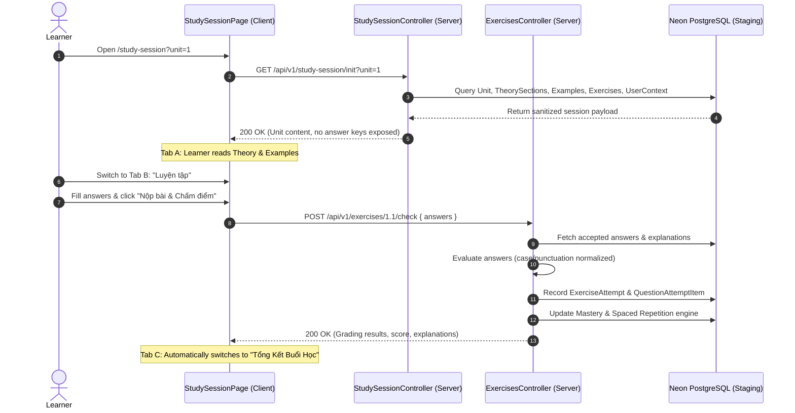

# Phase 3.3 — Unified Study Session Report

## 1. Objectives & Pedagogy

In earlier iterations, grammar theory was isolated in one view (`/theory`) while exercises were located in another (`/exercises`). Learners experienced friction switching between reading textbook rules and solving corresponding practice questions.

Phase 3.3 introduced the **Unified Study Session** (`/study-session?unit=X`), unifying the authentic pedagogical flow of *English Grammar in Use (Raymond Murphy)*:
1. **Tab A (Learn):** Theory reading with canonical section headings, rule explanations, and Murphy textbook illustrative examples paired with Vietnamese contextual translations.
2. **Tab B (Practice):** Direct digital completion of original textbook exercises (supporting fill-in-the-blank, word-bank matching, and multiple-choice items).
3. **Tab C (Evaluate & Understand):** Server-side authoritative grading, score summary, detailed grammar explanations, rule citations, and anti-spoiler protection.

---

## 2. Architecture of the Unified Study Session

---

## 3. Session Features & Implementation Highlights

### 3.1 Tab A: Theory Reading & Murphy Illustrative Examples
- **Canonical Structure:** Renders Murphy theory sections in order (e.g., `1A`, `1B`, `1C`).
- **Bilingual Illustrative Examples:** Displays authentic textbook example sentences accompanied by Vietnamese translations to ensure precise conceptual understanding without ambiguity.
- **Book Page Reference:** Displays authentic Murphy 4th Edition textbook page numbers (e.g., `Trang sách: 14`) for learners studying with physical book copies.

### 3.2 Tab B: Interactive Exercise Completion
- **Adaptive Input Types:**
  - Multiple choice / matching: Interactive option buttons with active selection states (`opt.key`).
  - Fill-in-the-blank: Text input fields with clear placeholders (`Nhập câu trả lời vào đây...`).
  - Word Bank: Pinned word-bank tokens when provided in canonical Murphy exercises.
- **Validation Guard:** Prevents submitting empty exercises with friendly inline prompts (`"Please answer at least one question before checking the exercise."`).

### 3.3 Tab C: Server Authoritative Grading & Anti-Spoiler Protection
- **Authoritative Grading:** The client never has access to the answer keys prior to submission. The server parses submitted answers, compares against canonical accepted answers (including alternative contractions such as `"She's"` vs `"She is"`), and returns the verified result.
- **Explanations & Grammar Rules:** Each question card reveals:
  - Correct answer indicator (`Đúng` / `Chưa chính xác`).
  - Canonical accepted answers.
  - Detailed grammar explanation explaining *why* the rule applies.
  - Murphy rule reference.
- **Unanswered Privacy:** For unanswered questions, expected answers and explanations are strictly suppressed to prevent spoiler exploits.

---

## 4. API Endpoints Specification

| Method | Endpoint | Auth | Purpose |
|---|---|---|---|
| `GET` | `/api/v1/study-session/init?unit=X` | Optional / Bearer | Retrieves full unit theory, examples, exercise list, and learner context |
| `POST` | `/api/v1/exercises/:exerciseId/check` | Optional / Bearer | Evaluates student answers, records telemetry, and triggers mastery updates |

---

## 5. Verification & Evidence

- **Backend Unit Tests:** `backend/tests/phase3-3-unit.test.ts` validated study session bundle compilation, theory section ordering, and exercise question mapping.
- **Staging Database Verification:** `backend/tests/phase3-3-staging.api.test.ts` verified initialization of Unit 1 through Unit 145 on Neon staging.
- **Frontend Component Tests:** `frontend/tests/phase3-3-experience.test.tsx` verified tab switching, question input rendering, and summary view transitions.
- **Playwright Live Verification:**
  - Journey 3 Theory verification: Captured in `03-unified-study-session-theory.png`.
  - Journey 3 Practice & Server Grading: 7 questions answered, submitted, graded with 200 OK, captured in `04-unified-study-session-practice-and-grading.png`.

