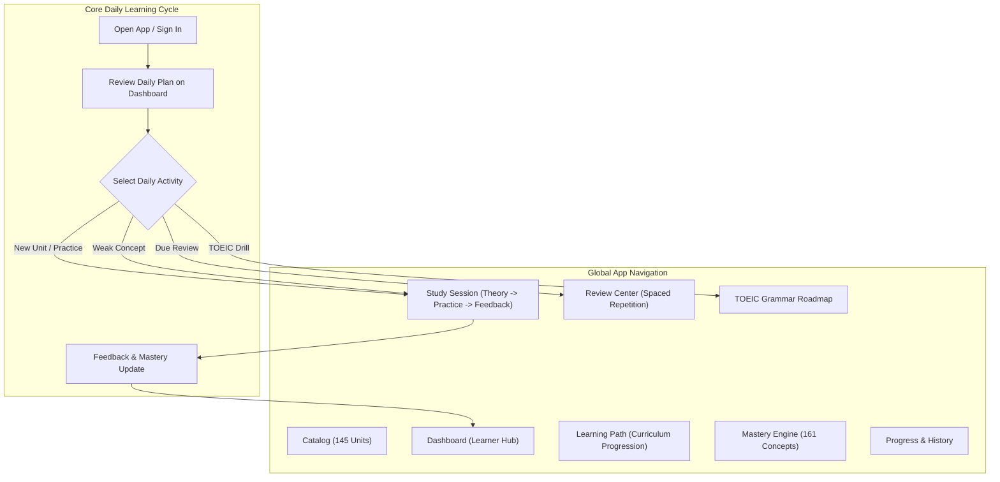
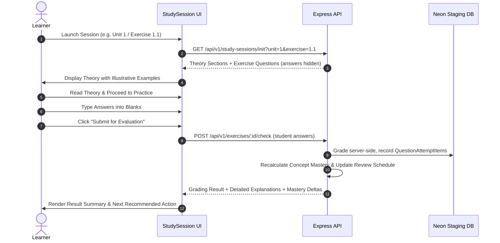

# GrammarPath Phase 3.3 — UX Architecture & Design Specification

**Document Version:** 1.0.0  
**Date:** 2026-11-13  
**Author:** Senior UX Engineer & Product Architect  
**Status:** APPROVED FOR IMPLEMENTATION  

---

## 1. Information Architecture & Navigation

GrammarPath Phase 3.3 unifies the application into an intuitive, learner-centric navigation model designed for both first-time visitors and recurring daily learners.

---

## 2. Page & Route Architecture

| Route | Primary Component | Purpose & Target Learner Need |
|---|---|---|
| `/` | `CatalogPage.tsx` | Comprehensive Murphy 4th Edition textbook index with search, unit quick-jump, and completion markers. |
| `/dashboard` | `DashboardPage.tsx` | Central command center: Daily Plan checklist, quick-resume banner, high-priority next actions, mastery snapshot, and streak counter. |
| `/learning-path` | `LearningPathPage.tsx` | Guided 5-tier progression (Foundation, Developing, Intermediate, Advanced, TOEIC Grammar Readiness) with concept-level statuses and direct launch triggers. |
| `/study-session` | `StudySessionPage.tsx` | The unified study workspace: seamlessly integrates Theory Section reading, interactive exercise solving, instant server-side grading, detailed explanations, and mastery telemetry in one focused interface. |
| `/mastery` | `MasteryPage.tsx` | Comprehensive view of all 161 grammar concepts with 7 mastery status tiers, retention percentages, and explainability modal. |
| `/reviews` | `ReviewCenterPage.tsx` | Spaced repetition review queue with due/fresh counters and interactive 3-5 question micro-drills. |
| `/roadmap` | `ToeicRoadmapPage.tsx` | Modular TOEIC grammar roadmap mapping Murphy units to Part 5 & 6 question types and practice simulations. |
| `/progress` | `ProgressDashboardPage.tsx` | Historical timeline of exercise submissions, accuracy trends, and unit-by-unit completion status. |
| `/mistakes` | `MistakeReviewPage.tsx` | Remedial review queue for unresolved errors from previous exercise attempts. |
| `/onboarding` | `OnboardingModal.tsx` | Multi-step first-time learner onboarding: preferences questionnaire + optional Murphy diagnostic assessment. |

---

## 3. The Unified Study Session Flow

The unified study session is the heart of Phase 3.3. It eliminates cognitive friction by connecting theory and practice in a single uninterrupted workflow:

---

## 4. Mobile Responsiveness Standards (375 × 812 Viewport)

1. **Zero Horizontal Overflow:** All container wrappers enforce `max-w-full overflow-x-hidden`.
2. **Keyboard Adaptability:** Input blanks in exercise cards automatically shift into visible scroll view when focused on mobile soft keyboards.
3. **Pinch/Zoom Stability:** Typography minimums (14px/16px for interactive inputs) prevent involuntary Safari iOS auto-zoom on focus.
4. **Touch Target Sizing:** All buttons, pills, tabs, and navigation links have a minimum touch target size of 44 × 44 pt.
5. **Drawer Navigation:** Sidebar collapses cleanly into a responsive hamburger slide-over drawer on screens `< 768px`.

---

## 5. Design Tokens & Component Consistency

- **Primary Brand:** Indigo / Blue (`bg-brand-600`, `text-brand-600`, `hover:bg-brand-700`).
- **Success:** Emerald / Green (`bg-emerald-500`, `text-emerald-700`, `border-emerald-200`).
- **Warning / Review Needed:** Amber / Orange (`bg-amber-500`, `text-amber-800`, `border-amber-200`).
- **Error / Unresolved:** Rose / Red (`bg-rose-500`, `text-rose-700`, `border-rose-200`).
- **Surface Elevation:** Clean white cards with `border border-slate-200/80` and subtle Tailwind `shadow-2xs` or `shadow-xs`.
- **Typography:** Inter / System UI, bold metric typography with clear uppercase section eyebrow headers (`text-[10px] uppercase font-bold tracking-wider text-slate-400`).

