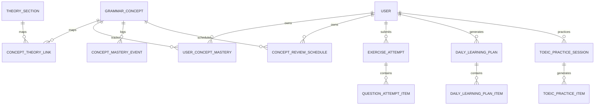

# Phase 3.4 — Data Architecture, Schema & Analytics Audit

**Status:** DESIGN ONLY (Audit & Architecture Stage)  
**Author:** Principal Database Architect, Educational Data Scientist  
**Date:** 2026-11-13  
**Target Modules:** `backend/prisma/schema.prisma`, `backend/src/services/mastery.service.ts`, `backend/src/services/toeic-generator.service.ts`

---

## 1. Executive Summary

This report evaluates GrammarPath's data architecture, schema integrity, telemetry pipelines, and entity relationships across its 42 PostgreSQL tables on Neon.

Key findings include:
1. **Schema Health is High (`[VERIFIED FACT]`):** All 42 tables, 12 enums, 53 foreign keys, 22 CHECK constraints, and 80 indexes are valid, with 0 migration drift and 0 orphaned records in staging.
2. **Missing Prerequisite Graph Entity (`[RISK: MEDIUM]`):** The schema lacks a `ConceptDependency` entity. Concept relationships rely exclusively on a nullable `parentConceptId`, which cannot represent a many-to-many Directed Acyclic Graph (DAG) for pedagogical dependencies.
3. **Missing Persistent TOEIC Question Bank (`[RISK: HIGH]`):** TOEIC practice questions are dynamically generated on the fly and duplicated in ephemeral `toeic_practice_items` rows. The system lacks a curated, persistent `ToeicQuestionBankItem` model, causing generation latency, cost, and inconsistent item quality.
4. **Mastery Versioning Foundation Exists (`[VERIFIED FACT]`):** `UserConceptMastery` includes a `model_version` column currently pinned to `"v1.0"`, providing a clean mechanism for algorithmic updates without data loss.

---

## 2. Quantitative Database Architecture Overview



### 2.1 Entity Relationship Integrity Matrix
- **Curriculum Layer (145 Units):** `Book` $\rightarrow$ `Unit` $\rightarrow$ `TheorySection` $\rightarrow$ `TextbookExample`; `Unit` $\rightarrow$ `Exercise` $\rightarrow$ `Question` $\rightarrow$ `QuestionBlank`/`QuestionOption` $\rightarrow$ `AnswerKey` $\rightarrow$ `Explanation`. Normalized to 3NF.
- **Pedagogical Mapping Layer:** `GrammarConcept` (161 records), `ConceptTheoryLink` (542 primary mappings, 0 unmapped sections), `UnitToeicMetadata` (145 units mapped to stages and parts).
- **Telemetry & Attempt Layer:** `ExerciseAttempt`, `QuestionAttemptItem` (enforces `attempt_status` CHECK constraints), `DiagnosticAssessment`, `DailyLearningPlan`.
- **Mastery & Retention Layer:** `UserConceptMastery`, `ConceptMasteryEvent` (audit trail), `ConceptReviewSchedule`.

---

## 3. Telemetry Retention & Audit Trail Analysis

### 3.1 Event Immutability in `ConceptMasteryEvent`
In [`backend/prisma/schema.prisma#L793-L810`](file:///Users/kd.quach03/Documents/grammarpath-app/backend/prisma/schema.prisma#L793-L810):
- `[VERIFIED FACT]` `ConceptMasteryEvent` is strictly append-only.
- Records exact timestamp, previous status/score, new status/score, and trigger reason (e.g. `"exercise_submission"`, `"spaced_review"`, `"adaptive_quiz"`).
- Enables precise longitudinal learning curve reconstruction and BKT parameter calibration.

### 3.2 Granularity of `QuestionAttemptItem`
In [`backend/prisma/schema.prisma#L581-L604`](file:///Users/kd.quach03/Documents/grammarpath-app/backend/prisma/schema.prisma#L581-L604):
- `[VERIFIED FACT]` Stores learner input (`studentAnswer`), grading status (`isCorrect`), attempt duration (`latencyMs`), and `attemptStatus` (`correct`, `incorrect`, `unanswered`).
- `[VERIFIED FACT]` Cascade deletion links to `User` and `ExerciseAttempt`, preventing orphaned attempt records upon user cleanup.

---

## 4. Architectural Gaps & Missing Entities

### 4.1 Missing Entity: `ConceptDependency` (Prerequisite DAG)
- `[OBSERVED IMPLEMENTATION]` `GrammarConcept.parentConceptId` represents single-inheritance taxonomy (e.g., Present Tenses $\rightarrow$ Present Continuous).
- **Pedagogical Reality:** Grammar concepts exhibit cross-category prerequisite dependencies:
  - *Passive Voice* (Category: Passive) requires *Past Participles* (Category: Verb Forms) and *Transitive Verbs*.
  - *Reported Speech* (Category: Reported Speech) requires *Past Tense Shift* and *Pronoun Substitution*.
- **Proposed Prisma Model:**
```prisma
model ConceptDependency {
  id                  String   @id @default(uuid()) @db.Uuid
  conceptId           String   @map("concept_id") @db.Uuid
  prerequisiteConceptId String @map("prerequisite_concept_id") @db.Uuid
  dependencyType      String   @default("strict") @db.VarChar(20) // strict | recommended
  createdAt           DateTime @default(now()) @map("created_at") @db.Timestamptz(6)

  concept             GrammarConcept @relation("ConceptTarget", fields: [conceptId], references: [id], onDelete: Cascade)
  prerequisiteConcept GrammarConcept @relation("ConceptPrerequisite", fields: [prerequisiteConceptId], references: [id], onDelete: Cascade)

  @@unique([conceptId, prerequisiteConceptId])
  @@index([prerequisiteConceptId])
  @@map("concept_dependencies")
}
```

### 4.2 Missing Entity: `ToeicQuestionBankItem` (Curated Question Repository)
- `[OBSERVED IMPLEMENTATION]` `toeic_practice_items` stores question text, distractors, and explanations per user session. Currently 0 persistent curated questions exist in the database (only 53 questions hardcoded in TS memory for Units 1–4).
- **Impact:** Every practice session generates repetitive LLM API calls or ephemeral rows that cannot be reused, quality-audited, or verified by instructors.
- **Proposed Prisma Model:**
```prisma
model ToeicQuestionBankItem {
  id              String   @id @default(uuid()) @db.Uuid
  unitNumber      Int      @map("unit_number")
  conceptId       String?  @map("concept_id") @db.Uuid
  toeicPart       Int      @default(5) @map("toeic_part")
  difficulty      String   @db.VarChar(20) // beginner | intermediate | advanced
  prompt          String   @db.Text
  options         Json     // Array of { key: "A"|"B"|"C"|"D", text: string }
  correctAnswer   String   @map("correct_answer") @db.VarChar(10)
  explanation     String   @db.Text
  businessDomain  String   @map("business_domain") @db.VarChar(80)
  distractorTypes Json?    @map("distractor_types") // e.g. ["wrong_tense", "part_of_speech"]
  qualityStatus   String   @default("curated") @map("quality_status") @db.VarChar(20) // curated | validated | draft
  createdAt       DateTime @default(now()) @map("created_at") @db.Timestamptz(6)
  updatedAt       DateTime @updatedAt @map("updated_at") @db.Timestamptz(6)

  concept         GrammarConcept? @relation(fields: [conceptId], references: [id], onDelete: SetNull)

  @@index([unitNumber, toeicPart])
  @@index([conceptId])
  @@index([qualityStatus])
  @@map("toeic_question_bank_items")
}
```

---

## 5. Algorithmic Recalculation & Model Versioning Strategy

### 5.1 Model Version Lifecycle
- `[VERIFIED FACT]` In [`backend/src/services/mastery.service.ts#L43`](file:///Users/kd.quach03/Documents/grammarpath-app/backend/src/services/mastery.service.ts#L43), the system defines:
  ```typescript
  export const CURRENT_MASTERY_MODEL_VERSION = "v1.0";
  ```
- All rows in `user_concept_mastery` are stamped with `model_version: "v1.0"`.

### 5.2 Transition to Model Version `"v2.0"`
- When Phase 3.4 implements TOEIC Transfer Learning and Spaced Review Evidence into mastery calculation, `CURRENT_MASTERY_MODEL_VERSION` increments to `"v2.0"`.
- **Zero-Downtime Migration Strategy:**
  1. No disruptive database migration required (schema column already exists).
  2. Background batch worker queries records where `modelVersion !== "v2.0"`.
  3. Re-runs `calculateConceptMastery(userId, conceptId)` using historical attempt logs in `question_attempt_items` and `toeic_practice_items`.
  4. Records transition in `concept_mastery_events` with `reason: "model_upgrade_v2.0"`.

