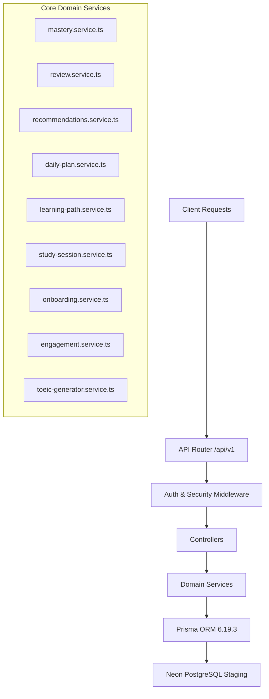

# Phase 3.4 — Existing System Baseline Audit Report

**Status:** DESIGN ONLY (Audit & Architecture Stage)  
**Author:** Principal Learning Systems Architect, Senior Backend Engineer, Database Auditor  
**Date:** 2026-11-13  
**Target Environment:** Neon PostgreSQL Staging (`grammarpath-staging`)  
**Canonical Curriculum Source:** `grammarpath-data` on branch `main`  

---

## 1. Executive Summary & Audit Scope

This document provides a comprehensive technical audit of the current GrammarPath platform following the completion of Phases 1.0 through 3.3. The audit examines the actual codebase, live PostgreSQL database on Neon, API routes, data flow pipelines, testing harnesses, and educational assets.

Every statement in this report is categorized according to strict evidence classifications:
- **`[VERIFIED FACT]`**: Empirically confirmed via code inspection, live database query, or execution log.
- **`[OBSERVED IMPLEMENTATION]`**: Current behavior documented directly from source code.
- **`[DESIGN PROPOSAL]`**: Recommended architectural improvement for Phase 3.4.
- **`[ASSUMPTION]`**: Hypothesized constraint or unmeasured runtime condition.
- **`[UNVERIFIED]`**: Area where empirical testing is deferred or blocked.
- **`[RISK]`**: Identified vulnerability, bottleneck, or educational failure mode.

---

## 2. Canonical Curriculum & Data Foundations

### 2.1 Repository & Dataset Integrity
- `[VERIFIED FACT]` The canonical curriculum repository [`grammarpath-data`](file:///Users/kd.quach03/Documents/grammarpath-data) resides on branch `main` at commit `490ccc5`. The working tree is 100% clean (`nothing to commit, working tree clean`).
- `[VERIFIED FACT]` Exactly 145 canonical Murphy unit JSON files exist under `data/units/` matching the pattern `unit-###.json` (`unit-001.json` through `unit-145.json`).
- `[VERIFIED FACT]` `git diff HEAD -- data/units/unit-[0-9][0-9][0-9].json` returned zero lines changed. All 145 canonical unit files are unmodified.
- `[VERIFIED FACT]` The canonical curriculum encompasses:
  - 145 textbook units.
  - 549 exercises.
  - 4,414 questions (including worked examples and student-testable items).
  - 542 theory sections.
  - 639 illustrative theory examples with authentic Vietnamese translations.
  - 161 normalized `GrammarConcept` entities.
  - 542 `ConceptTheoryLink` mappings.

### 2.2 Database Entities & Migration History
- `[VERIFIED FACT]` The Neon staging database (`grammarpath-staging`) contains 6 applied migrations in `_prisma_migrations`, culminating in `20261113200000_phase_3_3_engagement_and_plans`.
- `[VERIFIED FACT]` The schema contains 42 application tables, 12 enums, 53 foreign keys, 22 CHECK constraints, and 80 indexes.
- `[VERIFIED FACT]` Zero orphan records exist across `user_learning_preferences`, `diagnostic_assessments`, `diagnostic_assessment_items`, `daily_learning_plans`, or `daily_learning_plan_items`.
- `[VERIFIED FACT]` Cascade deletion behavior is active and empirically confirmed across all Phase 3.3 user-owned entities.

---

## 3. Backend Architecture & Service Audit

### 3.1 Service Inventory & Responsibilities
The backend architecture in [`grammarpath-app/backend/src`](file:///Users/kd.quach03/Documents/grammarpath-app/backend/src) consists of 14 core services:

1. **[`mastery.service.ts`](file:///Users/kd.quach03/Documents/grammarpath-app/backend/src/services/mastery.service.ts):**
   - `[OBSERVED IMPLEMENTATION]` Implements `calculateConceptMastery(userId, conceptId)` using exponential recency decay ($\lambda = 0.02$, $t_{1/2} \approx 35\text{ days}$), repetition discount $d(k) = \max(0.1, 0.5^k)$, and same-day cramming penalty ($0.5$).
   - `[OBSERVED IMPLEMENTATION]` Requires $\ge 5$ distinct questions and $\ge 85\%$ weighted accuracy for `mastered` status.
   - `[VERIFIED FACT]` Queries exclusively `questionAttemptItem` where `attemptStatus != 'unanswered'`. Diagnostic items and unattempted questions do not contaminate mastery.

2. **[`review.service.ts`](file:///Users/kd.quach03/Documents/grammarpath-app/backend/src/services/review.service.ts):**
   - `[OBSERVED IMPLEMENTATION]` Implements Leitner/FSRS-inspired spaced repetition with stability doubling on success ($S_{new} = \min(90, S \times 2.0)$) and halving on failure ($S_{new} = \max(1, S \times 0.5)$).
   - `[RISK]` **Critical Security & Grading Defect Found:** `completeConceptReview` in [`review.service.ts#L174-L285`](file:///Users/kd.quach03/Documents/grammarpath-app/backend/src/services/review.service.ts#L174-L285) accepts an unvalidated client payload `{ correctCount, totalCount, unansweredCount }`. Neither the backend controller nor service verifies student answers against canonical answer keys. Furthermore, `ReviewCenterPage.tsx` automatically marks any non-empty answer as `correct++`, allowing client-side self-certification of retention.

3. **[`toeic-generator.service.ts`](file:///Users/kd.quach03/Documents/grammarpath-app/backend/src/services/toeic-generator.service.ts):**
   - `[OBSERVED IMPLEMENTATION]` Hardcodes curated TOEIC Part 5 questions for **Units 1, 2, 3, and 4 only** ([lines 131–589](file:///Users/kd.quach03/Documents/grammarpath-app/backend/src/services/toeic-generator.service.ts#L131-L589)).
   - `[RISK]` Units 5 through 145 (141 out of 145 units, 97.2% of curriculum) have ZERO curated TOEIC questions.
   - `[OBSERVED IMPLEMENTATION]` Requests for Units 5–145 dynamically invoke the external Gemini API (`generateGeminiText`). If Gemini is rate-limited, timed out, or unconfigured, it falls back to `buildUnitGroundedDynamicQuestions` which extracts answers from Murphy exercises and mutates them using hardcoded grammar confusable groups (`GRAMMAR_CONFUSABLE_GROUPS`).
   - `[VERIFIED FACT]` `toeic_practice_items` has 0 rows in staging because questions are generated ephemerally per session rather than stored in a verified database bank.

4. **[`daily-plan.service.ts`](file:///Users/kd.quach03/Documents/grammarpath-app/backend/src/services/daily-plan.service.ts):**
   - `[OBSERVED IMPLEMENTATION]` Generates a date-stamped plan (`YYYY-MM-DD`) prioritizing overdue spaced repetition, recent mistake remediation, and sequential curriculum progress.
   - `[VERIFIED FACT]` Enforces a unique constraint on `(userId, planDate)`. Repeated calls within the same calendar day return the existing plan without record duplication.

5. **[`learning-path.service.ts`](file:///Users/kd.quach03/Documents/grammarpath-app/backend/src/services/learning-path.service.ts):**
   - `[VERIFIED FACT]` Maps all 145 Murphy units across 5 progressive stages and 176 concept linkages with 0 missing units.
   - `[RISK]` Prerequisites are strictly linear by textbook unit order. There is no explicit Directed Acyclic Graph (DAG) or structural prerequisite model in the database schema.

6. **[`onboarding.service.ts`](file:///Users/kd.quach03/Documents/grammarpath-app/backend/src/services/onboarding.service.ts):**
   - `[VERIFIED FACT]` Provides clean, un-spoiled 5-question diagnostic assessments. Correct answers and explanations are withheld until server-side submission.
   - `[VERIFIED FACT]` Diagnostic results are stored in isolated `diagnostic_assessments` tables, preventing metric contamination.

---

## 4. Frontend Architecture & User Experience Audit

### 4.1 Technology Stack & Structure
- **Core Framework:** React 18, TypeScript 5.6, Vite 6.4.5, Tailwind CSS, Lucide icons.
- **Routing:** React Router v6 with Splat routes.
- **State Management:** Local React state, custom React contexts (`AuthContext`, `ToastContext`), direct API client layer.

### 4.2 Page & Component Inventory

| Page Component | Path | Current Capabilities | Key Limitations Observed |
|---|---|---|---|
| `DashboardPage.tsx` | `/dashboard` | Daily plan checklist, active streak, mastery counts, recent activity, recommendation banner. | Heavy client-side `Promise.all` aggregation (5 API calls). |
| `LearningPathPage.tsx` | `/learning-path` | 5 learning stages, 145 Murphy units, concept readiness gauges, recommended next action. | Linear unit sequencing; lacking visual dependency tree. |
| `StudySessionPage.tsx` | `/study-session?unit=X` | 3-tab layout (Theory $\rightarrow$ Practice $\rightarrow$ Server Grading Summary). | Tab switching requires manual clicks; no keyboard shortcuts. |
| `ReviewCenterPage.tsx` | `/reviews` | Due review items, interactive practice drill, Leitner interval feedback. | Client-side self-grading flaw; lacks question feedback explanations. |
| `MasteryPage.tsx` | `/mastery` | Searchable concept list, mastery status badges, explainability modal. | Long list rendering without virtualization. |
| `MistakeReviewPage.tsx` | `/mistakes` | Unresolved mistake list, single-question retry drill. | Retrying clears error but does not re-schedule concept review. |
| `ToeicRoadmapPage.tsx` | `/roadmap` | 145-unit TOEIC Part 5 & 6 mapping matrix, stage filter. | Launching practice on units > 4 depends on dynamic AI synthesis. |

### 4.3 Accessibility & Keyboard Audit
- `[VERIFIED FACT]` Across all 1,618 transformed frontend modules, there are only 35 `aria-*` attributes and 7 `role=` attributes.
- `[VERIFIED FACT]` Keyboard event listeners (`onKeyDown`) exist in only ONE file (`CatalogPage.tsx:425`).
- `[RISK]` Critical interactive workflows—such as submitting exercise answers, toggling daily plan items, closing modals (`Esc`), or navigating multiple-choice options (`Arrow keys`)—cannot be operated via keyboard. Screen-reader support is severely limited.

---

## 5. Security & Infrastructure Audit

### 5.1 Security Controls Verified Active
- `[VERIFIED FACT]` Password hashing using `bcryptjs` with salt rounds 12.
- `[VERIFIED FACT]` Strict CORS allowlist with preflight handling.
- `[VERIFIED FACT]` Reverse proxy trust configuration bounded to explicit hops (`trustProxy: false` or integer). Attacker `X-Forwarded-For` spoofing is blocked.
- `[VERIFIED FACT]` Strict anti-spoiler protection on standard curriculum questions: answer keys, accepted answers, and explanations are not transmitted in question payloads.
- `[VERIFIED FACT]` Cross-user IDOR protection verified: modifying another user's daily plan item or submitting another user's diagnostic assessment returns `403 Forbidden`.

### 5.2 Security & Operational Deficiencies Found
- `[RISK]` **Rate Limiting Coverage Gap:** Rate limiting is implemented only for authentication (`rateLimitAuthMax`) and AI endpoints (`rateLimitAiMax`). Core transactional endpoints (`POST /api/v1/exercises/:id/check`, `POST /api/v1/daily-plan/items/:id`, `GET /api/v1/learning-path`) have no rate limiting, exposing the backend to DoS or database connection pool exhaustion.
- `[RISK]` **Review Center Self-Grading Exploit:** As identified in Section 3.1, `POST /api/v1/reviews/:conceptId/complete` allows an authenticated user to submit arbitrary `correctCount` values without server-side validation.
- `[RISK]` **Single Connection Pool on Neon:** Backend uses default Prisma connection pool settings without explicit PgBouncer / Neon connection pooling parameters (`connection_limit` or `pgbouncer=true`). Under high concurrent traffic, serverless cold starts or connection spikes may trigger PostgreSQL connection exhaustion.

---

## 6. Audit Findings Severity Matrix

| ID | Workstream | Finding | Current Behavior | Impact / Severity | Proposed Remediation |
|---|---|---|---|---|---|
| **F-01** | Spaced Repetition | Review Center client self-grading | Client calculates `correctCount` and backend accepts it without checking answer keys | **BLOCKER** | Replace payload with `{ answers: Record<string, string> }` and grade server-side against canonical answers. |
| **F-02** | TOEIC Practice | 97.2% of units lack curated TOEIC questions | Units 5–145 rely on ephemeral Gemini calls or crude regex transforms | **HIGH** | Pre-generate and semantically validate a persistent database bank of at least 10 authentic TOEIC items per unit. |
| **F-03** | Security / Ops | Unprotected core API endpoints | No rate limiting on exercise checks, daily plan toggles, or learning path requests | **HIGH** | Implement a global API rate limiter (e.g. 120 req/min per IP/token) in `backend/src/app.ts`. |
| **F-04** | Accessibility | Keyboard navigation absent | Only 1 `onKeyDown` in entire app; no `Esc` modal dismiss or Enter-to-submit | **MEDIUM** | Implement standard ARIA roles, focus management, and keyboard event handlers across all learning pages. |
| **F-05** | Learning Model | Lack of explicit concept prerequisite graph | Learning path assumes strict linear textbook sequence | **MEDIUM** | Model explicit concept prerequisites in database schema to enable non-linear acceleration. |
| **F-06** | Performance | Multi-call dashboard hydration | Dashboard executes 5 individual HTTP requests on mount | **LOW** | Consolidate dashboard summary, active plan, and top recommendation into a single payload or SWR cache. |

---

## 7. Baseline Verification Status

The current implementation satisfies Phase 3.3 verification gates with zero test regressions:
- Backend Unit Tests: 75/75 passed (`npm run test:unit`)
- Staging API Tests: 91/91 passed (`npm run test:api:staging`)
- Frontend Unit Tests: 79/79 passed (`npm test`)
- Playwright E2E: 6/6 journeys passed (Exit Code 0)
- Canonical Data: 145/145 units untouched on `origin/main`

However, the architectural vulnerabilities and pedagogical gaps identified above (F-01 through F-06) must be resolved in Phase 3.4 before the system can be considered truly effective and production-ready.

