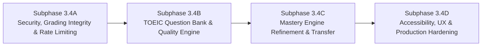

# Phase 3.4 — Multi-Stage Implementation Roadmap

**Status:** DESIGN ONLY (Audit & Architecture Stage)  
**Author:** Principal Learning Systems Architect, Senior Full-stack Engineer  
**Date:** 2026-11-13  
**Target Architecture:** GrammarPath Phase 3.4

---

## 1. Executive Roadmap Overview

To ensure safe, robust, and testable delivery without service interruption or database corruption, Phase 3.4 implementation is partitioned into **four independently verifiable subphases** executed sequentially:



| Subphase | Focus Area | Primary Deliverables | Severity Addressed |
| :--- | :--- | :--- | :--- |
| **3.4A** | Security & Integrity | Server-side review grading (F-01), Global API rate limiting (F-03), Transactional review completion | `BLOCKER`, `HIGH` |
| **3.4B** | Assessment Quality | `ToeicQuestionBankItem` model (F-02), Seed Units 5–52 bank, Distractor quality validator | `HIGH`, `MEDIUM` |
| **3.4C** | Learning Science | TOEIC transfer to mastery, Inertia mitigation, Returning learner refresher, Model v2.0 | `HIGH`, `MEDIUM` |
| **3.4D** | UX & Infrastructure | WCAG 2.1 AA keyboard/modal focus, Navigation consolidation, Neon PgBouncer config | `MEDIUM`, `LOW` |

---

## 2. Subphase 3.4A — Security, Grading Integrity & Rate Limiting

### 2.1 Scope & Boundaries
- **In-Scope:**
  - Eliminate client-side grading in `ReviewCenterPage.tsx` (Defect F-01).
  - Update `POST /api/v1/reviews/:conceptId/complete` to accept student answers `{ answers: Record<string, string> }` instead of client counts `{ correctCount, totalCount }`.
  - Server grades submitted answers against canonical `Question` answer keys.
  - Wrap review completion and mastery update in an atomic Prisma transaction.
  - Add general rate limiting (`100 req/min`) across all API routes (Defect F-03).
- **Out-of-Scope:**
  - Changes to BKT parameters or retention decay formulas.
  - Generating new curriculum content.

### 2.2 Technical Specification
- **Modified Files:**
  - `backend/src/routes/review.routes.ts`
  - `backend/src/controllers/review.controller.ts`
  - `backend/src/services/review.service.ts`
  - `backend/src/middleware/rate-limit.ts`
  - `backend/src/routes/index.ts`
  - `frontend/src/api/client.ts`
  - `frontend/src/pages/ReviewCenterPage.tsx`
- **API Contract Change:**
  ```typescript
  // Request POST /api/v1/reviews/:conceptId/complete
  {
    "answers": {
      "question-uuid-1": "is playing",
      "question-uuid-2": "haven't seen"
    }
  }
  // Response 200 OK
  {
    "success": true,
    "data": {
      "status": "success",
      "accuracy": 100,
      "correctCount": 2,
      "totalCount": 2,
      "stabilityDays": 4.0,
      "intervalDays": 4,
      "nextDueAt": "2026-11-17T00:00:00.000Z",
      "masteryScore": 0.88,
      "masteryStatus": "mastered"
    }
  }
  ```
- **Test Strategy:**
  - Unit tests verifying server evaluates correct, partial, and incorrect review answers.
  - Integration test confirming client-supplied counts are rejected.
  - Rate limiting integration test verifying 429 Too Many Requests after burst traffic.
- **Rollback Plan:** Revert controller and route handler commits; zero schema changes involved.
- **Acceptance Criteria:**
  - Review Center passes answers to backend; server evaluates against database answer keys.
  - Submitting empty or incorrect answers decreases review stability and triggers reinforcement.
  - Exceeding 100 requests/minute on unauthenticated or core endpoints yields HTTP 429.

---

## 3. Subphase 3.4B — Curated TOEIC Question Bank & Quality Engine

### 3.1 Scope & Boundaries
- **In-Scope:**
  - Create Prisma migration adding `ToeicQuestionBankItem` model and `ConceptDependency` model.
  - Implement seed pipeline to populate verified TOEIC Part 5 questions for Foundation Units 5–52.
  - Implement distractor quality validator ensuring 3 distinct functional distractors per item.
  - Update `toeic-generator.service.ts` to query `ToeicQuestionBankItem` before falling back to dynamic generation.
- **Out-of-Scope:**
  - Direct modifications to canonical `grammarpath-data` Murphy textbook files (strictly immutable).

### 3.2 Technical Specification
- **Database Schema Changes:**
  - Migration: `20261114000000_phase_3_4_toeic_bank_and_dependencies`.
  - Tables added: `toeic_question_bank_items`, `concept_dependencies`.
- **Modified Files:**
  - `backend/prisma/schema.prisma`
  - `backend/src/services/toeic-generator.service.ts`
  - `backend/src/services/toeic-validator.service.ts` (new)
  - `backend/src/scripts/seed-toeic-bank.ts` (new)
- **Test Strategy:**
  - Seed validation script verifying all seeded questions have valid answers, 4 distinct choices, and non-empty explanations.
  - Distractor validator unit tests detecting duplicate choices or empty options.
- **Rollback Plan:** Standard Prisma migration rollback down script or restoring pre-migration schema state.
- **Acceptance Criteria:**
  - Units 1–52 have at least 10 persistent, verified TOEIC questions per unit in `toeic_question_bank_items`.
  - TOEIC practice sessions serve curated questions with $< 50\text{ms}$ query latency without calling Gemini.

---

## 4. Subphase 3.4C — Mastery Engine Refinement & Transfer Learning

### 4.1 Scope & Boundaries
- **In-Scope:**
  - Incorporate TOEIC practice item results into `calculateConceptMastery` via Transfer Learning multiplier ($\beta_{\text{toeic}} = 0.85$).
  - Cap maximum BKT evaluation window to $N_{\text{max}} = 10$ recent attempts to resolve learning inertia.
  - Refine retention decay to grace-period model ($R(t) = 1.0$ for $t \le S$).
  - Implement Returning Learner Refresher pipeline.
  - Increment `CURRENT_MASTERY_MODEL_VERSION` to `"v2.0"`.
- **Out-of-Scope:**
  - Modifying historical `question_attempt_items` records.

### 4.2 Technical Specification
- **Modified Files:**
  - `backend/src/services/mastery.service.ts`
  - `backend/src/services/spaced-repetition.service.ts`
  - `backend/src/services/learning-path.service.ts`
- **Algorithm Updates:**
  - Recency-weighted sliding window ($N = 10$).
  - TOEIC attempt ingestion: `prisma.toeicPracticeItem` joined via unit's concept mapping.
- **Test Strategy:**
  - Comprehensive unit test suite covering:
    - Failing 5 TOEIC questions drops mastery from `mastered` to `practicing`.
    - 10 incorrect attempts followed by 5 correct attempts achieves $> 0.85$ probability without inertia lock.
    - Day 2 post-study retention returns 1.0 (no false decay).
- **Rollback Plan:** Revert `CURRENT_MASTERY_MODEL_VERSION` to `"v1.0"` in code; existing audit logs in `concept_mastery_events` preserve backward compatibility.
- **Acceptance Criteria:**
  - Learner scoring $< 50\%$ on TOEIC practice triggers concept remediation.
  - Returning learners receive calibrated 5-minute refresher before advancing.

---

## 5. Subphase 3.4D — Accessibility, Navigation & Production Hardening

### 5.1 Scope & Boundaries
- **In-Scope:**
  - Build accessible `ModalWrapper` implementing focus trapping, focus restoration, and `Escape` key listeners.
  - Add missing ARIA attributes (`aria-expanded`, `aria-controls`, `aria-label`) across exercise renderers.
  - Add keyboard shortcuts (Enter to submit, 1–4 to pick multiple-choice options).
  - Streamline sidebar navigation: merge `/progress` into `/dashboard`, clarify TOEIC Express vs Full Path.
  - Implement split-pane theory/practice view on `StudySessionPage`.
  - Configure Neon PgBouncer pooled connection strings with `connection_limit=10`.
- **Out-of-Scope:**
  - Native mobile application builds.

### 5.2 Technical Specification
- **Modified Files:**
  - `frontend/src/components/common/ModalWrapper.tsx` (new)
  - `frontend/src/components/auth/AuthModal.tsx`
  - `frontend/src/components/onboarding/OnboardingModal.tsx`
  - `frontend/src/components/layout/Sidebar.tsx`
  - `frontend/src/pages/StudySessionPage.tsx`
  - `frontend/src/pages/DashboardPage.tsx`
  - `backend/src/lib/prisma.ts`
- **Test Strategy:**
  - Playwright automated keyboard navigation test navigating entire application without mouse clicks.
  - Playwright modal focus trap verification.
  - Mobile responsiveness test at 375×812 viewport.
- **Rollback Plan:** Git revert frontend layout commits.
- **Acceptance Criteria:**
  - All modals close on `Escape` and trap focus while open.
  - Keyboard users can answer questions and submit exercises using Enter and Number keys.
  - Lighthouse accessibility score $\ge 95$.

