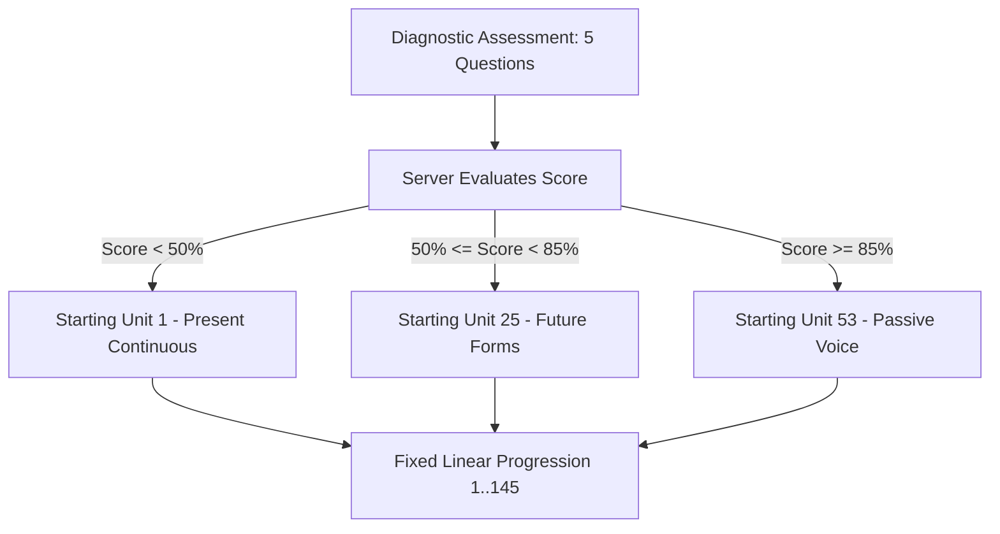
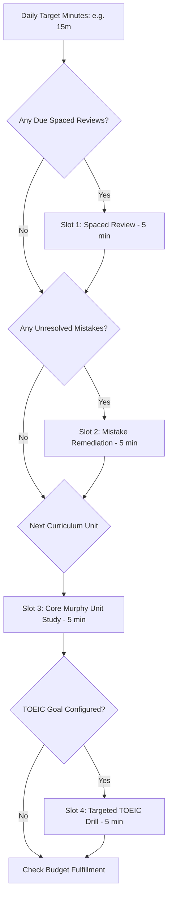

# Phase 3.4 — Personalization & Learning Path Audit

**Status:** DESIGN ONLY (Audit & Architecture Stage)  
**Author:** Principal Learning Systems Architect, Educational Data Scientist  
**Date:** 2026-11-13  
**Target Modules:** `backend/src/services/learning-path.service.ts`, `backend/src/services/daily-plan.service.ts`, `backend/src/services/recommendations.service.ts`, `backend/src/services/onboarding.service.ts`  

---

## 1. Executive Summary

This report delivers a critical evaluation of personalization in GrammarPath. The central question addressed is: **Is GrammarPath's learning path genuinely personalized, or is it merely a static 145-unit textbook sequence with superficial dynamic callouts?**

Key findings include:
1. **Diagnostic Routing is Coarse-Grained (`[OBSERVED IMPLEMENTATION]`):** The 5-minute diagnostic sorts users into one of only 3 fixed starting units (Unit 1, 25, or 53). It does not dynamically unlock non-linear paths or tailor module sequencing.
2. **Missing Prerequisite Graph (`[RISK: MEDIUM]`):** Curriculum progression assumes strict linear sequencing ($1 \rightarrow 2 \rightarrow 3 \dots 145$). No Directed Acyclic Graph (DAG) exists in the database schema to express true concept dependencies.
3. **Daily Routine Engine is Robust (`[VERIFIED FACT]`):** Daily plans successfully synthesize overdue spaced reviews, unresolved errors, and next curriculum steps with strict daily idempotency.

---

## 2. Workstream D1 — Onboarding & Diagnostic Assessment Calibration



### 2.1 Diagnostic Mechanics & Isolation
- `[VERIFIED FACT]` Questions are sampled dynamically from Units 1, 2, 7, 19, 25, and 26.
- `[VERIFIED FACT]` Answer keys are strictly suppressed on the client.
- `[VERIFIED FACT]` Submissions are stored exclusively in `diagnostic_assessments` and `diagnostic_assessment_items`.
- `[VERIFIED FACT]` Zero metric contamination: diagnostic attempts do not write to `question_attempt_items` or `exercise_attempts`, preserving clean baseline mastery metrics.

### 2.2 Calibration Limitations
- **3-Bucket Coarseness:** A learner who scores 48% is assigned to Unit 1 alongside a complete beginner who scored 0%. A learner who scored 84% is placed at Unit 25 rather than an advanced stage.
- **No Concept-Level Exemption:** Even if a learner answers the Unit 19 (Present Perfect) diagnostic question flawlessly, Unit 19 is not marked as exempt or proficient; the learner is still placed at Unit 1 or 25 and expected to complete Unit 19 linearly.

---

## 3. Workstream D2 — Learning Path Personalization vs. Linear Sequence

### 3.1 Structural Analysis of `learning-path.service.ts`
In [`backend/src/services/learning-path.service.ts#L47-L270`](file:///Users/kd.quach03/Documents/grammarpath-app/backend/src/services/learning-path.service.ts#L47-L270):
- `[VERIFIED FACT]` All 145 units appear exactly once across 5 stages and 176 concept nodes.
- `[OBSERVED IMPLEMENTATION]` Stages are partitioned strictly by unit number ranges:
  - Stage 1: Units 1–25 (Foundation Grammar)
  - Stage 2: Units 26–52 (Developing Grammar)
  - Stage 3: Units 53–91 (Intermediate Grammar)
  - Stage 4: Units 92–145 (Advanced Grammar)
  - Stage 5: Curated Units (TOEIC Readiness)
- `[RISK]` **Strict Linear Sequence:** There are no alternate tracks (e.g. "Business Writing Express", "TOEIC High-Yield Core", "Conversation Foundations"). All learners follow the exact 145-unit sequence regardless of their stated learning goals (`toeic_foundation` vs `murphy_mastery`).

### 3.2 Prerequisite Graph Evaluation
- `[VERIFIED FACT]` Neither `prisma/schema.prisma` nor backend services contain any entity or property named `prerequisite` or `dependency`.
- `[RISK]` Because prerequisites are implicit, the system cannot detect when a learner is ready to skip ahead safely. For example:
  - Unit 53 (*Passive 1*) depends on Past Participles (Units 7 & 19), but does *not* depend on Unit 36 (*Sense Verbs*).
  - Unit 98 (*Relative Clauses*) depends on Pronouns (Unit 92), but not on Conditionals (Units 47–52).
  - Without an explicit DAG, non-linear acceleration is impossible without breaking pedagogical coherence.

---

## 4. Workstream D3 — Daily Plan Generation & Recommendation Dynamics

### 4.1 Prioritization Hierarchy
In [`backend/src/services/daily-plan.service.ts#L60-L190`](file:///Users/kd.quach03/Documents/grammarpath-app/backend/src/services/daily-plan.service.ts#L60-L190), the plan generator synthesizes tasks in strict pedagogical order:



- `[VERIFIED FACT]` **Idempotency:** Unique constraint `(userId, planDate)` prevents multiple plans from being created on the same date.
- `[VERIFIED FACT]` **Persistence:** Toggling an item status (`not_started` $\rightarrow$ `completed`) updates PostgreSQL and updates total completed minutes.
- `[VERIFIED FACT]` **Error Handling:** When no reviews are due and no mistakes exist, the planner smoothly backfills with the next sequential curriculum units, avoiding empty plan states.

### 4.2 Recommendation Feedback Loop
In [`backend/src/services/recommendations.service.ts`](file:///Users/kd.quach03/Documents/grammarpath-app/backend/src/services/recommendations.service.ts):
- `[OBSERVED IMPLEMENTATION]` `buildRecommendations(userId, limit)` iterates over concepts with status `needs_review`, then `practicing`, then `developing`, and finally `not_started`.
- `[RISK]` **Recommendation Stagnation:** If a learner attempts a recommended exercise, fails, and leaves it unresolved, the recommendation engine will persistently recommend that exact same concept every day until the user clears the mistake, causing user frustration.

---

## 5. Proposed Phase 3.4 Personalization Enhancements

### 5.1 Explicit Concept Prerequisite Graph
Introduce a lightweight `ConceptDependency` table in the database:
```prisma
model ConceptDependency {
  id              String         @id @default(uuid()) @db.Uuid
  conceptId       String         @map("concept_id") @db.Uuid
  prerequisiteId  String         @map("prerequisite_id") @db.Uuid
  dependencyType  String         @default("strict") // 'strict' | 'advisory'
  
  concept         GrammarConcept @relation("TargetConcept", fields: [conceptId], references: [id], onDelete: Cascade)
  prerequisite    GrammarConcept @relation("PrereqConcept", fields: [prerequisiteId], references: [id], onDelete: Cascade)

  @@unique([conceptId, prerequisiteId])
  @@map("concept_dependencies")
}
```

### 5.2 Goal-Specific Fast-Track Paths
For users who select `primaryGoal: 'toeic_foundation'` in onboarding, provide a **High-Yield 50-Unit Fast Track**:
- Fast Track prioritizes the 50 Murphy units most heavily tested in TOEIC Part 5 & 6 (Verb Tenses, Passives, Modals, Word Forms, Prepositions, Conjunctions, Relative Clauses).
- Enables learners to complete a focused TOEIC preparation path in 6–8 weeks rather than requiring 6 months to traverse all 145 units linearly.

### 5.3 Diagnostic-Based Module Exemption
Allow learners scoring $\ge 85\%$ on diagnostic sub-sections to receive `exempt` status for introductory units, with confirmation checks during spaced reviews.

