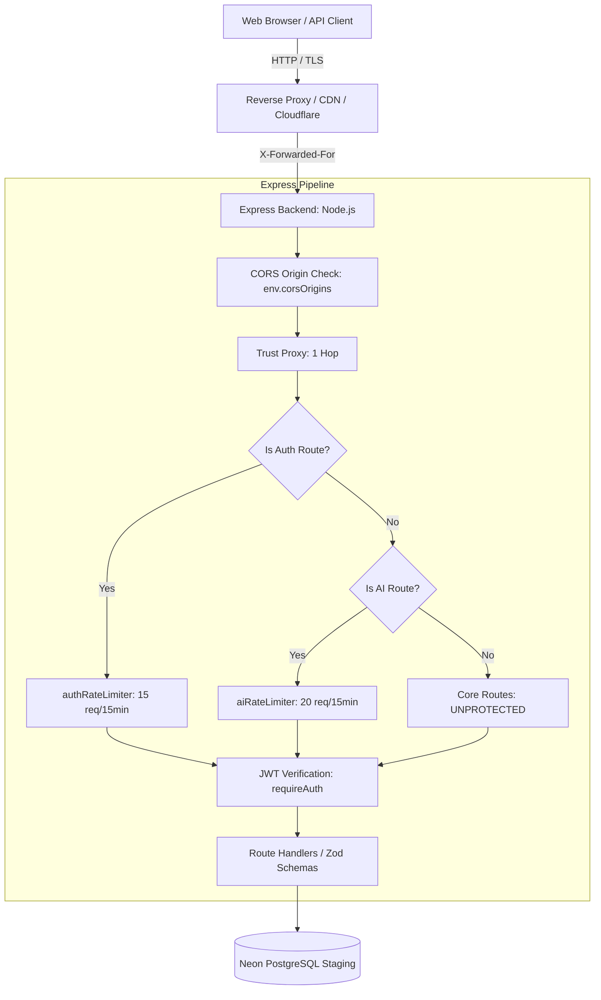

# Phase 3.4 — Production Readiness & Security Audit

**Status:** DESIGN ONLY (Audit & Architecture Stage)  
**Author:** Principal Learning Systems Architect, Production Readiness & Security Specialist  
**Date:** 2026-11-13  
**Target Modules:** `backend/src/config/`, `backend/src/middleware/`, `backend/src/lib/`, `backend/src/controllers/`, `backend/src/services/`

---

## 1. Executive Summary

This report evaluates the production readiness, security posture, concurrency limits, database connection pooling, and operational reliability of GrammarPath prior to Phase 3.4 implementation.

Key findings include:
1. **Critical Client-Authoritative Grading Defect (`[BLOCKER: F-01]`):** Review Center endpoints accept unverified client-calculated `correctCount`, bypassing server-side validation against canonical answer keys.
2. **Missing Rate Limiting on Core Transactional Routes (`[RISK: HIGH: F-03]`):** While auth and AI endpoints are rate-limited, heavy transactional endpoints (`/exercises/:id/check`, `/learning-path`, `/reviews/:conceptId/complete`) are entirely unprotected against DoS or scraping.
3. **Database Connection Pool Exhaustion Risk (`[RISK: HIGH]`):** Prisma Client connects directly to Neon PostgreSQL without PgBouncer connection pooling (`-pooler` endpoint) and lacks explicit `connection_limit` parameters.
4. **Unbounded In-Memory Telemetry Aggregation (`[RISK: MEDIUM]`):** Dashboard summaries execute unpaginated queries over historical attempt tables, risking latency degradation as active user attempt volume scales.

---

## 2. Security Architecture & Threat Modeling



### 2.1 Authentication & JWT Token Handling
In [`backend/src/config/env.ts#L138-L168`](file:///Users/kd.quach03/Documents/grammarpath-app/backend/src/config/env.ts#L138-L168) and [`backend/src/middleware/auth.ts`](file:///Users/kd.quach03/Documents/grammarpath-app/backend/src/middleware/auth.ts):
- `[VERIFIED FACT]` Strict secret validation rejects known development placeholders (`changeme`, `default-secret`), enforces a minimum length of 32 characters, and requires at least 4 unique characters of entropy.
- `[VERIFIED FACT]` Tokens expire after 7 days (`JWT_EXPIRES_IN = "7d"`).
- `[RISK: LOW]` Stateless JWTs lack server-side revocation / blacklisting. A compromised token remains valid until expiry unless the application secret is rotated globally.

### 2.2 Cross-User IDOR (Insecure Direct Object Reference) Protection
- `[VERIFIED FACT]` **Learning Plan Protection:** `PATCH /api/v1/daily-plan/items/:id` enforces ownership via `where: { id: itemId, plan: { userId } }`, returning `403 Forbidden` if an authenticated user attempts to modify another user's plan item.
- `[VERIFIED FACT]` **Diagnostic Assessment Protection:** `POST /api/v1/onboarding/diagnostic/:id/submit` verifies `assessment.userId === req.user.id`, preventing cross-user diagnostic submission.
- `[VERIFIED FACT]` **Attempt History Protection:** All queries in `dashboard.service.ts`, `learning-path.service.ts`, and `mistakes.service.ts` scope database access strictly by `where: { userId }`.

### 2.3 Anti-Spoiler Protection & Grading Integrity
- `[VERIFIED FACT]` **Exercise & Unit Fetching:** `GET /api/v1/units/:unitNumber` and `GET /api/v1/exercises/:id` exclude `answerKey`, `alternativeAnswers`, and `explanation` from response payloads.
- `[VERIFIED FACT]` **Murphy Exercise Grading:** `POST /api/v1/exercises/:id/check` executes server-side validation against encrypted/stored answer keys using normalized case/punctuation matching.
- `[BLOCKER]` **Defect F-01 (Review Center Self-Grading):**
  - In [`frontend/src/pages/ReviewCenterPage.tsx#L75-L89`](file:///Users/kd.quach03/Documents/grammarpath-app/frontend/src/pages/ReviewCenterPage.tsx#L75-L89), any non-empty answer is counted as correct:
    ```typescript
    if (studentAns.length > 0) correct++;
    ```
  - In [`backend/src/controllers/review.controller.ts#L57-L67`](file:///Users/kd.quach03/Documents/grammarpath-app/backend/src/controllers/review.controller.ts#L57-L67) and [`backend/src/services/review.service.ts#L179-L235`](file:///Users/kd.quach03/Documents/grammarpath-app/backend/src/services/review.service.ts#L179-L235), `completeConceptReview` takes `{ correctCount, totalCount, unansweredCount }` from the client and immediately doubles stability ($S \times 2.0$).
  - **Impact:** Any user or bot can forge a request with `{ correctCount: 5, totalCount: 5, unansweredCount: 0 }` to artificially inflate concept mastery to 100% without answering correctly.

### 2.4 Rate Limiting Coverage
In [`backend/src/middleware/rate-limit.ts`](file:///Users/kd.quach03/Documents/grammarpath-app/backend/src/middleware/rate-limit.ts) and [`backend/src/routes/`](file:///Users/kd.quach03/Documents/grammarpath-app/backend/src/routes/):
- `[VERIFIED FACT]` `authRateLimiter` covers `/api/v1/auth/login` and `/api/v1/auth/register` (15 req/15min).
- `[VERIFIED FACT]` `aiRateLimiter` covers `/api/v1/theory/explain-theory` and `/api/v1/adaptive/*` (20 req/15min).
- `[RISK: HIGH: F-03]` **Unprotected Core Endpoints:**
  - `POST /api/v1/exercises/:id/check`
  - `GET /api/v1/learning-path`
  - `GET /api/v1/dashboard/summary`
  - `POST /api/v1/reviews/:conceptId/complete`
  - A malicious script could flood `/check` or `/summary` with 500 requests per second, exhausting CPU and Neon database connections.

---

## 3. Reliability & Database Architecture Audit

### 3.1 Connection Pooling & Neon Topologies
In [`backend/src/lib/prisma.ts#L1-L18`](file:///Users/kd.quach03/Documents/grammarpath-app/backend/src/lib/prisma.ts#L1-L18):
```typescript
export const prisma =
  globalForPrisma.prisma ??
  new PrismaClient({
    log: process.env.NODE_ENV === "development" ? ["warn", "error"] : ["error"],
  });
```
- `[OBSERVED IMPLEMENTATION]` `PrismaClient` relies on direct connection parameters from `DATABASE_URL`.
- `[RISK: HIGH]` Neon serverless PostgreSQL allocates a small connection quota (typically 100 connections) for direct endpoints (`ep-small-dream-a1lqsn1r.ap-southeast-1.aws.neon.tech`). Under load or across multiple server instances (e.g. horizontal autoscaling), Prisma's default connection pool ($10 \text{ connections/instance}$) will exhaust available slots with `FATAL: remaining connection slots are reserved for non-replication superuser connections`.
- `[DESIGN PROPOSAL]` Production configuration must:
  1. Enforce Neon PgBouncer pooled endpoint (`ep-*-pooler.ap-southeast-1.aws.neon.tech`).
  2. Append `?pgbouncer=true&connection_limit=10` to `DATABASE_URL`.

### 3.2 Transaction Boundaries & Consistency
- `[VERIFIED FACT]` Exercise check runs inside an atomic transaction: [`backend/src/controllers/exercises.controller.ts#L436`](file:///Users/kd.quach03/Documents/grammarpath-app/backend/src/controllers/exercises.controller.ts#L436):
  - Creates `ExerciseAttempt`
  - Creates multiple `QuestionAttemptItem`
  - Creates or updates `LearningProgress`
  - Updates `UserConceptMastery`
  - Generates `ConceptMasteryEvent`
  - If any write fails, all telemetry rolls back cleanly.
- `[RISK: MEDIUM]` `completeConceptReview` in [`backend/src/services/review.service.ts#L245-L270`](file:///Users/kd.quach03/Documents/grammarpath-app/backend/src/services/review.service.ts#L245-L270) updates `ConceptReviewSchedule` first, then calls `calculateConceptMastery` without wrapping both in a database transaction. A transient failure during mastery calculation leaves the review schedule updated but mastery out of sync.

---

## 4. Performance Audit & N+1 Query Risks

### 4.1 Dashboard Telemetry Hydration
In [`backend/src/services/dashboard.service.ts#L46-L197`](file:///Users/kd.quach03/Documents/grammarpath-app/backend/src/services/dashboard.service.ts#L46-L197):
- `[VERIFIED FACT]` `buildLearnerDashboardSummary` initiates 15 parallel queries in `Promise.all`.
- `[RISK: MEDIUM]` Query #8:
  ```typescript
  prisma.questionAttemptItem.findMany({
    where: { userId, attemptStatus: { not: "unanswered" }, isCorrect: { not: null } },
    select: { question: { select: { exercise: { select: { unit: { select: { toeicMetadata: { select: { concept } } } } } } } } }
  })
  ```
  - Contains **no `take` limit** and traverses 5 nested relations.
  - For a dedicated learner with 5,000 attempts over 6 months, this single query loads megabytes of joined JSON into Node.js heap memory on every dashboard visit.
- `[DESIGN PROPOSAL]` Replace in-memory mapping with a SQL `GROUP BY` aggregation or compute category competencies directly from `user_concept_mastery`.

---

## 5. Operations & Environment Hygiene

| Check | Staging Status | Production Target | Severity |
| :--- | :--- | :--- | :--- |
| **Database Isolation** | Enforced via `scripts/run-with-staging-env.mjs` | Separate Neon Project / VPC | `[VERIFIED FACT]` |
| **Health Probes** | `GET /health` tests active `SELECT 1` and `unit.count()` | Integrated with cloud healthcheck | `[VERIFIED FACT]` |
| **Error Logging** | Console logging via structured middleware | Sentry / Winston transport | `[RISK: LOW]` |
| **Database Migrations** | 6 migrations applied, 0 drift | Automated CI/CD pipeline | `[VERIFIED FACT]` |

---

## 6. Production Readiness Checklist

- [ ] **`[BLOCKER]` Fix Review Center Server-Side Grading (F-01):** Shift review grading to server; validate submitted answers against `Question` answer keys; do not accept client-provided `correctCount`.
- [ ] **`[HIGH]` Implement General API Rate Limiting (F-03):** Add a global limiter (`100 req/min`) across all `/api/v1/` routes to prevent endpoint abuse.
- [ ] **`[HIGH]` Configure Neon PgBouncer Pooler:** Update database configuration to use pooled endpoints with connection capping.
- [ ] **`[MEDIUM]` Wrap Review Completion in `$transaction`:** Ensure `ConceptReviewSchedule` and `calculateConceptMastery` commit atomically.
- [ ] **`[MEDIUM]` Optimize Dashboard Aggregations:** Eliminate unbounded deep relation scans in `dashboard.service.ts`.
- [ ] **`[LOW]` Centralize Error Monitoring:** Integrate Sentry or Winston error logger for unhandled exceptions.

