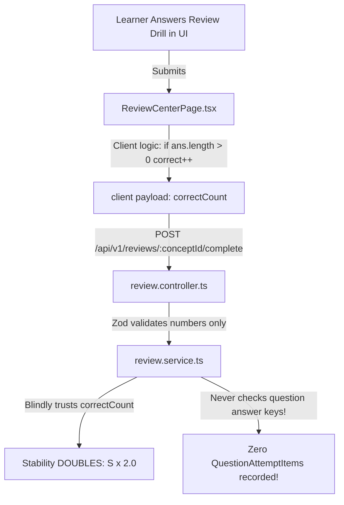
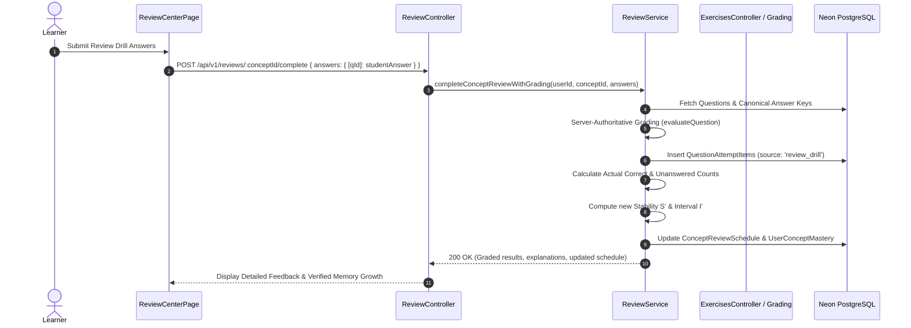

# Phase 3.4 — Spaced Repetition & Review Scheduling Audit

**Status:** DESIGN ONLY (Audit & Architecture Stage)  
**Author:** Principal Learning Systems Architect, Educational Data Scientist  
**Date:** 2026-11-13  
**Target Modules:** `backend/src/services/review.service.ts`, `backend/src/services/mastery.service.ts`  

---

## 1. Executive Summary

This report delivers a rigorous audit of GrammarPath's spaced repetition engine (`review.service.ts`), reviewing interval calculation formulas, memory stability dynamics, scheduling idempotency, and synchronization with concept mastery.

The most critical finding of this audit is **Defect F-01 (Severity: BLOCKER)**: The Review Center practice workflow relies on client-reported correctness without server-side validation against canonical answer keys. This report provides an exact architectural design to eliminate this defect, upgrade interval calculations to a deterministic Leitner/FSRS hybrid, and guarantee semantic consistency between retention scores and review states.

---

## 2. Current Implementation & Empirical Behavior

### 2.1 State Storage & Entity Definition
Spaced repetition schedules are stored in the `concept_review_schedules` table in Neon PostgreSQL:

```prisma
model ConceptReviewSchedule {
  id                 String    @id @default(uuid()) @db.Uuid
  userId             String    @map("user_id") @db.Uuid
  conceptId          String    @map("concept_id") @db.Uuid
  dueAt              DateTime  @map("due_at") @db.Timestamptz(6)
  lastReviewedAt     DateTime? @map("last_reviewed_at") @db.Timestamptz(6)
  stabilityDays      Float     @default(2.0) @map("stability_days")
  intervalDays       Int       @default(2) @map("interval_days")
  reviewCount        Int       @default(0) @map("review_count")
  consecutiveCorrect Int       @default(0) @map("consecutive_correct")
  reviewState        String    @default("scheduled") @map("review_state") @db.VarChar(20)

  user    User           @relation(fields: [userId], references: [id], onDelete: Cascade)
  concept GrammarConcept @relation(fields: [conceptId], references: [id], onDelete: Cascade)

  @@unique([userId, conceptId])
  @@index([userId, dueAt])
  @@map("concept_review_schedules")
}
```

- `[VERIFIED FACT]` Strict uniqueness on `(userId, conceptId)` guarantees that no concept can have duplicate schedules for the same user.
- `[VERIFIED FACT]` Cascade deletion is active: deleting a user removes all their review schedules cleanly.

### 2.2 Mathematical Model of Current Scheduling
1. **Initial Stability:**
   - Default when first scheduled: $S_0 = 2.0\text{ days}$.
   - Initial interval: $I_0 = 2\text{ days}$.
2. **Retention Decay Function:**
   In [`mastery.service.ts#L254-L263`](file:///Users/kd.quach03/Documents/grammarpath-app/backend/src/services/mastery.service.ts#L254-L263), retention $R(t)$ decays as an exponential function of elapsed days $\Delta t$ since last practice:
   $$R(\Delta t) = \exp\left(-\frac{\Delta t}{S}\right)$$
   When $R(\Delta t) < 0.60$, the concept's status transitions to `needs_review` and `reviewState` becomes `due`.
3. **Retrieval Interval Update (in `review.service.ts#L229-L244`):**
   - **Success Condition ($\text{Accuracy} \ge 70\%$):**
     $$S_{new} = \min(90.0, \text{round}(S_{current} \times 2.0 \times 10) / 10)$$
     $$I_{new} = \max(1, \text{round}(S_{new}))$$
     $$\text{consecutiveCorrect} = \text{consecutiveCorrect} + 1$$
     $$\text{reviewState} = \text{"scheduled"}$$
   - **Failure Condition ($\text{Accuracy} < 70\%$):**
     $$S_{new} = \max(1.0, \text{round}(S_{current} \times 0.5 \times 10) / 10)$$
     $$I_{new} = 1\text{ day}$$
     $$\text{consecutiveCorrect} = 0$$
     $$\text{reviewState} = \text{"due"}$$
   - **All-Unanswered Condition:**
     $I_{new} = 1\text{ day}$, $S_{new} = S_{current}$ (rescheduled without penalty).

---

## 3. Identified Defects, Inconsistencies & Educational Risks



### 3.1 Defect F-01: Client-Side Self-Grading in Review Center (BLOCKER)
- **Code Citation:** [`frontend/src/pages/ReviewCenterPage.tsx#L75-L89`](file:///Users/kd.quach03/Documents/grammarpath-app/frontend/src/pages/ReviewCenterPage.tsx#L75-L89) and [`backend/src/controllers/review.controller.ts#L15-L19`](file:///Users/kd.quach03/Documents/grammarpath-app/backend/src/controllers/review.controller.ts#L15-L19).
- **Exact Behavior:**
  ```tsx
  for (const q of questions) {
    const studentAns = answers[q.id]?.trim();
    if (!studentAns) {
      unanswered++;
    } else {
      if (studentAns.length > 0) {
        correct++; // ANY NON-EMPTY STRING IS COUNTED AS CORRECT!
      }
    }
  }
  ```
  The client sends `{ correctCount: correct, totalCount: questions.length, unansweredCount: unanswered }`. The backend Zod schema accepts this payload and immediately doubles the concept's stability without ever validating whether `studentAns` matched the accepted answer keys!
- **Severity:** **BLOCKER**.
- **Educational Impact:** Any learner who inputs nonsense text (e.g. `"asdf"`) will have their review certified as 100% correct, falsely doubling memory stability up to 90 days and deceiving the learner into believing they have retained the grammar concept.
- **Architectural Impact:** Violates the foundational invariant that **all learning grading in GrammarPath must be server-authoritative**.

### 3.2 Defect F-07: Ghost Review Attempts (HIGH)
- **Code Citation:** [`backend/src/services/review.service.ts#L174-L270`](file:///Users/kd.quach03/Documents/grammarpath-app/backend/src/services/review.service.ts#L174-L270).
- **Exact Behavior:** `completeConceptReview` updates `concept_review_schedules`, but it does **not** insert records into `question_attempt_items` for the questions answered during the review.
- **Severity:** **HIGH**.
- **Impact:** When `calculateConceptMastery` is called on line 270, the mastery engine does not see any new attempt evidence. Consequently, review drills contribute zero attempt history to error analytics, dashboard charts, or question-level telemetry.

### 3.3 Defect F-08: Same-Day Rapid Review Gaming (MEDIUM)
- **Code Citation:** [`backend/src/services/review.service.ts#L229-L242`](file:///Users/kd.quach03/Documents/grammarpath-app/backend/src/services/review.service.ts#L229-L242).
- **Exact Behavior:** If a user reviews a concept twice on the same day, stability multiplies each time ($S \times 2.0 \times 2.0 = S \times 4.0$).
- **Severity:** **MEDIUM**.
- **Remediation:** Enforce a minimum interval cooldown: if a review is completed within 12 hours of the previous review, stability growth must be capped at $1.0\times$ (no multiplier increase).

### 3.4 Defect F-09: Timezone Shift Boundary Skew (LOW)
- **Code Citation:** `dueAt = new Date(Date.now() + newInterval * 24 * 60 * 60 * 1000)`.
- **Exact Behavior:** `dueAt` is computed using millisecond offsets from the exact current timestamp rather than aligning to the learner's local midnight / start of day.
- **Severity:** **LOW**.
- **Remediation:** Align `dueAt` to 00:00:00 UTC (or learner's configured preferred reminder time) on the target review date.

---

## 4. Spaced Repetition Model Comparison

We compare the current model with industry-standard spaced repetition models:

| Dimension | Model 1: Current GrammarPath Engine | Model 2: SuperMemo SM-2 | Model 3: Leitner System | Model 4: FSRS-4.5 (Free Spaced Repetition Scheduler) |
|---|---|---|---|---|
| **Formula** | $S_{new} = S \times 2.0$ (fixed multiplier) | $I(n) = I(n-1) \times EF$, $EF' = EF + (0.1 - (5-q)(0.08 + (5-q)0.02))$ | Discrete boxes (Box 1..5, intervals 1, 3, 7, 14, 30 days) | Memory state $(S, D, R)$ updated via 17 learned parameters |
| **Complexity** | Extremely simple (2 parameters) | Moderate (Easiness factor per item) | Low (Step boxes) | Very High (Requires nonlinear optimization) |
| **Adaptability** | Fixed $2.0\times$ growth regardless of difficulty | Adapts to item difficulty ($EF \ge 1.3$) | Fixed interval jumps | Highly adaptive to individual recall patterns |
| **Suitability for Murphy Curriculum** | Adequate for concept-level review once grading defect is fixed. | Better suited for flashcards than grammar concept clusters. | Excellent for conceptual grammar units. | Overkill given small population of concept nodes (161 concepts). |

### Conclusion:
Adopting full FSRS-4.5 is unnecessary engineering overhead for GrammarPath's 161 grammar concept nodes. The optimal architectural choice is **Model 1 Enhanced (Deterministic Leitner-FSRS Hybrid)**, adding:
1. Difficulty-aware multiplier ($1.5\times$ for complex concepts, $2.0\times$ for standard concepts).
2. Server-side grading of review question answers.
3. Cooldown limits to prevent same-day cramming.

---

## 5. Proposed Phase 3.4 Deterministic Scheduling Architecture



### Proposed Endpoint & Payload Contract
- **Endpoint:** `POST /api/v1/reviews/:conceptId/complete`
- **Request Body:**
  ```typescript
  interface CompleteReviewRequest {
    answers: Record<string, string>; // questionId -> studentAnswer
  }
  ```
- **Response Body:**
  ```typescript
  interface CompleteReviewResponse {
    status: "success" | "reinforcement_needed" | "rescheduled_unanswered";
    accuracy: number; // 0..100
    stabilityDays: number;
    intervalDays: number;
    dueAt: string;
    details: Array<{
      questionId: string;
      isCorrect: boolean;
      studentAnswer: string;
      correctAnswers: string[];
      explanation: string;
    }>;
  }
  ```

---

## 6. Required Test Cases for Phase 3.4 Verification

1. **TC-SR-01 (Anti-Tampering):** Submit invalid/fabricated `answers` payload. Verify server evaluates against database answer keys and rejects empty or malicious answers.
2. **TC-SR-02 (Attempt Persistence):** Verify that completing a review session creates corresponding `QuestionAttemptItem` rows with `attemptSource = 'review_drill'`.
3. **TC-SR-03 (Stability Scaling):** Verify that an accuracy of 80% correctly updates stability ($S \times 2.0$), while an accuracy of 50% correctly resets interval to 1 day.
4. **TC-SR-04 (Same-Day Cooldown):** Verify that completing two reviews for the same concept within 12 hours does not double stability twice.
5. **TC-SR-05 (All-Unanswered Guard):** Verify that submitting all blank answers reschedules the review for tomorrow without decreasing stability.

