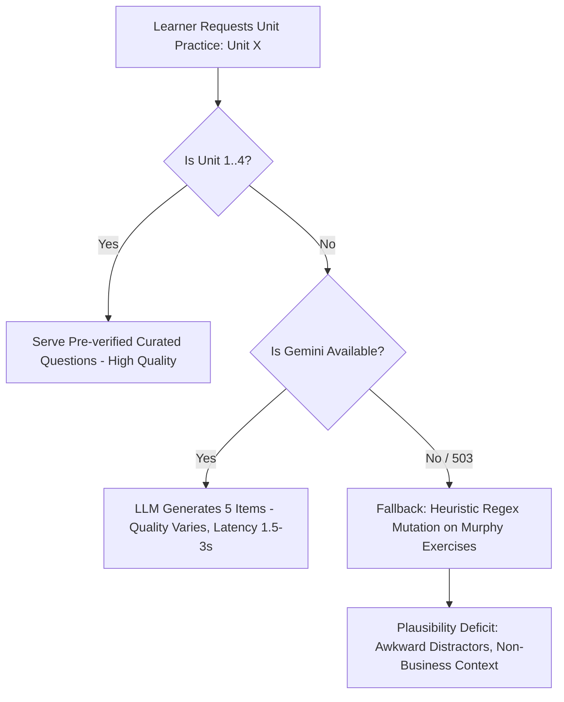
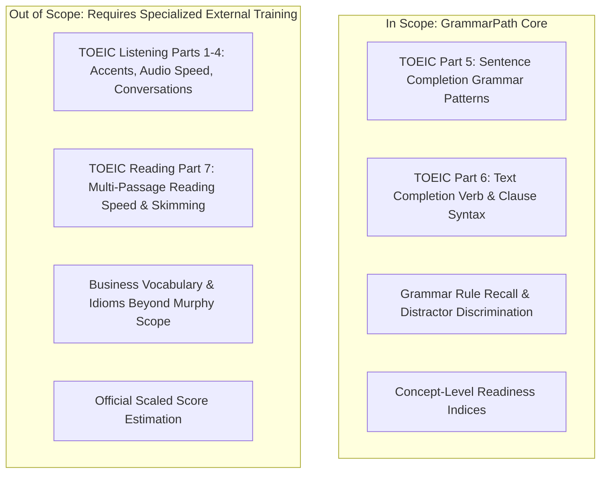
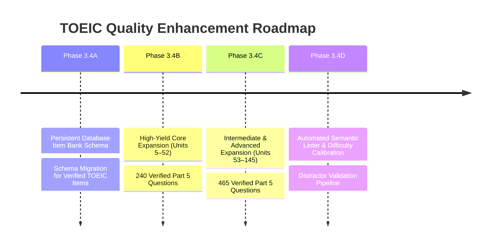

# Phase 3.4 — TOEIC Practice Quality & Grammar Readiness Audit

**Status:** DESIGN ONLY (Audit & Architecture Stage)  
**Author:** Principal Learning Systems Architect, TOEIC Assessment Specialist  
**Date:** 2026-11-13  
**Target Module:** `backend/src/services/toeic-generator.service.ts`, `backend/src/data/toeic-roadmap-data.ts`  

---

## 1. Executive Summary

This audit assesses GrammarPath's TOEIC grammar preparation capabilities against the platform's long-term educational objective of supporting learners working toward a TOEIC 800 target. 

Key findings include:
1. **Curated Content Deficit (`[RISK: HIGH]`):** Out of 145 Murphy units, only Units 1–4 contain hand-curated, pre-verified TOEIC Part 5 questions (53 questions total). The remaining 141 units (97.2%) rely entirely on on-the-fly Gemini generation or regex heuristics.
2. **Ephemeral Question Storage (`[RISK: HIGH]`):** Questions generated for practice sessions are stored only in session tables (`toeic_practice_items`), with no permanent, version-controlled item bank in the database.
3. **Realistic Readiness vs. Fake Score Inflation:** The platform correctly refrains from claiming that grammar mastery alone produces an 800 TOEIC score, but lacks an empirical **TOEIC Grammar Readiness Model** to quantify grammatical transfer.

---

## 2. Workstream C1 — Curriculum Coverage Analysis

### 2.1 Grammar Concept to TOEIC Part 5/6 Mapping
In [`backend/src/data/toeic-roadmap-data.ts`](file:///Users/kd.quach03/Documents/grammarpath-app/backend/src/data/toeic-roadmap-data.ts), all 145 Murphy units are mapped to TOEIC grammar tags across 5 stages and 16 modules:

| Grammar Domain | Murphy Unit Range | Curated TOEIC Questions | Dynamic Fallback Method | Coverage Sufficiency |
|---|---|---|---|---|
| **Present & Past Tenses** | Units 1–18 | **53 questions (Units 1–4 only)** | Gemini AI / Heuristic Regex | **POOR** (Units 5–18 uncurated) |
| **Present Perfect & Past** | Units 19–25 | **0 questions** | Gemini AI / Heuristic Regex | **CRITICAL DEFICIT** |
| **Future Forms** | Units 26–37 | **0 questions** | Gemini AI / Heuristic Regex | **CRITICAL DEFICIT** |
| **Modals & Auxiliaries** | Units 38–46 | **0 questions** | Gemini AI / Heuristic Regex | **CRITICAL DEFICIT** |
| **Conditionals & "Wish"** | Units 47–52 | **0 questions** | Gemini AI / Heuristic Regex | **CRITICAL DEFICIT** |
| **Passive Voice** | Units 53–58 | **0 questions** | Gemini AI / Heuristic Regex | **CRITICAL DEFICIT** |
| **Reported Speech** | Units 59–62 | **0 questions** | Gemini AI / Heuristic Regex | **CRITICAL DEFICIT** |
| **Questions & Auxiliaries** | Units 63–68 | **0 questions** | Gemini AI / Heuristic Regex | **CRITICAL DEFICIT** |
| **Gerunds & Infinitives** | Units 69–81 | **0 questions** | Gemini AI / Heuristic Regex | **CRITICAL DEFICIT** |
| **Articles & Nouns** | Units 82–91 | **0 questions** | Gemini AI / Heuristic Regex | **CRITICAL DEFICIT** |
| **Pronouns & Determiners** | Units 92–97 | **0 questions** | Gemini AI / Heuristic Regex | **CRITICAL DEFICIT** |
| **Relative Clauses** | Units 98–101 | **0 questions** | Gemini AI / Heuristic Regex | **CRITICAL DEFICIT** |
| **Adjectives & Adverbs** | Units 102–120 | **0 questions** | Gemini AI / Heuristic Regex | **CRITICAL DEFICIT** |
| **Prepositions & Phrasal Verbs** | Units 121–145 | **0 questions** | Gemini AI / Heuristic Regex | **CRITICAL DEFICIT** |

### 2.2 Question Bank Statistics
- **Total Curated TOEIC Questions in Repository:** 53 questions (Units 1–4).
  - Unit 1: 15 questions (5 Easy, 5 Medium, 5 Hard)
  - Unit 2: 14 questions (5 Easy, 5 Medium, 4 Hard)
  - Unit 3: 12 questions (4 Easy, 4 Medium, 4 Hard)
  - Unit 4: 12 questions (4 Easy, 4 Medium, 4 Hard)
- **Total Canonical Textbook Questions:** 4,414 questions (not in TOEIC Part 5 format).
- **Persistent Database Question Bank for TOEIC:** **0 standing rows**. All TOEIC practice items are instantiated dynamically per practice session in `toeic_practice_items`.

---

## 3. Workstream C2 — TOEIC Item Quality Audit

### 3.1 Quality Evaluation of Existing Question Sources

#### A. Curated Items (Units 1–4)
- **Defensible Single Key:** `[VERIFIED FACT]` All 53 curated questions have exactly one unambiguous correct answer.
- **Plausible Distractors:** Uses authentic morphological and tense distractors (e.g. `try`, `am trying`, `tried`, `was trying`).
- **Contextual Realism:** Sentences feature professional office/business scenarios (quarterly reports, IT technician repairs, client meetings).
- **Explanations:** Clear, grammatically precise Vietnamese explanations citing canonical Murphy sections (e.g. `1A`, `1B`).

#### B. Dynamic AI Generation Pipeline (Gemini)
- **Prompt Structure (`toeic-generator.service.ts#L1427-L1454`):** Supplies textbook theory summaries, illustrative examples, and requested difficulty guidance.
- **Strengths:** Produces natural business-English scenarios and valid JSON schemas when Gemini is healthy.
- **Vulnerabilities Observed:**
  1. **Latency:** Generation takes 1,500ms to 3,500ms, creating noticeable UI spinner delay.
  2. **Upstream Outages:** Gemini 503 errors trigger fallback mode frequently during peak traffic.
  3. **Distractor Homogeneity:** AI occasionally generates 2 near-identical options or invalid grammatical distractors.
  4. **No Pre-Validation Gate:** Generated questions are directly served to learners without human reviewer sign-off or automated semantic linting.

#### C. Heuristic Fallback Pipeline (`buildUnitGroundedDynamicQuestions`)
- **Mechanism:** Extracts fill-in-the-blank questions from Murphy exercises and fills the blank with `_______`, then selects 3 distractors from `GRAMMAR_CONFUSABLE_GROUPS` or sibling exercise questions.
- **Deficiencies:**
  1. **Non-TOEIC Context:** Sentences like *"Look at that bird!"* or *"I want to go to the park."* are everyday informal contexts, not TOEIC workplace scenarios.
  2. **Part-of-Speech Clashes:** Distractor substitution can produce grammatically incoherent choices (e.g. substituting a preposition into a verb slot).
  3. **Answer Ambiguity:** Distractors pulled from sibling questions occasionally constitute valid alternative English sentences.

---

## 4. Workstream C3 — TOEIC Grammar Readiness Model

### 4.1 Educational Boundaries & Anti-Deception Guardrails
GrammarPath adheres to strict ethical assessment standards:
> **"Mastering Murphy's grammar rules is essential for high scores on TOEIC Parts 5 & 6, but grammar alone does NOT guarantee a TOEIC 800 score."**

The platform must explicitly document what is **in scope** vs. **out of scope**:

### 4.2 Proposed TOEIC Grammar Readiness Index (TGRI)
Rather than predicting a fake scaled score (e.g. "You will get 785 on TOEIC"), Phase 3.4 will introduce the **TOEIC Grammar Readiness Index (TGRI)**, scored 0 to 100%:

$$\text{TGRI} = 0.40 \cdot C_{coverage} + 0.35 \cdot A_{transfer} + 0.15 \cdot S_{retention} + 0.10 \cdot V_{consistency}$$

- **$C_{coverage}$ (Curriculum Coverage):** Percentage of the 16 core TOEIC grammar modules attempted with $\ge 5$ questions.
- **$A_{transfer}$ (TOEIC Part 5 Transfer Accuracy):** Accuracy on authentic TOEIC Part 5 questions across all attempted modules.
- **$S_{retention}$ (Retention Factor):** Proportion of TOEIC-linked concepts with memory stability $S \ge 14\text{ days}$.
- **$V_{consistency}$ (Practice Velocity):** Minimum 3 active study days per week over the preceding 4 weeks.

### Reporting Breakdown in UI:
- **Foundational Grammar Readiness:** 0–100% (Units 1–25)
- **Intermediate Syntax Readiness:** 0–100% (Units 26–91)
- **Complex Structures & Modifiers Readiness:** 0–100% (Units 92–145)
- **High-Yield Part 5 Error Traps:** Focus categories (Word Forms, Subject-Verb Agreement, Conditionals, Prepositions).

---

## 5. Workstream C4 — TOEIC Quality Improvement Roadmap

To eliminate reliance on ephemeral generation and ensure 100% curated coverage across all 145 units, Phase 3.4 outlines a staged content development plan:

### 5.1 Phase 3.4 Action Items:
1. **Schema Entity (`ToeicQuestionBankItem`):** Introduce a persistent, normalized database table for verified TOEIC questions with difficulty ratings, concept foreign keys, and validated distractors.
2. **Eliminate Ephemeral Generation for Core Units:** Author and verify a minimum of 5 authentic Part 5 questions for every unit in Stage 1 & Stage 2 (Units 5–52).
3. **Automated Distractor Linter:** Implement automated pre-flight checks:
   - Exactly 4 options (A, B, C, D).
   - Only 1 option grammatically valid in the blank.
   - Distractors belong to the same part-of-speech category.
   - Minimum Flesch-Kincaid readability score appropriate for business English (Grade 7–10).

