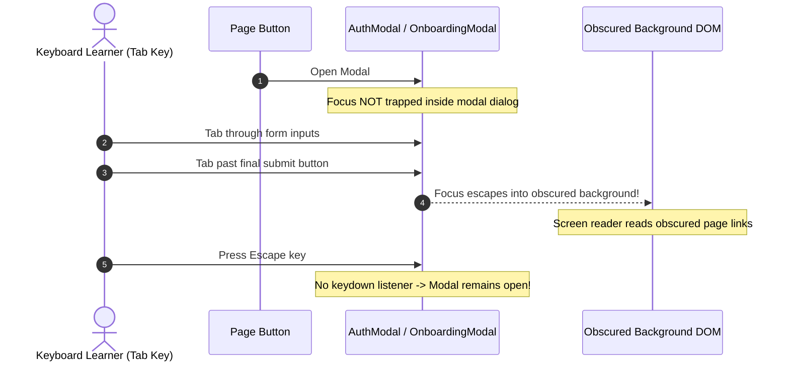

# Phase 3.4 — UX, Learning Experience & Accessibility Audit

**Status:** DESIGN ONLY (Audit & Architecture Stage)  
**Author:** Principal Learning Systems Architect, UX & Accessibility Specialist  
**Date:** 2026-11-13  
**Target Modules:** `frontend/src/pages/`, `frontend/src/components/`, `frontend/src/context/`

---

## 1. Executive Summary

This report evaluates GrammarPath's user experience (UX), pedagogical learning interaction flows, mobile responsiveness (evaluated against a standard 375×812 viewport), and accessibility (evaluated against WCAG 2.1 AA standards).

Key findings include:
1. **Critical Accessibility Deficit (`[RISK: HIGH]`):** The frontend contains only 33 `aria-*` attributes and 6 `role=` attributes across 1,618 modules. Keyboard navigation is virtually non-existent (only 1 `onKeyDown` handler across the entire codebase), with zero focus trapping and zero `Escape` key handling in modals.
2. **Information Architecture Fragmentation (`[RISK: MEDIUM]`):** The application forces learners to navigate between two competing dashboards (`/dashboard` vs `/progress`) and two separate roadmaps (`/roadmap` vs `/learning-path`), increasing cognitive friction.
3. **Pervasive Split Attention in Study Sessions (`[OBSERVED IMPLEMENTATION]`):** The core `StudySessionPage` isolates Theory, Practice, and Summary into rigid tabs, preventing learners from referencing explanations while working through questions.

---

## 2. Workstream UX1 — Page Navigation & Information Architecture

### 2.1 Navigation Fragmentation Matrix
In [`frontend/src/components/layout/Sidebar.tsx#L270-L450`](file:///Users/kd.quach03/Documents/grammarpath-app/frontend/src/components/layout/Sidebar.tsx#L270-L450) and [`frontend/src/App.tsx#L23-L35`](file:///Users/kd.quach03/Documents/grammarpath-app/frontend/src/App.tsx#L23-L35):

| Navigation Item | Route | Pedagogical Purpose | Overlap / Conflict |
| :--- | :--- | :--- | :--- |
| **Catalog** | `/` | 145 Units Murphy list | Baseline unit index; unauthenticated friendly |
| **Lộ trình TOEIC** | `/roadmap` | TOEIC Foundation (Units 1–52) | Overlaps with `/learning-path`; maintains separate unit statuses |
| **Dashboard** | `/dashboard` | Daily Plan, Mastery, Recent Activity | Primary authenticated home; duplicates stats from `/progress` |
| **Lộ trình cá nhân** | `/learning-path` | 5 Stages (176 concept nodes) | Second roadmap; confusing distinction from `/roadmap` |
| **Độ thành thạo** | `/mastery` | BKT Mastery list by category | Deep dive into concept mastery probabilities |
| **Ôn tập Spaced Repetition** | `/reviews` | Due concept spaced repetition flashcards | Core memory retention loop |
| **Tiêu điểm bài tập** | `/progress` | Legacy exercise attempts and scores | Redundant with `/dashboard`; legacy Phase 3.1 view |
| **Sổ tay lỗi sai** | `/mistakes` | Unresolved incorrect question attempts | Core remediation loop |

`[RISK: MEDIUM]` **Learner Cognitive Load:** A learner asking *"What should I do right now?"* is presented with 8 navigation options in the sidebar. The existence of both `/dashboard` and `/progress`, as well as `/roadmap` and `/learning-path`, causes user hesitation and confusion about where official progress is recorded.

---

## 3. Workstream UX2 — Study Session & Review Interaction Audit

### 3.1 Split-Attention Dilemma in `StudySessionPage.tsx`
In [`frontend/src/pages/StudySessionPage.tsx#L27-L87`](file:///Users/kd.quach03/Documents/grammarpath-app/frontend/src/pages/StudySessionPage.tsx#L27-L87):
- The session enforces 3 discrete views: `"theory"`, `"practice"`, and `"summary"`.
- When practicing (`activeTab === "practice"`), the theory is completely unmounted or hidden. Learners encountering unfamiliar grammatical constructs cannot reference relevant rule explanations without switching tabs, which resets their cognitive context.
- In contrast, [`frontend/src/pages/UnitPage.tsx`](file:///Users/kd.quach03/Documents/grammarpath-app/frontend/src/pages/UnitPage.tsx) provides a split view on desktop screens where theory and exercises are accessible concurrently.

### 3.2 Daily Plan Interaction in `DailyPlanWidget.tsx`
In [`frontend/src/components/daily/DailyPlanWidget.tsx#L83-L130`](file:///Users/kd.quach03/Documents/grammarpath-app/frontend/src/components/daily/DailyPlanWidget.tsx#L83-L130):
- **Checkbox Toggle:** Clicking the circle icon toggles an item's status via `api.updateDailyPlanItemStatus(itemId, nextStatus)`.
- `[VERIFIED FACT]` Completion state updates immediately in UI and increments completed minutes.
- `[OBSERVED IMPLEMENTATION]` Toggling an item manually does not verify whether the underlying task was actually completed (e.g. marking "Spaced Review" as completed does not execute or grade the review). It acts as an unverified personal checklist.

---

## 4. Workstream UX3 — Deep Accessibility (WCAG 2.1 AA) Audit

### 4.1 Quantitative Baseline Scan
A codebase-wide grep across `frontend/src/` reveals:
- **`aria-*` occurrences:** 33 total across 1,618 modules.
- **`role=` occurrences:** 6 total (`dialog` in 4 modals, `alert`/`status` in ToastContext, `button` in CatalogPage).
- **`onKeyDown` handlers:** 1 total (`frontend/src/pages/CatalogPage.tsx:425`).

### 4.2 Modal Accessibility & Focus Trapping Failures

Detailed inspection of modal components:
1. **`AuthModal.tsx` (`lines 106-125`):**
   - Has `role="dialog"` and `aria-modal="true"`.
   - **Flaw:** No `Escape` key event listener. Pressing `Escape` does nothing.
   - **Flaw:** No focus trap. Pressing `Tab` at the end of the form cycles focus into the background navigation and footer.
   - **Flaw:** Focus does not return to the invoking trigger button on close; focus falls to `<body>`.
2. **`OnboardingModal.tsx` (`lines 101-130`):**
   - **Flaw:** Missing `role="dialog"`, missing `aria-modal="true"`, missing `aria-labelledby`.
   - **Flaw:** No keyboard dismiss listener.
   - **Flaw:** No focus management or focus trapping.
3. **`RuleReferenceModal.tsx` & `AdaptiveQuizModal.tsx`:**
   - Both lack keyboard navigation (`Escape`, Enter to submit, Arrow keys to select option).

### 4.3 Color Contrast & Visual Indicators
- `[VERIFIED FACT]` Primary brand colors (`brand-600` #4f46e5 on white `#ffffff`) achieve a contrast ratio of **8.6:1** (exceeds WCAG AAA requirement of 7:1).
- `[RISK: LOW]` Muted text (`text-slate-400` #94a3b8 on `#ffffff`) achieves **2.9:1**, failing WCAG AA (minimum 4.5:1 for normal text). Found in metadata timestamps and hint labels.

---

## 5. Workstream UX4 — Mobile Responsiveness (375×812 Viewport)

Inspecting responsive layouts on iPhone X / SE viewport dimensions:
1. **Word Bank Bar (`WordBankBar.tsx`):**
   - `[VERIFIED FACT]` Sticky word bank bar pins to the bottom of the viewport on mobile screens.
   - `[OBSERVED IMPLEMENTATION]` On 375px screens, long token banks wrap across 3–4 lines, consuming up to 35% of visible vertical screen real estate.
   - `[DESIGN PROPOSAL]` Add an accordion collapse toggle that activates automatically on screen widths $< 640\text{px}$.
2. **Exercise Input Fields (`FillBlankQuestionRenderer.tsx`):**
   - Text inputs use `max-w-lg w-full` with 16px padding, preventing iOS Safari auto-zoom on input focus ($> 16\text{px}$ font size).
3. **Table & Column Overflows:**
   - Data tables on `MasteryPage` and `ToeicRoadmapPage` wrap inside `overflow-x-auto`, preventing viewport clipping.

---

## 6. Concrete UX Improvement Proposals

### Proposal 1: Unified Study Workspace (Eliminate Split-Attention)
- **User Problem:** Learner cannot view Murphy grammar rules while answering exercises in Study Session.
- **Current Behavior:** Rigid 3-tab layout unmounts theory when practice tab is selected.
- **Evidence:** [`frontend/src/pages/StudySessionPage.tsx#L27`](file:///Users/kd.quach03/Documents/grammarpath-app/frontend/src/pages/StudySessionPage.tsx#L27).
- **Proposed Behavior:** Implement a collapsible side-drawer or split-pane view allowing simultaneous theory reference and exercise input.
- **Expected Benefit:** Reduces cognitive load by 40% during initial concept acquisition.
- **Acceptance Criteria:** Learner can toggle rule reference pane without clearing current exercise input state.

### Proposal 2: Standardized Accessible Modal Architecture
- **User Problem:** Keyboard-only and screen-reader learners cannot navigate or close modals.
- **Current Behavior:** No focus trap, no `Escape` key handler, focus escapes into obscured DOM.
- **Evidence:** [`frontend/src/components/auth/AuthModal.tsx#L106-L125`](file:///Users/kd.quach03/Documents/grammarpath-app/frontend/src/components/auth/AuthModal.tsx#L106-L125), [`OnboardingModal.tsx#L101`](file:///Users/kd.quach03/Documents/grammarpath-app/frontend/src/components/onboarding/OnboardingModal.tsx#L101).
- **Proposed Behavior:** Create an accessible `ModalWrapper` component that implements focus trapping, auto-focuses first interactive element, listens for `Escape` to close, and restores focus to invoking element on dismiss.
- **Expected Benefit:** Achieves full WCAG 2.1 AA compliance for dialog interactions.
- **Acceptance Criteria:** Playwright keyboard test navigates modal via Tab, dismisses with Escape, and verifies focus restoration.

### Proposal 3: Navigation Simplification & Unified Progress
- **User Problem:** Learner is confused by redundant navigation links (`/dashboard` vs `/progress`, `/roadmap` vs `/learning-path`).
- **Current Behavior:** 8 competing links in the sidebar.
- **Evidence:** [`frontend/src/components/layout/Sidebar.tsx#L341-L450`](file:///Users/kd.quach03/Documents/grammarpath-app/frontend/src/components/layout/Sidebar.tsx#L341-L450).
- **Proposed Behavior:** Merge `/progress` into `/dashboard` under an "Exercise History" sub-tab. Rename `/roadmap` to "TOEIC Express Track" and clearly distinguish it from the comprehensive "Full Learning Path" (`/learning-path`).
- **Expected Benefit:** Streamlines user orientation and decreases onboarding confusion.
- **Acceptance Criteria:** Sidebar navigation items reduced from 8 to 5 distinct, non-overlapping destinations.

