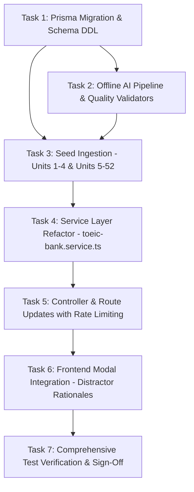

# GrammarPath Phase 3.4B — Report 9: Implementation Roadmap & Execution Workstreams
## Phased Implementation Tasks, Dependency Graphs, Test Milestones, and Verification Criteria

**Date:** 2026-11-13  
**Auditor:** Principal Software Architect & Technical Program Manager  
**Scope:** Phase 3.4B Stage 2 Implementation Tasks, Sequencing, Risk Mitigations, and Milestones  
**Phase Status:** DESIGN ONLY (Phase 3.4B Stage 1)

---

## 1. Executive Summary

This roadmap defines the sequential, risk-mitigated execution plan for **Phase 3.4B Stage 2 (Implementation & Seeding)**. The work is partitioned into 7 discrete, independently testable tasks designed to avoid breaking existing user workflows or introducing schema drift.

---

## 2. Workstream Breakdown & Task Specifications

### Task 1: Database Migration & Schema Implementation
- **Files Modified:** `backend/prisma/schema.prisma`
- **Deliverables:**
  - Define `ToeicPart`, `ToeicQuestionStatus`, and `ToeicSkillCategory` enums.
  - Define `ToeicQuestionBankItem`, `ToeicQuestionOption`, and `ToeicQuestionGenerationRun` models.
  - Run `scripts/run-with-staging-env.mjs -- npx prisma migrate dev --name phase_3_4b_toeic_question_bank` on Neon staging.
  - Verify migration with `verify-migrations.ts`.
- **Exit Criteria:** `prisma migrate status` reports clean schema; zero drift on staging.

### Task 2: Offline Generation Pipeline & Quality Gate Engine
- **Files Created:**
  - `backend/src/services/toeic-validator.service.ts`: Implements automated Gates 1–5 (schema, prompt length, blank count, non-word distractor filter, Jaccard duplicate detection).
  - `backend/src/services/toeic-pipeline.service.ts`: Implements dual-pass blind LLM evaluation and batch runner.
  - `backend/scripts/generate-toeic-bank.ts`: CLI script for batch generation (`--units 5-52 --count 6`).
- **Exit Criteria:** CLI script executes, validates output against rubric, and persists passing items with `status: 'approved'`.

### Task 3: Seed Ingestion Workstream (Units 1–52)
- **Files Created:**
  - `backend/scripts/seed-curated-toeic-bank.ts`: Extracts existing 30 curated questions for Units 1–4 from `toeic-generator.service.ts` and upserts into `ToeicQuestionBankItem`.
  - `backend/scripts/seed-core-toeic-bank.ts`: Seeds validated questions for Units 5–52.
- **Exit Criteria:** Verified count of >= 300 approved questions in `toeic_question_bank_items` covering Units 1–52.

### Task 4: Service Layer Refactoring
- **Files Created / Modified:**
  - `backend/src/services/toeic-bank.service.ts`: Implements `getPracticeQuestionsFromBank(unitNumber, count, difficulty)` querying *only* `status = 'approved'`.
  - Deprecate synchronous generation fallback in `toeic-generator.service.ts`.
- **Exit Criteria:** Query execution latency < 25ms on Neon staging; zero external API calls on read path.

### Task 5: Controller & Route Integration (with Rate Limiting & Telemetry Bridge)
- **Files Modified:**
  - `backend/src/controllers/adaptive.controller.ts`: Refactor `generateToeicPracticeHandler` to fetch from bank.
  - Refactor `checkToeicPracticeHandler` to persist `QuestionAttemptItem` with `attemptSource: "toeic_practice"` inside an atomic `prisma.$transaction`.
  - `backend/src/routes/adaptive.routes.ts`: Verify `submissionRateLimiter` remains attached.
- **Exit Criteria:** Endpoint responds with anti-spoiler questions; checking answer returns detailed distractor rationales and records telemetry item.

### Task 6: Frontend UI Enhancements (`ToeicPracticeModal.tsx`)
- **Files Modified:**
  - `frontend/src/components/adaptive/ToeicPracticeModal.tsx`:
    - Display skeleton loader during instant session fetch.
    - Render expandable accordion showing why each distractor was wrong upon checking.
    - Add optional timed practice stopwatch widget.
    - Display non-ETS attribution disclaimer.
- **Exit Criteria:** UI renders seamlessly; distractor feedback displays accurately; 0 console errors.

### Task 7: Comprehensive Regression & Verification Suite
- **Deliverables:**
  - `backend/tests/phase3-4b-toeic-bank.unit.test.ts`: Unit tests for validators, quality gates, and bank service.
  - `backend/tests/phase3-4b-staging.api.test.ts`: Integration tests on Neon staging verifying live API and telemetry persistence.
  - `backend/scripts/run-phase3-4b-browser-verification.mjs`: Playwright E2E browser test verifying modal practice and answer review.
- **Exit Criteria:** 100% test pass across all backend, frontend, and browser suites.

---

## 3. Milestones & Estimated Schedule

| Milestone | Scope | Target Deliverable | Dependency |
| :--- | :--- | :--- | :--- |
| **M1: Schema & Seeds** | Tasks 1, 2, 3 | Migration deployed; Units 1–52 seeded (~300 items) | Stage 1 Approval |
| **M2: Backend Bank Services** | Tasks 4, 5 | Refactored routes, rate limiting, and telemetry bridge | Milestone M1 |
| **M3: Frontend Experience** | Task 6 | Modal distractor accordion, instant loading | Milestone M2 |
| **M4: Independent Verification** | Task 7 | Reports & Playwright browser sign-off | Milestone M3 |

