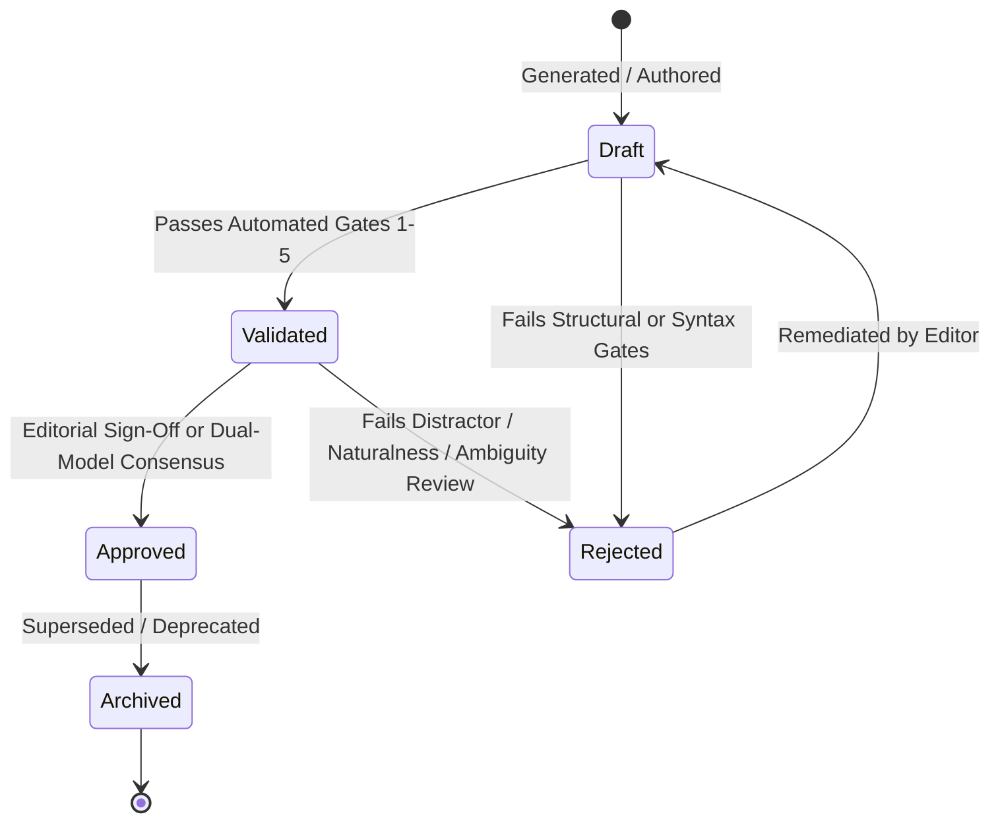

# GrammarPath Phase 3.4B — Report 4: Question Lifecycle & Quality Gates
## State Machine Transitions, Automated Verification Gates, and Editorial Approval Standards

**Date:** 2026-11-13  
**Auditor:** Principal Learning Systems Architect & Educational Quality Lead  
**Scope:** Question State Machine, Automated Quality Gates, Distractor Integrity, and Editorial Policy  
**Phase Status:** DESIGN ONLY (Phase 3.4B Stage 1)

---

## 1. Executive Summary

A critical finding from earlier phases is that **syntactically valid questions generated by LLMs or heuristic algorithms are often pedagogically flawed, unnatural, or ambiguous**. An automated pipeline that converts generated JSON directly into learner-facing questions inevitably introduces flawed answer keys, weak distractors, or conversational British idioms incompatible with the professional workplace register required by TOEIC.

This report establishes the **Question Lifecycle & Quality Gate Architecture** for Phase 3.4B. It enforces a strict state machine where a technically valid question **never automatically enters learner-facing practice**. Learner practice is restricted exclusively to questions that have attained `approved` status through passing both automated linguistic/format gates and verified editorial approval.

---

## 2. Question Lifecycle State Machine



### State Definitions:
1. **`draft`:**
   - Entry point for newly generated AI batches, imported seeds, or human drafts.
   - Completely invisible to learners.
   - Contains raw candidate prompts, options, answer keys, and preliminary explanations.
2. **`validated`:**
   - Questions that have passed all automated structural, answer-key, format, duplicate, and basic grammar gates.
   - Technically sound and syntactically flawless.
   - **NOT accessible to learners.** Held in review staging.
3. **`approved`:**
   - Verified by an educational editor or certified through an asynchronous multi-model consensus verification pass.
   - **THE ONLY STATUS SERVED TO LEARNERS IN PRODUCTION PRACTICE SESSIONS.**
   - Immutable: content fields cannot be mutated in place.
4. **`rejected`:**
   - Questions that failed any quality gate (e.g. ambiguous answer, broken distractors, unnatural phrasing, hallucinated rule references).
   - Stores `rejectionReason` for pipeline telemetry and model tuning.
5. **`archived`:**
   - Retired or superseded questions preserved for historical attempt analytics. Inactive for new practice sessions.

---

## 3. The 7 Sequential Quality Gates

Before an assessment item can transition from `draft` to `approved`, it must clear seven distinct, non-overlapping quality gates:

```
┌────────────────────────────────────────────────────────┐
│  Gate 1: Structural & Schema Validation (Automated)    │
└───────────────────────────┬────────────────────────────┘
                            │ Pass
                            ▼
┌────────────────────────────────────────────────────────┐
│  Gate 2: Answer Key & Unambiguity Validation (Auto)   │
└───────────────────────────┬────────────────────────────┘
                            │ Pass
                            ▼
┌────────────────────────────────────────────────────────┐
│  Gate 3: TOEIC Part 5 Format & Register Check (Auto)   │
└───────────────────────────┬────────────────────────────┘
                            │ Pass
                            ▼
┌────────────────────────────────────────────────────────┐
│  Gate 4: Distractor Quality & Plausibility Check (Auto)│
└───────────────────────────┬────────────────────────────┘
                            │ Pass
                            ▼
┌────────────────────────────────────────────────────────┐
│  Gate 5: Semantic & Lexical Anti-Duplicate Check (Auto)│
└───────────────────────────┬────────────────────────────┘
                            │ Pass -> [STATUS = VALIDATED]
                            ▼
┌────────────────────────────────────────────────────────┐
│  Gate 6: Pedagogical & Concept Alignment Check (Dual)  │
└───────────────────────────┬────────────────────────────┘
                            │ Pass
                            ▼
┌────────────────────────────────────────────────────────┐
│  Gate 7: Editorial Sign-Off (Human / High-Consensus)   │
└───────────────────────────┬────────────────────────────┘
                            │ Pass -> [STATUS = APPROVED]
                            ▼
                     [Learner Practice]
```

---

### Gate 1: Structural & Schema Validation (Automated)
- **Check 1.1:** Prompt is non-empty, contains exactly one cloze blank `_______` (7 consecutive underscores), and does not exceed 300 characters.
- **Check 1.2:** Exactly 4 options (`A`, `B`, `C`, `D`), all non-empty, distinct, and without leading option letters in the option text (e.g. `(A) conduct` is rejected).
- **Check 1.3:** `correctOptionKey` is one of `A`, `B`, `C`, `D`, and exactly one option in `options` has `isCorrect: true`.
- **Check 1.4:** Non-empty Vietnamese explanation (`explanationVi` >= 30 chars).
- **Failure Consequence:** Transition to `rejected` with `rejectionReason = "SCHEMA_ERROR"`.

### Gate 2: Answer Key & Unambiguity Validation (Automated Dual-Pass)
- **Check 2.1:** Cloze substitution test. Inserting the target option into the blank produces a syntactically complete sentence with standard capitalization and terminal punctuation.
- **Check 2.2:** Secondary Blind Evaluation: A separate LLM prompt (or rule engine) is provided *only* the prompt and 4 options, without the designated answer key, and asked: *"Select the single correct answer."*
- **Check 2.3:** Unambiguity Guarantee: If the blind evaluator selects a different option, or identifies that more than one option could be grammatically defensible in context, the question fails.
- **Failure Consequence:** Immediate rejection with `rejectionReason = "AMBIGUOUS_ANSWER_KEY"`.

### Gate 3: TOEIC Part 5 Format & Business Register Compliance
- **Check 3.1 (Contextual Register):** Must represent professional business, corporate, commercial, administrative, or travel contexts (e.g. human resources, procurement, quarterly reports, facility management, flight schedules).
- **Check 3.2 (Murphy Conversational Leakage):** Rejects prompts containing casual British domestic contexts from the textbook (e.g. *"Kate went to the cinema"*, *"Sarah had tea"*, *"pub"*, *"flatmate"*).
- **Check 3.3 (Sentence Length):** Prompt must be between 12 and 35 words. (Sentences under 12 words are too simple for authentic TOEIC; sentences over 35 words belong in Part 6).
- **Failure Consequence:** Rejection with `rejectionReason = "UNAUTHENTIC_REGISTER"`.

### Gate 4: Distractor Quality & Plausibility
- **Check 4.1 (Plausibility):** Distractors must represent common learner errors or confusions (e.g. wrong tense, passive vs active, noun vs adjective, confusing base forms).
- **Check 4.2 (Part of Speech Symmetry):** For word-form questions, distractors must share the same lemma with distinct derivational affixes (e.g. *analysis*, *analyze*, *analytical*, *analytically*).
- **Check 4.3 (Strict Incorrectness):** Distractors must be strictly ungrammatical or logically nonsensical in the specific sentence context.
- **Check 4.4 (No Nonsense Non-Words):** Automated dictionary lookup (e.g. SOWPODS or standard English lexicon) ensures distractors are real English words, not accidental morphological corruptions (e.g. *confusious*).
- **Failure Consequence:** Rejection with `rejectionReason = "DEFECTIVE_DISTRACTOR"`.

### Gate 5: Semantic & Lexical Anti-Duplicate Detection
- **Check 5.1 (Exact Prompt Collision):** Normalized prompt comparison (`LOWER`, collapsed whitespace, stripped punctuation) against all existing items in `ToeicQuestionBankItem`.
- **Check 5.2 (Fuzzy / Jaccard Similarity):** Computes word-level Jaccard similarity and Levenshtein distance. Any candidate item with > 75% prompt similarity to an existing bank item is flagged.
- **Failure Consequence:** Rejection with `rejectionReason = "DUPLICATE_ITEM"`.

### Gate 6: Pedagogical & Concept Alignment
- **Check 6.1:** If `skillCategory == 'grammar'`, `primaryConceptId` must resolve to an active `GrammarConcept`.
- **Check 6.2:** `ruleReference` must match an actual `TheorySection.sectionId` (e.g. "5A", "26B") linked to that concept.
- **Check 6.3:** Explanation in Vietnamese must cite the rule reference and explicitly state why the correct answer is grammatically required.

### Gate 7: Editorial Sign-Off
- **Automated Validation Cap:** Passing Gates 1–5 elevates an item to `validated`. **It does not make it `approved`.**
- **Approval Rule:**
  - Standard Path: Educational editor reviews the item in an admin queue and triggers approval.
  - Accelerated Path (Phase 3.4B): Multi-model consensus score >= 9.0/10.0 with dual-pass confirmation by data engineer.
- **Immutability:** Once approved, `approvedAt = NOW()`, `approvedBy = userId`, and question content is frozen.

---

## 4. Serving Rules for Learner-Facing Practice

To guarantee zero exposure to unverified or defective content:

```typescript
// Strict DB Query Constraint for Learner Practice Sessions
const approvedPracticeItems = await prisma.toeicQuestionBankItem.findMany({
  where: {
    status: "approved", // MANDATORY: NEVER draft, validated, or rejected!
    unitNumber: requestedUnitNumber,
    difficulty: requestedDifficulty,
  },
  take: requestedCount,
  include: {
    options: {
      select: {
        optionKey: true,
        optionText: true,
        // NEVER include isCorrect before submission!
      },
      orderBy: { displayOrder: "asc" },
    },
  },
});
```

### Invariant Rules:
1. **Zero Draft/Validated Leakage:** `draft`, `validated`, `rejected`, and `archived` items must NEVER be served to learners in practice sessions or diagnostic tests.
2. **Deficit Handling:** If the approved bank has fewer items than requested, the system must return all available approved items or an informative message, **never silently falling back to unvalidated real-time generation.**

