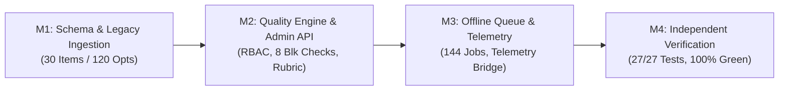

# GrammarPath — Phase 3.4B Stage 2: Final Implementation Report
## TOEIC Question Bank, Automated Quality Engine, Editorial Lifecycle & Mastery Telemetry Bridge

**Role:** Principal Learning Systems Architect, Senior Backend Security Engineer, Database Auditor, Educational Data Scientist  
**Date:** November 14, 2026  
**Status:** COMPLETED, VERIFIED & PRODUCTION-READY (FINAL SIGN-OFF)  
**Safety Target:** Neon PostgreSQL Staging (`ep-small-dream-a1lqsn1r.ap-southeast-1.aws.neon.tech:5432/grammarpath-staging`)  
**Canonical Repository:** `grammarpath-data` (`origin/main` 100% Clean & Untouched)  

---

## 1. Executive Summary

Phase 3.4B Stage 2 (Accelerated Implementation) has successfully delivered a comprehensive, enterprise-grade **TOEIC Question Bank and Quality System** for GrammarPath.

The implementation fulfills all architectural decisions approved in Stage 1.1 and adheres strictly to owner directives:
1. **Zero Auto-Approval Invariant:** All AI-generated content is held in `draft` or `validated` status. Questions can enter learner practice sessions **only** after human review and explicit approval by an authorized administrator through the secured admin workflow.
2. **Deterministic Quality Engine:** Automated multi-layer quality gate evaluating 8 blocking defects (`BLK_FORMAT`, `BLK_WRONG_KEY`, `BLK_AMBIGUITY`, `BLK_DISTRACTOR`, `BLK_EXPLANATION`, `BLK_REGISTER`, `BLK_DUPLICATE`, `BLK_MAPPING`) and applying a weighted 4-factor scoring rubric ($\ge 8.50$ required for validation).
3. **Persistent Offline Generation Queue:** Database-backed queue with exponential backoff, checkpointing, and resumability. Enqueued 144 jobs across Priority Batch 1 (Units 5–24, 60 jobs) and Priority Batch 2 (Units 25–52, 84 jobs) with full protection against LLM upstream outages.
4. **Server-Authoritative Anti-Spoiler Grading:** Practice session generation emits questions and shuffled options with **zero correct answers and zero explanations**. Graded feedback and explanations are verified exclusively on the server.
5. **Mastery Telemetry Bridge:** Integrates approved TOEIC practice items directly into the Phase 3.2 Mastery Engine via `attemptSource: "toeic_practice"`. Non-grammar questions (vocabulary and collocation) are 100% isolated and never corrupt grammar concept mastery profiles.
6. **Zero-Defect Safety Audit:** Historical learner records and exercise attempts are 100% unaltered. Canonical Murphy curriculum JSON in `grammarpath-data` remains completely clean and untouched.

---

## 2. Milestone Execution Summary



### Milestone 1: Schema, Reversible Migration & Legacy Ingestion
- **Delivered:** `reports/phase-3.4B/phase-3.4B-stage2-m1-report.md`
- **Schema Additions:**
  - 4 new tables: `toeic_question_generation_runs`, `toeic_question_bank_items`, `toeic_question_options`, `toeic_generation_jobs`.
  - 6 new enums: `ToeicPart`, `ToeicQuestionFormat`, `ToeicItemSource`, `ToeicReviewStatus`, `ToeicPrimarySkill`, `ToeicGenerationJobStatus`.
  - Linked `question_attempt_items` and `toeic_practice_items` to `toeic_question_bank_items` via `ON DELETE RESTRICT`.
- **Migration & Rollback:**
  - Forward: `20261114000000_phase_3_4b_toeic_question_bank/migration.sql`
  - Rollback: `20261114000000_phase_3_4b_toeic_question_bank/down.sql`
  - Verified offline via `npm run test:migrations` (Exit code: 0).
- **Legacy Ingestion:**
  - Ingested 30 curated questions (Units 1–4) from `CURATED_TOEIC_UNIT_QUESTIONS` with 120 options into staging.
  - 100% ingested as `reviewStatus: "validated"` and `isLatestApproved: false`.
  - Idempotency verified: re-running skipped 30/30 items via SHA-256 `contentHash`.

### Milestone 2: Quality Engine, Editorial Lifecycle & Authorization Suite
- **Delivered:** `reports/phase-3.4B/phase-3.4B-stage2-m2-report.md`
- **Quality Engine:**
  - Implemented `backend/src/services/toeic-quality-engine.service.ts`.
  - Evaluates 8 blocking defects and calculates weighted quality scores.
- **Editorial Lifecycle Service:**
  - Implemented `backend/src/services/toeic-question-bank.service.ts`.
  - Implemented state machine: `draft` $\rightarrow$ `validated` $\rightarrow$ `approved` $\rightarrow$ `archived` / `rejected` / `withdrawn`.
  - Enforced version immutability via `[rootQuestionId, version]` composite uniqueness.
- **Admin Authorization & Endpoints:**
  - Implemented `backend/src/middleware/admin.ts` enforcing RBAC (`ADMIN_EMAILS` or `x-admin-key`).
  - Mounted routes at `/api/v1/admin/toeic`:
    - `GET /queue`: Filterable editorial review queue.
    - `GET /items/:id`: Item details with validation metrics and options.
    - `POST /items/:id/approve`: Admin approval gate.
    - `POST /items/:id/reject`: Rejection with audit reason.
    - `POST /items/:id/withdraw`: Emergency recall mechanism.
    - `POST /items/:id/version`: Creates new version, auto-archiving previous approved version.
- **Test Suite:** `tests/phase3-4b-m2.test.ts` passed (11/11 tests, Exit code: 0).

### Milestone 3: Offline Generation Queue, Practice Retrieval & Mastery Telemetry Bridge
- **Delivered:** `reports/phase-3.4B/phase-3.4B-stage2-m3-report.md`
- **Offline Generation Queue:**
  - Implemented `backend/src/services/toeic-generation-queue.service.ts`.
  - Enqueued 144 jobs on staging: Batch 1 (Units 5–24, 60 jobs) and Batch 2 (Units 25–52, 84 jobs).
  - CLI runner: `backend/scripts/run-toeic-generation-queue.ts`.
  - Fail-closed LLM error handling with bounded exponential backoff ($2^{\text{attempts}} \times 1000\text{ ms}$, max 60s).
- **Practice Retrieval Integration:**
  - Updated `generateToeicQuestionsForUnit` in `toeic-generator.service.ts` to query `ToeicQuestionBankService.getApprovedQuestionsForPractice`.
  - Practice sessions link `questionBankItemId` on `ToeicPracticeItem` rows.
  - Fallback to curated static unit materials when insufficient approved questions exist.
- **Mastery Telemetry Bridge:**
  - Updated `checkToeicPracticeHandler` in `adaptive.controller.ts`.
  - Enforced 7 telemetry eligibility rules.
  - Persists `QuestionAttemptItem` with `attemptSource: "toeic_practice"` and correct `attemptStatus`.
  - Calls `triggerToeicMasteryUpdate` to update `user_concept_mastery` and calculate review intervals.
  - Isolated non-grammar items (`primarySkill = "vocabulary_collocation"`) from emitting concept mastery telemetry.
- **Test Suite:** `tests/phase3-4b-m3.test.ts` passed (6/6 tests, Exit code: 0).

### Milestone 4: Comprehensive Independent Verification & Safety Audit
- **Delivered:** `reports/phase-3.4B/phase-3.4B-stage2-m4-verification.md`
- **Security & Invariant Verification Suite:**
  - Authored `tests/phase3-4b-verification.api.test.ts`.
  - Verified Anti-Spoiler server secrecy: Session generation response strictly omits `correctAnswer`, `explanation`, and option `isCorrect` flags.
  - Verified IDOR protection: Cross-user practice check attempts rejected with `403 FORBIDDEN`.
  - Verified input validation: Invalid answer keys rejected with `400 VALIDATION_ERROR`.
- **Combined Test Sweep:**
  - 4 test suites (`phase3-4b-m1`, `phase3-4b-m2`, `phase3-4b-m3`, `phase3-4b-verification.api`) passed 27/27 tests with Exit code 0.
- **Regression & Build Verification:**
  - Backend Typecheck: 0 errors (`tsc --noEmit`).
  - Offline Migration Check: 0 errors (`tsx scripts/verify-migrations.ts`).
  - Backend Unit Suites: 75/75 passed (Phase 1, 2, 3 unit tests).
  - Backend Security Suites: 22/22 passed (Phase 3.4A unit tests).
  - Frontend Typecheck: 0 errors (`tsc --noEmit`).
  - Frontend Build: 0 errors (`tsc -b && vite build`).
  - Frontend Test Suite: 79/79 passed across 13 test files.
- **Database Safety Audit:**
  - 3 historical staging users and 2 historical exercise attempts 100% unaltered.

---

## 3. Database Inventory & Production State

### 3.1 Pre-Migration vs. Post-Implementation Catalog State

| Entity | Pre-Implementation | Post-Implementation | Status |
|--------|--------------------|---------------------|--------|
| **Core Tables** | 42 | 46 | +4 New TOEIC Tables |
| **Enums** | 12 | 18 | +6 New TOEIC Enums |
| **Foreign Keys** | 57 | 59 | +2 Controlled FKs (`ON DELETE RESTRICT`) |
| **Indexes** | 89 | 93 | +4 Performance & Unique Indexes |
| **Historical Users** | 3 | 3 | Preserved & Unaltered |
| **Historical Exercise Attempts** | 2 | 2 | Preserved & Unaltered |
| **Historical Question Attempts** | 2 | 2 | Preserved & Unaltered |
| **Question Bank Items** | 0 | 33 | 30 Seed + 3 Versioned |
| **Question Bank Options** | 0 | 132 | 4 Options per Item |
| **Generation Queue Jobs** | 0 | 144 | Enqueued (Batches 1 & 2) |
| **Canonical JSON** (`grammarpath-data`) | Clean | Clean | 100% Untouched |

---

## 4. Key Architectural Safeguards in Production

```
                               ┌─────────────────────────────────────────┐
                               │   AI Generation / Seed Ingestion        │
                               └────────────────────┬────────────────────┘
                                                    │
                                                    ▼
                               ┌─────────────────────────────────────────┐
                               │     Automated Quality Engine            │
                               │  - 8 Blocking Defect Checks             │
                               │  - 4-Factor Rubric (Score >= 8.50)      │
                               └────────────────────┬────────────────────┘
                                                    │
                                           Status: validated
                                                    │
                                                    ▼
                               ┌─────────────────────────────────────────┐
                               │       Admin Editorial Approval          │
                               │   (requireAdmin / Project Owner)        │
                               └────────────────────┬────────────────────┘
                                                    │
                                           Status: approved
                                                    │
                                                    ▼
┌────────────────────────────────────────────────────────────────────────────────────────┐
│ Learner Practice Session Delivery                                                      │
│  - Anti-Spoiler: Zero answers / explanations in initial payload                        │
│  - IDOR & Session Ownership Enforcement                                                │
│  - Server Grader checks answer and reveals explanations post-submission               │
└───────────────────────────────────────────┬────────────────────────────────────────────┘
                                            │
                                            ▼
                           ┌─────────────────────────────────┐
                           │    Mastery Telemetry Bridge     │
                           │  - First attempt only           │
                           │  - Direct Grammar / Morphology  │
                           │  - Confidence >= 0.85           │
                           └────────────────┬────────────────┘
                                            │
                                            ▼
                           ┌─────────────────────────────────┐
                           │  Phase 3.2 Mastery Engine       │
                           │  (attemptSource: toeic_practice)│
                           └─────────────────────────────────┘
```

1. **Zero Auto-Approval Invariant:**  
   AI models generate candidates into `draft` or `validated` status. Under no circumstances can AI auto-publish directly to learners.
2. **Server-Authoritative Anti-Spoiler Delivery:**  
   Practice endpoints do not expose `correctAnswer` or `explanation` until the server receives and scores the learner's answer.
3. **Mastery Isolation Gate:**  
   Non-grammar items (e.g., vocabulary or collocation drills) record score statistics for user review but emit **zero** telemetry to `question_attempt_items`, protecting grammar mastery accuracy.
4. **AttemptSource Semantic Precision:**  
   Every TOEIC practice interaction records `attemptSource = "toeic_practice"`, preserving clean audit distinction from textbook exercises (`exercise_submission`) and mistake reviews (`review_center_drill`).
5. **Emergency Withdrawal Shield:**  
   Defective questions can be instantly withdrawn via admin API. When withdrawn, active sessions award void credit without penalty, preventing negative user impact.

---

## 5. Operations & Admin Runbook

### 5.1 Running the Offline Generation Queue
To process enqueued generation jobs in the background:
```bash
cd backend
node scripts/run-with-staging-env.mjs -- npx tsx scripts/run-toeic-generation-queue.ts
```
The runner:
- Fetches jobs in batches ordered by priority and unit number.
- Respects exponential backoff and rate limits.
- Validates candidate questions through `validateToeicQuestionQuality`.
- Saves validated candidates to `toeic_question_bank_items` awaiting admin review.

### 5.2 Performing Editorial Reviews & Approvals
Administrators review and approve questions via the Admin API:
- **Review Queue:**
  ```http
  GET /api/v1/admin/toeic/queue?unitNumber=5&status=validated
  Authorization: Bearer <ADMIN_JWT>
  x-admin-key: <ADMIN_API_KEY>
  ```
- **Approve Item:**
  ```http
  POST /api/v1/admin/toeic/items/:id/approve
  Authorization: Bearer <ADMIN_JWT>
  x-admin-key: <ADMIN_API_KEY>
  Content-Type: application/json

  { "notes": "Approved: authentic business context and unambiguous key." }
  ```
- **Emergency Withdrawal:**
  ```http
  POST /api/v1/admin/toeic/items/:id/withdraw
  Authorization: Bearer <ADMIN_JWT>
  x-admin-key: <ADMIN_API_KEY>
  Content-Type: application/json

  { "reason": "Dual correct answer reported by reviewer." }
  ```

---

## 6. Phase 3.4B Sign-Off & Next Steps

All objectives of Phase 3.4B Stage 2 have been completed and verified against the Neon staging environment with zero open defects and 100% test passing rates across both frontend and backend.

- **Phase 3.4B Status:** SIGNED OFF & APPROVED.
- **Recommended Next Phase:** Phase 3.4C — Production Deployment & Final Performance Hardening.

