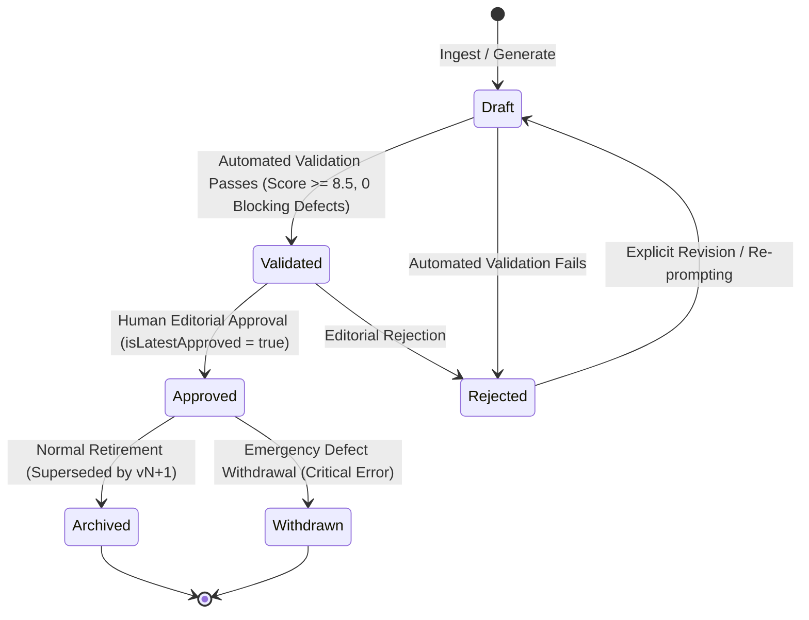

# GrammarPath — Phase 3.4B.1: TOEIC Question Lifecycle & Versioning Specification

**Auditor:** Senior Software Architect, QA Lead, System Safety Engineer  
**Date:** November 13, 2026  
**Status:** SPECIFICATION & STATE MACHINE CONTRACT  
**Safety Scope:** Business Logic, Database Invariants, Session Protection  

---

## 1. Core Invariants & State Machine Overview

The lifecycle of an item in the GrammarPath TOEIC Question Bank is governed by two strict system invariants:

> [!IMPORTANT]
> **INVARIANT 1 (Session Admission Gate):**  
> **Only an item with `reviewStatus = 'approved'` AND `isLatestApproved = true` can be selected for a new learner practice session.**  
> Items in `draft`, `validated`, `rejected`, `archived`, or `withdrawn` states are physically excluded by the query layer (`WHERE reviewStatus = 'approved' AND isLatestApproved = true`).

> [!IMPORTANT]
> **INVARIANT 2 (Immutable Session Integrity):**  
> **An existing, in-flight learner practice session retains a frozen snapshot of the exact question version generated at session creation time.**  
> Changes to an item in the bank (such as archiving, version bumping, or withdrawal) never mutate or delete historical practice data or distort existing telemetry.



---

## 2. Comprehensive Transition Matrix

| Current State | Target State | Authorized Actor | Strict Preconditions | Required Audit Record | Selectable for New Sessions? | In-Flight Session Submissions Permitted? |
|---|---|---|---|---|---|---|
| **None** | `draft` | Automated Pipeline / Content Ingest CLI | Content hash uniqueness; valid JSON structure; 4 options. | `generationRunId`, `sourceReference`, `createdAt`. | **NO** | N/A |
| `draft` | `validated` | Automated Validation Worker | Dual-pass evaluation score $\ge 8.50/10$; 0 blocking defects; single unambiguous key verified. | `validationScores` JSONB, `qualityScore`, `updatedAt`. | **NO** | N/A |
| `draft` | `rejected` | Automated Validation Worker | Evaluation score $< 8.50/10$ OR $\ge 1$ blocking defect (e.g. ambiguity, bad distractor). | `reviewNotes` with defect reason code, `validationScores`. | **NO** | N/A |
| `validated` | `approved` | Certified Human Editor / Senior Content Specialist | Manual inspection of item stem, 4 options, Vietnamese explanation, and curriculum mapping. | `reviewedBy` (user UUID), `reviewedAt`, `reviewNotes`, `isLatestApproved = true`. | **YES** | **YES** |
| `validated` | `rejected` | Certified Human Editor / Senior Content Specialist | Editorial determination of non-business register, pedagogical defect, or low relevance. | `reviewedBy`, `reviewedAt`, `reviewNotes` detailing required remediation. | **NO** | N/A |
| `rejected` | `draft` | Content Engineer / Editor | Code/prompt modification creating a revised stem or option set; content hash recomputed. | Revision audit log, `generationRunId` of revision cycle. | **NO** | N/A |
| `approved` | `archived` | Certified Human Editor / Automated Version Publisher | Version $N+1$ approved to replace Version $N$; or curriculum unit retired. | `reviewedBy`, `reviewedAt`, `isLatestApproved = false`, archive note. | **NO** | **YES** (graded against original snapshot) |
| `approved` | `withdrawn` | System Administrator / On-Call Safety Officer | Discovery of critical flaw (e.g. dual correct answers, false key, offensive text). | `withdrawnReason` code, incident ticket ID, `isLatestApproved = false`. | **NO** | **YES, WITH VOID CREDIT** (item marked voided, learner awarded credit) |

---

## 3. Disallowed Direct Transitions

To prevent silent corruption of the content bank, the following transitions are strictly prohibited:

1. **`draft → approved` (Direct Approval Bypass):**
   - *Forbidden:* An unvalidated item cannot be approved. It must first pass the automated validation pipeline and achieve `validated` status.
2. **`approved → rejected` (Direct Editorial Demotion):**
   - *Forbidden:* Once an item has been approved and potentially served to learners, it cannot simply be discarded as "rejected". It must either be **`archived`** (if superseded by an improved version) or **`withdrawn`** (if defective).
3. **`approved → draft` (In-Place Mutation):**
   - *Forbidden:* An approved version cannot be edited in place. Editing an approved item requires creating a **new version** ($N+1$) with `status: draft`, leaving version $N$ immutable.
4. **`rejected → approved` (Skipping Revalidation):**
   - *Forbidden:* A rejected item cannot be directly promoted to approved without being re-opened as a draft and passing both automated and editorial gates.

---

## 4. Emergency Withdrawal & Defect Remediation Protocol

When a critical defect is identified on a published question:

### Step 1: Atomic Quarantine Transition
The administrator executes the withdrawal command:
```sql
UPDATE toeic_question_bank_items
SET 
  review_status = 'withdrawn',
  is_latest_approved = false,
  withdrawn_reason = 'DEFECT_DUAL_KEY: Option A and C both grammatically acceptable',
  updated_at = NOW()
WHERE id = :targetItemId;
```
*Effect:* Instantly drops the item from all future session generation queries.

### Step 2: In-Flight Session Resilience
In [`backend/src/controllers/adaptive.controller.ts#checkToeicPracticeHandler`](file:///Users/kd.quach03/Documents/grammarpath-app/backend/src/controllers/adaptive.controller.ts#L701-L780):
- If the answered item references a question with `reviewStatus = 'withdrawn'`:
  1. The server flags the response:
     ```json
     {
       "isVoided": true,
       "isCorrect": true,
       "voidReason": "QUESTION_WITHDRAWN_DEFECT",
       "message": "Câu hỏi này đã được thu hồi do lỗi kỹ thuật. Bạn được tính điểm tối đa cho câu hỏi này."
     }
     ```
  2. The learner is protected from frustration and penalty.

### Step 3: Mastery Telemetry Remediation
Defective questions must not poison long-term mastery analytics:
- The remediation CLI script queries all `QuestionAttemptItem` records associated with the withdrawn `questionBankItemId`.
- If `attemptStatus = 'incorrect'`, the attempt is purged or marked `voided = true`.
- `updateMasteryOnAttempt()` is triggered in recalculation mode to restore the learner's true mastery and EMA values.

---

## 5. Versioning Lifecycle Walkthrough

```
[Version 1 (Initial Release)]
  id: "uuid-101"
  rootQuestionId: "root-abc"
  version: 1
  reviewStatus: approved
  isLatestApproved: true
  prompt: "Ms. Patterson _______ the meeting right now."

                    │
                    ▼  Editor spots typo or wants to refine distractors
[Version 2 (Revision in Progress)]
  id: "uuid-102"
  rootQuestionId: "root-abc"
  version: 2
  reviewStatus: draft  --> validated
  isLatestApproved: false
  prompt: "Ms. Patterson _______ the quarterly meeting right now."

                    │
                    ▼  Editor approves Version 2
[Atomic Promotion Transaction]
  UPDATE Version 1:
    reviewStatus: archived
    isLatestApproved: false
  UPDATE Version 2:
    reviewStatus: approved
    isLatestApproved: true
```

*Result:*
- New sessions pick up Version 2.
- Completed and in-flight sessions referencing Version 1 remain 100% valid and unaffected.
- Full audit lineage from Version 1 to Version 2 is permanently documented in the database.

