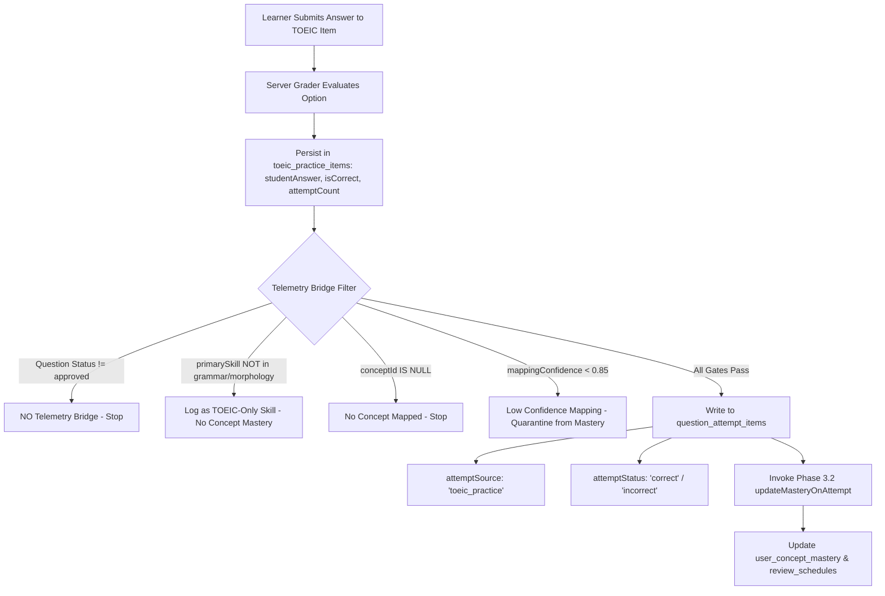

# GrammarPath — Phase 3.4B.1: Mastery Telemetry Contract & Bridge Specification

**Auditor:** Senior Learning Analytics Engineer, Backend Architect  
**Date:** November 13, 2026  
**Status:** SPECIFICATION & TELEMETRY CONTRACT  
**Safety Scope:** Mastery Engine Invariants, Attempt Telemetry & Concept Isolation  

---

## 1. Executive Principle: Separation of Attempt History from Mastery Evidence

A foundational architectural requirement of GrammarPath is the strict separation between **Comprehensive Attempt History** and **Curricular Mastery Evidence**:

> [!IMPORTANT]
> **Core Architectural Separation:**
> 1. **Comprehensive Attempt History (`toeic_practice_items`):**  
>    Captures 100% of user interactions across all TOEIC practice sessions, including grammar questions, morphology items, vocabulary drills, reading comprehension, and listening passages. It serves user review, mistake logs, session score cards, and overall TOEIC readiness metrics.
> 2. **Mastery Evidence (`question_attempt_items` $\rightarrow$ `user_concept_mastery`):**  
>    Captures **only high-confidence, grammar-concept-mapped** learning signals that satisfy the Phase 3.2 Mastery Engine contract. Attempting a vocabulary-only item or an unmapped question must **never** mutate grammar concept mastery.

---

## 2. The Telemetry Bridge Ingestion Rules

When a learner submits an answer via `POST /api/v1/adaptive/toeic-practice/check`:



### 2.1 The Seven Mandatory Eligibility Gates
An interaction in a TOEIC practice session triggers an entry in `question_attempt_items` and updates `user_concept_mastery` **if and only if all seven of the following conditions are met**:

1. **Gate 1 (Lifecycle State):** The target item version must be `reviewStatus = 'approved'`. Draft, validated, rejected, archived, or withdrawn items never emit mastery telemetry.
2. **Gate 2 (Skill Domain Isolation):** The item's `primarySkill` must be either:
   - `direct_grammar`
   - `word_form_morphology` (where morphological inflection reflects grammatical syntax, e.g. gerund vs participle).  
   *Items categorized under `vocabulary_collocation`, `reading_comprehension`, or `listening_comprehension` are strictly prohibited from writing to grammar concept mastery.*
3. **Gate 3 (Concept Referential Integrity):** The item must have an explicit foreign key `conceptId` referencing an existing record in `grammar_concepts`.
4. **Gate 4 (Mapping Confidence Threshold):** The item's `conceptMappingConfidence` must be $\ge 0.85$ (85%). Any experimental or low-confidence automated mapping ($< 0.85$) is quarantined from the mastery engine.
5. **Gate 5 (Attempt Source Preservation):** The telemetry row in `question_attempt_items` must strictly set:
   ```typescript
   attemptSource: "toeic_practice"
   ```
6. **Gate 6 (Binary Answer Status Integrity):** The telemetry row must strictly set:
   ```typescript
   attemptStatus: isCorrect ? "correct" : "incorrect"
   ```
   *(Note: Partial or omitted status cannot occur on a submitted 4-choice TOEIC question).*
7. **Gate 7 (Immutable Question Version Linkage):** The telemetry row links to the exact version ID of the `ToeicQuestionBankItem`, ensuring historical auditability.

---

## 3. Preservation of Phase 3.2 Mastery Semantics

> [!CAUTION]
> **Strict Safety Constraint:**  
> **The Phase 3.2 mastery algorithm, its weights, exponential moving averages (EMA), retention decay models, and spacing intervals MUST NOT be altered.**

### 3.1 Seamless Contract Integration
Under Phase 3.2 (`backend/src/services/mastery.service.ts`), the mastery engine accepts an `attemptSource` parameter:
```typescript
export async function updateMasteryOnAttempt(
  userId: string,
  conceptId: string,
  isCorrect: boolean,
  attemptSource: AttemptSource,
  tx?: Prisma.TransactionClient
): Promise<UserConceptMastery>
```
The enum `AttemptSource` already includes `"toeic_practice"`.

### 3.2 How TOEIC Evidence Feeds the Phase 3.2 Mastery Formula
In Phase 3.2, mastery is calculated via an EMA that blends historical performance with fresh evidence:
$$\text{EMA}_{\text{new}} = \alpha \cdot \text{score} + (1 - \alpha) \cdot \text{EMA}_{\text{old}}$$
- When a learner answers a concept-mapped TOEIC Part 5 question correctly:
  - $\text{score} = 1.0$.
  - It provides positive evidence of real-world syntactic application (transfer learning).
- When a learner answers incorrectly:
  - $\text{score} = 0.0$.
  - It signals that the learner struggles to apply the grammar rule in formal business contexts.
- Retention curves and next review intervals (`nextReviewAt`) advance or contract according to the existing Spaced Repetition formulas without code modification.

---

## 4. Handling Non-Grammar TOEIC Domains

TOEIC preparation encompasses skills beyond pure grammar. The table below specifies how each domain is handled by the telemetry pipeline:

| TOEIC Skill Domain | Mapped to `GrammarConcept`? | Emits to `question_attempt_items`? | Updates `user_concept_mastery`? | Emits to TOEIC Performance Analytics? |
|---|---|---|---|---|
| **Direct Grammar** (Tenses, Modals, Passives, Conditionals) | **YES** (Direct concept FK) | **YES** (`toeic_practice`) | **YES** | **YES** |
| **Word Form / Morphology** (Noun/Verb/Adj/Adv inflections) | **YES** (Syntactic concept FK) | **YES** (`toeic_practice`) | **YES** | **YES** |
| **Vocabulary & Collocation** (Business idioms, prepositions of idiom) | **NO** | **NO** | **NO** | **YES** (Tracked in TOEIC Vocab Subscore) |
| **Reading Comprehension** (Parts 6 & 7 text understanding) | **NO** | **NO** | **NO** | **YES** (Tracked in TOEIC Reading Score) |
| **Listening Comprehension** (Parts 1–4 audio drills) | **NO** | **NO** | **NO** | **YES** (Tracked in TOEIC Listening Score) |

---

## 5. Idempotency and Anti-Tampering Protections

1. **Submission Deduplication:** As established in Phase 3.4A, every submission incorporates `runDeduplicatedSubmission` with key `toeic-check:${userId}:${item.id}:${submissionId}`. Re-sending an answer cannot trigger duplicate mastery increments.
2. **One Attempt Telemetry Row per Question Instance:** A learner re-attempting a question within the same practice session increments `attemptCount` in `ToeicPracticeItem`, but only the **first graded interaction** emits mastery telemetry, preventing artificial mastery grinding via trial-and-error.
3. **Transaction Safety:** Writing to `toeic_practice_items`, inserting `question_attempt_items`, and updating `user_concept_mastery` execute within a single atomic Prisma transaction (`prisma.$transaction`).

