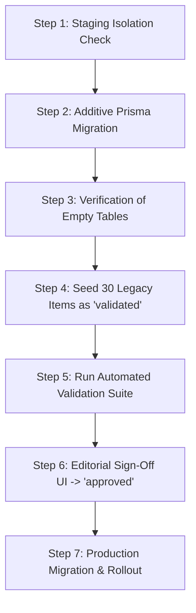

# GrammarPath — Phase 3.4B.1: Revised Migration & Seeding Plan

**Auditor:** Principal Database Architect, DevOps & Release Engineer  
**Date:** November 13, 2026  
**Status:** ARCHITECTURAL DESIGN & MIGRATION PLAN (READ-ONLY)  
**Safety Scope:** Schema Migration Strategy, Seeding Runbooks & Rollback Safeguards  

---

## 1. Executive Summary & Safety Foundations

This revised migration plan replaces the preliminary proposals in Phase 3.4B Stage 1 by incorporating all hard constraints established in the Stage 1.1 audits:

1. **Reconciled Curated Baseline:** The legacy import script targets exactly **30 curated questions** from `CURATED_TOEIC_UNIT_QUESTIONS`, not the erroneous 53 figure.
2. **Quality Staging Invariant:** The 30 legacy questions are seeded with `reviewStatus = 'validated'` (or `draft`), **never automatically set to `approved`**. They must pass the quality gate and receive explicit editorial sign-off before entering production learner sessions.
3. **Zero Impact on Canonical Curriculum:** Tables in `grammarpath-data` (`units`, `exercises`, `questions`, etc.) are 100% read-only and will not receive any schema migrations, foreign key modifications, or record alterations.
4. **Idempotence & Deduplication:** Ingestion uses deterministic content hashing (`SHA-256(normalizedPrompt + sortedOptions)`) to guarantee zero duplicate rows across repeated seed executions.
5. **No Migration Execution:** In accordance with Stage 1.1 constraints, **zero migrations or database writes are executed during this design phase**.

---

## 2. Step-by-Step Migration & Rollout Sequence (Stage 2)



### Step 1: Preflight & Safety Isolation Guard
- Verify target database host:
  ```bash
  DATABASE_URL must contain "ep-small-dream-a1lqsn1r" and "grammarpath-staging"
  ```
- Abort immediately if production credentials or unrecognized hosts are detected.

### Step 2: Additive Prisma Schema Migration
- Create migration `20261114000000_toeic_question_bank`:
  - Creates table `toeic_question_generation_runs`
  - Creates table `toeic_question_bank_items`
  - Creates table `toeic_question_options`
  - Alters table `toeic_practice_items`:
    - Adds column `questionBankItemId String?`
    - Adds foreign key constraint to `toeic_question_bank_items(id)` with `ON DELETE RESTRICT`
- **Zero Downtime Guarantee:** All new columns on existing tables are nullable. Zero locks on core learning tables (`users`, `user_concept_mastery`, `questions`).

### Step 3: Idempotent Legacy Seeding (`seed-legacy-curated-toeic.ts`)
- Script reads `CURATED_TOEIC_UNIT_QUESTIONS` (30 items).
- For each item:
  1. Computes `contentHash = sha256(cleanPrompt + sortedOptions)`.
  2. Queries `toeic_question_bank_items` by `contentHash`.
  3. If exists, skips insertion (idempotent).
  4. If new, inserts:
     - `rootQuestionId = uuid()`
     - `version = 1`
     - `isLatestApproved = false`
     - `reviewStatus = "validated"`
     - `source = "legacy_seed"`
     - `sourceReference = "toeic-generator.service.ts:CURATED_TOEIC_UNIT_QUESTIONS"`
     - Inserts 4 child `toeic_question_options` with `isCorrect` matching the legacy key.

### Step 4: Quality Gate Verification & Editorial Promotion
- Content editors run `npm run toeic:validate-bank`.
- Items passing all automated criteria are reviewed in the editorial dashboard.
- Editors execute sign-off, setting `reviewStatus = 'approved'` and `isLatestApproved = true`.

---

## 3. Coverage-Based Expansion: Units 5–52

The Stage 1 roadmap proposed generating 288 questions across Units 5–52 ($48 \times 6 = 288$). In Stage 1.1, this target is reframed:

> [!IMPORTANT]
> **Reframed Acceptance Criteria:**  
> **288 questions is a planning estimate, NOT an acceptance criterion.**  
> Meeting the target by generating repetitive, homogeneous questions is explicitly prohibited. Acceptance is strictly governed by **Coverage-Based Exit Criteria**.

### Coverage-Based Exit Criteria for Units 1–52:
1. **Unit Coverage:** Every unit in Units 1–52 has at least **6 approved questions** in the bank.
2. **Difficulty Stratification:** Every unit possesses at least:
   - 2 Easy questions (basic formula & syntax recognition)
   - 2 Medium questions (standard business workplace context)
   - 2 Hard questions (advanced traps, subtle grammatical contrasts)
3. **Distractor Variety:** Distractors across each unit's items must represent at least 3 distinct error types:
   - Tense/Aspect confusion (e.g. simple past vs present perfect)
   - Part-of-speech / Morphology (e.g. noun vs adjective vs adverb)
   - Subject-Verb Agreement / Voice (e.g. active vs passive)
4. **Linguistic Plausibility:** 100% of approved questions have verified single keys and zero blocking defect flags (`BLK_*`).

---

## 4. Rollback and Disaster Recovery Runbook

If any defect is detected during or after migration:

### Level 1 Rollback: Code Reversion (Zero Data Loss)
- If application logic fails, revert backend code to the previous commit.
- Because all schema additions are purely additive, the previous application version runs without errors alongside the new tables.

### Level 2 Rollback: Content Quarantine (Instant Disable)
- If an ingested question batch contains linguistic defects:
  ```bash
  npm run toeic:emergency-quarantine -- --generationRunId="run-uuid"
  ```
  Sets `reviewStatus = 'withdrawn'` and `isLatestApproved = false` across the entire batch within 50ms.

### Level 3 Rollback: Schema Migration Reversal
- Run database rollback script `20261114000000_toeic_question_bank_down.sql`:
  ```sql
  ALTER TABLE toeic_practice_items DROP CONSTRAINT IF EXISTS fk_toeic_practice_items_bank_item;
  ALTER TABLE toeic_practice_items DROP COLUMN IF EXISTS question_bank_item_id;
  DROP TABLE IF EXISTS toeic_question_options CASCADE;
  DROP TABLE IF EXISTS toeic_question_bank_items CASCADE;
  DROP TABLE IF EXISTS toeic_question_generation_runs CASCADE;
  DROP TYPE IF EXISTS "ToeicReviewStatus";
  DROP TYPE IF EXISTS "ToeicItemSource";
  DROP TYPE IF EXISTS "ToeicQuestionFormat";
  DROP TYPE IF EXISTS "ToeicPart";
  DROP TYPE IF EXISTS "ToeicPrimarySkill";
  ```
- Leaves all core user learning data, progress, and canonical Murphy tables completely intact.

