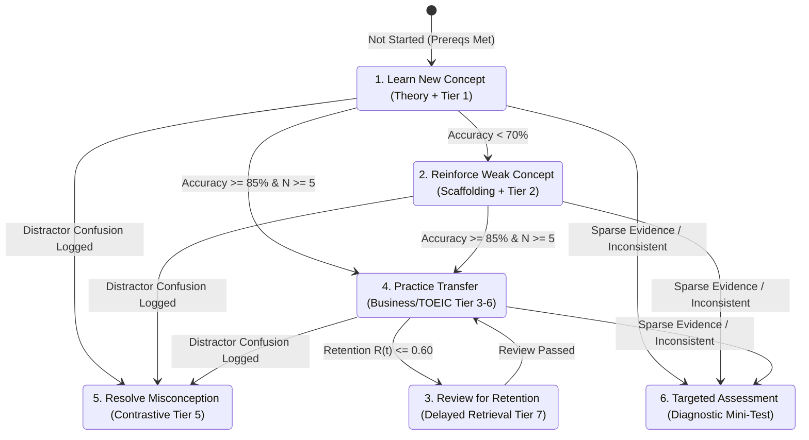
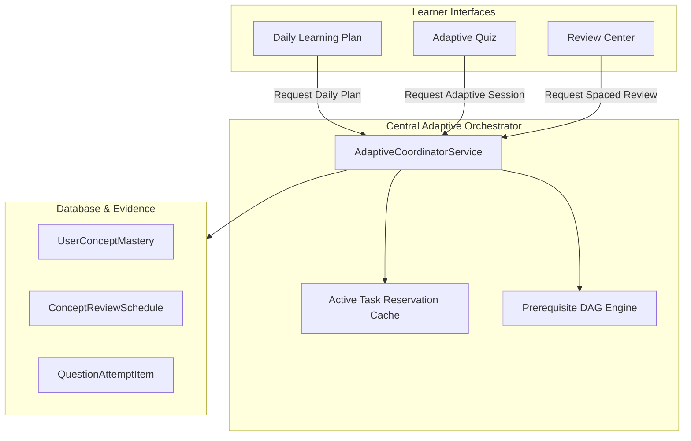

# GrammarPath — Phase 3.4C Stage 1G & 1H: Adaptive Learning Architecture & Learner UX Design

## 1. Executive Summary & Design Scope

The primary failure of conventional computer-assisted language learning (CALL) platforms is **static, uncoordinated activity assignment**. Learners are repeatedly fed redundant drills on concepts they already know, thrust into complex transfer tasks before establishing foundational grammar schemas, or bombarded with disconnected tasks across separate tabs (Daily Plan, Review Center, Adaptive Quiz).

This report specifies the architectural design for:
1. **Stage 1G: Adaptive Activity Coordination Engine** across 6 distinct learning modes with strict prerequisite and readiness gates.
2. **Subsystem Harmonization**: Eliminating task duplication and contention between the Daily Learning Plan, Adaptive Quiz, and Review Center.
3. **Stage 1H: Learner UX & Explainable Mastery**: Replacing deceptive binary labels ("Mastered") with a 7-tier calibrated status taxonomy, complete with bilingual (Vietnamese/English) diagnostic explanations and transparent evidence breakdowns.

---

## 2. The Six Pedagogical Activity Modes

An adaptive engine must match the pedagogical nature of the activity to the learner's exact cognitive state. Phase 3.4C establishes six formalized activity modes:



### Detailed Mode Specifications

| Mode ID | Mode Name | Target Learner State | Pedagogical Objective | Allowed Question Tiers | Scaffolding / Hint Level |
| :--- | :--- | :--- | :--- | :--- | :--- |
| **MODE_1** | **Learn New Concept** | `NOT_STARTED` with all DAG prerequisites completed | Initial schema formation & rule understanding | Tier 1 (Textbook Canonical Exercises) | High (Bilingual theory, rule reference, inline examples) |
| **MODE_2** | **Reinforce Weak Concept** | `DEVELOPING` ($\theta_{\text{foundational}} < 0.70$, $N \ge 3$) | Error correction, pattern stabilization | Tier 1 & Tier 2 (Similar-form drills) | Medium (Grammar rule hints enabled, step-by-step guidance) |
| **MODE_3** | **Review Approaching Forgetting** | `NEEDS_REVIEW` ($R(t) \le 0.60$ or `dueAt <= now`) | Long-term memory consolidation & retrieval strength | Tier 7 (Delayed Retrieval, mixed context) | None (Strict testing conditions, no prompt hints) |
| **MODE_4** | **Practice Transfer** | `PROFICIENT` ($\theta \ge 0.85$, $N \ge 5$, $ITEC < 3$) | Contextual generalization & workplace application | Tier 3 (Structural), Tier 4 (Contextual), Tier 6 (TOEIC Part 5) | Low (Context clues only, no direct rule reminders) |
| **MODE_5** | **Resolve Misconception** | Persistent error pattern / contrastive failure | Discrimination between confused grammar rules | Tier 5 (Contrastive pairs, minimal difference sentences) | Diagnostic (Comparative rule tables & distractor refutations) |
| **MODE_6** | **Targeted Assessment** | `INSUFFICIENT_EVIDENCE` or high cross-context variance | Rapid psychometric calibration & gap diagnosis | Tier 1–6 (Balanced diagnostic 3–5 question probe) | Zero (Unassisted, timed, server-authoritative) |

---

## 3. Prioritization & Readiness Gates

To prevent the common pitfalls of adaptive engines, the coordinator enforces two hard constraints:

### Constraint 1: Anti-Triviality Gate (No Redundant Drill on Mastered Rules)
- If a concept has $\theta_{\text{foundational}} \ge 0.90$ and $N_{\text{distinct}} \ge 8$, the engine is **strictly forbidden** from assigning additional Tier 1 or Tier 2 textbook drills.
- Any subsequent practice for this concept must be either **Transfer Practice (Mode 4)** or **Spaced Review (Mode 3)**.

### Constraint 2: Transfer Readiness Gate (No Premature Transfer)
- A learner must **never** be assigned TOEIC Part 5 or Tier 3–6 transfer questions on a concept unless:
  1. Foundational competence meets readiness: $\theta_{\text{foundational}} \ge 0.80$
  2. Distinct foundational evidence count: $N_{\text{foundational}} \ge 4$ questions
- **Pedagogical Rationale:** Exposing a learner who has not yet mastered basic subject-auxiliary inversion to complex TOEIC business paragraphs produces cognitive overload and guessing, yielding invalid assessment data.

### Global Activity Selection Priority Score

When the engine selects the next activity for a learner's study session, candidate concepts are ranked using the **Priority Objective Function** $\Psi(c)$:

$$\Psi(c) = w_{\text{urgency}} U(c) + w_{\text{readiness}} R_{\text{ready}}(c) + w_{\text{pref}} P(c)$$

Where:
1. **Urgency Factor $U(c)$**:
   - $U(c) = 100$ if $R(t) \le 0.50$ (High danger of memory extinction).
   - $U(c) = 80$ if unresolved active mistakes exist for $> 24$ hours.
   - $U(c) = 60$ if concept is in `DEVELOPING` status ($\theta < 0.70$).
   - $U(c) = 40$ if concept is ready for Transfer Practice ($\theta \ge 0.85, ITEC < 3$).
   - $U(c) = 20$ for next unlearned concept in curriculum sequence.
2. **Readiness Multiplier $R_{\text{ready}}(c)$**:
   - $1.0$ if all prerequisite concepts in the DAG have status $\ge \text{PROFICIENT}$.
   - $0.0$ if any mandatory prerequisite has $\theta_{\text{foundational}} < 0.70$ (Hard block).
3. **User Preference Alignment $P(c)$**:
   - $+15$ if activity matches user's target objective (e.g. TOEIC prep vs general grammar).

---

## 4. Subsystem Harmonization: Daily Plan, Adaptive Quiz, and Review Center

Currently, GrammarPath exhibits **subsystem contention**: `daily-plan.service.ts`, `adaptive.controller.ts`, and `review.service.ts` independently query attempts and schedules without cross-coordination.

### Unified Orchestration Architecture



### The Three Coordination Invariants

1. **The Single-Reservation Invariant:**
   When an item or concept is assigned in the Daily Learning Plan for Date $D$, it is flagged with a 24-hour reservation token. The Adaptive Quiz generator must **exclude** any questions or concepts currently reserved in the Daily Plan to avoid same-day double-testing.
2. **The Shared Progress Contract:**
   Completing a review session in the Review Center or answering an item in Adaptive Quiz immediately updates both `UserConceptMastery` and `ConceptReviewSchedule`. If the completed activity satisfies an item in the active Daily Plan, the Daily Plan item status transitions to `completed` automatically.
3. **Specialized Routing Responsibilities:**
   - **Review Center:** Exclusively handles **Mode 3 (Retention Review)** and **Mode 5 (Misconceptions)**.
   - **Adaptive Quiz:** Dynamically serves **Mode 4 (Transfer Practice)**, **Mode 2 (Targeted Weakness Remediation)**, and **Mode 6 (Diagnostic Probes)**.
   - **Daily Learning Plan:** Assembles a balanced daily portfolio containing at most:
     - 1 Spaced Review item (Mode 3)
     - 1 Remediation item (Mode 2 or 5)
     - 1 New/Transfer Practice item (Mode 1 or 4)

---

## 5. Stage 1H: Explainability & Learner UX Design

### 5.1 Calibrated 7-Tier Mastery Status Taxonomy

Phase 3.4C eliminates the deceptive binary flag `is_mastered = true` and replaces it with seven granular, evidence-based states:

| Status Code | Display Label (EN) | Display Label (VI) | Badge Style | Entry Criteria |
| :--- | :--- | :--- | :--- | :--- |
| `NOT_STARTED` | Not Started | Chưa bắt đầu | Gray / Neutral | $N_{\text{total}} = 0$ |
| `LEARNING` | Learning | Đang học | Blue / In-progress | $1 \le N_{\text{foundational}} < 3$ (Initial exposure) |
| `DEVELOPING` | Developing | Đang rèn luyện | Amber / Warning | $N_{\text{foundational}} \ge 3$ and $\theta_{\text{foundational}} < 0.75$ |
| `PROFICIENT` | Proficient | Nắm vững căn bản | Green / Standard | $\theta_{\text{foundational}} \ge 0.85$, $N_{\text{foundational}} \ge 5$, $ITEC < 3$ |
| `STRONG_TRANSFER` | Advanced Transfer | Vận dụng nâng cao | Purple / Elite | $\theta_{\text{foundational}} \ge 0.85$, $\tau_{\text{transfer}} \ge 0.80$, $ITEC \ge 3$, $CCC \ge 0.75$ |
| `NEEDS_REVIEW` | Needs Review | Cần ôn tập | Red / Alert | Previously Proficient, but $R(t) \le 0.60$ or active errors |
| `INSUFFICIENT_EVIDENCE` | Needs Evidence | Cần thêm dữ liệu | Orange / Outline | High accuracy ($\ge 85\%$) but $N_{\text{distinct}} < 3$ |

### 5.2 Diagnostic Feedback Card Specification

When a learner views their progress dashboard or completes a session, the system displays a structured **Concept Diagnostic Card**:

```
+------------------------------------------------------------------------------------+
|  Unit 1: Present Continuous (I am doing)                   [ ADVANCED TRANSFER ]  |
+------------------------------------------------------------------------------------+
|                                                                                    |
|  Evidence Breakdown:                                                              |
|  • Foundational Competence:  92%  [█████████░]  (6/6 textbook questions correct)   |
|  • Transfer Ability:         84%  [████████░░]  (3/4 TOEIC Part 5 questions)       |
|  • Retention Health:         78%  [███████░░░]  (Last practiced: 6 days ago)       |
|                                                                                    |
|  Pedagogical Diagnosis (Chẩn đoán sư phạm):                                        |
|  VI: Bạn đã làm chủ hoàn toàn cấu trúc câu và thì Hiện tại tiếp diễn trong ngữ     |
|      cảnh hàng ngày. Khi áp dụng vào bài thi TOEIC (ngữ cảnh doanh nghiệp), bạn    |
|      làm đúng 3/4 câu.                                                             |
|  EN: You have fully mastered the structure and daily usage of Present Continuous.   |
|      In TOEIC business contexts, you solved 3 out of 4 transfer questions correctly.|
|                                                                                    |
|  Identified Learning Gap (Điểm cần lưu ý):                                         |
|  VI: Bạn có xu hướng phân vân giữa thì Hiện tại tiếp diễn và Hiện tại đơn khi câu  |
|      có trạng từ chỉ tần suất (always/usually).                                    |
|  EN: You hesitate between Present Continuous and Present Simple when frequency     |
|      adverbs (always/usually) appear.                                              |
|                                                                                    |
|  Next Recommended Step (Bước tiếp theo):                                           |
|  [ Luyện tập phân biệt thì (Mode 5: Contrastive Practice) - 3 câu - ~4 phút ]      |
+------------------------------------------------------------------------------------+
```

### 5.3 Concrete Bilingual Explanation Templates

The UX engine formats explanations dynamically based on the learner's weakest dimension:

#### Template A: Insufficient Evidence State
- **VI:** *"Bạn đã trả lời đúng 2 câu đầu tiên, nhưng hệ thống cần ít nhất 3 câu hỏi thuộc các dạng bài khác nhau để xác nhận bạn đã thực sự nắm vững quy tắc này."*
- **EN:** *"You answered the first 2 questions correctly, but the system requires at least 3 distinct question types before confirming your understanding of this rule."*

#### Template B: Strong Textbook, Weak Transfer State
- **VI:** *"Bạn đạt 95% ở bài tập sách giáo khoa nhưng chỉ đạt 40% ở các câu hỏi TOEIC thực tế. Bạn cần luyện thêm khả năng nhận diện dấu hiệu ngữ pháp trong câu dài và từ vựng công sở."*
- **EN:** *"You achieved 95% on textbook exercises but only 40% on workplace TOEIC questions. Further practice is recommended to recognize grammar signals within complex sentences."*

#### Template C: Memory Decay / Needs Review State
- **VI:** *"Đã 24 ngày kể từ lần cuối bạn làm bài tập về 'Mệnh đề quan hệ'. Độ bền trí nhớ ước tính giảm còn 55%. Hãy hoàn thành 3 câu ôn tập nhanh để củng cố trí nhớ."*
- **EN:** *"It has been 24 days since you last practiced 'Relative Clauses'. Estimated memory retention has dropped to 55%. Complete a 3-question review to restore retention."*

---

## 6. Architectural Decision Summary

1. **Centralized Adaptive Coordination:** All learning requests from the Daily Plan, Adaptive Quiz, and Review Center must pass through a single coordinator service (`AdaptiveCoordinatorService`) that guarantees single-reservation and non-overlapping item delivery.
2. **Two-Way Gating:** The coordinator enforces Anti-Triviality (blocking redundant drill on mastered rules) and Transfer-Readiness (blocking premature TOEIC practice before foundational competence).
3. **Calibrated Transparency:** Binary "mastery" is abolished in favor of a 7-tier status taxonomy and multi-dimensional diagnostic reporting.

