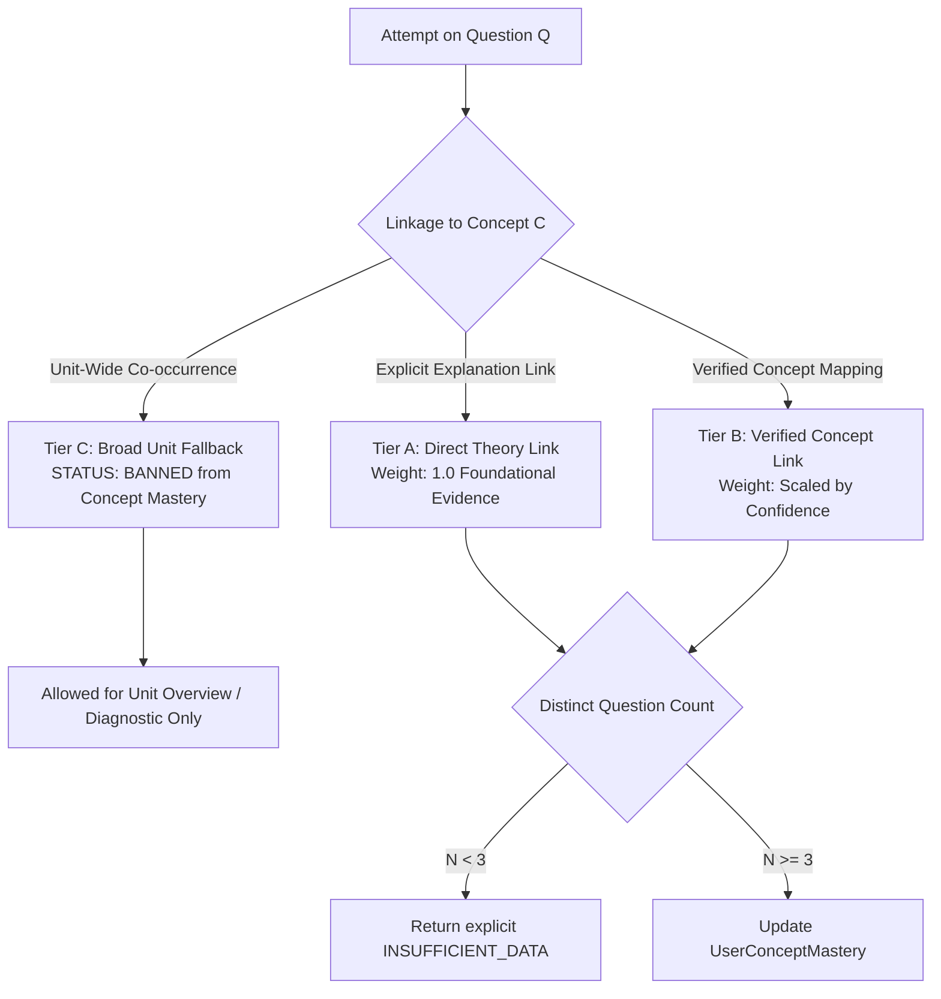

# GrammarPath — Phase 3.4C: Concept Evidence Isolation & Fallback Policy Specification

## 1. Specification Purpose & Problem Statement

This specification resolves **Critical Defect P0-B** identified during the Phase 3.4C Stage 1 audit:
In `backend/src/services/mastery.service.ts` (lines 89–105), when a grammar concept is associated with fewer than 5 questions linked via explicit `Explanation.theorySectionId`, the service executes an unconditional unit-wide fallback query:

```typescript
// backend/src/services/mastery.service.ts:94-104
if (questionIdsSet.size < 5 && associatedUnitIds.size > 0) {
  const questionsByUnit = await db.question.findMany({
    where: {
      isExample: false,
      exercise: {
        unitId: { in: Array.from(associatedUnitIds) },
      },
    },
    select: { id: true },
  });
  questionsByUnit.forEach((q) => questionIdsSet.add(q.id));
}
```

This broad fallback violates the fundamental measurement axiom of **Construct Relevance**: if Unit 4 covers both Stative Verbs (Section A) and Dynamic Continuous Meanings (Section B), a student failing a question on Stative Verbs should not receive negative evidence against their Dynamic Continuous mastery score merely because both exist in Unit 4.

---

## 2. Empirical Investigation: The 16 Concepts & Contamination Scope

### 2.1 Complete Census of Affected Concepts
Read-only queries against Neon staging executed via `run-with-staging-env.mjs` (exit code: 0) analyzed all 161 `GrammarConcept` records:

| Concept Category | Concept ID | Code | Display Name | Direct Theory Links | Linked Questions | Associated Units | Fallback Questions Swept In |
| :--- | :--- | :--- | :--- | :--- | :--- | :--- | :--- |
| `sentence_structure` | `32e628ac-...` | `module.1.1` | Sentence Word Order & Question Patterns | 0 | 0 | None (`[]`) | 0 |
| `nouns_articles` | `1fdd84df-...` | `module.1.2` | Nouns, Articles (a/an/the) & Compound Nouns | 0 | 0 | None (`[]`) | 0 |
| `pronouns_determiners` | `c00a1fc9-...` | `module.1.3` | Pronouns & Quantifiers (each / every / both / all) | 0 | 0 | None (`[]`) | 0 |
| `adjectives_adverbs` | `83e9dac4-...` | `module.1.4` | Word Forms, Adjectives, Adverbs & Comparisons | 0 | 0 | None (`[]`) | 0 |
| `present_past_tenses` | `6bb5d1f5-...` | `module.2.1` | Present Simple/Continuous & Past Simple/Continuous | 0 | 0 | None (`[]`) | 0 |
| `perfect_tenses` | `07b2c41a-...` | `module.2.2` | Present Perfect & Past Perfect | 0 | 0 | None (`[]`) | 0 |
| `future_tenses` | `1a919923-...` | `module.2.3` | Future Forms & Time Clauses | 0 | 0 | None (`[]`) | 0 |
| `passive_voice` | `8009bbc1-...` | `module.2.4` | Passive Voice Mastery | 0 | 0 | None (`[]`) | 0 |
| `modals_subjunctive` | `3d369777-...` | `module.3.1` | Modal Verbs, Obligation & Workplace Requests | 0 | 0 | None (`[]`) | 0 |
| `gerunds_infinitives` | `c05968df-...` | `module.3.2` | Gerunds, Infinitives & Preposition + -ing | 0 | 0 | None (`[]`) | 0 |
| `conditionals_reported`| `4ef3b1a2-...` | `module.3.3` | Conditionals & Reported Speech | 0 | 0 | None (`[]`) | 0 |
| `relative_clauses` | `cf80fbb0-...` | `module.4.1` | Relative Clauses & Participle Clauses | 0 | 0 | None (`[]`) | 0 |
| `conjunctions_clauses` | `b79e5bc8-...` | `module.4.2` | Conjunctions vs Prepositions (Although/Despite) | 0 | 0 | None (`[]`) | 0 |
| `prepositions_time_place`| `e00a4068-...`| `module.5.1` | Prepositions of Time, Position & Movement | 0 | 0 | None (`[]`) | 0 |
| `collocations_prepositions`|`ec9ad299-...`| `module.5.2` | Preposition Collocations for Business English | 0 | 0 | None (`[]`) | 0 |
| `phrasal_verbs` | `ebb0a9cd-...` | `module.5.3` | Essential Business & Daily Phrasal Verbs | 0 | 0 | None (`[]`) | 0 |

### 2.2 Critical Finding: Actual Contamination Scope on Staging
1. **The 16 concepts with 0 explanation-linked questions are 100% parent module concepts.**
   In the database schema, curriculum hierarchy is divided into 16 parent modules and 145 child units. `ConceptTheoryLink` records link theory sections directly to unit-level concepts (`unit.001` to `unit.145`), leaving parent modules with `theoryLinkCount = 0`.
2. **All 145 unit-level concepts have $\ge 14$ direct questions.**
   The census across all 145 unit concepts revealed that the minimum count of questions linked via `Explanation.theorySectionId` is **14** (Units 24 and 37), and the maximum is **37** (Unit 72).
3. **Contamination Scope on Staging is Exactly ZERO:**
   Because all 145 unit concepts have $\ge 14$ questions, the fallback condition `questionIdsSet.size < 5` has **never been triggered** for any unit concept. For the 16 module concepts, `associatedUnitIds` was empty, so zero questions were swept in, and `calculateConceptMastery` returned `not_started` immediately.
4. **Architectural Hazard:**
   Although staging data has suffered 0 contamination, the existence of this fallback in code represents an active latent hazard. If a granular concept (e.g. an appendix topic or future sub-concept) is added with only 2 questions, the fallback would sweep in an entire unit's questions without pedagogical justification.

---

## 3. Explicit Concept Evidence Policy

To guarantee strict evidence isolation, GrammarPath establishes four binding rules:



### Rule 1: Direct Theory Evidence (Gold Standard)
- A question linked to Concept $C$ via `Question -> Explanation -> TheorySection -> ConceptTheoryLink` where `confidence in ['high', 'medium']` is fully eligible.
- Evidence weight = $1.0 \times \text{repeatDiscount}(k) \times \text{recencyWeight}(t)$.

### Rule 2: Verified Granular Mapping
- A question mapped directly via an editorial or verified rule reference (e.g. `ruleReference = '1A'`) is eligible, scaled by its mapping confidence rating.

### Rule 3: Broad Unit-Level Fallback Banned from Mastery Updates
- **Under no circumstances shall questions gathered solely from unit-level co-occurrence (`exercise.unitId in associatedUnitIds`) be admitted into `UserConceptMastery` calculations.**
- Broad unit questions may be displayed in the UI as *"Related Unit Practice"* or utilized in Diagnostic Pre-tests, but they must **never** be used to calculate a specific concept's `masteryScore`, `accuracy`, or `masteryStatus`.

### Rule 4: Mandatory `INSUFFICIENT_DATA` State for Sparse Concepts
- If a concept has fewer than 3 eligible direct questions ($N_{\text{direct}} < 3$), the service must not attempt to "fill the gap" with unit-level proxies.
- The service must return:
  ```json
  {
    "conceptId": "...",
    "masteryScore": null,
    "masteryStatus": "insufficient_evidence",
    "distinctQuestionCount": 2,
    "reasonVi": "Chưa đủ dữ liệu đánh giá: cần ít nhất 3 câu hỏi trực tiếp để đo lường khái niệm này."
  }
  ```

---

## 4. Module-Level vs. Unit-Level Concept Separation

Because the 16 zero-explanation concepts are parent modules, `mastery.service.ts` must formalize how module progress is derived:

### Mathematical Invariant: Module Competence is an Aggregate, Not a Raw Attempt Pool
A parent module concept (e.g., `module.2.1: Present & Past Tenses`) must **not** attempt to query raw question attempts directly. Instead, module-level metrics are computed as the hierarchical rollup of its child unit concepts:

$$\Theta_{\text{module}} = \frac{1}{|\mathcal{C}_{\text{children}}|} \sum_{c \in \mathcal{C}_{\text{children}}} \theta_{\text{foundational}}(c)$$

- This eliminates the need for parent modules to have direct question links.
- Unit concepts hold the fine-grained attempt evidence; module concepts provide the macro curriculum overview.

---

## 5. Target Code Design Proposal for Milestone 3.4C.1

In `backend/src/services/mastery.service.ts`:

```typescript
// Proposed modification for Milestone 3.4C.1
// 1. If concept is a parent module, calculate hierarchical rollup instead of raw attempt query
if (concept.childConcepts && concept.childConcepts.length > 0) {
  return calculateModuleRollupMastery(userId, concept);
}

// 2. Query direct explanation links ONLY
const questionsByExplanation = await db.question.findMany({
  where: {
    isExample: false,
    explanation: {
      theorySectionId: { in: theorySectionIds },
    },
  },
  select: { id: true },
});

const mappedQuestionIds = Array.from(new Set(questionsByExplanation.map((q) => q.id)));

// 3. ELIMINATED: Broad unit fallback query (lines 89-105 removed)
// If mappedQuestionIds.length < 3, engine proceeds with whatever direct questions exist,
// and if distinct attempts < 3, assigns masteryStatus = 'insufficient_evidence'.
```

---

## 6. Distinctions: Facts vs Proposals vs Assumptions vs Open Questions

### Verified Facts
1. The 16 zero-explanation concepts are all parent module concepts (`module.1.1` to `module.5.3`).
2. All 145 unit concepts have between 14 and 37 questions linked via `Explanation.theorySectionId`.
3. Contamination on staging from the unit fallback is verified to be 0 questions.

### Design Proposals
1. Completely remove the broad unit fallback query (`if questionIdsSet.size < 5`) from `mastery.service.ts`.
2. Implement explicit module-level aggregation (`calculateModuleRollupMastery`) for parent concepts.
3. Return `masteryStatus = 'insufficient_evidence'` when direct evidence is $< 3$ questions.

### Assumptions
1. We assume that learners and educators view module mastery as an aggregate of unit achievements rather than an independent drill pool.

### Open Questions
- None. The empirical audit confirmed 0 current contamination, making the clean removal of the fallback query completely safe for Milestone 3.4C.1.

