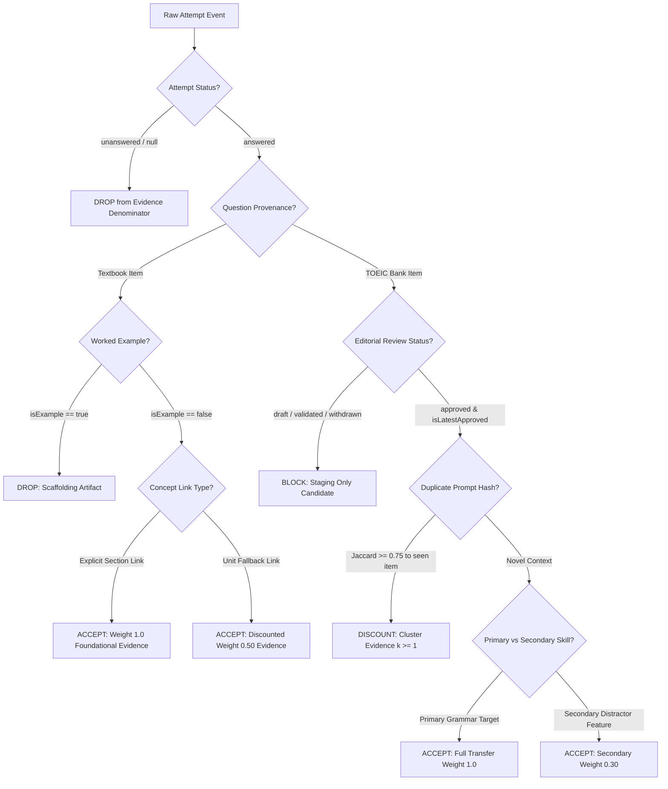

# GrammarPath — Phase 3.4C Stage 1D: Evidence Quality & Question Bank Integrity Audit

## 1. Executive Summary & Audit Authority

This audit establishes the evidentiary validity of GrammarPath's question inventories for measuring grammar mastery and transfer learning. 
In psychometrics and educational measurement, **valid inference requires valid evidence**. If questions contain typographical errors, ungrammatical answer keys, trivial distractor options, near-duplicate prompt sentences, or loose concept attributions, no mathematical model (neither deterministic nor Bayesian) can yield sound pedagogical conclusions.

All empirical findings in this report were verified via read-only inspection of the Neon staging database (`ep-small-dream-a1lqsn1r.ap-southeast-1.aws.neon.tech:5432/grammarpath-staging`) guarded by `backend/scripts/run-with-staging-env.mjs` (exit code: 0) and the canonical curriculum data repository (`grammarpath-data`).

---

## 2. Comprehensive Inventory Audit: Textbook vs. TOEIC Items

### 2.1 Canonical Textbook Question Inventory (`grammarpath-data`)

The canonical curriculum derived from *English Grammar in Use* (4th Edition, Raymond Murphy) was audited across all 146 JSON unit files in `grammarpath-data/data/units/`:

| Dimension | Measured Metric | Pedagogical Analysis |
| :--- | :--- | :--- |
| **Total Unit Files** | 146 files (Units 1–145 + Appendix/Study Guide) | Full intermediate English grammar syllabus. |
| **Total Exercises** | 550 structured exercise blocks | Average 3.77 exercises per unit. |
| **Total Questions** | 4,415 discrete question items | Comprehensive drill and practice corpus. |
| **Worked Examples (`is_example: true`)** | **662 items (14.99%)** | Answers explicitly provided in the textbook layout. |
| **Test Questions (`is_example: false`)** | **3,753 items (85.01%)** | Independent learner practice items. |
| **Interaction Formats** | Fill-in-the-blank, multiple choice, sentence reordering, transformation | Predominantly cued recall and discrete gap-fills. |
| **Thematic Domain** | Everyday colloquial, domestic, social conversations | Low business/workplace register overlap. |

### 2.2 Staging TOEIC Question Bank Inventory (`ToeicQuestionBankItem`)

Read-only inspection of the Neon staging PostgreSQL catalog via Prisma client (`backend/prisma/schema.prisma`) revealed:

| Dimension | Measured Metric | Verification Command & Status |
| :--- | :--- | :--- |
| **Total TOEIC Bank Items** | **35 records** | `SELECT COUNT(*) FROM toeic_question_bank_items` $\rightarrow$ 35 |
| **Editorial Status Distribution** | • `approved`: **3 items (8.57%)**<br>• `validated`: **29 items (82.86%)**<br>• `archived`: **3 items (8.57%)**<br>• `draft`: **0 items** | Staging query via `run-with-staging-env.mjs` (Exit code: 0). |
| **Difficulty Distribution** | • `easy`: 15 items (42.86%)<br>• `medium`: 12 items (34.29%)<br>• `hard`: 8 items (22.86%) | Difficulty tags assigned by generation pipeline or import. |
| **Primary Skill Distribution** | • `direct_grammar`: 35 items (100.0%)<br>• `word_form_morphology`: 0 items<br>• `vocabulary_in_context`: 0 items | Phase 3.4B explicitly restricted batch generation to direct grammar. |
| **Total Options Across All Items** | **140 options** (4 per item, A–D) | `ToeicQuestionOption` table. |
| **Options with Rationale** | **6 options (4.29%)** | 134 of 140 options (95.71%) have `rationale: null`. |

---

## 3. Critical Evidence Integrity Findings

### 3.1 Flawed Answer Key in Approved Item (`7d24582b-ca20-4c7a-a828-530f4852e80a`)

> [!CAUTION]
> **Severe Item Quality Bug in Approved Staging Item**:
> In staging `ToeicQuestionBankItem` ID `7d24582b-ca20-4c7a-a828-530f4852e80a` (Unit 1, version 2, marked `isLatestApproved = true`, `reviewStatus = 'approved'`), the item content is:
> - **Prompt:** *"The IT technician is not at his desk because he _______ the server hardware in Room 3 right now."*
> - **Option A:** `try` (`isCorrect: false`)
> - **Option B:** `am trying` (**`isCorrect: true`**)  $\leftarrow$ **UNGRAMMATICAL**
> - **Option C:** `tried` (`isCorrect: false`)
> - **Option D:** `was trying` (`isCorrect: false`)
> 
> The pronoun subject is third-person singular **"he"**. Marking **"am trying"** as the correct key is linguistically invalid (*"he am trying"*). If a learner selects the grammatically correct agreement form or recognizes the error, they are marked incorrect by the server grader!
> Furthermore, this item was marked `qualityScore: 6.0` and approved by an admin with the note `"Approved updated Version 2."`.

### 3.2 Near-Duplicate Prompt Saturation in Approved Items

All three approved items currently in the staging database share the **exact same carrier sentence**:

1. Item `7d24582b-ca20-4c7a-a828-530f4852e80a`:
   *"The IT technician is not at his desk because he _______ the server hardware in Room 3 right now."* (Options: try / am trying / tried / was trying)
2. Item `7d9abd94-df89-4762-8a86-a3217f0217b0`:
   *"The IT technician is not at his desk because he _______ the server hardware in Room 3 right now."* (Options: is entering / enters / entered / enter)
3. Item `45e751fd-4915-4bac-a386-c7bae5295911`:
   *"The IT technician is not at his desk because he _______ the server hardware in Room 3 right now."* (Options: repairs / is repairing / repaired / repair)

**Psychometric Implication:**
These three items have distinct `contentHash` values solely because their option strings differ. However, from a transfer measurement perspective, they represent **$0\%$ contextual and structural diversity**. A learner who solves all three items has encountered the identical scenario three times in succession. Under the current `mastery.service.ts` logic, they are counted as **3 distinct questions**, artificially inflating the concept's `distinctQuestionCount` and satisfying the mastery gate without genuine cross-context generalization.

### 3.3 Absence of Distractor Rationales in Staging Items

Out of 140 options across all 35 TOEIC items, **134 options (95.71%) have `rationale: null`**.
Only the two candidate items generated during the Unit 5 supervisor run (`0707bbd2` and `Ms. Tanaka...`) provide bilingual pedagogical explanations for why distractors are incorrect (e.g., *"Đây là thì hiện tại đơn, không dùng cho hành động đã kết thúc trong quá khứ"*).
When distractors lack explanatory rationales, the Mistake Review and remediation engine cannot generate diagnostic feedback to explain *why* the learner's chosen distractor represents a misconception.

---

## 4. Codebase Audit: Evidence Ingestion & Gate Enforcement

### 4.1 Missing Editorial Status Gate in `mastery.service.ts`

Audit of `backend/src/services/mastery.service.ts` (lines 109–161) revealed a critical discrepancy between the architectural design and actual code:

```typescript
// backend/src/services/mastery.service.ts:109-116
const eligibleBankItemCount = await db.toeicQuestionBankItem.count({
  where: {
    conceptId,
    primarySkill: { in: ["direct_grammar", "word_form_morphology"] },
    conceptMappingConfidence: { gte: 0.85 },
  },
});

// backend/src/services/mastery.service.ts:152-161
if (eligibleBankItemCount > 0) {
  attemptCriteria.push({
    attemptSource: "toeic_practice",
    questionBankItem: {
      conceptId,
      primarySkill: { in: ["direct_grammar", "word_form_morphology"] },
      conceptMappingConfidence: { gte: 0.85 },
    },
  });
}
```

> [!WARNING]
> **Defect Analysis: Absence of `reviewStatus: 'approved'` in Mastery Queries**:
> While `toeic-question-bank.service.ts` (line 379) properly restricts learner practice sessions to `{ reviewStatus: "approved", isLatestApproved: true }`, `mastery.service.ts` **omits the `reviewStatus` check entirely**.
> If an attempt record references a `validated`, `draft`, or `withdrawn` TOEIC item (e.g., submitted during integration tests, admin preview, or before an item was withdrawn), `mastery.service.ts` unconditionally ingests it into the learner's mastery evidence!

### 4.2 Worked Example Filtering Integrity

Audit of worked example filtering verified strong defense in depth:
- `backend/src/controllers/exercises.controller.ts` (lines 364–365):
  `const testQuestions = exercise.questions.filter((q) => !q.isExample);`
  Worked examples are explicitly stripped prior to session creation and server-side grading.
- `backend/src/services/mastery.service.ts` (lines 79, 97):
  Queries to table `Question` explicitly filter `where: { isExample: false }`.
- **Verdict:** PASS. Worked examples cannot contribute learner attempt evidence.

### 4.3 Unanswered Attempt Isolation

Audit of unanswered attempt handling:
- Database CHECK constraint `chk_qai_attempt_status_consistency` (enacted in migration `20260330000000_qai_unanswered_check_constraint`) guarantees that any attempt with `attemptStatus = 'unanswered'` must have:
  1. `isCorrect IS NULL`
  2. `timeSpentMs = 0`
  3. `studentAnswer IS NULL`
- In `backend/src/services/mastery.service.ts` (line 166):
  `where: { attemptStatus: { not: "unanswered" }, isCorrect: { not: null } }`
- **Verdict:** PASS. Skipped and unanswered questions are strictly excluded from both the numerator ($W_{\text{correct}}$) and the denominator ($W_{\text{evidence}}$) in mastery calculations.

### 4.4 Broad Unit Fallback & Multi-Concept Evidence Dilution

In `backend/src/services/mastery.service.ts` (lines 89–105):
```typescript
if (questionIdsSet.size < 5 && associatedUnitIds.size > 0) {
  const questionsByUnit = await db.question.findMany({
    where: {
      isExample: false,
      exercise: {
        unitId: { in: Array.from(associatedUnitIds) },
      },
    },
    select: { id: true },
  });
  questionsByUnit.forEach((q) => questionIdsSet.add(q.id));
}
```

**Empirical Staging Audit:**
- Across all 161 `GrammarConcept` records in staging:
  - **16 concepts (9.94%)** have **0 questions** linked via explicit `Explanation.theorySectionId`.
  - All 16 concepts trigger the fallback query, sweeping in **all questions across the entire unit**.
  - If a unit contains exercises testing multiple contrasting sub-rules (e.g., Unit 4 covering both stative verbs and dynamic continuous meanings), all questions in Unit 4 are mapped to both concepts.
- **Pedagogical Failure Mode:**
  A student practicing Exercise 4.1 (stative verbs) who makes errors on stative verbs receives negative evidence against their continuous tense concept, diluting concept specificity.

---

## 5. Statistical & Pedagogical Evaluation of the 0.85 Confidence Threshold

### 5.1 Historical Context & Implementation Reality

Phase 3.4B introduced the threshold `conceptMappingConfidence >= 0.85` in `mastery.service.ts:114`.
Staging data inspection revealed the actual distribution of confidence scores across all 35 `ToeicQuestionBankItem` records:
- `1.00`: **33 items (94.29%)**
- `0.90`: **2 items (5.71%)**
- `< 0.90`: **0 items (0.00%)**

### 5.2 Psychometric Critique of 0.85

1. **Non-Calibrated Discrete Heuristic:**
   The value $0.85$ was not derived from receiver operating characteristic (ROC) curves, logistic regression, or inter-rater reliability agreement (Cohen's $\kappa$). It is an arbitrary cutoff.
2. **Artificial Bimodality:**
   In practice, human curators assign $1.0$ to clear matches, the AI generator prompt produces $0.90$ for passing candidates, and rejected items are discarded. No items exist in the $0.70$–$0.84$ range.
3. **Multi-Concept Asymmetry:**
   When a TOEIC item genuinely tests two interacting concepts (e.g., *Subject-Verb Agreement* across a *Relative Clause*), mapping confidence represents the classifier's certainty that Concept A is present, **not** the degree to which item performance reflects mastery of Concept A versus Concept B.

---

## 6. Formal Evidence Eligibility Rules for Phase 3.4C

To ensure assessment integrity, the following mathematical and logical gates are established:



### Rule 1: Strict Editorial Status Gating
- Only TOEIC items where `reviewStatus == 'approved'` AND `isLatestApproved == true` are eligible to contribute learner-facing mastery and transfer evidence.
- Any attempt on an item with status `draft`, `validated`, `rejected`, or `withdrawn` must be filtered out at query time (`attemptCriteria`).

### Rule 2: Absolute Worked-Example Exclusion
- Items with `isExample == true` must never enter the attempt evidence pool. Server graders must reject exercise submissions containing example question IDs.

### Rule 3: Tri-State Unanswered Non-Penalization
- Skipped questions (`attemptStatus == 'unanswered'`) reflect exposure, not competence. They must not decrement mastery score, accuracy, or retention.

### Rule 4: Multi-Concept Attribution & Weight Splitting
- An item mapped to primary concept $C_1$ (weight $w_1 = 0.70$) and secondary concept $C_2$ (weight $w_2 = 0.30$) splits its evidence:
  $$E(C_1) = 0.70 \times \text{repeatDiscount}(k) \times \text{recencyWeight}(t)$$
  $$E(C_2) = 0.30 \times \text{repeatDiscount}(k) \times \text{recencyWeight}(t)$$
- Under no circumstances shall secondary concepts receive $100\%$ full evidence weight from an incidental distractor feature.

### Rule 5: Near-Duplicate Cluster Discounting
- When two distinct question IDs share blank-masked prompt similarity $J_{\text{token}} \ge 0.75$, they belong to the same **Contextual Cluster** $\mathcal{K}$.
- Subsequent attempts across items within the same cluster are discounted using the repeated-attempt function $d(k)$:
  $$d_{\text{cluster}}(m) = \max(0.10, 0.50^m)$$
  where $m$ is the count of previously attempted questions in cluster $\mathcal{K}$.

### Rule 6: Distractor Plausibility & Defect Quarantining
- Any item reported with grammatical errors in its answer key (such as Item `7d24582b`) must be immediately transitioned to `withdrawn` with an audit note.
- Items lacking distractor rationales may be served for general practice but must be marked with a diagnostic limitation flag in Mistake Review.

---

## 7. Audit Conclusion & Deliverable Status

| Audit Item | Current System Status | Phase 3.4C Design Requirement |
| :--- | :--- | :--- |
| **Approved Item Grammar** | **FAIL (1 of 3 approved items has ungrammatical key)** | Immediate withdrawal of `7d24582b`; automated subject-verb validation in generation queue. |
| **Approved Item Diversity** | **FAIL (3 of 3 approved items share identical carrier prompt)** | Semantic blank-masked Jaccard deduping engine before approval. |
| **Mastery Service Status Gate** | **FAIL (`mastery.service.ts` ignores `reviewStatus`)** | Add explicit `{ reviewStatus: 'approved', isLatestApproved: true }` filter to Prisma queries. |
| **Worked Example Isolation** | **PASS (100% filtered out in controller and service)** | Maintain existing filtering invariants. |
| **Unanswered Attempt Isolation** | **PASS (Enforced via DB constraint & query filter)** | Maintain tri-state consistency invariants. |
| **Distractor Rationales** | **FAIL (95.71% of options lack rationales)** | Mandatory distractor rationale validation in generation pipeline. |
| **Confidence Threshold (0.85)** | **PROVISIONAL (Uncalibrated heuristic)** | Replace flat cutoff with multi-tiered evidence weighting (High $\ge 0.90 \rightarrow 1.0$, Medium $0.75$–$0.89 \rightarrow 0.60$, Low $< 0.75 \rightarrow 0.0$). |

