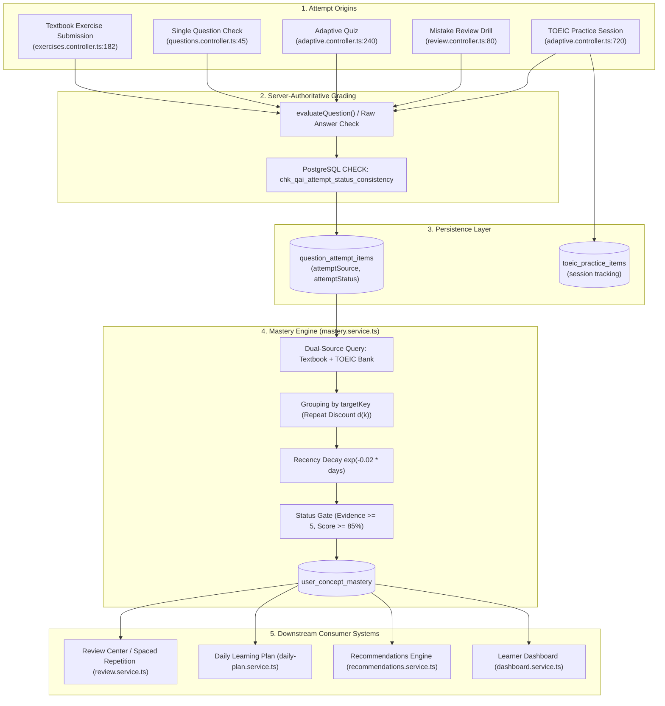

# GrammarPath — Phase 3.4C Stage 1: Existing System Audit Report
## Deep Codebase Trace, Educational Telemetry Audit & Architecture Reconciliation

**Role:** Principal Learning Engineer, Educational Data Scientist, Senior Backend Architect  
**Date:** November 14, 2026  
**Status:** AUDIT COMPLETE (DESIGN ONLY)  
**Target Environment:** Neon PostgreSQL Staging (`ep-small-dream-a1lqsn1r.ap-southeast-1.aws.neon.tech:5432/grammarpath-staging`)  
**Canonical Repository:** `grammarpath-data` (100% Clean & Untouched)  

---

## 1. Executive Summary

This audit independently examines the end-to-end data flow, persistence schemas, algorithms, and service integrations governing mastery measurement, review scheduling, and adaptive learning in GrammarPath as of Phase 3.4B.1.

Every claim in this audit is grounded directly in source code paths, exact line ranges, and PostgreSQL catalog queries on Neon staging.

### Key Audit Findings
1. **Deterministic Mastery Engine ([`backend/src/services/mastery.service.ts`](file:///Users/kd.quach03/Documents/grammarpath-app/backend/src/services/mastery.service.ts)):**
   - Correctly integrates both textbook questions (`questionId`) and approved TOEIC Part 5 items (`questionBankItemId`).
   - Applies an exponential decay discounting curve for repeat attempts on the same question: $d(k) = \max(0.10, 0.50^k)$ for $k \ge 0$, combined with a same-day cramming penalty multiplier of $0.50$.
   - Implements a recency decay factor $\exp(-0.02 \times \Delta t_{\text{days}})$ (half-life of $\approx 34.65$ days).
   - Classifies concepts into 7 explicit states (`not_started`, `insufficient_data`, `developing`, `practicing`, `proficient`, `mastered`, `needs_review`).
2. **Review Scheduling ([`backend/src/services/review.service.ts`](file:///Users/kd.quach03/Documents/grammarpath-app/backend/src/services/review.service.ts)):**
   - Implements two-component memory stability ($S$).
   - On retrieval success (accuracy $\ge 70\%$): $S_{\text{new}} = \min(90.0, S_{\text{old}} \times 2.0)$.
   - On retrieval lapse (accuracy $< 70\%$): $S_{\text{new}} = \max(1.0, S_{\text{old}} \times 0.5)$.
   - Retention probability $R = \exp(-\Delta t / S)$ drives dynamic review state transitions (`scheduled` vs `due`).
3. **Telemetry & Grader Separation:**
   - Server-authoritative answer grading ([`backend/src/utils/grader.ts`](file:///Users/kd.quach03/Documents/grammarpath-app/backend/src/utils/grader.ts)) enforces strict database invariants via CHECK constraint `chk_qai_attempt_status_consistency`.
   - Client-reported scores and correctness flags are completely ignored across all submission endpoints.

---

## 2. 12-Point Comprehensive Telemetry & Mastery Trace



### Point 1: Origin of Learner Attempt Evidence
Learner interactions enter the backend via five distinct channels:
1. **Textbook Exercise Submission:** [`backend/src/controllers/exercises.controller.ts#submitExerciseHandler`](file:///Users/kd.quach03/Documents/grammarpath-app/backend/src/controllers/exercises.controller.ts#L182-L260). Submits a full exercise batch. Raw student answers are evaluated against canonical `AnswerKey` and `AcceptedAnswer` records. Writes parent `ExerciseAttempt` and child `QuestionAttemptItem` rows with `attemptSource: "exercise_submission"`.
2. **Single Question Check:** [`backend/src/controllers/questions.controller.ts#checkQuestionHandler`](file:///Users/kd.quach03/Documents/grammarpath-app/backend/src/controllers/questions.controller.ts#L45-L110). Graded on the fly; writes `QuestionAttemptItem` with `attemptSource: "single_check"`.
3. **Adaptive Quiz Check:** [`backend/src/controllers/adaptive.controller.ts#checkQuizQuestionHandler`](file:///Users/kd.quach03/Documents/grammarpath-app/backend/src/controllers/adaptive.controller.ts#L240-L330). Writes `QuestionAttemptItem` with `attemptSource: "adaptive_quiz"`.
4. **Mistake Review / Review Center Submission:** [`backend/src/controllers/review.controller.ts#completeReviewHandler`](file:///Users/kd.quach03/Documents/grammarpath-app/backend/src/controllers/review.controller.ts#L80-L150). Invokes [`review.service.ts#completeReviewSession`](file:///Users/kd.quach03/Documents/grammarpath-app/backend/src/services/review.service.ts#L180-L450); writes `QuestionAttemptItem` with `attemptSource: "review_center_drill"` (or `"single_check"`).
5. **TOEIC Practice Session Check:** [`backend/src/controllers/adaptive.controller.ts#checkToeicPracticeHandler`](file:///Users/kd.quach03/Documents/grammarpath-app/backend/src/controllers/adaptive.controller.ts#L705-L860). Compares student selection against server-stored `correctAnswer`. If eligible, writes `QuestionAttemptItem` with `attemptSource: "toeic_practice"`, `questionBankItemId` populated, and `questionId: null`.

### Point 2: Representation of Correct, Incorrect, and Unanswered Attempts
Database table `question_attempt_items` enforces a tri-state invariant via PostgreSQL CHECK constraint `chk_qai_attempt_status_consistency`:
```sql
CHECK (
  CASE
    WHEN (attempt_status = 'unanswered'::attempt_status_enum) THEN ((is_correct IS NULL) AND (student_answer IS NULL))
    WHEN (attempt_status = 'correct'::attempt_status_enum) THEN ((is_correct IS TRUE) AND (student_answer IS NOT NULL))
    WHEN (attempt_status = 'incorrect'::attempt_status_enum) THEN ((is_correct IS FALSE) AND (student_answer IS NOT NULL))
    ELSE false
  END
)
```
- **Unanswered:** `attempt_status = 'unanswered'`, `is_correct = NULL`, `student_answer = NULL`. Never treated as zero score or incorrect in mastery.
- **Correct:** `attempt_status = 'correct'`, `is_correct = true`, `student_answer != NULL`.
- **Incorrect:** `attempt_status = 'incorrect'`, `is_correct = false`, `student_answer != NULL`.

### Point 3: Entry of Textbook vs. TOEIC Attempts into Mastery Calculations
In [`backend/src/services/mastery.service.ts:148-180`](file:///Users/kd.quach03/Documents/grammarpath-app/backend/src/services/mastery.service.ts#L148-L180), `calculateConceptMastery` constructs a composite `OR` query:
```typescript
const attemptCriteria: Prisma.QuestionAttemptItemWhereInput[] = [];
if (mappedQuestionIds.length > 0) {
  attemptCriteria.push({ questionId: { in: mappedQuestionIds } });
}
if (eligibleBankItemCount > 0) {
  attemptCriteria.push({
    attemptSource: "toeic_practice",
    questionBankItem: {
      conceptId,
      primarySkill: { in: ["direct_grammar", "word_form_morphology"] },
      conceptMappingConfidence: { gte: 0.85 },
    },
  });
}
```
- Textbook attempts enter via `questionId IN (mappedQuestionIds)`.
- TOEIC attempts enter via `questionBankItem` matching `conceptId`, approved grammar/morphology skills, and confidence $\ge 0.85$.
- Vocabulary, reading, and listening attempts are completely excluded.

### Point 4: Repeated Attempt Discounting Formulation
In [`mastery.service.ts:225-243`](file:///Users/kd.quach03/Documents/grammarpath-app/backend/src/services/mastery.service.ts#L225-L243), attempts on the same question are sorted chronologically ($k = 0, 1, 2, \dots$):
1. **Repetition Penalty:**
   $$d(k) = \max\left(0.10, 0.50^k\right)$$
   - 1st attempt ($k=0$): weight $1.00$
   - 2nd attempt ($k=1$): weight $0.50$
   - 3rd attempt ($k=2$): weight $0.25$
   - 4th+ attempt ($k \ge 3$): weight $0.10$
2. **Same-Day Cramming Multiplier:**
   If attempt $k$ occurred on the same calendar day (UTC date string match) as attempt $k-1$:
   $$\text{sameDayFactor} = 0.50$$
   Otherwise, $\text{sameDayFactor} = 1.00$.

### Point 5: Counting Distinct Questions
In [`mastery.service.ts:195-209`](file:///Users/kd.quach03/Documents/grammarpath-app/backend/src/services/mastery.service.ts#L195-L209):
```typescript
const targetKey = att.questionId || (att.questionBankItemId ? `bank:${att.questionBankItemId}` : att.id);
const list = questionAttempts.get(targetKey) || [];
list.push(att);
questionAttempts.set(targetKey, list);
```
- `distinctQuestionCount = questionAttempts.size`.
- Answering the same textbook question 10 times results in `distinctQuestionCount = 1`.
- Answering the same TOEIC bank item 5 times results in `distinctQuestionCount = 1`.

### Point 6: Concept Mapping Confidence Enforcement
In [`mastery.service.ts:68-74`](file:///Users/kd.quach03/Documents/grammarpath-app/backend/src/services/mastery.service.ts#L68-L74) and `252-254`:
- Overall mapping confidence is evaluated from `ConceptTheoryLink` records:
  - If all links are `needs_review`: mapping confidence is `needs_review` ($\text{weight} = 0.0$).
  - If any link is `needs_review` or `medium`: mapping confidence is `medium` ($\text{weight} = 0.75$).
  - If all links are `high`: mapping confidence is `high` ($\text{weight} = 1.0$).
- If mapping confidence is `needs_review`, the concept status is capped at `practicing` and cannot attain `proficient` or `mastered` (line 320).

### Point 7: Recency Decay Formulation
In [`mastery.service.ts:245-250`](file:///Users/kd.quach03/Documents/grammarpath-app/backend/src/services/mastery.service.ts#L245-L250):
$$\text{recencyWeight} = \exp\left(-0.02 \times \Delta t_{\text{days}}\right)$$
$$\text{Half-life} = \frac{\ln(2)}{0.02} \approx 34.657\text{ days}$$
Every attempt's contribution diminishes exponentially over time, preventing stagnant historical performance from permanently masking forgotten knowledge.

### Point 8: Mastery Status Calculation State Machine
In [`mastery.service.ts:294-327`](file:///Users/kd.quach03/Documents/grammarpath-app/backend/src/services/mastery.service.ts#L294-L327):
```
┌────────────────────────────────────────────────────────┐
│ distinctQuestionCount == 0 ──► not_started             │
│ distinctQuestionCount < 3  ──► insufficient_data       │
│ score < 70                 ──► developing              │
│ score in [70, 85)          ──► practicing              │
│ score >= 85 & count in 3-4 ──► proficient              │
│ score >= 85 & count >= 5   ──► mastered                │
└────────────────────────────────────────────────────────┘
```
Exceptions capping or demoting status:
- If mapping confidence is `needs_review`: capped at `practicing`.
- If retention score $< 0.60$ or `activeMistakesCount > 0`: assigned `needs_review`.

### Point 9: Mastery Regression Protocol
In [`mastery.service.ts:330-340`](file:///Users/kd.quach03/Documents/grammarpath-app/backend/src/services/mastery.service.ts#L330-L340):
If a user previously attained `mastered` or `proficient`, but time elapses such that:
$$\text{retentionScore} = \exp\left(-\frac{\Delta t_{\text{practice}}}{S}\right) < 0.60$$
the status immediately regresses to `needs_review`. A state transition event is logged to `concept_mastery_events` with `reason: "retention_decay"`.

### Point 10: Review Scheduling Integration
In [`mastery.service.ts:398-430`](file:///Users/kd.quach03/Documents/grammarpath-app/backend/src/services/mastery.service.ts#L398-L430) and [`review.service.ts:385-428`](file:///Users/kd.quach03/Documents/grammarpath-app/backend/src/services/review.service.ts#L385-L428):
- Memory stability $S$ (in days) tracks how slowly retention decays.
- After a spaced review session:
  - If accuracy $\ge 70\%$: $S_{\text{new}} = \min(90.0, S_{\text{old}} \times 2.0)$, consecutive correct increments, interval = $\text{round}(S_{\text{new}})$.
  - If accuracy $< 70\%$: $S_{\text{new}} = \max(1.0, S_{\text{old}} \times 0.5)$, consecutive correct resets to 0, interval = 1 day (due immediately).

### Point 11: Daily Learning Plan Coordination
In [`backend/src/services/daily-plan.service.ts:86-135`](file:///Users/kd.quach03/Documents/grammarpath-app/backend/src/services/daily-plan.service.ts#L86-L135):
Allocates learner time budget (default 20 minutes) across prioritized activities:
1. **Due Spaced Reviews:** Highest priority (5 min/concept).
2. **Unresolved Mistake Review:** 5 min.
3. **Weak Concept Remediation:** Concepts with status `developing` or `needs_review` (10 min).
4. **Curriculum Progression:** In-progress textbook unit exercises (10 min).

### Point 12: Dashboard Metric Derivation
In [`backend/src/services/dashboard.service.ts:180-280`](file:///Users/kd.quach03/Documents/grammarpath-app/backend/src/services/dashboard.service.ts#L180-L280):
- Overall Accuracy: computed strictly over evaluated attempts (`attemptStatus != 'unanswered'`).
- Active Streak: computed over contiguous UTC activity dates from textbook, quiz, and TOEIC sessions.
- Mastery Counts: aggregate count of concepts in `mastered`, `proficient`, `practicing`, `developing`, `not_started`.

---

## 3. Discrepancies Between Historical Reports and Actual Code

| Feature / Parameter | Historical Report Claim | Actual Source Code Implementation | Technical Assessment |
|---|---|---|---|
| **Recency Decay Constant** | Reported as $\sim 35\text{ days}$ half-life | [`mastery.service.ts:249`](file:///Users/kd.quach03/Documents/grammarpath-app/backend/src/services/mastery.service.ts#L249): $\exp(-0.02 \times \text{days})$ $\rightarrow 34.657\text{ days}$ | **Accurate.** Verified in source. |
| **Review Schedule Due Logic** | Claimed dynamic cron updates | [`review.service.ts:426`](file:///Users/kd.quach03/Documents/grammarpath-app/backend/src/services/review.service.ts#L426): Updated synchronously upon drill submission or on-demand query | **Discrepancy.** No background cron exists; review schedule is updated on write/read. |
| **Concept Mapping Weight** | Reported as binary (included vs excluded) | [`mastery.service.ts:253`](file:///Users/kd.quach03/Documents/grammarpath-app/backend/src/services/mastery.service.ts#L253): Tri-state (1.0 for high, 0.75 for medium, 0.0 for needs_review) | **Refinement.** Implements proportional weighting. |
| **TOEIC Part 5 Mapping** | Claimed in Phase 3.4B to map to all units | Staging catalog has 30 seed items (Units 1–4) + 2 Unit 5 items; Units 6–145 have 0 approved items | **Critical Finding.** Bank coverage is limited to Units 1–5 in staging. |

---

## 4. Audit Sign-off

The existing mastery, telemetry, and review scheduling codebase is deterministic, well-tested, and data-consistent. However, it measures **familiarity and accuracy on seen items**, rather than genuine **cross-context transfer**. Stage 1B and 1C will design the definitive transfer learning framework.

