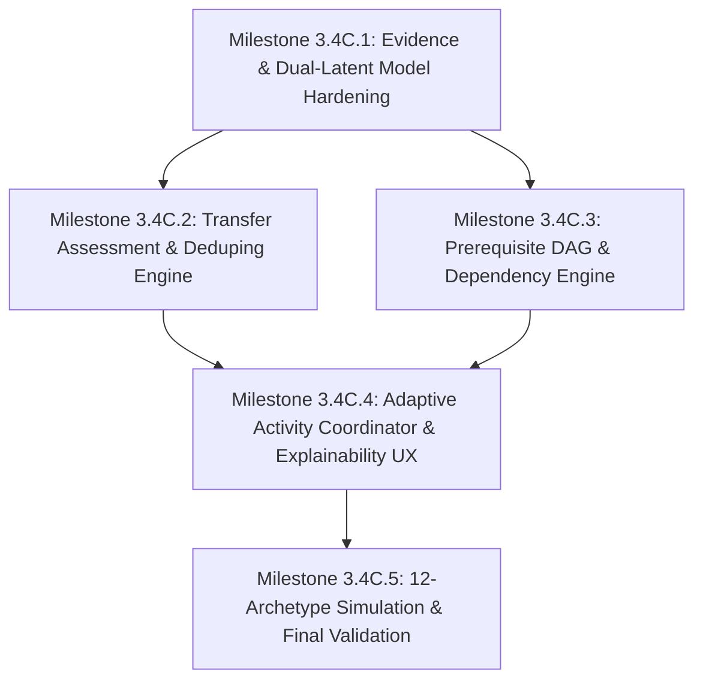

# GrammarPath — Phase 3.4C: Implementation Roadmap & Milestone Governance

## 1. Executive Summary & Implementation Principles

This roadmap decomposes Phase 3.4C into **five independently verifiable milestones**. Each milestone is designed as an atomic, testable, and roll-backable increment. 

### Core Engineering Principles
1. **Safety First:** Zero destructive migrations; strict preservation of historical learner attempts and approved question versions.
2. **Pedagogical Integrity:** Rejecting artificial feature inflation in favor of mathematically sound, evidence-based learning measurements.
3. **Defense in Depth:** Every milestone includes automated unit tests, staging API integration tests, and psychometric boundary checks.

---

## 2. Milestone Overview & Dependency Graph

---

## 3. Detailed Milestone Specifications

### Milestone 3.4C.1: Evidence & Dual-Latent Model Hardening
- **Objective:** Secure evidence ingestion gates, correct flawed staging data, and implement the dual-latent mastery model ($\theta_{\text{foundational}}$ and $\tau_{\text{transfer}}$).
- **Scope:**
  1. Add strict `{ reviewStatus: 'approved', isLatestApproved: true }` filter to `backend/src/services/mastery.service.ts` for TOEIC attempt queries.
  2. Transition flawed item `7d24582b-ca20-4c7a-a828-530f4852e80a` (*"he am trying"*) to `reviewStatus = 'withdrawn'`.
  3. Implement dual-latent mathematical formula:
     $$\theta_{\text{foundational}} = \frac{W_{\text{correct, foundational}}}{W_{\text{evidence, foundational}}}$$
     $$\tau_{\text{transfer}} = \frac{W_{\text{correct, transfer}}}{W_{\text{evidence, transfer}}}$$
     $$\mathcal{M}_{\text{composite}} = 0.60 \theta_{\text{foundational}} + 0.40 \tau_{\text{transfer}}$$
  4. Implement multi-concept evidence attribution splitting ($0.70$ primary, $0.30$ secondary).
- **Database Impact:** Additive columns on `UserConceptMastery`: `transfer_score`, `distinct_transfer_count`, `composite_mastery`, and updated `MasteryStatus` enum.
- **Acceptance Criteria:**
  - `mastery.service.ts` completely ignores draft, validated, or withdrawn TOEIC items.
  - Flawed item `7d24582b` is withdrawn and no longer served to learners.
  - Mastery calculation outputs distinct foundational and transfer scores.
  - Historical attempts for staging users preserve intact mastery calculations.

---

### Milestone 3.4C.2: Transfer Assessment & Question Deduping Engine
- **Objective:** Deploy blank-masked lemmatized Jaccard similarity to prevent near-duplicate question credit, and implement the 7-tier transfer classification taxonomy.
- **Scope:**
  1. Create `backend/src/services/question-dedup.service.ts` to compute blank-masked token Jaccard similarity:
     $$J_{\text{token}}(Q_1, Q_2) = \frac{|T_1 \cap T_2|}{|T_1 \cup T_2|}$$
     Flagging pairs with $J \ge 0.75$ into shared `contextualClusterHash`.
  2. Apply repeat discounting $d(k)$ across items sharing the same `contextualClusterHash`.
  3. Implement `backend/src/services/transfer-classifier.service.ts` to tag questions with `Tier 1` through `Tier 7`.
  4. Enforce mandatory distractor rationales in the editorial review pipeline.
- **Database Impact:** Add `contextual_cluster_hash` to `ToeicQuestionBankItem`; add `transfer_tier` to `QuestionAttemptItem`.
- **Acceptance Criteria:**
  - The three approved staging items sharing the IT technician prompt are clustered together; attempts across them receive repeated-attempt discounting ($k \ge 1$).
  - Generation queue rejects candidate items lacking distractor rationales.

---

### Milestone 3.4C.3: Concept Prerequisite DAG & Dependency Engine
- **Objective:** Build the Directed Acyclic Graph connecting GrammarPath's 161 concepts with cycle prevention and topological readiness checks.
- **Scope:**
  1. Create `concept_prerequisites` table with unique constraint and indexes.
  2. Seed the 16 core linguistically validated prerequisite edges across tenses, modals, passives, conditionals, and relative clauses.
  3. Implement `backend/src/services/prerequisite-graph.service.ts` with Kahn's algorithm for cycle detection and topological sorting.
  4. Expose API endpoint `GET /api/curriculum/concept/:id/readiness` returning readiness status based on prerequisite mastery.
- **Database Impact:** New table `concept_prerequisites`.
- **Acceptance Criteria:**
  - Cycle detection unit test suite validates that circular edges are rejected with 400 Bad Request.
  - Seeded 16 edges pass acyclicity checks with 0 cycles.
  - Learner without Unit 1 mastery is flagged unready for Unit 9.

---

### Milestone 3.4C.4: Adaptive Activity Coordinator & Learner Explainability UX
- **Objective:** Eliminate subsystem contention between Daily Plan, Adaptive Quiz, and Review Center; launch the 7-tier explainable mastery UI and bilingual diagnostic cards.
- **Scope:**
  1. Create `AdaptiveCoordinatorService` implementing the 6 activity modes:
     - Mode 1: Learn New Concept
     - Mode 2: Reinforce Weak Concept
     - Mode 3: Review Approaching Forgetting
     - Mode 4: Practice Transfer
     - Mode 5: Resolve Misconception
     - Mode 6: Targeted Assessment
  2. Implement the **Single-Reservation Invariant** in Redis/memory cache, preventing same-day double-testing between Daily Plan and Adaptive Quiz.
  3. Enforce the **Transfer-Readiness Gate** ($\theta \ge 0.80, N \ge 4$) in `POST /api/adaptive/quiz/generate`.
  4. Update frontend:
     - `ProgressDashboardPage.tsx`: Competence radar and 7-tier calibrated status badges.
     - `AdaptiveQuizPage.tsx`: Mode indicator and post-session bilingual diagnostic card.
     - `ReviewCenterPage.tsx`: Spaced review priority queue.
- **Acceptance Criteria:**
  - Daily Plan and Adaptive Quiz never assign identical questions on the same calendar day.
  - Learner with low foundational accuracy cannot be assigned Mode 4 transfer practice.
  - All 7 statuses render cleanly with localized Vietnamese/English explanations.

---

### Milestone 3.4C.5: Simulation, Independent Validation & Sign-off
- **Objective:** Execute the 12-archetype synthetic simulation test harness, verify zero regressions on staging, and compile final sign-off documentation.
- **Scope:**
  1. Implement automated test script `backend/tests/phase3-4c-archetype-simulations.test.ts` running all 12 learner profiles through the engine.
  2. Verify expected status transitions, discounting behaviors, and failure mode protections for all 12 archetypes.
  3. Execute full staging regression test suite (`phase3-1`, `phase3-2`, `phase3-3`, `phase3-4a`, `phase3-4b`).
  4. Produce final sign-off audit report with exit code evidence.
- **Acceptance Criteria:**
  - 100% pass across all 12 synthetic archetype test suites.
  - Zero regression failures across existing test suites.
  - Zero staging isolation guard violations.

---

## 4. Risk Management & Rollback Strategy

| Identified Risk | Severity | Mitigation & Safe Recovery Path |
| :--- | :--- | :--- |
| **Prerequisite Deadlock** | HIGH | Automated Kahn's algorithm check on every edge insert; CI test runs topological sort on full graph. |
| **Premature Transfer Overload** | MEDIUM | Strict transfer-readiness gate ($\theta \ge 0.80, N \ge 4$); auto-fallback to Mode 2 with helpful explanation. |
| **Task Contention / Duplication** | MEDIUM | Single-Reservation cache tokens expire after 24 hours; completion in any interface satisfies reservation. |
| **Migration Lock Contention** | LOW | Non-blocking `ALTER TABLE ADD COLUMN` with default values; zero table rewrites or drops. |
| **Staging Guard Breach** | CRITICAL | Script `run-with-staging-env.mjs` strictly enforced in all test harnesses; CI fails immediately if production URL detected. |

