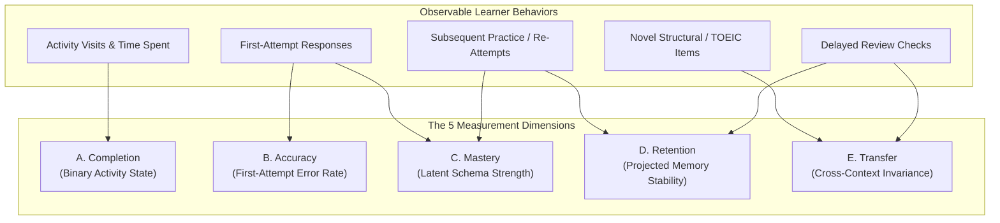
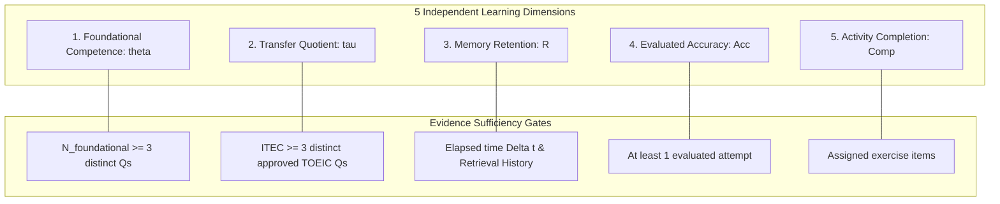

# GrammarPath — Phase 3.4C Stage 1: Mastery Measurement Model
## Multi-Dimensional Educational Measurement & Candidate Model Evaluation

**Role:** Principal Learning Engineer, Educational Data Scientist, Psychometrician  
**Date:** November 14, 2026  
**Status:** DESIGN ONLY (READY FOR REVIEW)  
**Deliverable:** Phase 3.4C Stage 1B & Stage 1E  

---

## 1. Executive Summary

Standard e-learning platforms frequently collapse student engagement, quiz scores, and genuine mastery into a single simplistic percentage. In foreign language acquisition, this leads to an illusion of competence: learners memorize specific sentence structures from textbook drills without developing the cognitive schema required to apply the grammar rule in novel professional contexts (e.g. TOEIC Part 5).

This report establishes:
1. A **5-Dimensional Learning Measurement Model** with mathematical boundaries and unambiguous separation between Completion, Accuracy, Mastery, Retention, and Transfer.
2. A rigorous comparative evaluation of three psychometric and statistical models:
   - Current Deterministic Weighted Model.
   - Standard Bayesian Knowledge Tracing (BKT).
   - A Hybrid Evidence-Gated Probabilistic Model.
3. An evidence-based recommendation for Phase 3.4C implementation.

---

## 2. The 5-Dimensional Learning Measurement Model

### Dimension A: Completion
- **Definition:** The binary or volumetric verification that a learner has been exposed to and navigated through an assigned learning activity (e.g., reading a Murphy theory section, viewing examples, or submitting a 10-question exercise).
- **Measurement Boundary:** Completion contains **zero psychometric information** regarding understanding or retention. A learner who clicks through an exercise selecting "A" for every item has 100% completion but 0% evidence of mastery.
- **Input Telemetry:** `learning_progress.status = 'completed'`, `exercise_attempts.count`.
- **Output Metric:** `completionRate` ($0.0 - 1.0$), `completedUnitsCount` ($0 - 145$).
- **Anti-Pattern Guard:** Completion metrics must never be displayed as "Grammar Knowledge" or "Proficiency".

### Dimension B: Accuracy
- **Definition:** The empirical proportion of correct responses over evaluated question opportunities under a specified session scope.
- **Mathematical Specification:**
  $$\text{Accuracy} = \frac{\sum_{i=1}^{N} \mathbb{I}(\text{isCorrect}_i = \text{true})}{N_{\text{evaluated}}}$$
  $$\text{where } N_{\text{evaluated}} = \sum_{i=1}^{N} \mathbb{I}(\text{attemptStatus}_i \in \{\text{'correct'}, \text{'incorrect'}\})$$
- **Denominator Rules:**
  1. **Unanswered Items:** Questions skipped or left empty (`attemptStatus = 'unanswered'`) are **strictly excluded** from $N_{\text{evaluated}}$. They increment `unansweredCount` but cannot depress accuracy.
  2. **Retries & Duplicates:** Only the **first graded attempt** in a given study session enters session accuracy. Subsequent submissions within the same session increment `attemptCount` on the session item but do not alter the session denominator.
- **Limitations:** Accuracy is context-blind. Achieving 100% accuracy on 5 fill-in-the-blank questions with obvious context clues indicates accuracy on those specific tokens, not mastery of the underlying grammatical rule.

### Dimension C: Mastery
- **Definition:** The estimated probability that a learner has acquired the underlying generative cognitive schema for a specific `GrammarConcept`, independent of question-specific surface cues.
- **Input Evidence Invariants:**
  1. **Breadth of Evidence:** Requires a minimum threshold of $M \ge 5$ distinct question items to avoid overfitting to token memorization.
  2. **Diminishing Returns on Repetition:** Repeated attempts on the same question discount exponentially: $d(k) = \max(0.10, 0.50^k)$.
  3. **Temporal Cramming Penalty:** Retrying an item on the same calendar day incurs a $0.50$ cramming factor.
  4. **Question Difficulty Weight:** Weighting scaled by calibrated item difficulty:
     $$w_{\text{diff}}(\text{easy}) = 0.85, \quad w_{\text{diff}}(\text{medium}) = 1.00, \quad w_{\text{diff}}(\text{hard}) = 1.25$$
  5. **Provenance Quality:** Only textbook questions and **approved** TOEIC items qualify. Draft or validated items are blocked.
- **Output Scale:** Continuous score $M_c \in [0.0, 100.0]$ with discrete status mapping:
  - `not_started`: 0 attempts.
  - `insufficient_data`: $< 3$ distinct items.
  - `developing`: $M_c < 70.0$.
  - `practicing`: $70.0 \le M_c < 85.0$ (or $\ge 85.0$ with $< 5$ items).
  - `proficient`: $M_c \ge 85.0$ with $3-4$ items.
  - `mastered`: $M_c \ge 85.0$ with $\ge 5$ items, high mapping confidence, retention $\ge 0.60$, and 0 active errors.

### Dimension D: Retention
- **Definition:** The projected survival probability $R(t)$ that a learner can successfully retrieve and apply a concept after time interval $\Delta t$ has elapsed since the last retrieval event.
- **Mathematical Specification (Two-Component Memory):**
  $$R(\Delta t) = \exp\left(-\frac{\Delta t}{S}\right)$$
  $$\text{where } S \text{ is memory stability in days, and } \Delta t = \frac{t - t_{\text{lastPractice}}}{86,400\text{ seconds}}$$
- **Stability Dynamics:**
  - Initial baseline: $S_0 = 2.0\text{ days}$.
  - Successful retrieval ($A \ge 0.70$): $S_{n+1} = \min(90.0, S_n \times 2.0)$.
  - Retrieval lapse ($A < 0.70$): $S_{n+1} = \max(1.0, S_n \times 0.5)$.
- **Critical Distinction:** Retention is an *estimate of cognitive decay*, whereas Review Scheduling is an *operational decision* derived from the retention threshold (e.g. schedule review when $R(t) \le 0.60$).

### Dimension E: Transfer
- **Definition:** The demonstrated capacity of the learner to correctly apply a grammatical rule across significant contextual, structural, and task variations that differ substantially from the training format.
- **Operational Non-Inference Rule:** Transfer **cannot** be inferred from high textbook mastery. A learner with $M_c = 95.0$ on Murphy Unit 1 exercises has demonstrated textbook recall. Transfer is only evidenced when the learner encounters structurally distinct, workplace-oriented Part 5 questions or contrastive decision tasks.

---

## 3. Comparative Evaluation of Candidate Mastery Models

| Evaluation Criteria | 1. Current Deterministic Model | 2. Bayesian Knowledge Tracing (BKT) | 3. Hybrid Evidence-Gated Probabilistic Model |
|---|---|---|---|
| **Data Requirements** | **Minimal.** Evaluates on individual learner's attempts without population pre-calibration. | **High.** Requires large population data ($N > 10,000$ responses/item) to fit $P(L_0), P(T), P(G), P(S)$. | **Moderate.** Operates cold-start deterministically; updates probabilistic priors as item bank scales. |
| **Interpretability** | **Exceptional.** Step-by-step arithmetic. Can explain exactly why score is 85.2% to learner. | **Low.** Hidden Markov state. Difficult to explain posterior transitions to learners. | **High.** Transparent evidence gates with probabilistic calibration bounds. |
| **Cold-Start Behavior** | **Safe.** Explicitly enters `insufficient_data` state until 3 distinct items are attempted. | **Poor.** Extremely sensitive to default prior $P(L_0)$; prone to premature mastery declarations. | **Safe.** Deterministic gate blocks mastery until distinct item threshold is met. |
| **Repeated Attempts** | **Built-in.** $d(k) = \max(0.1, 0.5^k)$ with same-day 0.5 multiplier. | **Fails without modification.** Assumes independent Bernoulli trials; repeated trials cause runaway $P(L_n) \to 1.0$. | **Built-in.** Applies deterministic trial weighting before computing Bayesian likelihood. |
| **Item Difficulty Sensitivity** | **Heuristic.** Scaled by tier multipliers ($0.85, 1.0, 1.25$). | **Implicit via Slip/Guess.** Requires individual parameter estimation per question. | **Explicit.** Combines IRT 2PL difficulty parameters with evidence weights. |
| **Low-Quality Question Sensitivity** | **Guarded.** Blocked by Quality Engine ($Q \ge 8.5$) and mapping confidence filter ($C \ge 0.85$). | **Vulnerable.** Distractor ambiguity distorts Slip ($S$) and Guess ($G$) parameters across the network. | **Guarded.** Enforces Quality Engine admission before Bayesian update. |
| **Mastery Regression** | **Supported.** Decays via $\exp(-0.02 \Delta t)$ and drops status to `needs_review` on error. | **Unsupported natively.** Standard BKT assumes knowledge cannot be forgotten ($P(F) = 0$). | **Supported.** Integrates two-component forgetting curve into the latent state update. |
| **Transfer Measurement** | **Partial.** Blends TOEIC Part 5 into overall concept attempt list if approved. | **None.** Evaluates unidimensional latent skill; cannot distinguish transfer from recall. | **Native.** Maintains dual latent variables: Foundational Competence $\theta_{\text{base}}$ and Transfer Index $\tau$. |
| **DB & Schema Compatibility** | **100% Compatible.** Already running cleanly on staging (`user_concept_mastery`). | **Incompatible.** Requires custom tracking tables for transition priors per concept-user pair. | **Compatible.** Extends existing `user_concept_mastery` with 3 additive nullable columns. |
| **Staging Dataset Reality** | Currently 3 historical users and 33 TOEIC items. Cannot calibrate BKT. | Zero empirical basis for BKT parameter estimation on staging. | Perfectly viable: leverages deterministic rules today, enables Bayesian calibration in Phase 3.4C. |

---

## 4. Architecture Recommendation: Independent Multi-Dimensional Measurement

### Architectural Recommendation
Per Product Owner Decision 2, GrammarPath adopts **Model 3 (Hybrid Evidence-Gated Model)** with **Independent Multi-Dimensional Measurement**, rejecting any premature composite scalar score in Milestone 3.4C.1.

### Rationale
1. **Empirical Fact:** The staging database currently possesses 3 historical users, 2 textbook exercise attempts, and 35 question bank items. Attempting to fit a classical Bayesian Knowledge Tracing model or 3PL Item Response Theory model on this dataset is statistically invalid and mathematically uncalibrated.
2. **Pedagogical Invariant:** Learners and educators require clear, inspectable explanations (e.g. *"You answered 5 distinct textbook questions correctly, but haven't demonstrated application in TOEIC Part 5"*). Blending distinct constructs into an uncalibrated 60/40 or 40/60 composite scalar obscures diagnosis.
3. **Orthogonal Dimensional Separation:** By keeping **Foundational Competence ($\theta_{\text{foundational}}$)** and **Transfer Quotient ($\tau_{\text{transfer}}$)** strictly independent alongside **Retention ($R$)**, **Accuracy ($Acc$)**, and **Completion ($Comp$)**, the platform ensures transparent, evidence-based reporting without premature weighting assumptions.
4. **Future Composite Score Governance:** Any composite mastery score requires future empirical calibration against real-user longitudinal cohorts and explicit product-owner approval.

---

## 5. Explicit Evidence Sufficiency & State Rules for Each Dimension

### Dimension 1: Foundational Competence ($\theta_{\text{foundational}}$)
- **Mathematical Definition:**
  $$\theta_{\text{foundational}} = \frac{\sum_{i=1}^{N_{\text{foundational}}} w_{\text{diff}}(i) \cdot d(k_i) \cdot r(t_i) \cdot \mathbb{I}(\text{isCorrect}_i = \text{true})}{\sum_{i=1}^{N_{\text{foundational}}} w_{\text{diff}}(i) \cdot d(k_i) \cdot r(t_i)}$$
- **Evidence Sufficiency Gate:**
  Requires $N_{\text{foundational}} \ge 3$ distinct textbook/canonical questions.
- **Categorical States:**
  - `INSUFFICIENT_DATA`: $N_{\text{foundational}} < 3$ distinct items.
  - `FOUNDATIONAL_DEVELOPING`: $N_{\text{foundational}} \ge 3$ and $\theta_{\text{foundational}} < 0.75$.
  - `FOUNDATIONAL_COMPETENT`: $N_{\text{foundational}} \ge 3$ and $0.75 \le \theta_{\text{foundational}} < 0.85$.
  - `FOUNDATIONAL_PROFICIENT`: $N_{\text{foundational}} \ge 5$ and $\theta_{\text{foundational}} \ge 0.85$ (with $R \ge 0.60$ and 0 active errors).

### Dimension 2: Transfer Quotient ($\tau_{\text{transfer}}$)
- **Mathematical Definition:**
  $$\tau_{\text{transfer}} = \frac{\sum_{j=1}^{N_{\text{transfer}}} w_{\text{diff}}(j) \cdot d(k_j) \cdot r(t_j) \cdot \mathbb{I}(\text{isCorrect}_j = \text{true})}{\sum_{j=1}^{N_{\text{transfer}}} w_{\text{diff}}(j) \cdot d(k_j) \cdot r(t_j)}$$
- **Evidence Eligibility Invariant:**
  Only attempts where `questionBankItem.reviewStatus == 'approved'` AND `isLatestApproved == true` enter the calculation.
- **Evidence Sufficiency Gate:**
  Requires $ITEC \ge 3$ distinct approved TOEIC/workplace transfer items.
- **Categorical States:**
  - `TRANSFER_LOCKED`: Foundational competence not yet verified ($\theta_{\text{foundational}} < 0.80$ or $N_{\text{foundational}} < 4$).
  - `TRANSFER_UNTESTED`: Foundational competence verified, but $ITEC = 0$.
  - `TRANSFER_INSUFFICIENT`: $1 \le ITEC < 3$ distinct approved items.
  - `TRANSFER_STRUGGLING`: $ITEC \ge 3$ and $\tau_{\text{transfer}} < 0.65$.
  - `TRANSFER_COMPETENT`: $ITEC \ge 3$ and $0.65 \le \tau_{\text{transfer}} < 0.80$.
  - `TRANSFER_ADVANCED`: $ITEC \ge 5$ and $\tau_{\text{transfer}} \ge 0.80$ with Cross-Context Consistency $CCC \ge 0.70$.

### Dimension 3: Memory Retention ($R(t)$)
- **Mathematical Definition:**
  $$R(\Delta t) = \exp\left(-\frac{\Delta t}{S}\right)$$
- **Categorical States:**
  - `RETENTION_FRESH`: $R(t) \ge 0.85$.
  - `RETENTION_STABLE`: $0.70 \le R(t) < 0.85$.
  - `RETENTION_DECAYING`: $0.60 \le R(t) < 0.70$.
  - `NEEDS_REVIEW`: $R(t) < 0.60$ or `dueAt <= now` (Triggers Mode 3 Spaced Review).

### Dimension 4: Evaluated Accuracy ($Acc$)
- **Mathematical Definition:**
  $$Acc = \frac{N_{\text{correct}}}{N_{\text{evaluated}}} \quad \text{where } N_{\text{evaluated}} = N_{\text{correct}} + N_{\text{incorrect}}$$
- **Invariant:** Skipped or unanswered questions (`attemptStatus = 'unanswered'`) are strictly excluded from $N_{\text{evaluated}}$.

### Dimension 5: Activity Completion ($Comp$)
- **Mathematical Definition:**
  $$Comp = \frac{N_{\text{completed}}}{N_{\text{assigned}}}$$
- **Invariant:** Measures exposure and effort; carries zero inference of grammatical competence.

