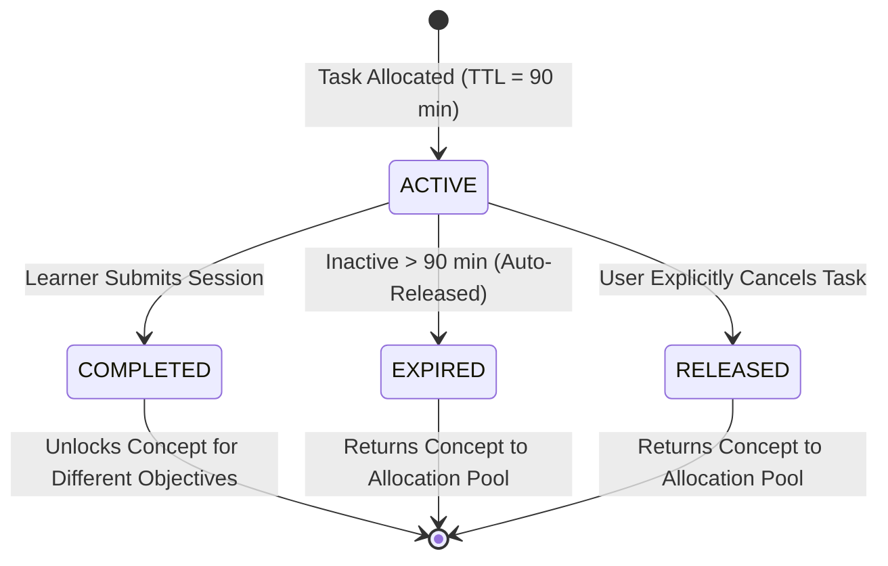

# GrammarPath — Phase 3.4C: Scoped Adaptive Reservation Model Specification

## 1. Specification Purpose & Design Principles

This specification designs the **Scoped Task Reservation Architecture** mandated by Product Owner Decision 4.

### 1.1 Rejection of Rigid 24-Hour Calendar Locks
In naive adaptive learning systems, assigning a task to a user locks that topic or concept for an entire 24-hour calendar day. This creates artificial user friction:
- A dedicated learner who completes their 15-minute Daily Plan in the morning is blocked from practicing those same concepts in an evening Adaptive Quiz or Review Center session.
- Conversely, an uncoordinated system with zero locks allows the Daily Plan, Adaptive Quiz, and Review Center to assign the exact same questions simultaneously on the same afternoon.

### 1.2 The Scoped Reservation Solution
GrammarPath implements **Fine-Grained, Objective-Scoped Task Reservations**:
1. Concurrency locks are scoped by **(User, Concept, Learning Objective)** rather than a coarse global date lock.
2. Concurrent tasks targeting the **same learning objective** on the same concept are prevented.
3. Subsequent tasks targeting **different learning objectives** on the same concept are permitted immediately upon completion.
4. Abandoned sessions release their locks automatically via sliding time-to-live (TTL) expiration.

---

## 2. Formal Entity & State Model



### 2.1 Reservation Record Attributes

A task reservation represents an active or completed pedagogical contract:

| Field Name | Type | Description |
| :--- | :--- | :--- |
| `id` | `UUID` | Unique reservation token. |
| `userId` | `UUID` | Target learner identity. |
| `conceptId` | `UUID` | Target grammar concept. |
| `activityType` | `Enum` | `spaced_review`, `mistake_remediation`, `transfer_practice`, `curriculum_exercise`, `diagnostic_probe` |
| `learningObjective` | `Enum` | `retention_consolidation`, `error_correction`, `transfer_extension`, `initial_acquisition`, `boundary_calibration` |
| `sourceSubsystem` | `Enum` | `DAILY_PLAN`, `ADAPTIVE_QUIZ`, `REVIEW_CENTER`, `CURRICULUM_PATH` |
| `taskIdentity` | `String` | Foreign key to `DailyLearningPlanItem.id` or `StudySession.id`. |
| `reservationState` | `Enum` | `ACTIVE`, `COMPLETED`, `RELEASED`, `EXPIRED` |
| `allocatedAt` | `DateTime` | Timestamp of allocation. |
| `expiresAt` | `DateTime` | Sliding expiration cutoff (`allocatedAt + 90 minutes`). |
| `completedAt` | `DateTime?` | Timestamp of successful session grading. |

---

## 3. The Core Coordination & Non-Interference Invariants

### Invariant 1: Single Active Objective Invariant
At any given timestamp $T$, for a specific tuple $(\text{userId}, \text{conceptId}, \text{learningObjective})$, there may exist **at most one** reservation in the `ACTIVE` state:

$$\sum_{r \in \mathcal{R}} \mathbf{1}\Big( r.\text{userId} = u \;\land\; r.\text{conceptId} = c \;\land\; r.\text{learningObjective} = o \;\land\; r.\text{state} = \text{'ACTIVE'} \Big) \le 1$$

- **Enforcement:** If `AdaptiveQuizGenerator` attempts to allocate a `transfer_extension` task for Unit 1, but Unit 1 already has an `ACTIVE` reservation for `transfer_extension` in today's Daily Plan, the quiz generator must choose another concept.

### Invariant 2: Multi-Objective Concurrency Permission
Different learning objectives on the same concept **do not block each other**:
- **Scenario:** A learner has an `ACTIVE` `spaced_review` task (objective: `retention_consolidation`) for Concept A in the Review Center.
- **Allowed:** If the learner enters Adaptive Quiz, the system is permitted to assign a `mistake_remediation` task (objective: `error_correction`) on Concept A, because error remediation does not interfere with memory retention evaluation.

### Invariant 3: Immediate Re-engagement Post-Completion
- Once a reservation transitions to `reservationState = 'COMPLETED'`, its active lock is removed.
- The learner is immediately eligible to undertake another activity on that concept, provided the new activity advances their learning path.

---

## 4. Idempotency, Session Recovery & Cleanup Behavior

### 4.1 Idempotent Task Retrieval
When the frontend requests the Daily Learning Plan or starts an Adaptive Quiz:
1. The service executes an atomic lookup for existing `ACTIVE` reservations for that user.
2. If an active reservation exists for the requested intent, the service **returns the existing task** rather than instantiating a duplicate item or creating a new database row.
3. This guarantees that page refreshes, intermittent network disconnects, or tab closures never multiply learning tasks.

### 4.2 Sliding Expiration & Automatic Cleanup
1. **Default TTL:** Each active reservation is created with `expiresAt = now() + 90 minutes`.
2. **Heartbeat Extension:** While the learner is actively answering questions in an interactive session, client heartbeat pings extend `expiresAt` by $+30$ minutes (up to a maximum ceiling of 4 hours).
3. **Passive Expiry:** When queries check for active reservations, any record where `expiresAt < now()` and `reservationState = 'ACTIVE'` is lazily evaluated as `EXPIRED` and ignored.
4. **Periodic Sweeper:** A background maintenance job executed during low-traffic periods updates stale active rows to `reservationState = 'EXPIRED'`.

### 4.3 Explicit User Cancellation (`RELEASED`)
If a learner explicitly dismisses or skips a task in the UI (e.g. clicks *"Skip this task for today"*), the backend marks the reservation `RELEASED`. The concept immediately returns to the candidate pool for other activity modes.

---

## 5. Architectural Implementation Design for Milestone 3.4C.4

In Milestone 3.4C.4, the coordination engine is implemented via `backend/src/services/adaptive-coordinator.service.ts`:

```typescript
export interface ReserveTaskParams {
  userId: string;
  conceptId: string;
  activityType: ActivityType;
  learningObjective: LearningObjective;
  sourceSubsystem: SubsystemSource;
  taskIdentity: string;
  ttlMinutes?: number;
}

export class AdaptiveCoordinatorService {
  /**
   * Attempts to acquire an objective-scoped task reservation.
   * Returns true if reservation acquired, false if conflict exists.
   */
  static async tryAcquireReservation(params: ReserveTaskParams): Promise<boolean> {
    const { userId, conceptId, learningObjective, ttlMinutes = 90 } = params;
    const now = new Date();
    const expiresAt = new Date(now.getTime() + ttlMinutes * 60 * 1000);

    // Check for conflicting ACTIVE reservation
    const conflict = await prisma.taskReservation.findFirst({
      where: {
        userId,
        conceptId,
        learningObjective,
        reservationState: "ACTIVE",
        expiresAt: { gt: now },
      },
    });

    if (conflict) {
      return false; // Conflicting active objective already allocated
    }

    await prisma.taskReservation.create({
      data: {
        ...params,
        reservationState: "ACTIVE",
        allocatedAt: now,
        expiresAt,
      },
    });

    return true;
  }

  /**
   * Completes a reservation upon successful session submission.
   */
  static async completeReservation(userId: string, taskIdentity: string): Promise<void> {
    await prisma.taskReservation.updateMany({
      where: { userId, taskIdentity, reservationState: "ACTIVE" },
      data: {
        reservationState: "COMPLETED",
        completedAt: new Date(),
      },
    });
  }
}
```

---

## 6. Distinctions: Facts vs Proposals vs Assumptions vs Open Questions

### Verified Facts
1. Current staging `daily-plan.service.ts` creates daily plans with `planDate = 'YYYY-MM-DD'` unique index, enforcing a 1-plan-per-day constraint.
2. `adaptive.controller.ts` queries mistakes and weak units directly without checking `daily-plan.service.ts`, leading to potential same-day question duplication.
3. No reservation model currently exists in the database.

### Design Proposals
1. Implement `TaskReservation` entity supporting fine-grained `(userId, conceptId, learningObjective)` locking.
2. Adopt a 90-minute sliding TTL to gracefully handle abandoned sessions.
3. Allow multi-objective tasks on the same concept concurrently or immediately post-completion.

### Assumptions
1. We assume 90 minutes is sufficient for an uninterrupted grammar practice session.
2. We assume learners prioritize completing their daily plan items before seeking open-ended adaptive quizzes.

### Open Questions
- Should reservations be stored in a dedicated PostgreSQL table (`task_reservations`) or ephemeral Redis cache?
  *(Recommendation: In Milestone 3.4C.4, implement in PostgreSQL with an index on `[userId, conceptId, learningObjective, reservationState]` for full transaction safety and auditability without introducing a mandatory Redis dependency).*

