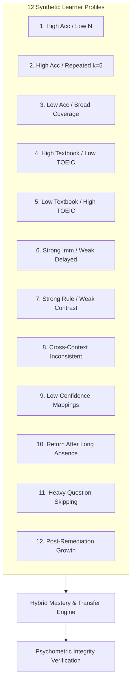

# GrammarPath — Phase 3.4C Stage 1I: Simulation Framework & Empirical Validation Plan

## 1. Executive Summary & Epistemological Boundaries

A core principle of educational data science is that **a passing unit test or synthetic Monte Carlo simulation proves logical consistency, NOT educational efficacy**. A mathematical formula may balance gracefully in Python or TypeScript while failing completely in human cognitive acquisition.

This document establishes:
1. **The Synthetic Simulation Suite**: 12 edge-case learner archetypes engineered to stress-test the Hybrid Evidence-Gated Model, Transfer Classifier, and Adaptive Coordinator against boundary failures.
2. **Failure Mode Matrix**: Concrete expected behaviors and explicit bug definitions for each archetype.
3. **Future Real-User Empirical Validation Protocol**: A pre-registered psychometric calibration and randomized educational study designed for execution once learner cohort size permits.

---

## 2. The Twelve Synthetic Learner Archetypes

### Archetype 1: High Accuracy, Low Evidence ($N = 2$, 100% Correct)
- **Profile Scenario:** Learner answers only 2 distinct textbook questions on Unit 1, getting both correct ($2/2$).
- **Expected Measurement:**
  - Foundational Accuracy: $100\%$
  - Distinct Question Count: $N_{\text{distinct}} = 2$ (Fails evidence gate $N \ge 3$)
  - Mastery Status: **`INSUFFICIENT_EVIDENCE`**
  - Transfer Status: **`NOT_STARTED`**
- **Adaptive Coordinator Action:** Mode 6 (Targeted Assessment) to administer 2 additional distinct questions.
- **Critical Failure Mode to Prevent:** Deceptively awarding the label "Mastered" based solely on $100\%$ accuracy.

### Archetype 2: High Accuracy, Many Repeated Questions ($N = 2$, 10 Total Attempts)
- **Profile Scenario:** Learner attempts the exact same two questions 5 times each on the same afternoon, scoring $10/10$.
- **Expected Measurement:**
  - Repeat Discount: $d(k) = \max(0.10, 0.50^k)$ reduces weights of attempts $k \ge 1$ to $0.5, 0.25, 0.10$.
  - Same-Day Cramming Multiplier: $0.50$ applied to all subsequent attempts.
  - Distinct Question Count: Strictly $N_{\text{distinct}} = 2$.
  - Mastery Status: **`INSUFFICIENT_EVIDENCE`** (Effective evidence weight $< 2.5$).
- **Critical Failure Mode to Prevent:** Permitting "answer key memorization" to satisfy evidence volume thresholds.

### Archetype 3: Low Accuracy, Broad Coverage ($N = 10$ Distinct Questions, 40% Correct)
- **Profile Scenario:** Learner completes 10 distinct questions across Exercises 1.1–1.4, answering 4 correctly and 6 incorrectly.
- **Expected Measurement:**
  - Foundational Competence: $\theta_{\text{foundational}} = 0.40$
  - Distinct Question Count: $N_{\text{distinct}} = 10$ (Passes evidence gate)
  - Mastery Status: **`DEVELOPING`**
  - Transfer Readiness: **`LOCKED`** ($R_{\text{ready}} = 0.0$)
- **Adaptive Coordinator Action:** Mode 2 (Reinforce Weak Concept) with scaffolding and grammar hints enabled.
- **Critical Failure Mode to Prevent:** Assigning TOEIC Part 5 questions when foundational rules are unmastered.

### Archetype 4: Strong Textbook Performance, Weak Transfer (Textbook 95%, TOEIC 30%)
- **Profile Scenario:** Learner scores $19/20$ on textbook exercises (Tier 1), but scores $3/10$ on workplace TOEIC Part 5 items (Tier 6).
- **Expected Measurement:**
  - Foundational Competence: $\theta_{\text{foundational}} = 0.95$ (Status: `PROFICIENT`)
  - Transfer Accuracy: $TA = 0.30$, Transfer Quotient: $\tau_{\text{transfer}} = 0.35$
  - Overall Mastery Status: **`PROFICIENT` (Foundational Only)** — Explicitly denied `STRONG_TRANSFER`.
- **Adaptive Coordinator Action:** Mode 4 (Transfer Practice) targeting business register clues and clausal syntax.
- **Critical Failure Mode to Prevent:** Masking transfer failure under a blended single percentage that shows $75\%$ ("Satisfactory").

### Archetype 5: Weak Textbook Performance, Strong TOEIC Performance (Textbook 40%, TOEIC 90%)
- **Profile Scenario:** Learner struggles with textbook production ($4/10$), but scores $9/10$ on TOEIC Part 5 multiple choice.
- **Expected Measurement:**
  - Cross-Context Consistency: $CCC = 1.0 - |0.90 - 0.40| = 0.50$ (High context discrepancy).
  - Transfer Confidence Score: $TCS$ downweighted due to low $CCC$.
  - Overall Status: **`DEVELOPING` (Discrepant Evidence)**.
- **Adaptive Coordinator Action:** Mode 6 (Targeted Assessment) to test whether TOEIC success was due to multiple-choice guessing heuristics.
- **Critical Failure Mode to Prevent:** Uncritically trusting multiple-choice recognition over productive syntactic failure.

### Archetype 6: Strong Immediate Recall, Weak Delayed Recall ($R(0) = 1.0, R(14) = 0.30$)
- **Profile Scenario:** Learner achieves $100\%$ on day 0. No practice for 14 days. On day 14, retention probe fails ($0/3$).
- **Expected Measurement:**
  - Memory Retention Estimate: $R(14) = \exp(-0.02 \times 14) \approx 0.755$.
  - Post-retrieval failure update: Retrieval outcome $O_t = 0$ collapses stability:
    $$S_{\text{new}} = \max(1.0, S_{\text{old}} \times 0.50)$$
  - Mastery Status: Transitions immediately from `PROFICIENT` $\to$ **`NEEDS_REVIEW`**.
- **Adaptive Coordinator Action:** Priority Spaced Review (Mode 3) scheduled in Daily Learning Plan.
- **Critical Failure Mode to Prevent:** "Permanent Mastery" bug where a concept once mastered is never downgraded despite forgetting.

### Archetype 7: Strong Grammar, Weak Contrastive Discrimination
- **Profile Scenario:** Learner scores $95\%$ on isolated Present Continuous drills (Unit 1) and $95\%$ on isolated Present Simple drills (Unit 2), but drops to $45\%$ when faced with Unit 3/4 contrastive exercises.
- **Expected Measurement:**
  - Contrastive Discrimination Index: $CDI = 0.45$
  - Concept Mastery (Unit 1 & 2): `PROFICIENT`
  - Contrast Concept (Unit 3 & 4): **`DEVELOPING`**
- **Adaptive Coordinator Action:** Mode 5 (Resolve Misconception) using minimal pair sentences and state vs action verbs.
- **Critical Failure Mode to Prevent:** Assuming that knowing two rules in isolation implies knowing when to choose between them.

### Archetype 8: Cross-Context Inconsistency
- **Profile Scenario:** Learner performs well on informal conversational prompts ($90\%$) but fails on formal written memos ($40\%$).
- **Expected Measurement:**
  - Contextual Variance: $\sigma_{\text{context}} > 0.25$
  - Cross-Context Consistency: $CCC < 0.60$
  - Status: **`DEVELOPING`**
- **Adaptive Coordinator Action:** Mode 4 (Contextual Variation Practice).

### Archetype 9: High Performance with Low-Confidence Mappings
- **Profile Scenario:** Learner answers 10 questions correctly, but all questions originate from broad unit fallback links with `confidence = 0.60`.
- **Expected Measurement:**
  - Mapping Weight: $0.60$ applied to all evidence items.
  - Effective Evidence: $W_{\text{evidence}} = 6.0$.
  - Status: Requires more distinct questions to reach Proficient threshold compared to high-confidence direct links.
- **Critical Failure Mode to Prevent:** Treating tangential questions with identical evidentiary weight as core targeted items.

### Archetype 10: Returning Learner After Long Absence (60 Days Inactive)
- **Profile Scenario:** Learner was `PROFICIENT` across 20 concepts, then leaves the app for 60 days.
- **Expected Measurement:**
  - Recency Decay: $\exp(-0.02 \times 60) \approx 0.301$.
  - Retention Health: Dropped to $30\%$.
  - All 20 concepts flagged **`NEEDS_REVIEW`**.
- **Adaptive Coordinator Action:** Staggered reactivation queue: 3 concepts reviewed per day, ordered by DAG prerequisite hierarchy (foundations first).
- **Critical Failure Mode to Prevent:** Overwhelming the returning learner with 20 simultaneous overdue reviews on Day 61.

### Archetype 11: Heavy Question Skipping / Unanswered
- **Profile Scenario:** Learner opens 10 questions, answers 2 correctly, and skips 8 (`attemptStatus = 'unanswered'`).
- **Expected Measurement:**
  - Unanswered Attempts: Strictly excluded from numerator and denominator ($W_{\text{correct}} = 2.0, W_{\text{evidence}} = 2.0$).
  - Evaluated Accuracy: $100\%$ ($2/2$).
  - Distinct Evaluated Questions: $N_{\text{distinct}} = 2$.
  - Status: **`INSUFFICIENT_EVIDENCE`** (Not penalized as failure, but prevented from graduating).
- **Critical Failure Mode to Prevent:** Either counting skips as incorrect (driving score to 20%) or counting skips as correct.

### Archetype 12: Post-Remediation Growth
- **Profile Scenario:** Learner starts at $30\%$ accuracy ($3/10$). Completes Mode 2 scaffolding and re-tests 3 days later, scoring $5/5$ on fresh questions.
- **Expected Measurement:**
  - Historical error weights decayed by recency.
  - Recent success weighted at $1.0$.
  - Status transitions successfully from `DEVELOPING` $\to$ **`PROFICIENT`**.
- **Critical Failure Mode to Prevent:** "Permanent Failure Penalty" where early struggle permanently mathematically prevents reaching mastery.

---

## 3. Summary of Archetype Simulation Expectations

| Archetype | Key Input | Expected Status | Key Safeguard Verified |
| :--- | :--- | :--- | :--- |
| **1. Low Evidence** | 2/2 Correct | `INSUFFICIENT_EVIDENCE` | Anti-Triviality / Evidence Volume Gate |
| **2. Repeated Drill** | 10/10 (2 Qs x 5) | `INSUFFICIENT_EVIDENCE` | Repeat Discount & Same-Day Cram Multiplier |
| **3. Low Accuracy** | 4/10 Correct | `DEVELOPING` | Transfer Readiness Lock ($R_{\text{ready}} = 0$) |
| **4. High Book / Low TOEIC** | 95% Book, 30% TOEIC | `PROFICIENT` (No Transfer) | Multi-Dimensional Separation |
| **5. Low Book / High TOEIC** | 40% Book, 90% TOEIC | `DEVELOPING` (Discrepant) | Cross-Context Consistency Penalty |
| **6. Retrieval Decay** | Day 0: 100%, Day 14: 0% | `NEEDS_REVIEW` | Spaced Repetition Regression Trigger |
| **7. Weak Contrast** | 95% Solo, 45% Mixed | `DEVELOPING` | Contrastive Discrimination Index ($CDI$) |
| **8. Inconsistent Context** | 90% Casual, 40% Formal | `DEVELOPING` | Cross-Context Consistency ($CCC$) |
| **9. Low Confidence Map** | 100% on Fallback Qs | Calibrated Growth | Mapping Confidence Weighting |
| **10. Long Absence** | 60 Days Inactive | `NEEDS_REVIEW` (Staggered) | Recency Decay & Re-activation Batching |
| **11. Heavy Skipping** | 2 Correct, 8 Skipped | `INSUFFICIENT_EVIDENCE` | Tri-State Invariant Non-Penalization |
| **12. Remediation Growth** | 30% Initial $\to$ 100% Later | `PROFICIENT` | Recency-Weighted Rehabilitation |

---

## 4. Future Real-User Empirical Validation Protocol

When GrammarPath reaches sufficient production user volume, the following pre-registered empirical study must be conducted:

### Phase A: Sample Size & Cohort Requirements
- Minimum cohort: $N \ge 300$ active ESL/EFL learners with target TOEIC goals.
- Study duration: 8 weeks.

### Phase B: Controlled Experimental Design (A/B Test)
- **Control Group ($N = 150$):** Traditional linear sequential curriculum (Murphy unit-by-unit) with simple percentage accuracy tracking.
- **Intervention Group ($N = 150$):** Phase 3.4C Adaptive Coordinator (Prerequisite DAG, 6 Activity Modes, Hybrid Mastery, and Transfer Gating).

### Phase C: Psychometric Outcome Measures
1. **Pre-Intervention Baseline:** Standardized 40-question grammar diagnostic (CEFR calibrated, A2–B2 range).
2. **Immediate Post-Intervention Test:** 40-question comprehensive assessment (20 textbook-style, 20 TOEIC Part 5).
3. **Delayed Post-Intervention Test (Week 8):** 40-question retention and transfer probe (novel contexts, zero overlapping prompts).
4. **Primary Endpoints:**
   - **Grammar Transfer Gain ($GTG$):** Difference in TOEIC Part 5 accuracy from pre- to post-test.
   - **30-Day Retention Decay Rate:** Comparison of forgetting curves between scheduled spaced review vs linear review.
   - **Learning Efficiency (Time to Competence):** Total study minutes required to achieve $\ge 85\%$ accuracy on delayed transfer probes.

