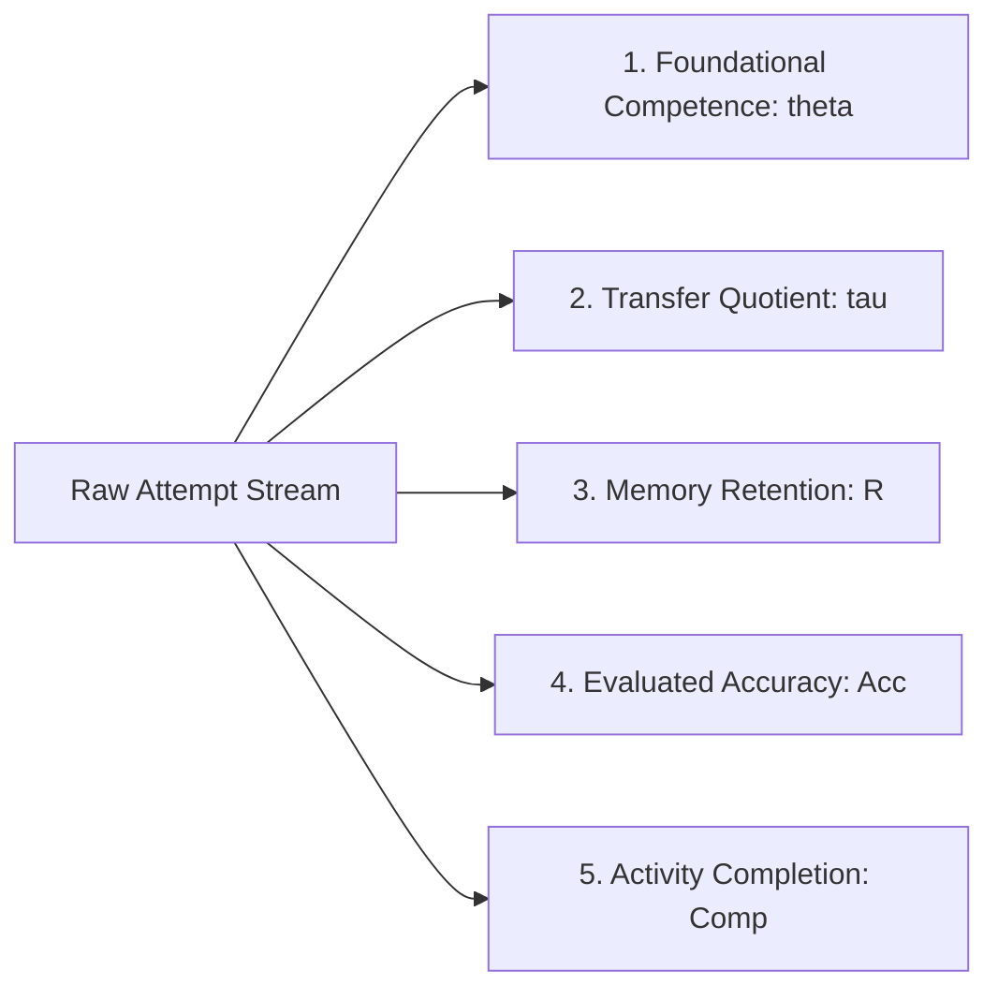
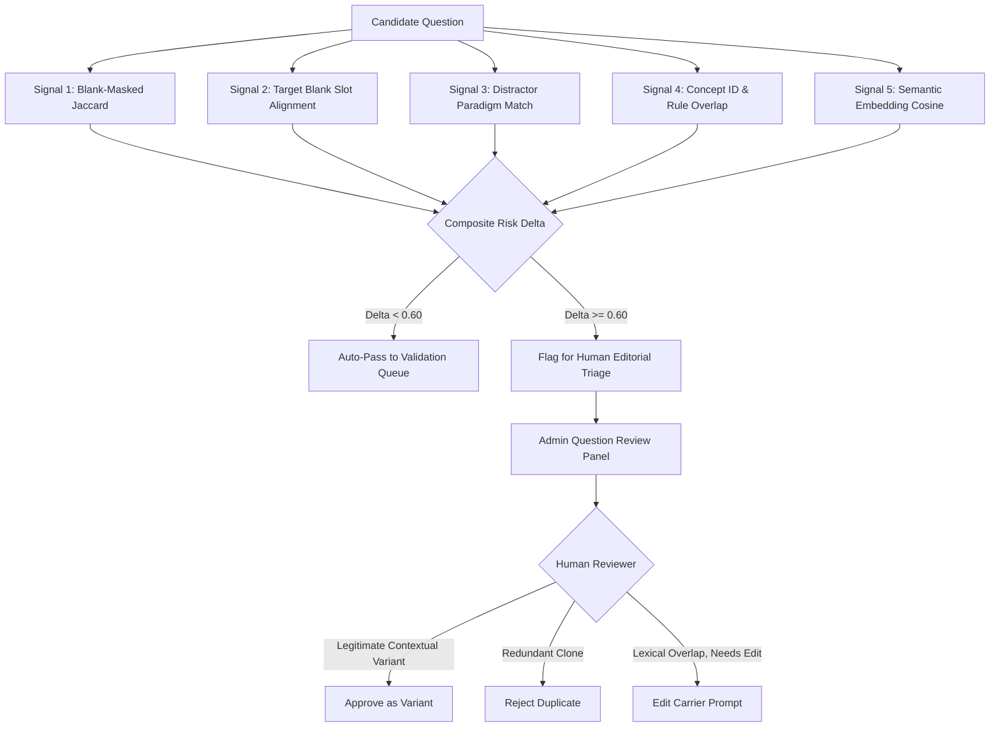

# GrammarPath — Phase 3.4C Stage 1.1: Architecture Decision Reconciliation

## 1. Executive Summary & Reconciliation Charter

This report codifies the formal reconciliation of architecture decisions between the Phase 3.4C Stage 1 audit findings and the product owner's governance directives. 
Stage 1.1 operates under **strict read-only and design-only constraints**:
- Zero database writes, schema changes, migrations, or status mutations.
- Zero source code changes in application services or controllers.
- Historical attempts and approved item versions are 100% preserved.
- Staging inspection was executed under the staging isolation guard (`backend/scripts/run-with-staging-env.mjs`, exit code: 0).

---

## 2. Decision 1: Remediation Protocol for Flawed Staging Item `7d24582b`

### 2.1 Target Item Identity
- **Item ID:** `7d24582b-ca20-4c7a-a828-530f4852e80a`
- **Root Question ID:** `3d71c0d1-6a2d-498a-b6f2-c5abad85657e`
- **Version:** 2 (`isLatestApproved = true`, `reviewStatus = 'approved'`)
- **Carrier Prompt:** *"The IT technician is not at his desk because he _______ the server hardware in Room 3 right now."*
- **Defect:** Correct option marked is Option B: *"am trying"* (`isCorrect: true`). Subject is 3rd-person singular *"he"*; *"he am trying"* is an objective grammatical error.

### 2.2 Empirical Database Investigation (Verified Facts)
Read-only inspection of the Neon staging database via `run-with-staging-env.mjs` confirmed:
1. **Zero Existing Attempts on Item `7d24582b`:**
   ```sql
   SELECT COUNT(*) FROM question_attempt_items WHERE question_bank_item_id = '7d24582b-ca20-4c7a-a828-530f4852e80a';
   ```
   **Result:** `0` records.
2. **Zero Existing Attempts on ANY Question Bank Item:**
   ```sql
   SELECT COUNT(*) FROM question_attempt_items WHERE question_bank_item_id IS NOT NULL;
   ```
   **Result:** `0` records. (The only 2 attempts on staging are on textbook question `1.3-q1`).
3. **Zero Impact on Historical Masteries & Schedules:**
   `UserConceptMastery.distinctQuestionCount > 0`: `0` records.
   `ConceptReviewSchedule`: `0` records.
   No learner has ever been graded against this item; no mastery scores, accuracy metrics, or spaced review schedules have been contaminated.

### 2.3 Strict Governance Mandate: WITHDRAW, Do Not Silently Edit
- The product owner has mandated: **WITHDRAW** the item.
- The approved version record must **NOT** be silently mutated, overwritten, or deleted.
- The historical record is preserved for auditability.

### 2.4 Downstream Execution Plan for Milestone 3.4C.1
1. **Step 1 (Status Transition):**
   In Milestone 3.4C.1, execute the established withdrawal service method:
   ```typescript
   await ToeicQuestionBankService.emergencyWithdrawQuestion({
     adminUserId: "system-audit",
     itemId: "7d24582b-ca20-4c7a-a828-530f4852e80a",
     reason: "Withdrawn in Phase 3.4C audit: ungrammatical answer key (he am trying).",
   });
   ```
   This atomically sets `reviewStatus = 'withdrawn'` and `isLatestApproved = false`.
2. **Step 2 (Replacement Editorial Workflow):**
   A corrected replacement must be generated or authored as **Version 3** with root ID `3d71c0d1-6a2d-498a-b6f2-c5abad85657e`.
   The replacement must undergo independent validation, enter `reviewStatus = 'validated'`, and require human admin editorial review and approval before becoming active.

---

## 3. Decision 2: Multi-Dimensional Mastery Independence

### 3.1 Rejection of Premature Scalar Composites
The product owner has explicitly directed:
- **Do NOT adopt a fixed 60/40 or adaptive 40/60 composite score in Milestone 3.4C.1.**
- In educational measurement, collapsing distinct latent constructs without empirical factor analysis creates an uncalibrated composite that obscures learning diagnosis.

### 3.2 Independent Orthogonal Dimensions

The learning measurement model maintains five independent metrics:



1. **Foundational Competence ($\theta_{\text{foundational}} \in [0.0, 1.0]$):**
   - Source: Canonical textbook exercises (Tier 1 & Tier 2).
   - Reflects basic rule acquisition, syntactic morphology, and cued sentence completion.
2. **Transfer Quotient ($\tau_{\text{transfer}} \in [0.0, 1.0]$):**
   - Source: Approved TOEIC Part 5 items (Tier 3 through Tier 6).
   - Reflects cross-context application in workplace registers, long-distance dependencies, and distractor rejection.
3. **Memory Retention ($R(t) \in [0.0, 1.0]$):**
   - Source: Spaced review retrieval outcomes and elapsed time since last retrieval.
   - Decays according to stability dynamics: $R(t) = \exp(-t / S)$.
4. **Evaluated Accuracy ($Acc \in [0.0, 1.0]$):**
   - Source: Raw ratio of correct attempts over answered attempts ($N_{\text{correct}} / N_{\text{answered}}$). Skipped/unanswered strictly excluded.
5. **Activity Completion ($Comp \in [0.0, 1.0]$):**
   - Source: Proportion of assigned curriculum or session items completed.

---

## 4. Decision 3: Multi-Signal Duplicate Triage Process

### 4.1 Reclassification of Jaccard Cutoff
- Blank-masked lemmatized Jaccard similarity $J_{\text{token}} \ge 0.75$ is established strictly as an **initial triage alert signal**.
- It must **never** automatically delete, merge, or reject a question.

### 4.2 Multi-Signal Detection Architecture



### 4.3 Risk Analysis: False Positives vs. False Negatives
- **False-Positive Risk:** Short grammatical frames testing inverted syntax (e.g., *"Scarcely _______ the meeting started when the fire alarm rang."*) share high lexical overlap with legitimate variations. Multi-signal verification and human editorial review prevent discarding valid items.
- **False-Negative Risk:** Paraphrased sentences that test the exact same grammatical trap using completely different business vocabulary (*"The manager examined the financial statement"* vs *"The director reviewed the accounting audit"*). Semantic embeddings and identical distractor morphological paradigms catch these paraphrases.

---

## 5. Decision 4: Scoped Adaptive Reservation Model

### 5.1 Rejection of Rigid 24-Hour Calendar Lock
- A rigid 24-hour calendar-day lock prevents a learner who completes their daily plan in 15 minutes from doing targeted practice or quiz activities on the same concepts later in the day.

### 5.2 Scoped Reservation Architecture
Reservations are scoped by:
- `userId` (Learner identity)
- `conceptId` (Target grammar concept)
- `activityType` (`spaced_review`, `mistake_remediation`, `transfer_practice`, etc.)
- `learningObjective` (`retention_consolidation`, `error_correction`, `transfer_extension`, `initial_acquisition`)
- `reservationState` (`ACTIVE`, `COMPLETED`, `EXPIRED`, `RELEASED`)
- `expiresAt` (Sliding session TTL: 90 minutes)

### 5.3 Core Non-Interference Invariant
- Two active tasks cannot share the **same user, concept, and learning objective** concurrently.
- Once a task is `COMPLETED`, its reservation clears, allowing the learner to immediately undertake an activity with a **different learning objective** on that same concept.

---

## 6. Critical P0: TOEIC Mastery Evidence Eligibility Invariant

### 6.1 Strict Eligibility Rule
Only valid, currently approved TOEIC question versions may contribute learner evidence to mastery calculations:
$$\text{Eligible Item} \iff \text{reviewStatus} = \text{'approved'} \land \text{isLatestApproved} = \text{true}$$

Draft, validated, rejected, withdrawn, archived, or superseded question versions are strictly excluded at query time in `mastery.service.ts`.

---

## 7. Critical P0: Concept Evidence Isolation & Fallback Policy

### 7.1 Empirical Investigation of the 16 Concepts (Verified Facts)
Read-only staging queries revealed:
1. All 145 unit-level concepts (`unit.001` through `unit.145`) have **$\ge 14$ test questions** directly linked via `Explanation.theorySectionId`.
2. The 16 concepts with 0 explanation-linked questions are **exclusively the 16 parent module concepts** (`module.1.1` to `module.5.3`), which represent curriculum groupings, not individual units.
3. On staging, the fallback query in `mastery.service.ts:94` has swept in **zero questions** because module concepts have empty `associatedUnitIds`.

### 7.2 Strict Evidence Isolation Policy
- **Direct Theory Link Evidence:** Fully eligible ($1.0$ weight).
- **Verified Concept Mapping:** Eligible according to mapped confidence.
- **Broad Unit Fallback:** Strictly prohibited from contributing to concept-level mastery evidence. Contextual/unit-level questions may be presented for diagnostic overview, but must **never** update `UserConceptMastery`.
- **Sparse Concepts ($N_{\text{direct}} < 3$):** System must return explicit status **`INSUFFICIENT_DATA`**.

---

## 8. Summary of Reconciled Design Status

| Decision / Issue | Stage 1 Initial State | Stage 1.1 Reconciled State | Verification Status |
| :--- | :--- | :--- | :--- |
| **Flawed Item `7d24582b`** | Identified bug in staging | Formal withdrawal protocol designed; zero historical attempts confirmed. | VERIFIED FACT |
| **Mastery Weights** | Proposed 60/40 composite | Independent 5-dimensional vector; no composite score in 3.4C.1. | ADOPTED |
| **Near-Duplicate Rule** | Hard Jaccard cutoff $\ge 0.75$ | Multi-signal triage alert; human editorial decision gate. | ADOPTED |
| **Daily Plan Lock** | Proposed 24-hr calendar lock | Scoped reservation model with objective-based non-interference & 90-min TTL. | ADOPTED |
| **TOEIC Mastery Eligibility** | Filter missing in code | Strict `{ reviewStatus: 'approved', isLatestApproved: true }` invariant. | P0 CLOSED |
| **Concept Evidence Fallback** | Fallback swept unit questions | Broad fallback banned from mastery updates; explicit `insufficient_data` state. | P0 CLOSED |

