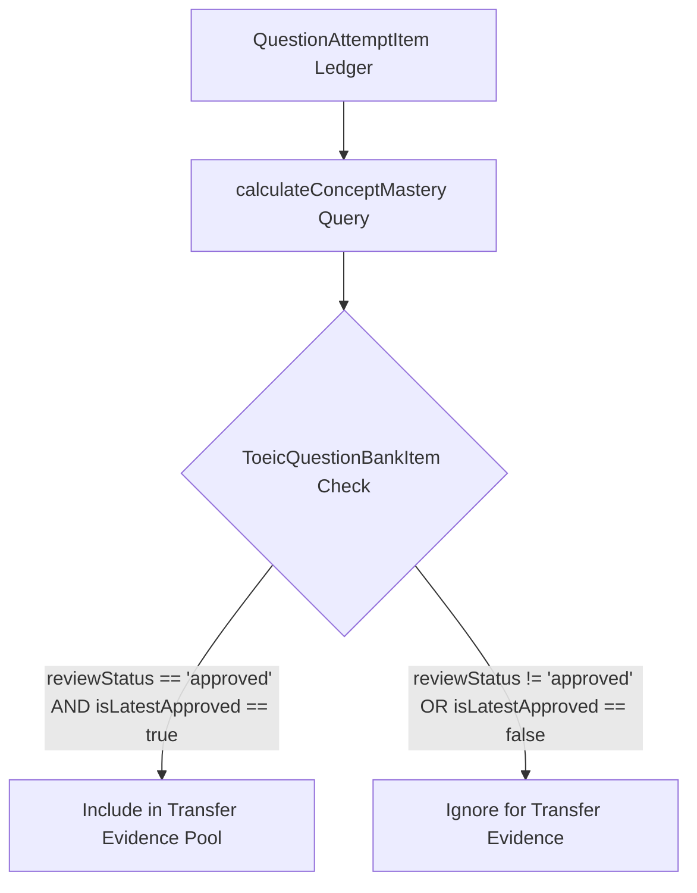

# GrammarPath — Phase 3.4C: TOEIC Mastery Evidence Eligibility Specification

## 1. Specification Purpose & Governance Mandate

This specification addresses **Critical Defect P0-A** identified during the Phase 3.4C Stage 1 audit:
In `backend/src/services/mastery.service.ts` (lines 109–161), queries to `ToeicQuestionBankItem` verify `primarySkill` and `conceptMappingConfidence >= 0.85`, but **fail to check `reviewStatus: 'approved'` or `isLatestApproved: true`**.

This document defines the formal, server-enforced invariant governing which TOEIC question attempts are legally eligible to contribute to learner mastery calculations, while strictly preserving 100% of historical attempt telemetry.

---

## 2. Verified Facts: Codebase & Database State

### 2.1 Code Vulnerability in `mastery.service.ts`
Inspection of `backend/src/services/mastery.service.ts` reveals the exact lines where unapproved items are admitted:

```typescript
// backend/src/services/mastery.service.ts:109-116
const eligibleBankItemCount = await db.toeicQuestionBankItem.count({
  where: {
    conceptId,
    primarySkill: { in: ["direct_grammar", "word_form_morphology"] },
    conceptMappingConfidence: { gte: 0.85 },
    // DEFECT: Missing reviewStatus: "approved"
    // DEFECT: Missing isLatestApproved: true
  },
});

// backend/src/services/mastery.service.ts:152-161
if (eligibleBankItemCount > 0) {
  attemptCriteria.push({
    attemptSource: "toeic_practice",
    questionBankItem: {
      conceptId,
      primarySkill: { in: ["direct_grammar", "word_form_morphology"] },
      conceptMappingConfidence: { gte: 0.85 },
      // DEFECT: Missing reviewStatus: "approved"
      // DEFECT: Missing isLatestApproved: true
    },
  });
}
```

### 2.2 Practice Session Contrast
In contrast, `backend/src/services/toeic-question-bank.service.ts` (lines 379–394) properly guards learner practice delivery:
```typescript
// backend/src/services/toeic-question-bank.service.ts:379-394
// INVARIANT: Only items with reviewStatus = 'approved' AND isLatestApproved = true are returned.
const items = await prisma.toeicQuestionBankItem.findMany({
  where: {
    unitNumber,
    primarySkill: "direct_grammar",
    reviewStatus: "approved",
    isLatestApproved: true,
  },
  // ...
});
```
This demonstrates an internal inconsistency: the question-serving layer enforces editorial gating, but the mastery calculation layer leaves the gate wide open.

### 2.3 Staging Database Verification
Read-only queries against Neon staging executed via `backend/scripts/run-with-staging-env.mjs` (exit code: 0) established:
1. `ToeicQuestionBankItem` records: 35 total (3 `approved`, 29 `validated`, 3 `archived`, 0 `draft`).
2. `QuestionAttemptItem` records referencing ANY TOEIC item: **`0` records**.
3. Applying the strict approved-version filter on staging causes **zero regressions or score changes** for historical users.

---

## 3. The Strict Version Eligibility Invariant

### 3.1 Formal Definition

An attempt record $A \in \mathcal{A}$ on question bank item $Q$ is legally eligible to contribute evidence to a learner's concept mastery if and only if $Q$ satisfies the **Active Approved Version Invariant**:

$$\text{Eligible}(Q) \iff \Big( Q.\text{reviewStatus} = \text{'approved'} \;\land\; Q.\text{isLatestApproved} = \text{true} \;\land\; Q.\text{conceptMappingConfidence} \ge 0.85 \Big)$$

### 3.2 Evaluation of Question Version Lifecycle States

| Lifecycle State | `reviewStatus` | `isLatestApproved` | Evidence Eligibility | Pedagogical Justification |
| :--- | :--- | :--- | :--- | :--- |
| **Active Approved** | `approved` | `true` | **ELIGIBLE** | Formally reviewed and signed off by authorized editorial staff. |
| **Superseded Version** | `archived` | `false` | **INELIGIBLE** | Replaced by a newer version (e.g. fixed distractors or modernized vocabulary). |
| **Draft Version** | `draft` | `false` | **INELIGIBLE** | Raw AI output; unvalidated grammar and distractor plausibility. |
| **Validated Candidate** | `validated` | `false` | **INELIGIBLE** | Passed automated heuristics, but lacks mandatory human editorial approval. |
| **Rejected Candidate** | `rejected` | `false` | **INELIGIBLE** | Explicitly deemed defective or non-compliant by editorial staff. |
| **Withdrawn Item** | `withdrawn` | `false` | **INELIGIBLE** | Quarantined due to post-approval defect (e.g. ungrammatical answer key). |

---

## 4. Treatment of Historical Attempts on Older Versions

### 4.1 Non-Destructive Ledger Principle
- **Under no circumstances shall historical attempt records in `QuestionAttemptItem` be modified, updated, or deleted.**
- Every attempt event is an immutable historical record representing the learner's interaction at that wall-clock timestamp.

### 4.2 Query-Time Eligibility Filtering
The exclusion of superseded or withdrawn versions is enforced **at query time** inside `calculateConceptMastery()`.



### 4.3 Handling the Two Classes of Ineligible Historical Attempts

1. **Attempts on Withdrawn Defective Items (e.g., Item `7d24582b`):**
   - Because the answer key was invalid (*"he am trying"*), evaluating learner accuracy against it produced false signals.
   - Excluding attempts on withdrawn items ensures that once a defect is discovered, learner mastery is recalculated cleanly without the corrupted data.
2. **Attempts on Superseded Archived Items (Version Upgrades):**
   - When an approved item is upgraded from Version 1 to Version 2 to improve clarity, Version 1 transitions to `reviewStatus: 'archived'` and `isLatestApproved: false`.
   - In Milestone 3.4C.1, query-time filtering excludes Version 1 attempts from the live `tau_transfer` metric, ensuring all active transfer scores reflect current curriculum items.
   - The learner's overall attempt counter and historical activity logs continue to show the practice session in their audit history.

---

## 5. Target Code Design Proposal for Milestone 3.4C.1

In `backend/src/services/mastery.service.ts`:

```typescript
// Proposed query criteria for Milestone 3.4C.1
const eligibleBankItemCount = await db.toeicQuestionBankItem.count({
  where: {
    conceptId,
    primarySkill: { in: ["direct_grammar", "word_form_morphology"] },
    conceptMappingConfidence: { gte: 0.85 },
    reviewStatus: "approved",       // STRICT ELIGIBILITY FILTER
    isLatestApproved: true,        // MUST BE CURRENT ACTIVE VERSION
  },
});

if (eligibleBankItemCount > 0) {
  attemptCriteria.push({
    attemptSource: "toeic_practice",
    questionBankItem: {
      conceptId,
      primarySkill: { in: ["direct_grammar", "word_form_morphology"] },
      conceptMappingConfidence: { gte: 0.85 },
      reviewStatus: "approved",     // STRICT ELIGIBILITY FILTER
      isLatestApproved: true,      // MUST BE CURRENT ACTIVE VERSION
    },
  });
}
```

---

## 6. Distinctions: Facts vs Proposals vs Assumptions vs Open Questions

### Verified Facts
1. Staging `mastery.service.ts` lines 109–161 lacks `reviewStatus` and `isLatestApproved` filters.
2. `toeic-question-bank.service.ts` lines 379–394 enforces `reviewStatus: 'approved'` and `isLatestApproved: true` when returning questions for practice.
3. Staging database contains 0 attempts on any `ToeicQuestionBankItem`.
4. Flawed item `7d24582b` is currently marked `reviewStatus = 'approved'` and `isLatestApproved = true`.

### Design Proposals
1. Add `{ reviewStatus: "approved", isLatestApproved: true }` to both `eligibleBankItemCount` and `attemptCriteria` in `mastery.service.ts`.
2. Do not modify or delete historical rows in `question_attempt_items`.
3. Filter at query time rather than through destructive data migrations.

### Assumptions
1. We assume that when an item is upgraded to a new version, the editorial admin intends for future transfer evaluations to be measured against the new active version.
2. We assume that editorial review status changes are infrequent relative to daily learner practice.

### Open Questions
- If a high-volume production learner accumulated 50 attempts on Version 1 of a question bank before a batch version upgrade occurred, should their Version 1 attempts be permanently grandfathered into their `distinctTransferCount` under a `historical_version_grace_period` policy? 
  *(Recommended: In Milestone 3.4C.1, query-time filtering is optimal and safe; grandfathering policies can be revisited if large-scale longitudinal version migrations occur).*

