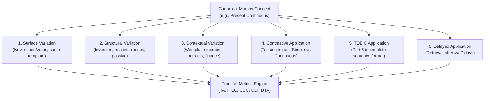

# GrammarPath — Phase 3.4C Stage 1: Transfer Learning Design
## Operational Framework for Measuring Cross-Context Grammar Application

**Role:** Principal Learning Engineer, Educational Data Scientist, TOEIC Assessment Specialist  
**Date:** November 14, 2026  
**Status:** DESIGN ONLY (READY FOR REVIEW)  
**Deliverable:** Phase 3.4C Stage 1C  

---

## 1. Executive Summary

A student who masters Unit 1 (*Present continuous*) in the textbook can effortlessly solve:
> *"Please be quiet. I _______ (work)."* $\rightarrow$ `"am working"`

However, when presented with a standard TOEIC Part 5 item:
> *"The chief project auditor is currently out of the office because she _______ the manufacturing facility in Busan until Friday afternoon."*  
> (A) inspects &nbsp;&nbsp; (B) is inspecting &nbsp;&nbsp; (C) inspected &nbsp;&nbsp; (D) inspection

The same student frequently fails, choosing (A) or (D). This failure demonstrates a lack of **cognitive transfer**: the student learned the mechanical rule in a short, conversational template, but cannot identify the trigger cues (*"currently"*, *"until Friday afternoon"*) amidst workplace distractors, formal lexical density, and part-of-speech decoys.

This report establishes:
1. The **6 Transfer Dimensions** of English grammar.
2. A **Concept-Specific Transfer Taxonomy** across Murphy's 16 grammar categories.
3. A **7-Tier Question Classification Engine** with automated near-duplicate protection.
4. Measurable, transparent **Transfer Metrics**.

---

## 2. The 6 Transfer Dimensions



### Dimension 1: Surface Variation (Lexical Substitution)
- **Mechanism:** Changing surface tokens (proper nouns, verbs, everyday objects) while preserving identical syntactic sentence frames.
- **Example:**
  - *Base:* *"I'm washing my hair."*
  - *Surface Variant:* *"David is cleaning his apartment."*
- **Psychometric Value:** Low. Tests that the learner is not memorizing a single sentence verbatim, but does not prove robust schema abstraction.

### Dimension 2: Structural Variation (Syntactic Complexity)
- **Mechanism:** Embedding the grammatical target into complex syntactic environments: subordinate adverbial clauses, fronted prepositional phrases, passive structures, or cleft sentences.
- **Example:**
  - *Base:* *"They are building a new hospital."*
  - *Structural Variant:* *"Although funding was delayed, a new hospital _______ by the municipal development agency this month."* (Passive + subordinate clause).
- **Psychometric Value:** High. Proves the learner identifies the grammatical head and agreement across syntactic intervening clauses.

### Dimension 3: Contextual Variation (Register & Domain Shift)
- **Mechanism:** Shifting from Raymond Murphy's everyday British conversational context (weather, holidays, domestic chores) to formal, professional registers (logistics, corporate finance, legal notices, engineering).
- **Example:**
  - *Base:* *"Look! That man is trying to open the door of your car."*
  - *Contextual Variant:* *"Security cameras indicate that an unauthorized technician _______ to access the server vault."*
- **Psychometric Value:** Very High. Validates that vocabulary density does not overwhelm grammatical parsing.

### Dimension 4: Contrastive Application (Discrimination)
- **Mechanism:** Forcing a binary or multi-way choice between the target concept and a semantically adjacent, commonly confused concept.
- **Example:**
  - *Target:* Unit 1 (Present Continuous) vs Unit 2 (Present Simple).
  - *Contrastive Item:* *"Dr. Lee usually _______ keynote lectures in Tokyo, but this week she _______ a medical symposium in Geneva."*
  - *Required Response:* `gives / is attending`.
- **Psychometric Value:** Critical. Distinguishes superficial pattern recognition from conceptual boundary comprehension.

### Dimension 5: TOEIC Application (Standard Part 5 Testing)
- **Mechanism:** Operationalizing the rule in ETS Part 5 format: 4 options with controlled distractors (morphological variants, tense decoys, and lexical confounds).
- **Format Requirements:** Authentic sentence length ($18-28$ words), business context, exactly one blank (`_______`), 4 mutually exclusive options.
- **Psychometric Value:** Essential for GrammarPath's platform mission.

### Dimension 6: Delayed Application (Longitudinal Transfer)
- **Mechanism:** Evaluating the concept across structural or TOEIC variations after a minimum temporal gap of $\ge 7$ days without same-day theory review.
- **Psychometric Value:** Confirms consolidation into long-term semantic memory.

---

## 3. Concept-Specific Transfer Taxonomy

Different grammar categories demand different transfer weights. Forcing an identical transfer rubric on prepositions versus conditionals produces invalid assessments.

| Murphy Grammar Category | Primary Transfer Dimensions | Excluded / Inappropriate Dimensions | Pedagogical Rationale |
|---|---|---|---|
| **Present & Past Tenses** (Units 1–6) | Contrastive Application, TOEIC Part 5, Delayed Application | Surface Variation alone is insufficient | Tenses require temporal anchor decoding and aspect discrimination (habitual vs progressive). |
| **Perfect Tenses** (Units 7–18) | Structural Variation, Contrastive Application, TOEIC Part 5 | Casual Conversational Surface Variation | Perfect tenses in workplace English depend heavily on time adverbials (*"since"*, *"for"*, *"already"*, *"by the time"*). |
| **Future Tenses** (Units 19–25) | Contrastive Application (*will* vs *be going to* vs *present continuous*) | Lexical Substitution | Future forms in business reflect intention, certainty, and scheduled timetables. |
| **Modals & Subjunctive** (Units 26–41) | Contextual Variation, Structural Inversion (*Had we known...*) | Pure Mechanical Drills | Modals convey subtle interpersonal pragmatics (obligation, deduction, polite requests). |
| **Passive Voice** (Units 42–46) | Structural Variation (Agent omission, by-phrases), TOEIC Part 5 | Active voice conversational templates | Over 30% of TOEIC Part 5 verb items test passive voice in corporate reporting. |
| **Conditionals & Reported** (Units 38–41, 47–50) | Inverted Conditionals (*Should you need...*, *Were we to...*), Contrastive | Simple *if + present* templates | High-frequency TOEIC items test formal inversion without *if*. |
| **Nouns & Articles** (Units 69–81) | Countable/Uncountable discrimination, Determiner agreement | Contextual Register shift | Transfer depends on noun category mastery (*equipment*, *information*, *furniture* are uncountable). |
| **Relative Clauses** (Units 92–97) | Contact clauses, reduced relative clauses (*the goods ordered yesterday*) | Basic *who/which* fill-in-the-blank | Professional English heavily compresses relative clauses into participial phrases. |
| **Prepositions & Collocations** (Units 121–136) | Phrasal verb collocations, dependent prepositions (*depend on*, *comply with*) | Complex syntactic inversion | Prepositional transfer is lexical-syntactic rather than structural. |

---

## 4. Question Classification & Near-Duplicate Detection Engine

```
                      Raw Question Candidate
                               │
                               ▼
        ┌──────────────────────────────────────────────┐
        │  Near-Duplicate Detection Engine             │
        │  - Token-level Levenshtein Distance          │
        │  - Blank-Masked Jaccard Similarity (Thresh: 0.70)│
        │  - AST Part-of-Speech Pattern Match          │
        └──────────────────────┬───────────────────────┘
                               │
                     Is Duplicate? ──► REJECT (BLK_DUPLICATE)
                               │ (No)
                               ▼
        ┌──────────────────────────────────────────────┐
        │  7-Tier Transfer Classification Engine       │
        │  1. Textbook Mechanical (Murphy verbatim)   │
        │  2. Similar-Form Variant (Surface)           │
        │  3. Structurally Varied (Complex clauses)    │
        │  4. Contextually Varied (Business domain)    │
        │  5. Contrastive Item (Boundary test)         │
        │  6. TOEIC Part 5 Authentic                   │
        │  7. Delayed Retrieval Item                  │
        └──────────────────────┬───────────────────────┘
                               │
                               ▼
                Assigned Transfer Tier Tag
```

### 4.1 Anti-Near-Duplicate Detection Engine
To prevent question generation scripts from gaming the "distinct question" threshold by substituting a single word (e.g. changing *"The manager wrote the report"* to *"The director wrote the report"*), questions are evaluated through a 3-stage deduplication filter:

1. **Blank-Masked Surface Fingerprinting:**
   All blanks (`_______`) are normalized. Stop-words and named entities are stripped:
   $$\text{Normalized Template} = \text{Lemmatize}(\text{RegexStrip}(\text{Prompt}))$$
2. **Jaccard Token Distance:**
   If $\text{Jaccard}(Q_1, Q_2) \ge 0.75$ and both map to the same `conceptId`, $Q_2$ is classified as a **Near-Duplicate Variant** and awarded $0.0$ distinct question credit.
3. **Option Distractor Overlap:**
   If 3 or more options share identical root lemmas in the same key positions, the item is flagged as a structural twin.

### 4.2 The 7 Question Classification Tiers
1. `TIER_1_TEXTBOOK_CANONICAL`: Extracted verbatim or near-verbatim from Murphy 4th Edition.
2. `TIER_2_SURFACE_VARIANT`: Replaced entities with everyday nouns/verbs; identical syntax frame.
3. `TIER_3_STRUCTURAL_VARIANT`: Contains subordinate clauses, participial phrases, or passive transformations.
4. `TIER_4_CONTEXTUAL_BUSINESS`: Workplace scenarios (memos, purchasing, HR, client relations).
5. `TIER_5_CONTRASTIVE_DISCRIMINATION`: Explicitly contrasts 2 distinct grammatical rules in one sentence.
6. `TIER_6_TOEIC_PART5_AUTHENTIC`: Professional Part 5 multiple choice adhering to ETS style guides.
7. `TIER_7_DELAYED_TRANSFER`: Any Tier 3–6 question administered $\ge 7$ days after initial concept mastery.

---

## 5. Quantitative Transfer Metrics

Rather than collapsing transfer into a single arbitrary grade, Phase 3.4C calculates five transparent metrics:

### 1. Transfer Accuracy ($TA$)
$$\text{TA}(u, c) = \frac{\sum_{i \in \text{Attempts}(\text{Tier} \ge 3)} \mathbb{I}(\text{isCorrect}_i = \text{true})}{N_{\text{evaluated}}(\text{Tier} \ge 3)}$$
Measures pure accuracy when the question escapes basic textbook templates.

### 2. Independent Transfer Evidence Count ($ITEC$)
$$\text{ITEC}(u, c) = \left|\left\{ Q_j \in \text{UniqueItems}(u, c) \mid \text{Tier}(Q_j) \in [3, 6] \land \text{IsNearDuplicate}(Q_j) = \text{false} \right\}\right|$$
Guarantees that a learner has faced at least 3 genuinely distinct transfer challenges.

### 3. Cross-Context Consistency ($CCC$)
The correlation of performance between textbook exercises and TOEIC Part 5 practice:
$$\text{CCC}(u, c) = 1.0 - \left| \text{Accuracy}_{\text{textbook}}(u, c) - \text{Accuracy}_{\text{TOEIC}}(u, c) \right|$$
- $CCC \approx 1.0$: Seamless transfer (learner performs equally well in TOEIC as in Murphy drills).
- $CCC < 0.60$: Severe context gap (learner excels in Murphy drills but collapses in TOEIC Part 5).

### 4. Contrastive Discrimination Index ($CDI$)
Accuracy specifically on Tier 5 contrastive questions:
$$\text{CDI}(u, c) = \frac{\text{Correct Contrastive Attempts}}{\text{Total Evaluated Contrastive Attempts}}$$
Measures whether the student understands when **not** to use the grammar rule.

### 5. Transfer Confidence Score ($TCS$)
An aggregated, explainable rating ($0.0 - 100.0$):
$$\text{TCS}(u, c) = 0.40 \cdot \text{TA} + 0.30 \cdot \min(1.0, \text{ITEC} / 5) + 0.20 \cdot \text{CCC} + 0.10 \cdot \text{CDI}$$
- $TCS \ge 80.0$: **High Transfer Confidence.** Learner can reliably apply the rule in novel professional exams.
- $50.0 \le TCS < 80.0$: **Emerging Transfer.** Learner understands the rule but falters under lexical density or complex distractors.
- $TCS < 50.0$: **Fragile / Textbook-Bound.** Learner relies on textbook pattern cues.

