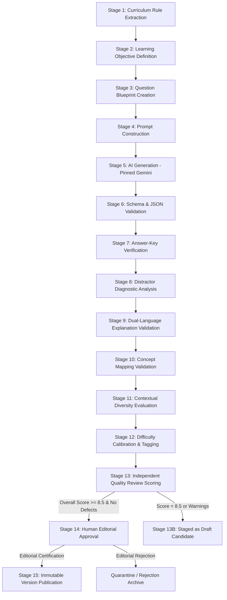

# GrammarPath — Phase 3.4C.4B.4.1: Generation Architecture Specification
## End-to-End 15-Stage AI-Assisted TOEIC Question Generation Pipeline and Data Contracts

**Author:** Antigravity (Principal Backend Architect & Educational Data Scientist)  
**Milestone:** Phase 3.4C.4B.4.1 (AI TOEIC Question Generation Pipeline — Design & Readiness Audit)  
**Date:** November 14, 2026  
**Status:** Architectural Design (Design-Only)  
**Target Coverage:** Units 2–25 (*English Grammar in Use*)  

---

## 1. Architectural Overview & Workflow Diagram

To eliminate LLM hallucinations, double auxiliaries, semantic clashes, and concept misalignments, question generation is structured into a **15-stage fail-closed pipeline**. 

No item can skip a stage. Any stage failure immediately halts processing or routes the candidate to an audit queue.



---

## 2. Granular Stage Specifications & Contracts

### Stage 1: Curriculum Rule Extraction
- **Objective:** Extract the exact grammatical rules, sub-rules, contrasts, and textbook examples from canonical database tables for a given Unit.
- **Input Contract:**
  ```typescript
  interface Stage1Input {
    unitNumber: number; // 1 to 145
  }
  ```
- **Execution Logic:** Queries `Unit`, `TheorySection`, and `TextbookExample` records for the unit, parsing sections (e.g. `3A`, `3B`, `3C`), key contrasts, and forbidden structures.
- **Output Contract:**
  ```typescript
  interface Stage1Output {
    unitNumber: number;
    unitTitle: string;
    conceptCode: string; // e.g. "unit.003"
    conceptId: string;
    sections: Array<{
      sectionId: string; // e.g. "3A"
      heading: string;
      rulesSummary: string;
      canonicalExamples: string[];
      contrastRules?: string[]; // e.g. "I am doing vs I do"
    }>;
  }
  ```

---

### Stage 2: Learning Objective Definition
- **Objective:** Define the precise pedagogical capability and grammatical discrimination required of the learner.
- **Input Contract:** `Stage1Output` + Target Sub-rule (`sectionId`).
- **Execution Logic:** Synthesizes the core construct to be assessed (e.g., distinguishing temporary action around present from habitual routine).
- **Output Contract:**
  ```typescript
  interface Stage2Output {
    targetUnit: number;
    targetRule: string; // "3A"
    primaryObjective: string; // "Distinguish ongoing temporary action from permanent state"
    targetGrammarFeature: string; // "Present continuous with dynamic verbs"
    prohibitedFeature: string; // "Stative verbs in continuous"
    diagnosticTarget: string; // "Failure to detect temporal contrast markers"
  }
  ```

---

### Stage 3: Question Blueprint Creation
- **Objective:** Create a deterministic architectural blueprint specifying the workplace setting, grammatical carrier sentence structure, blank position, correct answer form, and 3 specific distractor archetypes.
- **Input Contract:** `Stage2Output` + Target Difficulty (`easy` | `medium` | `hard`) + Target Domain.
- **Execution Logic:** Selects a business domain (e.g., `finance_accounting`) and specifies exactly which error each distractor must represent.
- **Output Contract:**
  ```typescript
  interface Stage3Output {
    blueprintId: string;
    workplaceDomain: string; // "finance_accounting"
    communicativeScenario: string; // "Quarterly budget re-allocation meeting"
    syntacticStructure: string; // "Subject + Adverb of frequency + [BLANK] + Object + Concessive clause"
    expectedBlankForm: "main_verb" | "auxiliary" | "participle";
    targetCorrectKeyMorphology: string; // "3rd-person singular present simple"
    distractorProfiles: [
      { type: "aspect_confusion"; requiredMorphology: "present continuous" },
      { type: "tense_confusion"; requiredMorphology: "simple past" },
      { type: "agreement_failure"; requiredMorphology: "bare plural verb" }
    ];
  }
  ```

---

### Stage 4: Prompt Construction
- **Objective:** Assemble a structured, few-shot prompt with strict negative constraints preventing known LLM failure modes.
- **Input Contract:** `Stage1Output` + `Stage2Output` + `Stage3Output`.
- **Execution Logic:** Injects canonical theory, domain keywords, distractor requirements, explicit negative constraints (no double auxiliaries, no semantic anomalies like *"entering hardware"*), and strict JSON schema.
- **Output Contract:**
  ```typescript
  interface Stage4Output {
    systemInstruction: string;
    userPrompt: string;
    pinnedModel: "gemini-1.5-pro" | "gemini-1.5-flash";
    temperature: number; // 0.2 to 0.4 for structural determinism
    schemaDefinition: Record<string, unknown>;
  }
  ```

---

### Stage 5: AI Generation (Pinned Gemini)
- **Objective:** Execute inference against the Google Gemini REST API using explicit model pinning and per-call token telemetry.
- **Input Contract:** `Stage4Output`.
- **Execution Logic:** Invokes Gemini API with timeout (15s), exponential retry backoff, and usage extraction. Silent fallback to other models is strictly forbidden.
- **Output Contract:**
  ```typescript
  interface Stage5Output {
    rawJsonText: string;
    modelUsed: string;
    latencyMs: number;
    usageMetadata: {
      promptTokens: number;
      candidatesTokens: number;
      totalTokens: number;
    };
  }
  ```

---

### Stage 6: Schema & JSON Validation
- **Objective:** Validate that the LLM response parses into valid JSON conforming exactly to the Part 5 specification.
- **Input Contract:** `Stage5Output.rawJsonText`.
- **Execution Logic:** Zod schema validation checking prompt existence, exactly 1 blank (`_______`), exactly 4 options (`A`, `B`, `C`, `D`), and word count bounds (8–45 words).
- **Output Contract:**
  ```typescript
  interface Stage6Output {
    prompt: string;
    options: Array<{
      optionKey: "A" | "B" | "C" | "D";
      optionText: string;
      isCorrect: boolean;
      rationaleEn: string;
      rationaleVi: string;
    }>;
    explanationEn: string;
    explanationVi: string;
  }
  ```

---

### Stage 7: Answer-Key Verification
- **Objective:** Verify that exactly one option is designated as correct, that the prompt sentence with the correct option inserted is grammatically flawless, and that all 3 distractors produce ungrammatical or contextually invalid sentences.
- **Input Contract:** `Stage6Output`.
- **Execution Logic:** 
  1. Asserts `options.filter(o => o.isCorrect).length === 1`.
  2. Runs grammatical test: checks subject-verb agreement on the completed sentence.
  3. Rejects sentences with double auxiliaries (`is is`, `has has`, `are are`).
- **Output Contract:**
  ```typescript
  interface Stage7Output extends Stage6Output {
    correctKey: "A" | "B" | "C" | "D";
    completedCorrectSentence: string;
    isAgreementValid: boolean;
    hasNoStutterAuxiliaries: boolean;
  }
  ```

---

### Stage 8: Distractor Diagnostic Analysis
- **Objective:** Verify that all 3 incorrect options represent genuine, plausible pedagogical error archetypes and are not obvious gibberish.
- **Input Contract:** `Stage7Output` + `Stage3Output.distractorProfiles`.
- **Execution Logic:** Checks each distractor against required morphological forms. Confirms all option texts are distinct and non-trivial.
- **Output Contract:**
  ```typescript
  interface Stage8Output extends Stage7Output {
    distractorsVerified: boolean;
    diagnosticsSummary: Array<{
      key: "A" | "B" | "C" | "D";
      errorClass: string;
      isPlausible: boolean;
    }>;
  }
  ```

---

### Stage 9: Dual-Language Explanation Validation
- **Objective:** Verify that explanations provide rigorous pedagogical guidance in both English and Vietnamese.
- **Input Contract:** `Stage8Output`.
- **Execution Logic:** Checks that Vietnamese explanation explains *why* the correct answer is right, *why* each distractor is wrong, and explicitly cites the clue words in the prompt (e.g. *"Last Friday"*, *"every day"*, *"right now"*).
- **Output Contract:**
  ```typescript
  interface Stage9Output extends Stage8Output {
    explanationQualityScore: number; // 0.0 to 2.0
    citationsValid: boolean;
  }
  ```

---

### Stage 10: Concept Mapping Validation
- **Objective:** Validate that the completed sentence actively requires the specific concept and rule of the target Unit.
- **Input Contract:** `Stage9Output` + Target Unit / Concept.
- **Execution Logic:** Evaluates whether the sentence accidentally tests a different unit (e.g. testing past tense in a Unit 3 prompt). If concept divergence is detected, the item is rejected.
- **Output Contract:**
  ```typescript
  interface Stage10Output extends Stage9Output {
    validatedConceptId: string;
    validatedConceptCode: string;
    conceptMappingConfidence: 1.0;
  }
  ```

---

### Stage 11: Contextual Diversity Evaluation
- **Objective:** Measure pairwise contextual distance against all existing approved and candidate questions in the bank.
- **Input Contract:** `Stage10Output` + Existing Question Bank items.
- **Execution Logic:** Evaluates $S_{\text{norm}}$, $S_{\text{slot}}$, $S_{\text{dist}}$, $S_{\text{rule}}$, $S_{\text{sem}}$, and $D_{\text{ctx}}$. Confirms $D_{\text{ctx}} \ge 0.50$ against all existing pool items.
- **Output Contract:**
  ```typescript
  interface Stage11Output extends Stage10Output {
    minDistanceToBank: number;
    closestMatchingItemId?: string;
    workplaceDomain: string;
    isContextuallyIndependent: boolean; // D_ctx >= 0.50
  }
  ```

---

### Stage 12: Difficulty Calibration & Tagging
- **Objective:** Empirically calibrate whether lexical complexity, sentence length, and distractor subtlety align with the target difficulty tier (`easy`, `medium`, `hard`).
- **Input Contract:** `Stage11Output`.
- **Execution Logic:** Calculates Flesch-Kincaid / TOEIC readability index, sentence word count, and distractor confusability index.
- **Output Contract:**
  ```typescript
  interface Stage12Output extends Stage11Output {
    assignedDifficulty: "easy" | "medium" | "hard";
    difficultyRationale: string;
  }
  ```

---

### Stage 13: Independent Quality Review Scoring
- **Objective:** Aggregate all stage results into an overall quality score (0.00 to 10.00) and assign pre-approval review status.
- **Input Contract:** `Stage12Output`.
- **Execution Logic:** Calculates rubric scores. If `overallScore >= 8.5` and zero blocking defects, assigns `reviewStatus: "validated"`. Otherwise, assigns `reviewStatus: "draft"`. **NEVER assigns `approved`.**
- **Output Contract:**
  ```typescript
  interface Stage13Output {
    stagedRecord: ToeicQuestionBankItem;
    contentHash: string;
    overallScore: number;
    reviewStatus: "validated" | "draft";
    isLatestApproved: false;
  }
  ```

---

### Stage 14: Human Editorial Approval
- **Objective:** Human assessment specialist reviews the staged item via admin audit interface, inspecting distractors, prompt phrasing, and contextual distance.
- **Input Contract:** `Stage13Output`.
- **Execution Logic:** Reviewer enters approval decision, reviewedBy identity, review notes, and certification timestamp.
- **Output Contract:**
  ```typescript
  interface Stage14Output {
    decision: "APPROVED" | "REJECTED" | "REQUEST_REVISE";
    reviewerIdentity: string;
    editorialNotes: string;
    approvalTimestamp: Date;
  }
  ```

---

### Stage 15: Immutable Version Publication
- **Objective:** Atomically publish the approved version into the active question bank, setting `isLatestApproved = true`, updating concept cluster partitions, and archiving any prior approved version for that root.
- **Input Contract:** `Stage14Output` (`decision === "APPROVED"`).
- **Execution Logic:** Executes atomic PostgreSQL transaction. Invariant enforced: exactly 1 latest-approved version per root.
- **Output Contract:**
  ```typescript
  interface Stage15Output {
    publishedItemId: string;
    rootQuestionId: string;
    version: number;
    isLatestApproved: true;
    reviewStatus: "approved";
    practiceRetrievalEligible: true;
  }
  ```

---

## 3. Pipeline Invariants Summary

1. **Zero Auto-Approval:** Stages 1–13 can only produce records in `draft` or `validated` status. Stage 14 (Human Editorial Approval) is an unskippable hard gate.
2. **Deterministic Model Lineage:** Every staged question record references its explicit `generationRunId`, which captures the exact pinned Gemini model, prompt template hash, and execution timestamp.
3. **Fail-Closed Processing:** Failure at any stage aborts the generation for that item without creating dangling records.

