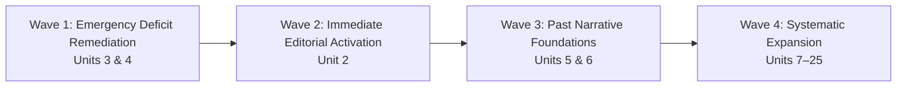

# GrammarPath — Phase 3.4C.4B.4.1: Unit Coverage Plan (Units 2–25)
## Differentiated Curriculum Sizing, Census Analysis, Rule Mapping, and Phased Expansion Strategy

**Author:** Antigravity (Principal Learning Engineer & Curriculum Specialist)  
**Milestone:** Phase 3.4C.4B.4.1 (AI TOEIC Question Generation Pipeline — Design & Readiness Audit)  
**Date:** November 14, 2026  
**Status:** Curriculum Coverage Strategy (Design-Only)  
**Target Coverage:** Units 2 through 25 (*English Grammar in Use*, 4th Edition)  

---

## 1. Baseline Question Bank Census (Units 1–25)

An exhaustive query of `toeic_question_bank_items` on Neon staging confirms the following baseline:

```
┌────────────────────────────────────────────────────────────────────────────────────────┐
│ QUESTION BANK POPULATION: UNITS 1–25                                                   │
├──────┬───────────────────────────────┬──────────┬───────────┬──────────┬───────────────┤
│ Unit │ Title / Concept               │ Approved │ Validated │ Archived │ Current State │
├──────┼───────────────────────────────┼──────────┼───────────┼──────────┼───────────────┤
│ 1    │ Present continuous            │ 12       │ 4         │ 5        │ Certified     │
│ 2    │ Present simple                │ 0        │ 9         │ 0        │ Audit Ready   │
│ 3    │ Present cont & simple 1       │ 0        │ 0         │ 0        │ ZERO (Deficit)│
│ 4    │ Present cont & simple 2       │ 0        │ 1         │ 0        │ Severe Deficit│
│ 5    │ Past simple                   │ 0        │ 3         │ 0        │ Partial Seed  │
│ 6    │ Past continuous               │ 0        │ 2         │ 0        │ Partial Seed  │
│ 7–25 │ Present Perfect / Future / Mod│ 0        │ 0         │ 0        │ Unpopulated   │
└──────┴───────────────────────────────┴──────────┴───────────┴──────────┴───────────────┘
```

---

## 2. Non-Uniform Sizing Strategy

Different grammar concepts carry differing frequencies in the TOEIC Part 5 test and differ in internal sub-rule breadth. Rather than generating a flat number of questions per unit, GrammarPath establishes a **differentiated sizing model**:

```
┌─────────────────────────────────────────────────────────────────────────────────────────┐
│ CURRICULUM SIZING TIERS                                                                 │
├──────┬─────────────────────┬───────────────────┬──────────────┬─────────────────────────┤
│ Tier │ Curriculum Scope    │ Target Pool Size  │ Min Clusters │ Rationale               │
├──────┼─────────────────────┼───────────────────┼──────────────┼─────────────────────────┤
│ High │ Core Verb Tenses    │ 10–12 questions   │ K_ctx >= 6   │ High TOEIC frequency;   │
│      │ (Units 1–6, 7–10)   │                   │              │ multiple sub-rules.     │
├──────┼─────────────────────┼───────────────────┼──────────────┼─────────────────────────┤
│ Med  │ Perfects & Futures  │ 6–8 questions     │ K_ctx >= 4   │ Standard Part 5 items;  │
│      │ (Units 11–16, 19–23)│                   │              │ moderate rule breadth.  │
├──────┼─────────────────────┼───────────────────┼──────────────┼─────────────────────────┤
│ Niche│ Narrow Idioms       │ 4–6 questions     │ K_ctx >= 3   │ Specific idiomatic form │
│      │ (Units 17, 18, 24)  │                   │              │ (e.g. used to, have got)│
└──────┴─────────────────────┴───────────────────┴──────────────┴─────────────────────────┘
```

---

## 3. Four-Wave Controlled Expansion Roadmap



### Wave 1: Emergency Deficit Remediation (Units 3 & 4)
- **Priority:** P0 (Highest).
- **Unit 3 (`unit.003`):** Currently has **0 valid questions** following the Phase 3.4C.4B.3 cleansing.
  - *Target Rules:* 
    - 3A: Continuous for temporary actions vs. simple for permanent/habitual truths.
    - 3B: Questions and negative forms in simple vs. continuous.
    - 3C: Contrast between *"I always do"* (regular habit) vs. *"I'm always doing"* (annoying or unusual frequency).
  - *Generation Target:* **10 questions** (3 easy, 5 medium, 2 hard).
- **Unit 4 (`unit.004`):** Currently has only **1 valid question** (`fe61381a`, stative verb *doubt*).
  - *Target Rules:*
    - 4A: Stative mental verbs (*believe, doubt, suppose, understand, know*).
    - 4B: Stative preference/attitude verbs (*like, prefer, need, want*).
    - 4C: Polysemous verbs (*think* as opinion vs. *thinking* as active consideration; *see* as perception vs. *seeing* as meeting).
  - *Generation Target:* **8 questions** (2 easy, 4 medium, 2 hard) to join `fe61381a` (total: 9).

---

### Wave 2: Immediate Editorial Activation (Unit 2)
- **Priority:** P1.
- **Unit 2 (`unit.002`):** Currently has **9 validated candidates** in staging (`32ed699c`, `92a0e4b0`, `a47fbe81`, `a6c7ae58`, `a9d29ec3`, `eb746b7c`, `f5381446`, `f89aceea`, and remapped `ac0c643a`).
- *Action Required:* Does not require bulk AI generation. Requires editorial audit and pairwise diversity validation following the Phase 3.4C.4B.2 blueprint.
- *Generation Supplement:* Generate 1–2 supplementary items only if diversity clustering drops below $K_{\text{ctx}} = 8$.

---

### Wave 3: Past Narrative Foundations (Units 5 & 6)
- **Priority:** P2.
- **Unit 5 (`unit.005`):** Currently has **3 validated candidates** (`0707bbd2`, `4ce8fea3`, and remapped `43753724`).
  - *Target Rules:* 5A (regular -ed verbs), 5B (irregular past forms), 5C (negative/interrogative *did/didn't*).
  - *Generation Target:* **6 questions** (total pool: 9).
- **Unit 6 (`unit.006`):** Currently has **2 validated candidates** (`6948841f`, `c10918d0`).
  - *Target Rules:* 6A (action in progress in the past), 6B (past continuous interrupted by past simple), 6C (*while* vs *when* past sequences).
  - *Generation Target:* **7 questions** (total pool: 9).

---

### Wave 4: Systematic Expansion (Units 7–25)
- **Priority:** P3.
- Populates the remaining 19 units in structured thematic bundles:
  - **Bundle 4A (Units 7–10):** Present Perfect (Simple & Continuous). Target: 8 items/unit.
  - **Bundle 4B (Units 11–14):** *For / Since*, Present Perfect vs. Past Simple contrast. Target: 8 items/unit.
  - **Bundle 4C (Units 15–18):** Past Perfect and *Used to*. Target: 6 items/unit.
  - **Bundle 4D (Units 19–25):** Future Forms (*will*, *going to*, *present continuous for future*, future continuous/perfect). Target: 6 items/unit.

---

## 4. Canonical Rule-Level Mapping Requirements

To prevent concept misalignment:
1. Every generated question must specify a validated `sectionId` (e.g. `3A`, `3B`, `4A`, `4C`).
2. The prompt builder must look up the exact section title and theory content from `TheorySection` before prompting Gemini.
3. Automated validation asserts that the correct answer requires the rule of that specific section.

