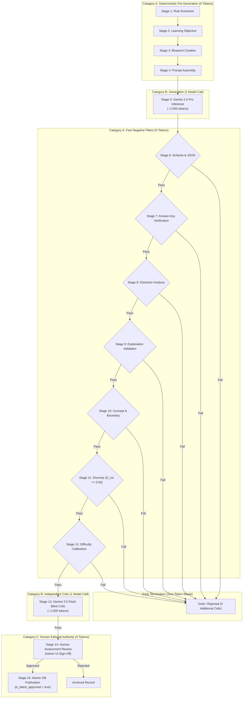

# GrammarPath — Phase 3.4C.4B.4.1.1: Generation Stage Classification Specification
## Rigorous Separation of Deterministic Code, AI Validation, and Human Editorial Authority

**Author:** Antigravity (Principal Backend Architect & AI Systems Specialist)  
**Milestone:** Phase 3.4C.4B.4.1.1 (Design Corrections & Pilot Readiness Reconciliation)  
**Date:** November 14, 2026  
**Status:** Architecture Specification (Design-Only — Zero Database Writes, Zero API Calls)  

---

## 1. Executive Summary & Architectural Motivation

In the design established in Phase 3.4C.4B.4.1 (`phase-3.4C.4B.4.1-generation-architecture.md`), a 15-stage lifecycle was introduced to govern TOEIC Part 5 question authoring from curriculum extraction to database publication.

However, an AI-assisted pipeline that invokes language models across multiple intermediate stages incurs:
1. **Excessive Latency:** Compounded API round-trips (800ms–2500ms per call) making batch authoring sluggish.
2. **Unnecessary Token Expenditure:** Wasting inference cost on checks that deterministic algorithmic code performs faster, cheaper, and with 100% mathematical reproducibility.
3. **Non-Deterministic Flakiness:** Introducing LLM hallucinations into deterministic tasks such as JSON parsing, word count bounds, option letter indexing, or schema checking.

To solve this, Phase 3.4C.4B.4.1.1 establishes a strict **Three-Category Taxonomy** for all 15 stages:
- **Category A: Deterministic Code Validation (0 Model Calls).** Fast, deterministic TypeScript logic, Zod validation, regex/AST parsing, relational database queries, and mathematical diversity vector scoring.
- **Category B: AI-Assisted Linguistic Generation & Validation (Model Calls Permitted).** Explicitly pinned LLM inference using structured output schemas.
- **Category C: Human Editorial Authority (0 Model Calls).** Authenticated human review via admin interface. The **sole** gateway to the `approved` status.

---

## 2. Stage Classification Matrix (15-Stage Lifecycle)

The following table formally classifies every stage in the 15-stage lifecycle, identifying its category, whether an LLM model call is permitted, the target engine, and the failure behavior.

| Stage # | Stage Name | Category | Model Call? | Engine / Execution Target | Cost (Tokens) | Failure Behavior |
| :--- | :--- | :---: | :---: | :--- | :---: | :--- |
| **Stage 1** | Curriculum Rule Extraction | **A** | **NO** | TypeScript / Prisma Staging DB | 0 | Fail-Closed (Halt) |
| **Stage 2** | Learning Objective Definition | **A** | **NO** | Deterministic Pedagogical Catalog | 0 | Fail-Closed (Halt) |
| **Stage 3** | Question Blueprint Creation | **A** | **NO** | Deterministic Combinatorial Generator | 0 | Fail-Closed (Halt) |
| **Stage 4** | Prompt Assembly & Negative Constraints | **A** | **NO** | Deterministic Template Engine | 0 | Fail-Closed (Halt) |
| **Stage 5** | AI Generation | **B** | **YES (1 Call)** | Google Gemini REST API (`gemini-2.5-pro`) | ~2,000 | Retry Backoff (Max 2) |
| **Stage 6** | Schema & JSON Validation | **A** | **NO** | Zod Schema Validator | 0 | Reject to Staging Draft |
| **Stage 7** | Structural & Single-Key Verification | **A** | **NO** | Deterministic AST / Regex Matcher | 0 | Reject to Staging Draft |
| **Stage 8** | Distractor Diagnostic Analysis | **A** | **NO** | Morphological / Lexical Analyzer | 0 | Reject to Staging Draft |
| **Stage 9** | Dual-Language Explanation Validation | **A** | **NO** | Deterministic Format & Clue Matcher | 0 | Flag Warning / Draft |
| **Stage 10** | Concept & Boundary Mapping | **A** | **NO** | Lexical & Stative Verb Guard | 0 | Reject to Staging Draft |
| **Stage 11** | Contextual Diversity Evaluation | **A** | **NO** | Deterministic Vector Distance ($D_{\text{ctx}}$) | 0 | Reject to Staging Draft |
| **Stage 12** | Difficulty Calibration & Tagging | **A** | **NO** | Flesch-Kincaid & Morphological Scorer | 0 | Recalibrate Tier |
| **Stage 13** | Independent Quality Review Scoring | **A / B** | **OPTIONAL (1 Call)** | `gemini-2.5-flash` (Targeted Critic) | ~1,500 (if active) | Assign Score / Status |
| **Stage 14** | Human Editorial Approval | **C** | **NO** | Admin Web UI / Certified Editor | 0 | Approve / Remediate |
| **Stage 15** | Immutable Version Publication | **A** | **NO** | Atomic PostgreSQL Transaction | 0 | Rollback / Commit |

---

## 3. Deep Architectural Analysis by Category

### 3.1 Category A: Deterministic Code Validation (13 Stages)

Deterministic stages execute in Node.js / TypeScript with zero external network overhead and zero token consumption.

#### Stage 1: Curriculum Rule Extraction
- **Function:** Reads canonical unit and section records from PostgreSQL staging (`grammarpath-staging`).
- **Inputs:** `unitNumber: number`, `sectionId: string`.
- **Logic:** Queries `units` and `theory_sections` tables to retrieve the exact textbook rule, sub-rules, and canonical examples.
- **Model Calls:** **0**. Completely programmatic.

#### Stage 2: Learning Objective Definition
- **Function:** Maps target rule to a discrete, testable grammatical discrimination capability.
- **Inputs:** Canonical rule metadata from Stage 1.
- **Logic:** Resolves against an immutable pedagogical catalog mapping rules to specific grammatical contrasts (e.g., *habitual present vs. continuous action in progress*).
- **Model Calls:** **0**. Pure code mapping.

#### Stage 3: Question Blueprint Creation
- **Function:** Creates a structural skeleton for the question before any text is generated.
- **Inputs:** Pedagogical objective, target difficulty (`easy` | `medium` | `hard`), target workplace domain.
- **Logic:** Deterministically assigns:
  - Carrier sentence archetype (e.g., compound clause with temporal subordinating conjunction).
  - Blank position and syntactic slot (main verb of independent clause).
  - Target correct inflection (e.g., third-person singular present continuous: *is inspecting*).
  - Three distinct distractor archetypes (e.g., Distractor 1: simple present *inspects*; Distractor 2: infinitive *to inspect*; Distractor 3: past participle *inspected*).
- **Model Calls:** **0**. Pure combinatorial synthesis.

#### Stage 4: Prompt Assembly & Negative Constraints
- **Function:** Synthesizes the exact JSON generation prompt.
- **Inputs:** Blueprint from Stage 3 + canonical curriculum examples from Stage 1.
- **Logic:** Merges system prompt, few-shot demonstration, Zod JSON schema specification, and explicit negative constraints (forbidding double auxiliaries, stative verbs, informal complaint idioms, and semantic anomalies).
- **Model Calls:** **0**. String interpolation and formatting.

#### Stage 6: Schema & JSON Validation
- **Function:** Validates that the raw response from Stage 5 is valid JSON matching the Part 5 specification.
- **Inputs:** `rawResponseText: string`.
- **Logic:** Parses JSON; strips any stray markdown backticks; validates with Zod schema:
  - Exactly one `prompt` containing exactly one `_______` (7 underscores).
  - Exactly four options with letters `A`, `B`, `C`, `D`.
  - Exactly one option with `isCorrect: true`.
  - Non-empty explanations in English and Vietnamese.
- **Model Calls:** **0**. Zod schema parser.

#### Stage 7: Structural & Single-Key Verification
- **Function:** Deterministically verifies that the question has a structurally valid answer key.
- **Inputs:** Validated JSON item.
- **Logic:**
  - Verifies that all 4 option texts are unique (no duplicates).
  - Verifies that no option contains blanks or punctuation errors.
  - Verifies that the correct option inserted into the blank produces valid basic capitalization and terminal punctuation.
- **Model Calls:** **0**. Deterministic string and lexical checks.

#### Stage 8: Distractor Diagnostic Analysis
- **Function:** Verifies morphological and syntactic plausibility of distractors.
- **Inputs:** Item options and Stage 3 distractor blueprints.
- **Logic:** Checks that each distractor belongs to a plausible grammatical category (e.g., distinct verb inflections) and does not contain typographical nonsense or duplicate stems.
- **Model Calls:** **0**. Deterministic lexical analysis.

#### Stage 9: Dual-Language Explanation Validation
- **Function:** Validates structural presence and completeness of explanations.
- **Inputs:** Item explanation fields (`explanationEn`, `explanationVi`).
- **Logic:**
  - Validates character count thresholds ($L_{\text{en}} \ge 50$, $L_{\text{vi}} \ge 50$).
  - Asserts that both explanations explicitly mention the correct option letter.
  - Asserts that the Vietnamese explanation contains pedagogical contrast markers (e.g., *"bởi vì"*, *"thì hiện tại tiếp diễn"*, *"dấu hiệu nhận biết"*).
- **Model Calls:** **0**. Deterministic string inspection.

#### Stage 10: Concept & Boundary Mapping
- **Function:** Enforces curriculum boundary guards.
- **Inputs:** Generated prompt, options, target Unit number.
- **Logic:**
  - **Stative Verb Guard:** If `unitNumber === 3`, scans prompt and options against the canonical Unit 4 stative verb list (*know, understand, believe, want, need, prefer, belong, depend, contain, consist, seem*). If any stative verb is used as the target testing verb, the item fails immediately.
  - **Complaint Idiom Guard:** Scans for informal complaint idioms (*"always complaining"*, *"always losing"*).
- **Model Calls:** **0**. Deterministic lexical regex and dictionary lookup.

#### Stage 11: Contextual Diversity Evaluation
- **Function:** Evaluates pairwise contextual distance against all existing question bank records.
- **Inputs:** Generated item + Question Bank items in the active pool.
- **Logic:** Runs the Phase 3.4C.3 Contextual Diversity Engine ($S_{\text{norm}}$, $S_{\text{slot}}$, $S_{\text{dist}}$, $S_{\text{rule}}$, $S_{\text{sem}}$).
  - Computes composite distance: $D_{\text{ctx}} = 1 - S_{\text{composite}}$.
  - Asserts $D_{\text{ctx}} \ge 0.50$ against all existing items.
- **Model Calls:** **0**. Mathematical vector calculation.

#### Stage 12: Difficulty Calibration & Tagging
- **Function:** Calculates readability metrics and assigns empirical difficulty tier.
- **Inputs:** Prompt sentence and option set.
- **Logic:**
  - Computes word count (Target: Easy 12–18, Medium 16–24, Hard 20–30 words).
  - Computes Flesch-Kincaid Grade Level.
  - Evaluates distractor syntactic distance.
- **Model Calls:** **0**. Deterministic readability algorithm.

#### Stage 15: Immutable Version Publication
- **Function:** Writes the finalized, approved item to the database.
- **Inputs:** Approved item from Stage 14.
- **Logic:** Executes atomic PostgreSQL transaction on `toeic_question_bank_items`:
  - Inserts new version record (`review_status: 'approved'`).
  - Sets `is_latest_approved = true`.
  - Atomically demotes prior approved version (`is_latest_approved = false`).
  - Records cryptographic audit trail.
- **Model Calls:** **0**. Database transaction.

---

### 3.2 Category B: AI-Assisted Linguistic Generation & Validation (Stages 5 & 13)

Language models are invoked exclusively in stages requiring open-ended linguistic synthesis or deep semantic critique.

#### Stage 5: AI Generation (Primary Generation Call)
- **Model Assigned:** `gemini-2.5-pro` (GA).
- **Inference Configuration:**
  - Temperature: $0.20$ (low entropy, strict compliance).
  - Top-P: $0.95$.
  - Max Output Tokens: $1,024$.
  - Response MIME Type: `application/json`.
- **Payload:** Structured prompt containing blueprint, target domain, target verb, canonical rules, few-shot exemplars, and strict negative constraints.
- **Model Calls:** **Exactly 1 Call per generation attempt.**

#### Stage 13: Independent Quality Review Scoring (Targeted Linguistic Critic)
- **Model Assigned:** `gemini-2.5-flash` (GA).
- **Inference Configuration:**
  - Temperature: $0.10$.
  - Max Output Tokens: $512$.
  - Response MIME Type: `application/json`.
- **Execution Policy:** **Gated Execution.**
  - Stage 13 model call is **ONLY** executed if Stages 6 through 12 have passed with zero blocking errors.
  - If an item fails schema validation (Stage 6), structural verification (Stage 7), or concept boundary guard (Stage 10), the pipeline halts immediately. **Zero review tokens are wasted on invalid candidates.**
- **Critic Task:** Blind assessment. The model is given the sentence and 4 options *without* knowing which option the generator selected as correct.
  - Critic must independently identify the single correct option.
  - If Critic's answer $\ne$ Generator's designated answer $\rightarrow$ **Immediate Blocking Failure.**
  - If Critic identifies that more than one option is grammatically defensible in context $\rightarrow$ **Immediate Blocking Failure.**
- **Model Calls:** **At most 1 Call per valid candidate.**

---

### 3.3 Category C: Human Editorial Approval (Stage 14)

Under no circumstances can an AI model or automated pipeline promote a question to `review_status: 'approved'`.

#### Stage 14: Human Editorial Approval
- **Executor:** Authenticated Human Reviewer (Curriculum Specialist / Assessment Editor).
- **Interface:** Admin Review Portal (`/admin/question-bank/review`).
- **Review Checks:**
  1. Inspects carrier sentence for natural ETS corporate register.
  2. Verifies that all 3 distractors are 100% incorrect and defensibly wrong.
  3. Inspects Vietnamese explanation for natural phrasing and pedagogical clarity.
  4. Verifies contextual uniqueness.
- **Decision Outcomes:**
  - `APPROVED`: Advances item to Stage 15 publication.
  - `REJECTED`: Permanently archives candidate (`review_status: 'archived'`).
  - `REVISE`: Sends candidate back with human editorial notes for manual remediation.
- **Model Calls:** **0**. Pure human agency.

---

## 4. Pipeline Execution Flow & Early-Termination Gate

---

## 5. Token Efficiency & Redundancy Prevention Guarantees

1. **Maximum Model Calls per Item:** Exactly **2 calls** (1 Generation + 1 Independent Blind Review) in the successful path.
2. **Early Termination on Failure:** If an item fails any deterministic check between Stage 6 and Stage 12 (e.g. malformed JSON, stative verb contamination, or $D_{\text{ctx}} < 0.50$), execution terminates immediately. The Stage 13 Critic is **never called**, saving 100% of review tokens on defective drafts.
3. **Zero Automated Approval:** Stage 15 publication requires explicit human authentication credentials from Stage 14. Automated scripts are physically barred by application logic from executing Stage 15 directly.

---

## 6. Verification & Architectural Conformance

- [x] All 15 stages explicitly categorized into Category A, Category B, or Category C.
- [x] Exact model call counts defined (Stage 5: 1 call; Stage 13: at most 1 call; all other 13 stages: 0 calls).
- [x] Redundant intermediate model calls completely eliminated.
- [x] Deterministic code filters run first to eliminate defective candidates before incurring review cost.
- [x] Human editorial sign-off preserved as non-negotiable gateway to question approval.

