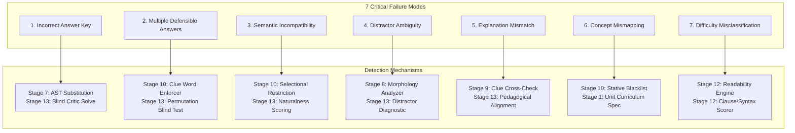
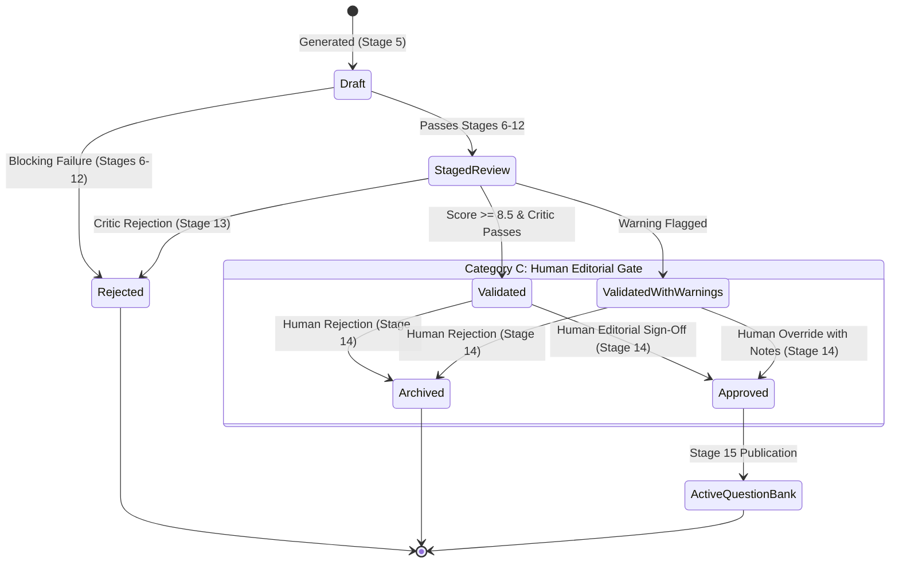

# GrammarPath — Phase 3.4C.4B.4.1.1: Quality Validation & Defect Detection Refinement
## Multi-Layered Semantic Verification, Defect Taxonomy, and Non-Negotiable Editorial Controls

**Author:** Antigravity (Principal Assessment Engineer & Quality Assurance Lead)  
**Milestone:** Phase 3.4C.4B.4.1.1 (Design Corrections & Pilot Readiness Reconciliation)  
**Date:** November 14, 2026  
**Status:** Architecture Specification (Design-Only — Zero Database Writes, Zero API Calls)  

---

## 1. Executive Summary & Epistemic Boundaries

In high-stakes standardized assessments such as TOEIC Part 5, a flawed question damages learner trust, corrupts adaptive theta ($\theta$) estimates, and invalidates transfer competence ($\tau$) measurements.

A central flaw of naive AI generation pipelines is relying on **regex patterns** as proof of grammatical or semantic validity. Regex patterns (such as checking for `_______` or matching `/(is|are)\s+[a-z]+ing/`) are strictly **surface-level syntactic checks**. They are fast negative filters capable of catching formatting deformities, but they **cannot** verify:
- Semantic plausibility (avoiding category mistakes like *"the server is drinking coffee"*).
- Single-answer exclusivity (ensuring only one option is defensible in context).
- Distractor plausibility without ambiguity (ensuring incorrect options are genuine diagnostic errors, not arguably correct variants).
- Register authenticity (ensuring the tone reflects authentic ETS business English).

This specification establishes:
1. A rigorous **Blocking vs. Warning Check Taxonomy**.
2. Explicit detection mechanisms for the seven critical failure modes of AI-generated assessment items.
3. The multi-tiered defense architecture combining deterministic pre-filtering, independent AI critic verification, and non-negotiable human editorial authority.

---

## 2. Blocking vs. Warning Check Taxonomy

The pipeline categorizes all validation rules into two mutually exclusive severity tiers:

### 2.1 Severity Tiers Defined

| Tier | Name | System Behavior | Candidate State | Human Intervention Required? |
| :---: | :--- | :--- | :--- | :--- |
| **P0** | **BLOCKING** | **Immediate Termination.** Generation pipeline halts processing for this item. Item cannot advance to subsequent stages and can **never** be approved. | `rejected` or `failed_validation` | Automatic rejection. Human review not required unless investigating generation failure rates. |
| **P1** | **WARNING** | **Non-Fatal Advisory.** Item continues through automated pipeline, but defect is permanently flagged in metadata and displayed in amber in the Admin Review UI. | `validated_with_warnings` or `draft` | **Mandatory Human Decision.** Admin editor must explicitly review flagged warnings and either remediate, override with documented rationale, or reject. |

### 2.2 Comprehensive Quality Check Registry

| Check Code | Check Name | Severity | Stage | Detection Mechanism | Failure Condition |
| :--- | :--- | :---: | :---: | :--- | :--- |
| **VAL-BLK-01** | JSON Schema Conformance | **BLOCKING** | Stage 6 | Zod Schema Parser | Malformed JSON, missing fields, or invalid types. |
| **VAL-BLK-02** | Blank Slot Integrity | **BLOCKING** | Stage 6 | Deterministic Regex | Prompt contains $\ne 1$ blank or blank length $\ne 7$ underscores. |
| **VAL-BLK-03** | Option Count & Labeling | **BLOCKING** | Stage 6 | Deterministic Array Check | Options array length $\ne 4$ or option letters not `[A, B, C, D]`. |
| **VAL-BLK-04** | Single-Key Designation | **BLOCKING** | Stage 7 | Deterministic Filter | Options with `isCorrect: true` count $\ne 1$. |
| **VAL-BLK-05** | Duplicate Option Texts | **BLOCKING** | Stage 7 | Deterministic Set Check | Two or more options share identical normalized text. |
| **VAL-BLK-06** | Stative Verb Boundary Violation | **BLOCKING** | Stage 10 | Lexical Blacklist Filter | Target testing verb in Unit 3 belongs to Unit 4 stative verb registry. |
| **VAL-BLK-07** | Dual Defensible Answers | **BLOCKING** | Stage 13 | Blind Critic & Substitution Test | Independent critic identifies $\ge 2$ grammatically valid options in context. |
| **VAL-BLK-08** | Key Disagreement | **BLOCKING** | Stage 13 | Blind Critic Independent Solve | Independent critic selects different answer letter than generator. |
| **VAL-BLK-09** | Semantic Category Clash | **BLOCKING** | Stage 13 | Blind Critic Naturalness Score | Naturalness score $< 4.0/5.0$ or flagged collocation absurdity. |
| **VAL-BLK-10** | Context Diversity Violation | **BLOCKING** | Stage 11 | Vector Distance ($D_{\text{ctx}}$) | Composite diversity distance $D_{\text{ctx}} < 0.50$ against existing bank pool. |
| **VAL-WRN-01** | Sentence Length Boundary | **WARNING** | Stage 12 | Deterministic Word Count | Word count slightly out of optimal tier range (e.g. 11 words or 31 words). |
| **VAL-WRN-02** | Flesch-Kincaid Tier Drift | **WARNING** | Stage 12 | Readability Index | Readability score drifts by 1 grade level from target difficulty band. |
| **VAL-WRN-03** | Distractor Lexical Rarity | **WARNING** | Stage 8 | CEFR Vocabulary Scorer | Distractor uses vocabulary rated CEFR C1+ in an Easy/Medium tier question. |
| **VAL-WRN-04** | Vietnamese Explanation Brevity | **WARNING** | Stage 9 | Character Length Check | Vietnamese explanation length between 50 and 80 characters (advising expansion). |
| **VAL-WRN-05** | Punctuation Style Advisory | **WARNING** | Stage 7 | Regex Punctuation Scan | Prompt uses semicolon or em-dash where a period or comma is standard. |

---

## 3. Seven Critical Failure Modes & Detection Architecture



### 3.1 Failure Mode 1: Incorrect Answer Key
- **The Problem:** The designated correct option creates a grammatically flawed sentence, while one of the distractors is actually correct.
- **Detection Mechanism:**
  1. *Deterministic Pre-Check (Stage 7):* The carrier sentence is populated with the correct option. Code parses subject-verb agreement (e.g. singular subject + singular verb) and tense morphology.
  2. *Blind Critic Evaluation (Stage 13):* The independent critic model (`gemini-2.5-flash`) receives the prompt sentence with `_______` and the 4 options *with no indication of which option was marked correct*. The critic must output:
     ```json
     { "solvedOptionLetter": "B", "confidence": 0.98, "justification": "..." }
     ```
     If `solvedOptionLetter !== generatorTargetOptionLetter`, the system triggers **`VAL-BLK-08` (Key Disagreement)** and rejects the item immediately.
  3. *Human Audit (Stage 14):* Human editor confirms grammatical correctness during editorial sign-off.

### 3.2 Failure Mode 2: Multiple Defensible Answers (Ambiguity / Dual Key)
- **The Problem:** In tense and aspect questions, both the Simple Present (*habitual*) and Present Continuous (*ongoing*) can be grammatically defensible if the prompt sentence lacks an explicit, unambiguous temporal anchor (e.g., *"The director _______ the contract"* — both *"reviews"* and *"is reviewing"* are grammatically sound).
- **Detection Mechanism:**
  1. *Deterministic Clue Word Enforcer (Stage 10):* The carrier sentence is scanned for mandatory canonical aspectual markers:
     - For Present Continuous: must contain explicit real-time or temporary markers (*"at the moment"*, *"currently"*, *"right now"*, *"this week"*, *"temporarily during the transition"*).
     - For Simple Present: must contain explicit habitual or frequency markers (*"every morning"*, *"routinely"*, *"on a regular basis"*, *"annually"*, *"as standard company policy"*).
     - Sentences lacking an explicit aspectual clue trigger **`VAL-BLK-07`**.
  2. *Permutation Blind Test (Stage 13):* The critic is tasked with evaluating each incorrect option individually:
     ```json
     {
       "optionEvaluations": [
         { "letter": "A", "defensibleInContext": false, "pedagogicalFlaw": "Violates habitual marker 'every day'" },
         { "letter": "C", "defensibleInContext": false, "pedagogicalFlaw": "Base form cannot follow singular subject" }
       ]
     }
     ```
     If any distractor returns `defensibleInContext: true`, the question is blocked immediately.

### 3.3 Failure Mode 3: Semantic Incompatibility (Collocation & Category Clash)
- **The Problem:** The sentence is syntactically well-formed according to grammar rules but semantically absurd or unidiomatic in business English (e.g. *"The quarterly revenue is drinking tea"*, *"entering hardware"*).
- **Detection Mechanism:**
  1. *Business Lexicon & Selectional Restriction (Stage 10):* Fast deterministic check verifying that subject-verb-object combinations do not violate animacy or domain requirements (e.g., inanimate subjects paired with agent-exclusive verbs).
  2. *Register & Naturalness Scoring (Stage 13):* The independent critic evaluates the carrier sentence against standard corporate communications (TOEIC Part 5 authentic corpus). Critic assigns a naturalness score ($1.0$ to $5.0$). Any score $< 4.0$ triggers **`VAL-BLK-09`**.

### 3.4 Failure Mode 4: Distractor Ambiguity
- **The Problem:** Distractors are either so bizarre that any test-taker can eliminate them without understanding grammar (trivial distractors), or subtly defensible under specialized non-standard interpretations.
- **Detection Mechanism:**
  1. *Morphological Validity (Stage 8):* All distractors must be valid English words existing in the standard dictionary (no invented non-words).
  2. *Distractor Archetype Verification (Stage 8):* Deterministic code verifies that the 3 distractors map to the 3 required blueprint archetypes:
     - Archetype 1: Aspect/Tense contrast (e.g., simple present vs. present continuous).
     - Archetype 2: Non-finite form (e.g., bare infinitive, full infinitive, or gerund).
     - Archetype 3: Voice or agreement mismatch (e.g., past participle or plural verb with singular subject).
  3. *Independent Diagnostic Verification (Stage 13):* The critic verifies that each distractor represents a known learner error pattern rather than a random syntactic failure.

### 3.5 Failure Mode 5: Explanation Mismatch
- **The Problem:** The explanation explains a completely different rule than the one tested, states the wrong letter, or fails to address the distractors.
- **Detection Mechanism:**
  1. *Deterministic Text Cross-Check (Stage 9):*
     - The exact option letter (e.g., `(B)`) must be explicitly present in both English and Vietnamese explanation strings.
     - The exact word text of the correct option must appear in both explanations.
     - The explicit clue word identified in Stage 10 must appear within quotes in both explanations.
  2. *Bilingual Consistency Verification (Stage 9):*
     - The English and Vietnamese explanations must both exceed length minimums ($L \ge 50$ characters).
     - The Vietnamese explanation must contain pedagogical connective keywords (*"dấu hiệu"*, *"thì"*, *"nguyên thể"*, *"bởi vì"*).

### 3.6 Failure Mode 6: Incorrect Concept Mapping (Curriculum Boundary Violation)
- **The Problem:** An item generated for Unit 3 actually tests Unit 4 (stative verbs), Unit 1 (past simple), or Unit 5 (present perfect).
- **Detection Mechanism:**
  1. *Canonical Stative Verb Blacklist (Stage 10):* For Unit 3 items, deterministic code executes an exact-match blacklist check against all 25 canonical stative verbs defined in Unit 4 of *English Grammar in Use*:
     - *Mental / Perception:* `know`, `believe`, `understand`, `recognize`, `remember`, `suppose`, `mean`, `realize`.
     - *Preference / Emotion:* `want`, `need`, `prefer`, `like`, `love`, `hate`.
     - *Possession / Relation:* `belong`, `contain`, `consist`, `depend`, `fit`, `suit`, `matter`, `seem`, `resemble`.
     - If the target testing verb or blank root matches any of these stems, the item is **immediately blocked (`VAL-BLK-06`)**.
  2. *Cross-Unit Tense Filter (Stage 10):* Verifies that the item does not test auxiliary *have/has* (Unit 5) or past tense markers like *"yesterday"*, *"last month"* (Unit 1/5).

### 3.7 Failure Mode 7: Difficulty Misclassification
- **The Problem:** An item tagged as "Easy" has a complex multi-clause sentence structure with rare vocabulary, or an item tagged as "Hard" is solvable by a beginner due to an obvious clue.
- **Detection Mechanism:**
  1. *Quantitative Readability Metrics (Stage 12):*
     - Word count bounds:
       - **Easy:** $12 \le W \le 18$ words; exactly 1 independent clause; 0 subordinate clauses.
       - **Medium:** $16 \le W \le 24$ words; 1 independent clause + 1 subordinate time/condition clause.
       - **Hard:** $20 \le W \le 30$ words; complex/compound syntax, introductory participial phrase or correlative conjunction.
     - Flesch-Kincaid Grade Level targets:
       - Easy: Grade 5.0 – 7.5.
       - Medium: Grade 7.6 – 9.5.
       - Hard: Grade 9.6 – 12.0.
  2. *Recalibration or Warning (Stage 12):*
     - If metrics deviate by $\le 1$ band, a warning is logged (`VAL-WRN-02`) and the difficulty tag is automatically adjusted to match empirical metrics.
     - If metrics deviate by $> 1$ band, the item is blocked.

---

## 4. The Human Editorial Gate: Sole Path to Approval

Under no circumstances does any score, metric, or AI recommendation allow an item to bypass human review.



### Strict Editorial Invariants:
1. **Physical API Separation:** The internal generation pipeline writes items with `review_status: 'draft'` or `review_status: 'validated'`. The endpoint that updates status to `approved` is exposed exclusively to authenticated admin sessions with role `CONTENT_EDITOR` or `SUPER_ADMIN`.
2. **Immutable Audit Trail:** Every approval requires the reviewer's unique user ID, certification timestamp, and editorial notes. This information is cryptographically committed in `toeic_question_bank_items.metadata`.
3. **Fail-Closed Default:** If an item remains unreviewed, it is completely invisible to learner practice sessions and cannot enter theta or transfer evidence pipelines.

---

## 5. Summary of Verification & Architectural Conformance

- [x] Clear, mutually exclusive definition of Blocking vs. Warning checks.
- [x] Explicit acknowledgment of the limitations of regex (surface negative filter only).
- [x] Complete specifications for detecting all 7 critical failure modes.
- [x] Canonical stative verb blacklist enforced for Unit 3.
- [x] Independent blind critic protocol defined to catch dual-key and answer-key bugs.
- [x] Human editorial sign-off confirmed as the single, non-negotiable gateway to question approval.

