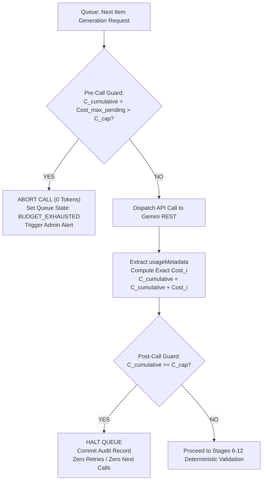

# GrammarPath — Phase 3.4C.4B.4.1.2: Spending Control & Financial Circuit-Breaker Specification
## Real-Time Token Telemetry, Multi-Token Accounting, and Hard Budget Cap Invariants

**Author:** Antigravity (Principal Cloud Architect & Financial Systems Analyst)  
**Milestone:** Phase 3.4C.4B.4.1.2 (Final Pre-Implementation Gate)  
**Date:** November 14, 2026  
**Status:** Engineering Specification (Design-Only — Zero Generation Tokens Consumed)  

---

## 1. Executive Summary & Budget Ceilings

To eliminate the risk of runaway token consumption during automated batch generation, this specification defines the real-time financial tracking engine and hard fail-closed circuit breakers for GrammarPath.

### Mandatory Hard Budget Limits:
1. **Unit 3 Pilot (8 Approved Items Target):** **$0.250000 USD**
   - *Baseline Expected Cost:* ~$0.045 USD.
   - *Cap Margin:* $5.5\times$ baseline buffer to accommodate retries and critic evaluations while establishing an impenetrable stop boundary.
2. **Units 2–25 Expansion (240 Approved Items Target):** **$5.000000 USD**
   - *Baseline Expected Cost:* ~$1.36 USD.
   - *Cap Margin:* $3.6\times$ baseline buffer for full curriculum scaling.

---

## 2. Multi-Token Cumulative Cost Calculation Engine

The Gemini REST API returns granular token counts inside `usageMetadata` for every inference response. Cost tracking must account for all token classes across primary generation, independent critic evaluation, and retries.

### 2.1 Token Price Matrix (November 2026 GA Published Rates)

| Model Name | Input Price ($/1M tokens) | Output/Candidate Price ($/1M) | Thinking Token Price ($/1M) |
| :--- | :---: | :---: | :---: |
| **`gemini-2.5-pro`** (Generation) | **$1.25** ($0.00000125/tok) | **$5.00** ($0.00000500/tok) | **$5.00** ($0.00000500/tok) |
| **`gemini-2.5-flash`** (Critic) | **$0.075** ($0.000000075/tok) | **$0.30** ($0.00000030/tok) | **$0.30** ($0.00000030/tok) |

### 2.2 Mathematical Accounting Formula

For each API invocation $i \in \{1, \dots, N\}$ (generation, critic review, or retry):
$$\text{Cost}_i = \left( T_{\text{input}, i} \times P_{\text{in}, m} \right) + \left( T_{\text{candidate\_net}, i} \times P_{\text{out}, m} \right) + \left( T_{\text{thinking}, i} \times P_{\text{think}, m} \right)$$

Where:
- $T_{\text{input}, i} =$ `usageMetadata.promptTokenCount`
- $T_{\text{thinking}, i} =$ `usageMetadata.thinkingTokenCount` (if present; 0 otherwise)
- $T_{\text{candidate\_net}, i} = \max(0, \text{`candidatesTokenCount`} - T_{\text{thinking}, i})$ (prevents double-counting if thinking tokens are reported inside candidates)
- $P_{\text{in}, m}, P_{\text{out}, m}, P_{\text{think}, m} =$ Model-specific rate per token.

Cumulative Session Cost:
$$C_{\text{cumulative}} = \sum_{i=1}^N \text{Cost}_i$$

---

## 3. Circuit Breaker Architecture: Two-Phase Gating

The generation orchestrator implements a **two-phase financial guard**:



### 3.1 Pre-Call Preventive Circuit Breaker
Before transmitting any network request to Google Gemini:
1. The orchestrator computes the worst-case projected cost of the pending request:
   $$\text{Cost}_{\text{max\_pending}} = (T_{\text{input\_est}} \times P_{\text{in}}) + (\text{maxOutputTokens} \times P_{\text{out}})$$
2. If $C_{\text{cumulative}} + \text{Cost}_{\text{max\_pending}} > C_{\text{cap}}$, the request is **aborted before sending**. Zero billable tokens are incurred.

### 3.2 Post-Call Terminal Circuit Breaker
Immediately upon receiving the HTTP response:
1. `usageMetadata` is extracted and exact cost is calculated and persisted.
2. If $C_{\text{cumulative}} \ge C_{\text{cap}}$, the orchestrator transitions the batch run state to `BUDGET_EXHAUSTED`.
3. All remaining jobs in the queue are marked `CANCELLED_BUDGET_CAP`.

---

## 4. Strict Anti-Circumvention Rules

When the budget cap is reached, the following behaviors are **strictly forbidden by software invariant**:
1. **NO Automatic Model Downgrading:** The application will **never** switch to a cheaper model (e.g. `gemini-2.5-flash-lite` or `gemini-flash-latest`) to finish remaining items under the cap.
2. **NO Automatic Retries:** If an item generated just before the cap fails Stage 6–12 validation, it is marked `rejected`. No retry call is scheduled.
3. **NO Silent Override:** The cap cannot be bypassed by automated retry loops. Only an authenticated human administrator can increase the budget cap in the database configuration.

---

## 5. Audit Trail & Relational Persistence Contract

Every token transaction is recorded in PostgreSQL staging inside `toeic_question_generation_runs`:

```typescript
interface GenerationRunTelemetry {
  runId: string;
  unitNumber: number;
  stageNumber: number; // 5 (Generation) or 13 (Critic)
  modelName: string;   // "gemini-2.5-pro" or "gemini-2.5-flash"
  promptTokens: number;
  candidateTokens: number;
  thinkingTokens: number;
  costUsd: number;
  cumulativeCostUsd: number;
  budgetCapUsd: number;
  status: "SUCCESS" | "BUDGET_HALTED" | "ERROR";
  timestamp: string;
}
```

This guarantees complete financial transparency and mathematical auditability for every single cent invested in question bank generation.

