# GrammarPath — Phase 3.4C.4B.4.2: Controlled Pipeline Implementation & Verification Report
## Implementation Audit, Model Access Probe Findings, Spending Circuit Breakers, and Stop Boundary

**Author:** Antigravity (Principal Backend Architect & Security Auditor)  
**Milestone:** Phase 3.4C.4B.4.2 (Controlled Pipeline Implementation)  
**Date:** November 14, 2026  
**Final Status:** `IMPLEMENTATION & TEST VERIFIED — STOPPED AT PILOT EXECUTION GATE`  
**Execution Invariant:** ZERO billable TOEIC questions generated; ZERO attempts deleted; ZERO unapproved items published.  

---

## 1. Executive Summary

In Phase 3.4C.4B.4.2, the canonical 15-stage TOEIC Part 5 question generation pipeline was fully implemented on staging and verified using deterministic fixtures, mocked AI interfaces, and isolated database queries.

### Key Milestones Accomplished:
1. **G-1 (Model Access Probe Executed):** Dispatched minimal `"ping"` probes against candidate models `gemini-2.5-pro` and `gemini-2.5-flash`. Both models returned `HTTP 404 Not Found` with upstream provider notification: *"no longer available to new users"*. In adherence to fail-closed invariants, no silent fallback occurred, and execution halted to present empirical findings.
2. **G-2 (Gemini Client Refactored):** Completely eliminated legacy unmanaged fallback arrays in `backend/src/lib/gemini.ts`. Enforced explicit model pinning, fail-closed handling on 4xx/5xx errors, secret redaction, and token usage metadata extraction.
3. **G-3 (Canonical 15-Stage Pipeline Implemented):** Delivered `backend/src/services/toeic-pipeline/canonical-pipeline.service.ts` featuring 12 Category A deterministic code stages, 2 Category B AI stages (with blind critic evaluation), and 1 Category C human editorial gate (forbidding auto-approval).
4. **Spending Controls Enforced:** Implemented `SpendingController` with two-phase circuit breakers enforcing hard caps of **$0.25 USD (Unit 3 Pilot)** and **$5.00 USD (Expansion)**. Pre-call reservations abort before dispatch if remaining budget is insufficient.
5. **Data Integrity & Attempt Telemetry Preserved:** Verified that all 41 existing question bank items and all 32 attempt/session records in PostgreSQL staging remain completely intact and unaltered.

---

## 2. G-1: Live Model Access Probe Findings

The minimal live `generateContent` probe authorized under G-1 was executed at `2026-11-14T16:01:23Z` against the configured project `GEMINI_API_KEY`:

```
+-------------------------------------------------------------------------------------------------------------+
| G-1 LIVE GENERATECONTENT PROBE AUDIT LOG                                                                    |
+---------------------+-------------------------------+-------------------------------------------------------+
| Parameter           | Candidate 1: gemini-2.5-pro   | Candidate 2: gemini-2.5-flash                         |
+---------------------+-------------------------------+-------------------------------------------------------+
| Target Model ID     | gemini-2.5-pro                | gemini-2.5-flash                                      |
| HTTP Method         | POST                          | POST                                                  |
| Endpoint            | /v1beta/models/...            | /v1beta/models/...                                    |
| Timestamp           | 2026-11-14T16:01:23.235Z      | 2026-11-14T16:01:23.707Z                              |
| HTTP Status Code    | 404 Not Found                 | 404 Not Found                                         |
| Prompt Payload      | {"text": "ping"} (1 token)    | {"text": "ping"} (1 token)                            |
| Upstream Error Code | 404 (NOT_FOUND)               | 404 (NOT_FOUND)                                       |
| Upstream Message    | "This model models/gemini-    | "This model models/gemini-2.5-flash is no longer      |
|                     | 2.5-pro is no longer          | available to new users. Please update your code to    |
|                     | available to new users.       | use models/gemini-3.8-flash for the latest            |
|                     | Please update your code to    | features and improvements."                           |
|                     | use models/gemini-3.1-pro-    |                                                       |
|                     | preview..."                   |                                                       |
| Tokens Billed       | 0 tokens (Rejected at gateway)| 0 tokens (Rejected at gateway)                        |
| Actual Probe Cost   | $0.00000000 USD               | $0.00000000 USD                                       |
+---------------------+-------------------------------+-------------------------------------------------------+
```

### Critical Takeaway & Fail-Closed Adherence:
Both candidate models from Google's 2.5 series have been sunset for new users on this API endpoint. In accordance with strict user instructions:
- **No silent substitution was performed.**
- **No unapproved model calls were dispatched.**
- Execution halted at the gate, and Google's recommended replacements (`gemini-3.1-pro-preview` for Pro, `gemini-3.8-flash` for Flash) are presented to the user for explicit decision.

---

## 3. G-2: Gemini Client Refactoring (`backend/src/lib/gemini.ts`)

The legacy client was purged of all unmanaged preview loops:

### 3.1 Architectural Changes
- **Removed:** `const DEFAULT_MODEL_CANDIDATES = [{ name: "gemini-3-flash-preview" }, ...]` loop.
- **Added:** Pinned model resolution via `getGenerationModel()` and `getCriticModel()`.
- **Added:** Fail-closed execution. An error returned by the target model halts execution immediately; it never falls back to another model.
- **Added:** Token usage metadata capturing prompt tokens, candidate tokens, total tokens, and thinking tokens.
- **Added:** Regex redaction of sensitive credentials (`key=[REDACTED]`) in all error strings.

### 3.2 Unit Test Verification
Tested in `backend/tests/phase3-4c-gemini-client.test.ts`:
- Passed 5 of 5 tests (Exit Code: 0).
- Confirmed zero fallback attempts on 404.
- Confirmed credential redaction on 400 bad request.
- Confirmed missing API key fail-closed behavior.

---

## 4. G-3: Canonical 15-Stage Pipeline Implementation

Implemented in `backend/src/services/toeic-pipeline/canonical-pipeline.service.ts`:

```mermaid
flowchart TD
    subgraph CAT_A_PRE ["Category A: Deterministic Setup"]
        S1["Stage 1: Rule Extraction"] --> S2["Stage 2: Learning Objective"]
        S2 --> S3["Stage 3: Blueprint Creation\n(Stative Blacklist Check)"]
        S3 --> S4["Stage 4: Prompt Assembly\n(Strict JSON Schema & Constraints)"]
    end

    subgraph CAT_B_GEN ["Category B: Generation (Pre-Call Budget Guard)"]
        S4 --> S5["Stage 5: Primary AI Generation\n(gemini-2.5-pro or Approved Model)"]
    end

    subgraph CAT_A_VAL ["Category A: Fast Deterministic Filters"]
        S5 --> S6{"Stage 6: Schema & JSON"}
        S6 -- Pass --> S7{"Stage 7: Answer-Key Verification"}
        S7 -- Pass --> S8{"Stage 8: Distractor Analysis"}
        S8 -- Pass --> S9{"Stage 9: Explanation Validation"}
        S9 -- Pass --> S10{"Stage 10: Concept & Boundary\n(Unit 4 Stative Blacklist)"}
        S10 -- Pass --> S11{"Stage 11: Diversity Engine\n(D_ctx >= 0.50)"}
        S11 -- Pass --> S12{"Stage 12: Difficulty Calibration"}
    end

    subgraph CAT_B_CRITIC ["Category B: Blind Critic Review"]
        S12 -- Pass --> S13["Stage 13: Independent Blind Critic\n(Unlabeled Options Solve + Naturalness)"]
    end

    subgraph CAT_C_HUMAN ["Category C: Non-Negotiable Human Gate"]
        S13 -- Pass --> S14["Stage 14: Human Editorial Approval Gate\n(HALTS at 'validated' status)"]
        S14 -- Human Certified Sign-Off --> S15["Stage 15: Immutable Version Publication\n(Atomic DB is_latest_approved Commit)"]
    end
```



### Key Architectural Invariants Enforced:
1. **Blind Critic Independence:** In Stage 13, the item options are stripped of `isCorrect` markers before being submitted to the critic model. If the critic's independently solved letter does not match the generator's intended answer, the item is rejected immediately.
2. **Anti-Contamination Stative Blacklist:** In Stage 10, the prompt and all options are scanned against all 25 Unit 4 stative verbs (*know, understand, believe, want, need, belong, etc.*). Any match aborts processing.
3. **No Auto-Approval:** The automated pipeline terminates at Stage 14 with `review_status: 'validated'`. Under no circumstances can automated code execute Stage 15 publication without certified human credentials.

---

## 5. Spending Controls & Budget Guard Verification

Implemented in `backend/src/services/toeic-pipeline/spending-controller.ts`:

### 5.1 Hard Limits
- **Unit 3 Pilot:** **$0.250000 USD**
- **Units 2–25 Expansion:** **$5.000000 USD**

### 5.2 Circuit Breakers Verified
Tested in `backend/tests/phase3-4c-spending-controller.test.ts` (6 of 6 tests passed, Exit Code: 0):
- **Pre-Call Reservation:** Calculates worst-case projected cost before dispatch. If pending call would breach the cap, call is aborted before network transmission (0 tokens spent).
- **Post-Call Reconciliation:** Reconciles prompt, candidate, and thinking tokens.
- **Missing Usage Penalty:** If provider usage metadata is missing or empty, worst-case reservation is charged (never treated as $0).
- **Zero Retries / Substitutions Post-Cap:** When cap is reached, all further calls and retries are rejected.

---

## 6. Data Integrity & Attempt Reconciliation

Tested live against PostgreSQL staging in `backend/tests/phase3-4c-data-integrity.test.ts` (5 of 5 tests passed, Exit Code: 0):

```
+----------------------------------------------------------------------------------------------------+
| STAGING DATA INTEGRITY MASTER CENSUS                                                               |
+--------------------------+---------------------+-------------------+-------------------------------+
| Table / Category         | Verified Count      | Sub-Category      | Description                   |
+--------------------------+---------------------+-------------------+-------------------------------+
| Total Question Bank Items| 41 records          | Units 1–25: 40    | Out-of-Range: 1 (Unit 40)     |
| Review Status            | 41 records          | 12 approved       | 20 validated, 5 archived, 4 w/d|
| Root Lineages            | 32 distinct roots   | 12 latest-appr.   | Multiplicity = 1.000          |
| Exercise Attempts        | 2 records           | exercise_subm.    | Linked to canonical book ex.  |
| Question Attempt Items   | 5 records           | 2 ex_subm, 3 toeic| Exactly matches source events |
| TOEIC Practice Sessions  | 10 records          | adaptive practice | 10 distinct session records   |
| TOEIC Practice Items     | 15 records          | 10 bank, 5 dynamic| Linked to bank items 45e/449  |
+--------------------------+---------------------+-------------------+-------------------------------+
```

---

## 7. Migration Requirements

**Zero Migrations Required:**
The existing Prisma schema on staging already includes `ToeicQuestionGenerationRun` and `ToeicGenerationJob` with all necessary fields (`promptTokens`, `completionTokens`, `latencyMs`, etc.), and `ToeicQuestionBankItem` includes `qualityMetrics` and `metadata` JSON fields. All pipeline run metadata and token accounting are persisted without altering schema tables.

---

## 8. Changed & New Files Inventory

```
+----------------------------------------------------------------------------------------+
| REPOSITORY CHANGE AUDIT                                                                |
+------------------------------------+---------------------------------------------------+
| File Path                          | Action & Purpose                                  |
+------------------------------------+---------------------------------------------------+
| backend/src/lib/gemini.ts          | Refactored: Removed fallback loop, pinned models  |
| backend/src/services/toeic-pipeline/| Created: SpendingController, CanonicalPipeline   |
|   spending-controller.ts           | Multi-token cost accounting, hard caps ($0.25/$5) |
|   canonical-pipeline.service.ts    | Full 15-stage canonical lifecycle orchestration   |
| backend/tests/                     | Created: Unit & integration test suites           |
|   phase3-4c-gemini-client.test.ts  | Tests model pinning & fail-closed behavior        |
|   phase3-4c-spending-controller... | Tests pre-call budget guard & token reconciliation|
|   phase3-4c-canonical-pipeline... | Tests 15 stages, blind critic, stative blacklist  |
|   phase3-4c-data-integrity.test.ts| Live relational staging census & attempt balance  |
+------------------------------------+---------------------------------------------------+
```

---

## 9. Comprehensive Test Results

| Test Suite File | Tests Run | Passed | Failed | Exit Code | Duration |
| :--- | :---: | :---: | :---: | :---: | :---: |
| `tests/phase3-4c-gemini-client.test.ts` | 5 | 5 | 0 | **0** | 186ms |
| `tests/phase3-4c-spending-controller.test.ts` | 6 | 6 | 0 | **0** | 164ms |
| `tests/phase3-4c-canonical-pipeline.test.ts` | 6 | 6 | 0 | **0** | 235ms |
| `tests/phase3-4c-data-integrity.test.ts` | 5 | 5 | 0 | **0** | 2,240ms |
| **Combined Phase 3.4C Pipeline Suites** | **22** | **22** | **0** | **0** | **2,560ms** |
| **Existing Backend Unit Suite (`npm run test:unit`)** | **75** | **75** | **0** | **0** | **2,580ms** |

---

## 10. Remaining Blockers & Decisions Required Before Pilot Execution

In adherence to user instructions, **zero billable question generations were dispatched**. Execution is halted at the pre-pilot boundary awaiting user approval on:

1. **Model Selection for Generation & Critic:**
   Because `gemini-2.5-pro` and `gemini-2.5-flash` returned 404 ("no longer available to new users"), Google's API explicitly directed:
   - For Pro: `gemini-3.1-pro-preview`
   - For Flash: `gemini-3.8-flash`
   Does the user approve updating the pinned configuration in `backend/.env` to `GEMINI_GENERATION_MODEL=gemini-3.1-pro-preview` and `GEMINI_CRITIC_MODEL=gemini-3.8-flash`, followed by a safe single-token probe?
2. **Pilot Execution Authorization:**
   Once models are confirmed, does the user authorize enqueuing and executing the 8 Unit 3 pilot questions under the verified $0.25 USD hard spending cap?

